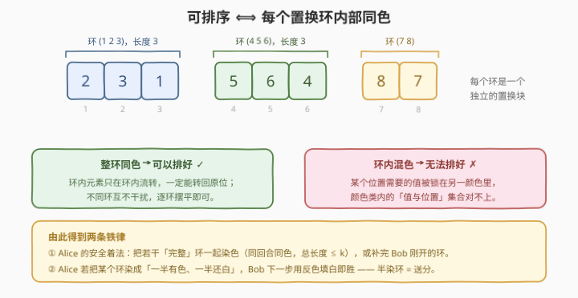
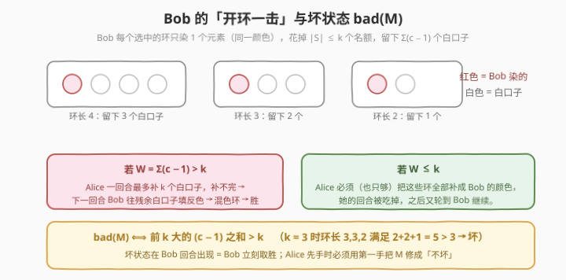
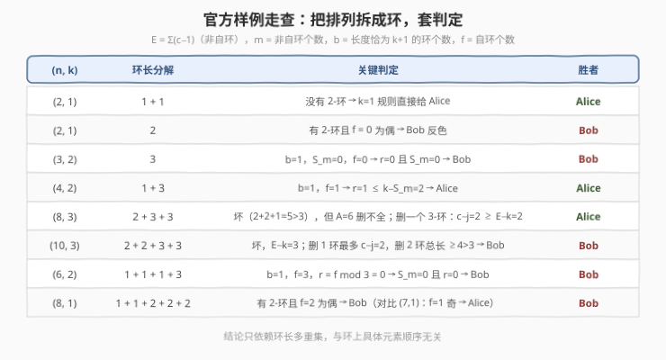

# Codeforces 2276F 排列染色游戏 题解

## 1. 题目概述

- **标题 / 题号**：排列染色游戏（Codeforces 2276F，英文名 Permutation Coloring Game）
- **链接**：https://codeforces.com/problemset/problem/2276/F
- **来源**：Educational Codeforces Round 195 (Rated for Div. 2) · Problem F
- **难度**：2400
- **限制**：时间 3 s / 内存 512 MB
- **标签**：博弈论，置换环，分类讨论，贪心，位集背包

**题意**：Alice 与 Bob 用排列 $p$（$1..n$ 各出现一次）玩染色游戏。初始所有元素白色，Alice 先手，双方轮流：每回合当前玩家选 $1$ 到 $k$ 个白元素，把它们**全部**染成红色或蓝色（同一回合必须同色）。白元素用尽时结束。若最终排列能在「只允许交换**同色**元素」的规则下排成递增序列，Alice 胜；否则 Bob 胜。双方最优，逐组输出胜者。

**约束**：$1 \le t \le 10^4$，$2 \le n \le 2\cdot 10^5$，$1 \le k \le \min(20,n)$，$\sum n \le 2\cdot10^5$。

## 2. 示例

官方样例（输入 / 输出原样）：

```text
输入：
10
2 1
1 2
2 1
2 1
2 2
2 1
3 2
2 3 1
4 2
2 3 1 4
8 3
2 3 1 5 6 4 8 7
10 3
2 3 1 5 6 4 8 7 10 9
6 2
1 2 3 5 6 4
7 1
4 5 6 1 2 3 7
8 1
4 5 6 1 2 3 7 8

输出：
Alice
Bob
Alice
Bob
Alice
Alice
Bob
Bob
Alice
Bob
```

（自造示例：$k=2,p=[2,1,4,5,3]$，环为 $(1\ 2)$ 与 $(3\ 4\ 5)$；Alice 先整染 2-环，只剩 $3=k+1$ 的环，Bob 开它、Alice 补齐 → `Alice`。）

## 3. 解题思路

### 3.1 暴力思路

直接对「每个位置的染色状态」做博弈搜索是 $3^n$ 级，加上每回合可选 $1..k$ 个跨环白元素，分支爆炸。关键是先把**排序可行性**翻译成对置换环的约束（状态降到「环长多重集」），再证明 Bob 只有一种有效进攻。

### 3.2 核心观察：环内必须同色 + Bob 的「开环一击」



**引理 1**：最终染色可排好序 $\iff$ 每个置换环内元素**同色**。

交换只在同色元素间进行，故某颜色类占据的位置集合 $S$ 不变，$S$ 上的值集合恒为 $\{p_i:i\in S\}$。排好序要求 $\{p_i:i\in S\}=S$，即 $S$ 对 $p$ 封闭、是完整环之并；于是混色环永远摆不正，全单色则逐环旋转即可。

由此：Alice 的安全着法只有「把若干**完整**环一起染色（总长 $\le k$）」或「补完 Bob 刚开的环」；她一旦留下「半染环 + 白元素」，Bob 用反色填一个白元素就造出混色环。状态因此只需记**未染环的长度多重集** $M$。



**Bob 的一击**：选 $|S|\le k$ 个环、每环只染 $1$ 个元素（同色），花 $|S|$ 个名额，留下 $W=\sum_{c\in S}(c-1)$ 个白口子。若 $W>k$，Alice 一回合补不完，Bob 下一手反色即胜。于是定义

$$\mathrm{bad}(M)\iff \text{前 } k \text{ 大的 }(c-1)\text{ 之和}>k$$

反之若 $M$ 非坏，Bob 任一着留下的白口子总数都 $\le k$（因为 $\sum_{c\in S}(c-x_c)\le\sum_{S}(c-1)\le k$），Alice 一定补得完。

### 3.3 算法流程


记 $F(M)$ 为「Bob 回合」的胜负（真 = Alice 胜），$G(M)$ 为「Alice 自由回合」。由 3.2 可证（$k\ge2$）：

- $\mathrm{bad}(M)\Rightarrow F(M)=$ 假；
- $M$ 非坏且**无**长 $k+1$ 的环 $\Rightarrow F(M)=$ 真；
- $M$ 非坏且**含**长 $k+1$ 的环 $\Rightarrow$ 其余环必全为自环（否则前 $k$ 大之和 $\ge k+1>k$），且 $F(M)=[\,f\equiv0\pmod{k+1}\,]$，$f$ 为自环数。

$k=1$ 不同（前 $1$ 大只取一项，多个 2-环并不坏）：$F=[\,$无 2-环 $\lor f$ 偶$\,]$，Alice 先手则要求「无 2-环 $\lor f$ 奇」。

最后 $G(M)=\exists$ 非空 $S$，$\sum_{c\in S}c\le k$，$F(M\setminus S)=$ 真。按 $M$ 的形状分类：

1. **$n\le k$**：一手全染同色，胜。
2. **存在环长 $\ge k+2$**：删不掉（长 $>k$），$M\setminus S$ 仍坏，负。
3. **$k=1$**：无 2-环胜；否则 $f$ 奇胜、偶负。
4. **$k\ge2$，$b=$ 长 $k+1$ 的环数 $\ge2$**：两个就凑出 $>k$ 个白口子且都删不掉，负。
5. **$b=1$**：$M\setminus S$ 必含它，要非坏只能其余全为自环，故 $S$ 必须包含所有长 $2..k$ 的环（总长 $S_m$），再从自环删 $t$ 个使 $f-t\equiv0$。因 $t\le k<k+1$ 只能取 $t=r=f\bmod(k+1)$，故
   $$\text{胜}\iff S_m\le k\ \land\ r+S_m\le k\ \land\ (S_m>0\lor r>0)$$
   末项保证 $S$ 非空（Alice 至少要动一手）。
6. **$b=0$**：需要 $M\setminus S$ 非坏。
   - $M$ 本身非坏：随便整染一个环（子集不坏性单调），胜。
   - $M$ 坏：记非自环数 $m$、$E=\sum_{c\ge2}(c-1)$、$A=\sum_{c\ge3}c$。若 $A\le k$，把长 $\ge3$ 的环全整染，只剩 2-环与自环（永不坏），胜。否则若靠「留下 $m'\le k$ 个非自环」修好，需删 $j=m-m'\ge m-k$ 个环；每环长 $\ge2$ 故 $c\ge2j$，于是 $2m\le3k$ 是必要条件，不满足则负。其余用位集背包：删 $j$ 个环、总长 $c\le k$ 时 $E'=E-(c-j)$，条件即 $c-j\ge E-k$；以 $j\le k/2$ 为层、$c\le k$ 为位做 0/1 背包，检查是否存在 $j\ge m-k$ 且 $c-j\ge E-k$。



### 3.4 示例演算

- $n=10,k=3$，环长 $2,2,3,3$：前 3 大 $(c-1)$ 之和 $=5>3$ 坏；$E=6$ 需 $c-j\ge3$，删 1 环最多 $3-1=2$，删 2 环最小总长 $4>3$ → Bob。
- $n=8,k=3$，环长 $2,3,3$：同样坏，但 $A=6>3$、$2m=6\le9$；背包给出删一个 3-环：$j=1,c=3$，$c-j=2\ge E-k=2$ → Alice。

## 4. 算法细节

1. **求环**：1-indexed 存 $p$，用 `vis` 沿 $i\to p_i$ 走；答案只依赖环长多重集，与环内顺序无关。
2. **多测清空**：`vis`、计数桶每组重开，不复用全局数组。
3. **「坏」判定**：出现长 $\ge k+2$ 已提前返回，故只需长度 $\le k+1$ 的桶，从大到小取前 $k$ 项 $(c-1)$ 求和，$O(n+k)$。
4. **位集背包**：`dp[j]` 用 64 位整数存「删 $j$ 个环能凑出的总长集合」（只需 $k+1\le21$ 位），转移 `dp[j] |= dp[j-1] << c`，$j\le k/2$，共 $O(k^2)$。
5. **候选环限量**：同尺寸最多取 `k/c` 个（每个至少花 $c$ 名额）；只取「最大的若干环」会漏掉「用多个 2-环凑 $j$」的解。
6. **溢出、截断与 I/O**：$E,A,S_m$ 用 `long long`，移位后 `& mask` 截断高位；C++ 开 `ios::sync_with_stdio(false)`，Python 一次读完输入。

## 5. 正确性证明

**引理 1（排序条件）**：可排好序 $\iff$ 每个环同色。**证明**：颜色类位置集合 $S$ 上的值集合恒为 $\{p_i:i\in S\}$，排好序需 $\{p_i:i\in S\}=S$，即 $S$ 对 $p$ 封闭、是完整环之并；反之全单色时逐环旋转即可。∎

**引理 2（半染环必败）**：Bob 回合若存在「有色且留白」的环，Bob 用反色染其一个白元素即造出混色环，胜。∎

**引理 3（坏状态一击必胜）**：$\mathrm{bad}(M)\Rightarrow$ Bob 胜。**证明**：取达到前 $k$ 大 $(c-1)$ 和的环集 $S$（$|S|\le k$），每环染 $1$ 个元素，合法；留 $W>k$ 个白口子，Alice 一手至多染 $k$ 个同色元素，必有一环留白且已含 Bob 颜色，Bob 反色 → 引理 2。∎

**引理 4（非坏打不穿）**：$M$ 非坏时 Bob 任一着留白口子 $W\le k$，Alice 能一手补完，且 $M\setminus S$ 仍非坏。**证明**：$|S|\le k$ 且 $W\le\sum_{S}(c-1)\le k$；子多重集不坏性显然保持。∎

**引理 5（$F$ 的封闭形式，$k\ge2$）**：坏 ⇒ 假；非坏且无长 $k+1$ 环 ⇒ 真；非坏且含长 $k+1$ 环 ⇒ 其余全自环且 $F=[f\equiv0\pmod{k+1}]$。**证明**：第一句即引理 3；「含 $k+1$ 则其余全自环」由 $k+(c-1)>k$ 得。*无 $k+1$ 环*：对总长归纳——Bob 一着后由引理 4 可补齐得到更小的同类局面；若他一着没留白（整染），Alice 自由整染任一环，仍同类且更小；空局面 Alice 胜。*含 $k+1$ 环*：对 $f$ 归纳。$f\equiv0$ 时，Bob 整染 $s$ 个自环，Alice 可再整染 $t\equiv-s\equiv k+1-s\le k$ 个（$f\ge k+1$ 保证 $t\le f-s$）回到 $f'\equiv0$；Bob 打开 $k+1$ 环则 Alice 补齐后它整体被消掉，只剩自环为真。$f\not\equiv0$ 时 Bob 整染 $r=f\bmod(k+1)\in[1,k]$ 个自环，轮到 Alice 的自环数为 $0\bmod(k+1)$，她只能整染自环，染 $t\ge1$ 后余数非零（$t\le k<k+1$）→ 假。∎

**引理 6（$k=1$）**：$F=[\,$无 2-环 $\lor f$ 偶$\,]$，Alice 先手胜 $\iff$ 无 2-环 $\lor f$ 奇。**证明**：$k=1$ 时每回合只染 1 个元素，Alice 自由回合只能整染一个自环。记状态 $(f,p)$，$F(f,p)=(f=0\lor G(f-1,p))\land(p=0\lor F(f,p-1))$，$G(f,p)=(f\ge1)\land F(f-1,p)$，空局面为真。对 $f+p$ 归纳即得 $F=[p=0\lor f\text{ 偶}]$：$p\ge1$ 时 Bob 每轮开一个 2-环、Alice 被迫补齐，等价于 Bob 单方面消耗 2-环，胜负只由 $f$ 奇偶决定。∎

**定理**：算法输出恰为胜者。**证明**：由引理 5、6，Alice 先手胜 $\iff\exists$ 非空 $S$，$\sum_S c\le k$，$F(M\setminus S)$ 为真。3.3 的六种情形精确覆盖它：情形 2、4 说明一类环删不掉且必留坏；情形 5 由 $b=1$ 时的结构推出唯一可行删法；情形 6 中「剩余非自环数 $m'\ge k+1$」迫使剩余全是 2-环（即删光长 $\ge3$ 的环，代价 $A$），$m'\le k$ 时非坏 $\iff E'=E-(c-j)\le k$，位集背包精确枚举所有 $c\le k$ 的 $(j,c)$，故与 $G(M)$ 一致。∎

## 6. 复杂度分析

- **时间**：每组 $O(n+k^2)$，总计 $O(\sum n+t\,k^2)$；**空间** $O(n)$（排列 + 标记）与 $O(k)$（桶 + 背包）。
- **实测**：$n=2\cdot10^5$ 单组约 $0.21$ s；$t=10^4,\sum n=2\cdot10^5$ 约 $0.16$ s（时限 $3$ s）；Python 约 $0.1$ s。

## 7. 参考代码

### C++17

```cpp
#include <bits/stdc++.h>
using namespace std;

int main() {
    ios::sync_with_stdio(false);
    cin.tie(nullptr);
    int T; cin >> T;
    while (T--) {
        int n, k; cin >> n >> k;
        vector<int> p(n + 1);
        for (int i = 1; i <= n; i++) cin >> p[i];
        vector<char> vis(n + 1, 0); vector<int> cyc;
        for (int i = 1; i <= n; i++) if (!vis[i]) {           // 分解置换环
            int j = i, c = 0;
            while (!vis[j]) { vis[j] = 1; j = p[j]; c++; }
            cyc.push_back(c);
        }
        int mx = *max_element(cyc.begin(), cyc.end());
        int f = count(cyc.begin(), cyc.end(), 1);
        int b = 0; for (int s : cyc) b += (s == k + 1);       // 长度恰为 k+1 的环
        bool alice;
        if (n <= k) alice = true;
        else if (mx >= k + 2) alice = false;
        else if (k == 1) alice = (b == 0) || (f % 2 == 1);    // 无 2-环 或 f 为奇
        else if (b >= 2) alice = false;
        else if (b == 1) {                                    // 必须删光所有长 2..k 的环
            long long Sm = 0;
            for (int s : cyc) if (s >= 2 && s <= k) Sm += s;
            int r = f % (k + 1);
            alice = (Sm <= k) && (r + Sm <= k) && !(Sm == 0 && r == 0);
        } else {
            vector<int> cnt(k + 2, 0), cntk(k + 1, 0);
            for (int s : cyc) if (s >= 2) { cnt[min(s, k + 1)]++; if (s <= k) cntk[s]++; }
            long long topk = 0; int want = k;                 // 前 k 大 (c-1) 之和
            for (int s = k + 1; s >= 2 && want > 0; s--) {
                int t = min(cnt[s], want); topk += 1LL * t * (s - 1); want -= t;
            }
            long long E = 0, A = 0; int m = 0;
            for (int s : cyc) if (s >= 2) { m++; E += s - 1; if (s >= 3) A += s; }
            if (topk <= k || A <= k) alice = true;
            else if (2LL * m > 3LL * k) alice = false;
            else {
                int half = k / 2; unsigned long long mask = (1ULL << (k + 1)) - 1;
                vector<unsigned long long> dp(half + 1, 0); dp[0] = 1ULL;  // bit c：删若干环总长 c
                for (int s = 2; s <= k; s++)
                    for (int t = 0; t < cntk[s] && t < k / s; t++)
                        for (int j = half; j >= 1; j--) dp[j] |= (dp[j - 1] << s) & mask;
                long long need = E - k; int J = max(0, m - k);
                alice = false;
                for (int j = J; j <= half && !alice; j++) {
                    long long th = max(0LL, need + j);            // 需 c >= need + j
                    if (th <= k && (dp[j] >> th)) alice = true;
                }
            }
        }
        cout << (alice ? "Alice" : "Bob") << '\n';
    }
    return 0;
}
```

### Python3

```python
import sys

def main():
    data = sys.stdin.buffer.read().split()
    t = int(data[0]); pos = 1
    out = []
    for _ in range(t):
        n = int(data[pos]); k = int(data[pos + 1]); pos += 2
        p = data[pos:pos + n]; pos += n
        vis = bytearray(n + 1); cyc = []
        for i in range(1, n + 1):
            if not vis[i]:
                j = i; c = 0
                while not vis[j]:
                    vis[j] = 1; j = int(p[j - 1]); c += 1
                cyc.append(c)
        mx = max(cyc)
        f = sum(1 for s in cyc if s == 1)
        b = sum(1 for s in cyc if s == k + 1)        # 长度恰为 k+1 的环
        if n <= k:
            alice = True
        elif mx >= k + 2:
            alice = False
        elif k == 1:
            alice = (b == 0) or (f % 2 == 1)
        elif b >= 2:
            alice = False
        elif b == 1:
            Sm = sum(s for s in cyc if 2 <= s <= k)
            r = f % (k + 1)
            alice = (Sm <= k) and (r + Sm <= k) and not (Sm == 0 and r == 0)
        else:
            e = sorted((s - 1 for s in cyc if s >= 2), reverse=True)
            E = sum(e); m = len(e)
            A = sum(s for s in cyc if s >= 3)
            if sum(e[:k]) <= k or A <= k:
                alice = True
            elif 2 * m > 3 * k:
                alice = False
            else:
                cntk = {}
                for s in cyc:
                    if 2 <= s <= k:
                        cntk[s] = cntk.get(s, 0) + 1
                half = k // 2; mask = (1 << (k + 1)) - 1
                dp = [0] * (half + 1); dp[0] = 1
                cand = [s for s, c in cntk.items() for _ in range(min(c, k // s))]
                for s in cand:
                    for j in range(half, 0, -1):
                        dp[j] |= (dp[j - 1] << s) & mask
                need = E - k; J = max(0, m - k)
                alice = any(dp[j] >> (need + j) for j in range(J, half + 1) if need + j <= k)
        out.append("Alice" if alice else "Bob")
    sys.stdout.write("\n".join(out) + "\n")

main()
```

## 8. 边界情况与易错点

1. **$k=1$ 必须特判**：此时「坏」只取一项，多个 2-环并不坏；若沿用 $b\ge2\Rightarrow$ Bob 会把环长 $1,2,2$ 误判成 Bob（实际 Alice 先染自环、之后 Bob 每开一个 2-环她都能补齐）。
2. **$b=1,S_m=0,r=0$**：自环数已是 $k+1$ 的倍数，但 Alice 必须动一手，一动就破坏同余 → Bob（如 $n=3,k=2,p=[2,3,1]$）。
3. **$n\le k$ 最先判**：一手全染同色，任何环都单色，Alice 必胜。
4. **含长 $k+1$ 的环时不能只删部分短环**：只要还剩一个长 $2..k$ 的环，前 $k$ 大之和就 $>k$。
5. **背包候选要按尺寸限量**：同尺寸最多 `k//c` 个；只取「最大的若干环」会漏解。
6. **$2m>3k$ 只是必要条件**：据此提前判负，通过后仍须背包精确判定。
7. **下标与截断**：`vis` 每组新开；`p` 用 1-indexed；`dp[j] << c` 后 `& mask` 防止高位污染（$k=20$ 时 `1ULL<<(k+1)` 安全）。

## 相关题目与扩展

- [Codeforces 1385G Columns Swaps](https://codeforces.com/problemset/problem/1385/G)：把排列拆成置换环，每环二选一。
- [Codeforces 1454E Number of Simple Paths](https://codeforces.com/problemset/problem/1454/E)：基环树结构计数，训练按环长分类。
- [LeetCode 765. 情侣牵手](https://leetcode.cn/problems/couples-holding-hands/)：最少交换次数 $=n-$ 置换环数，是「环内可任意重排」的经典应用。

**延伸思考**：若要求每回合染「恰好」$k$ 个元素，Alice 首手可能被强制超额，结论会退化；若目标换成「最少交换次数」，每个混色环贡献 $\text{环长}-1$ 的代价，可套用同样的「坏状态 + 预算」框架；若每回合名额随时间递减，「补不补得完」的判定不再是前 $k$ 大之和，而要维护动态预算序列。
