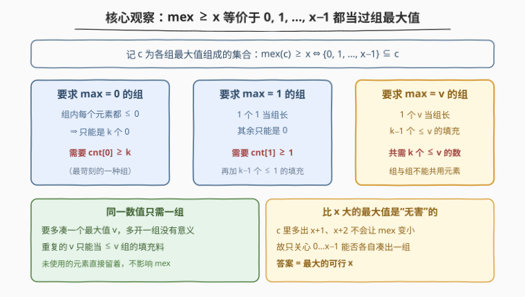
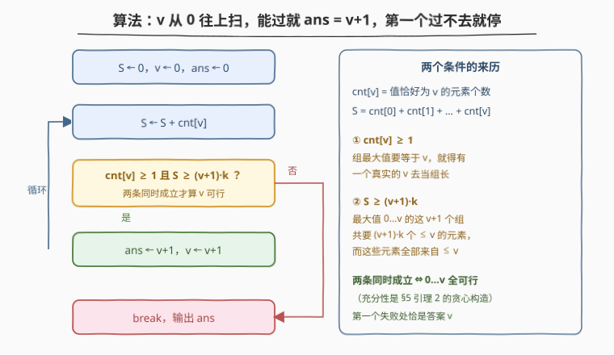
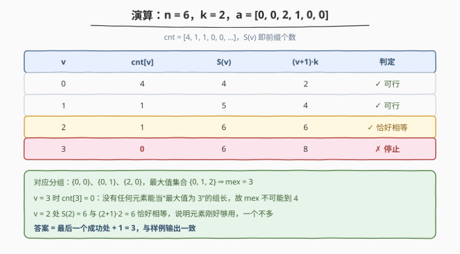

# Codeforces 2277A 子集选取 题解

## 1. 题目概述

- **标题 / 题号**：子集选取（Codeforces 2277A，英文名 Subset Selecting）
- **链接**：https://codeforces.com/problemset/problem/2277/A
- **来源**：Codeforces Round 1129 (Div. 2) · Problem A（UTC 2026-10-24）
- **难度**：未评级（500 分 / Div. 2 A，约 800 档）
- **限制**：时间 1 s / 内存 256 MB
- **标签**：贪心，计数，mex

**题意**：给定长度为 $n$ 的数组 $a$ 与正整数 $k$。把 $a$ 中的**一部分**元素划分成若干组 $S_1, S_2, \dots, S_m$（$m \ge 0$），要求：

- 每组至少含 $k$ 个元素；
- 每个元素至多属于一组（也可以一个组都不进）。

求 $\operatorname{mex}\bigl(\{\max S_1, \dots, \max S_m\}\bigr)$ 的最大值，其中 $\operatorname{mex}(c)$ 表示不在 $c$ 中的最小非负整数，并规定 $\operatorname{mex}(\varnothing) = 0$。多测：第一行是测试组数 $t$，每组给出 $n, k$ 与数组 $a$，逐组输出一个整数。

**约束**：

- $1 \le t \le 500$，$1 \le k \le n \le 100$，$0 \le a_i \le n$
- 组数 $m \le \lfloor n/k \rfloor$，因此答案不会超过 $\lfloor n/k \rfloor$
- 元素可重复；$\sum n \le 5 \times 10^4$，$O(n)$ 或 $O(n \log n)$ 的单组做法都绰绰有余

## 2. 示例与观察
官方样例（输入 / 输出原样）：

```text
输入：
6
3 1
0 2 1
4 2
1 2 3 4
5 2
0 1 0 1 0
5 4
0 0 1 0 0
5 1
4 0 0 0 2
6 2
0 0 2 1 0 0

输出：
3
0
2
1
1
3
```

逐组说明：

| # | $n\ k$ | $a$ | 最优分组 | 最大值集合 | 答案 |
|---|--------|-----|----------|-----------|------|
| 1 | `3 1` | `0 2 1` | $\{0\},\{1\},\{2\}$ | $\{0,1,2\}$ | 3 |
| 2 | `4 2` | `1 2 3 4` | 缺 $0$，无法造出最大值 $0$ | — | 0 |
| 3 | `5 2` | `0 1 0 1 0` | $\{0,0\},\{1,1\}$ | $\{0,1\}$ | 2 |
| 4 | `5 4` | `0 0 1 0 0` | $\{0,0,0,0\}$ | $\{0\}$ | 1 |
| 5 | `5 1` | `4 0 0 0 2` | $\{0\}$ | $\{0\}$ | 1 |
| 6 | `6 2` | `0 0 2 1 0 0` | $\{0,0\},\{0,1\},\{2,0\}$ | $\{0,1,2\}$ | 3 |

自造两组用于校验「$k$ 大于最小值的重数」与「缺值」两种情形：

```text
输入：
2
4 1
0 1 1 3
6 3
0 0 1 1 1 2
```

对应输出为 `2` 和 `0`。第一组 $k=1$：$\{0\},\{1\}$ 可行，但数组里没有 $2$，答案 $2$。第二组 $k=3$：只有 $2$ 个 $0$，凑不出大小 $3$、最大值 $0$ 的组，故连 $x=1$ 都不可行，答案 $0$。

## 3. 解题思路

### 3.1 暴力思路

直接搜索分组方式：把 $n$ 个元素逐个指派到「第几组」或「不进组」，是指数级的；即便先把组数固定为 $x$，指派方案也有 $(x+1)^n$ 种，$n = 100$ 时毫无希望。换一个角度：答案只关心**每组最大值**，而最大值必是数组里的某个元素，于是「分组」这个连续对象可以拆成 $n+1$ 个离散问题——值 $v$ 能不能当某个组的最大值？剩下只需判断这些「能」能否同时成立。

### 3.2 核心观察：$\operatorname{mex} \ge x$ 等价于 $0, \dots, x-1$ 都是某组最大值



设 $c = \{\max S_1, \dots, \max S_m\}$。由 mex 的定义，

$$\operatorname{mex}(c) \ge x \iff \{0, 1, \dots, x-1\} \subseteq c .$$

两个直接推论：

1. **比 $x$ 大的最大值是无害的**。$c$ 里多出 $x+1, x+2$ 只会让 mex 更大，所以不需要刻意回避任何数值。
2. **一个数值只需要一组**。某个 $v$ 已经当过最大值之后，再造一组最大值还是 $v$ 的组，不会给 $c$ 增加任何新元素；多出来的 $v$ 只能当「填充料」。

于是问题变成：**最大的 $x$ 是多少，使得对每个 $v < x$，都能单独凑出一个「最大值恰为 $v$」的组**，且这些组两两不相交。

要让一组最大值恰为 $v$：

- 组里至少有一个元素**等于 $v$**（当组长，否则最大值小于 $v$）；
- 其余元素都 $\le v$（否则最大值大于 $v$）；
- 元素总数 $\ge k$。

注意 $v = 0$ 是最苛刻的情形：组内每个元素都 $\le 0$，只能是 $k$ 个 $0$。

### 3.3 两个判据：前缀计数



统计 $cnt[v]$ = 值恰好为 $v$ 的元素个数，令

$$S(v) = \sum_{i=0}^{v} cnt[i]$$

表示值 $\le v$ 的元素总数。则

$$\boxed{\ x \text{ 可行} \iff \forall\, 0 \le v < x:\ cnt[v] \ge 1 \ \text{且}\ S(v) \ge (v+1)k\ }$$

两条判据的含义：

- $cnt[v] \ge 1$：必须存在一个真实的值 $v$ 去当组长；
- $S(v) \ge (v+1)k$：最大值 $0, 1, \dots, v$ 这 $v+1$ 个组一共要吃掉 $(v+1)k$ 个元素，而它们的元素全部 $\le v$，所以值 $\le v$ 的元素必须够多。

**为什么这就够了**（详细构造见 §5 引理 2）：按 $v$ 升序构造，处理 $v$ 时此前用掉的元素都 $\le v-1$，所以值为 $v$ 的副本一个都没被动过，$cnt[v] \ge 1$ 保证组长仍在；又由 $S(v) - vk \ge k$ 知还剩至少 $k$ 个 $\le v$ 的未用元素，取 $k-1$ 个填进该组即可。

于是全算法只有一趟扫描：$v$ 从 $0$ 往上走、增量累加 $S$，两条判据都成立就令 $ans = v+1$ 继续，遇到第一个不成立的 $v$ 立刻停并输出 $ans$（初值 $0$，对应 $m = 0$）。

### 3.4 示例演算



以第 6 组 $n = 6, k = 2, a = [0,0,2,1,0,0]$ 为例，$cnt = [4,1,1,0,\dots]$，上图逐行给出 $v = 0,1,2,3$ 处的 $cnt[v]$、$S(v)$ 与 $(v+1)k$ 的对比：前三行两条判据都成立，$ans$ 一路涨到 $3$；$v = 3$ 时 $cnt[3] = 0$，停。对应分组 $\{0,0\}, \{0,1\}, \{2,0\}$，最大值集合 $\{0,1,2\}$，$\operatorname{mex} = 3$，与官方输出一致。$v = 2$ 处 $S(2) = 6$ 与 $(2+1)\cdot 2 = 6$ 恰好相等，说明元素刚好够用、一个不多。

## 4. 算法细节

1. **统计数组开 $n+2$**：题目允许 $a_i = n$，若只开 $n$ 会越界；多开两格最省心。
2. **一趟扫描完成**：$S(v)$ 在循环里增量累加，不要为每个 $v$ 重新求和，否则退化成 $O(n^2)$（虽然 $n \le 100$ 也不超时，但没必要）。
3. **第一个失败点即答案**：判据是「对所有 $v < x$ 成立」的前缀合取，所以一旦某个 $v$ 不成立，任何 $x > v$ 都不可能可行，直接 `break` 即可，不需要继续扫。
4. **$ans$ 的更新位置**：只在判据成立的分支里写 `ans = v + 1`，初值为 $0$，这样 $m = 0$（一组都不分）时输出 $0$ 天然正确。
5. **乘法用 `long long`**：$(v+1)k \le 101 \times 100$，`int` 其实够，但统一用 `long long` 可以彻底免掉「以后放大数据范围就溢出」的心智负担。
6. **多测清空**：$cnt$ 在每组循环内部用 `vector<int>` 重新构造，天然清零；不要把它提到循环外靠 `memset`，容易漏清。
7. **I/O**：$t \le 500$、输出只有 $500$ 行，C++ 开 `sync_with_stdio(false)` 即可；Python 用 `sys.stdin.buffer.read().split()` 一次读入，避免逐行 `input()`。

## 5. 正确性证明

**引理 1（mex 的刻画）**：对任意非负整数集合 $c$ 与整数 $x \ge 0$，$\operatorname{mex}(c) \ge x \iff \{0, 1, \dots, x-1\} \subseteq c$。

**证明**：$\operatorname{mex}(c)$ 是最小的不属于 $c$ 的非负整数。若 $0, \dots, x-1$ 全在 $c$ 中，则最小缺失值不小于 $x$；反之若某个 $v < x$ 不在 $c$ 中，则最小缺失值 $\le v < x$，即 $\operatorname{mex}(c) < x$。两种情形互斥且穷尽。∎

**引理 2（可行性的充要条件）**：记「$x$ 可行」为能分出 $x$ 个两两不交的组，使第 $v$ 组大小 $\ge k$ 且最大值恰为 $v$（$0 \le v < x$）。则 $x$ 可行 $\iff$ 对一切 $0 \le v < x$ 有 $cnt[v] \ge 1$ 且 $S(v) \ge (v+1)k$。

**证明**：

($\Rightarrow$) 第 $v$ 组最大值恰为 $v$，故组内元素都 $\le v$，且其中必有一个等于 $v$ 的元素（否则最大值 $< v$），于是 $cnt[v] \ge 1$。又第 $0, 1, \dots, v$ 这 $v+1$ 个组两两不交、各含 $\ge k$ 个元素，共 $\ge (v+1)k$ 个互不相同的元素，它们的值都 $\le v$，全部被 $S(v)$ 统计，故 $S(v) \ge (v+1)k$。

($\Leftarrow$) 按 $v = 0, 1, \dots, x-1$ 的顺序构造。设构造第 $v$ 组之前已用掉 $vk$ 个元素，且由构造方式知它们的值都 $\le v-1$。于是值为 $v$ 的元素一个都没被用过，由 $cnt[v] \ge 1$ 可取出一个作为组长；再由 $S(v) - vk \ge k$ 知值 $\le v$ 的未用元素至少有 $k$ 个，从中任取 $k-1$ 个（例如取其中值最小的 $k-1$ 个，它们必然 $\le v$）填入该组。所得组含 $k$ 个元素、最大值恰为 $v$，且与之前各组不交。对 $v$ 归纳即得 $x$ 个组。∎

**引理 3（扫描的正确性）**：设 $f(x)$ 表示「引理 2 的条件对一切 $v < x$ 成立」。则 $f(x+1) \Rightarrow f(x)$，且算法输出的 $ans$ 等于 $\max\{x : f(x)\}$。

**证明**：$f(x)$ 是前 $x$ 项条件 $C_0, C_1, \dots, C_{x-1}$ 的合取（$C_v$ 为 $cnt[v] \ge 1 \wedge S(v) \ge (v+1)k$），故 $f(x+1) = f(x) \wedge C_x \Rightarrow f(x)$。算法从 $v=0$ 起逐项检查，第 $v$ 项成立时把 $ans$ 置为 $v+1$（此时 $f(v+1)$ 成立），遇到第一个不成立的 $v$ 就停止（此后所有 $x > v$ 都因 $f$ 单调而不成立）。因此 $ans$ 恰为满足 $f$ 的最大 $x$。∎

**定理**：算法对每组输入都输出 mex 的最大值。

**证明**：由引理 1，所求答案等于「使 $0, \dots, x-1$ 全部能作为某组最大值的最大 $x$」，而这正等价于引理 2 中的「$x$ 可行」；再由引理 3，算法输出的正是该最大值。∎

## 6. 复杂度分析

- **时间**：单组 $O(n)$。统计 $cnt$ 一遍 $O(n)$，扫描 $v = 0 \dots n$ 一遍 $O(n)$，每次判定 $O(1)$；总时间 $O(\sum n) \le 5 \times 10^4$ 次基本操作。实测 $t = 500$、每组 $n = 100$ 且 $k = 1$（扫描最远）时，C++ 约 $40$ ms、Python 约 $40$ ms（均含进程启动），相对 $1$ s 的时限有 $20$ 倍以上余量。
- **空间**：单组 $O(n)$，只需 $cnt$ 数组；除此之外是常数个变量。Python 一次性读入全部输入，额外 $O(\sum n)$ 的 token 列表。

## 7. 参考代码

### C++17

```cpp
#include <iostream>
#include <vector>

int main() {
    std::ios::sync_with_stdio(false);
    std::cin.tie(nullptr);

    int t;
    if (!(std::cin >> t)) return 0;
    while (t--) {
        int n, k;
        std::cin >> n >> k;
        std::vector<int> cnt(n + 2, 0);          // a[i] 可以等于 n，多开两格
        for (int i = 0; i < n; ++i) {
            int x;
            std::cin >> x;
            ++cnt[x];
        }

        int ans = 0;                             // 一组都不分时 mex = 0
        long long pref = 0;                      // S(v) = cnt[0] + ... + cnt[v]
        for (int v = 0; v <= n; ++v) {
            pref += cnt[v];
            if (cnt[v] >= 1 && pref >= 1LL * (v + 1) * k) {
                ans = v + 1;                     // 0..v 都能当最大值
            } else {
                break;                           // 第一个失败点之后都不可能
            }
        }
        std::cout << ans << '\n';
    }
    return 0;
}
```

### Python3

```python
import sys


def main() -> None:
    data = sys.stdin.buffer.read().split()
    if not data:
        return
    t = int(data[0])
    pos = 1
    out = []
    for _ in range(t):
        n = int(data[pos]); k = int(data[pos + 1]); pos += 2
        cnt = [0] * (n + 2)                      # a[i] 可以等于 n
        for i in range(n):
            cnt[int(data[pos + i])] += 1
        pos += n

        ans = 0                                  # 一组都不分时 mex = 0
        pref = 0                                 # S(v) = cnt[0] + ... + cnt[v]
        for v in range(n + 1):
            pref += cnt[v]
            if cnt[v] >= 1 and pref >= (v + 1) * k:
                ans = v + 1                      # 0..v 都能当最大值
            else:
                break                            # 第一个失败点之后都不可能
        out.append(str(ans))

    sys.stdout.write("\n".join(out) + "\n")


main()
```

## 8. 边界情况与易错点

1. **数组里没有 $0$**：$cnt[0] = 0$，连最大值 $0$ 的组都凑不出，答案恒为 $0$（样例 2）。这是最常见的一类，不要因为 $S(0) \ge k$ 成立就误判。
2. **$n = 1$**：$k = 1$，$a = [0]$ 输出 $1$，$a = [1]$ 输出 $0$。$a_i$ 可以是 $n$ 而不仅是 $0$，读入与计数都要容得下。
3. **$k = n$**：只可能有一组，答案只能是 $0$ 或 $1$；判据退化为 $cnt[0] \ge n$。$S(v) \ge (v+1)n$ 对 $v \ge 1$ 必然不成立，循环自然在 $v = 1$ 处停。
4. **答案可以达到 $n$**：$k = 1$ 且 $a$ 恰为 $0, 1, \dots, n-1$ 时，$n$ 个单元素组给出 $c = \{0, \dots, n-1\}$，答案为 $n$。不要写成「答案不超过 $\lfloor n/k \rfloor - 1$」之类的偏小上界。
5. **越界与溢出**：$a_i$ 最大为 $n$，`cnt` 至少要开 $n+1$ 格，写成 `vector<int> cnt(n)` 会在 $a_i = n$ 时越界（UB，可能 RE 也可能莫名 WA）；$(v+1) \cdot k$ 本题最大约 $10^4$，`int` 够用，但参考代码仍统一 `long long`。
6. **不要强行把所有元素都用完**：题目允许元素不进组。若为了让「元素刚刚好」而去造额外组，可能引入意料之外的最大值，白白增加实现复杂度；本题判据根本不需要关心剩余元素。
7. **多测清空**：$cnt$ 必须在每组内新建；把 $cnt$ 放在循环外只清前 $n$ 项，会残留上一组的下标 $n$、$n+1$ 的计数。

## 9. 验证记录

- **编译环境与命令**：`clang++ -std=c++17 -O2`（本机无 GNU g++，配 `codeforces/tools/include/bits/stdc++.h` 兼容头；正文代码只用标准库，可原样提交 GNU C++17）；Python 侧为 `Python 3.9.6`。
- **官方样例**：1 / 1 通过（按 Codeforces 标准 checker 的 token 比对，忽略空白与大小写）。
- **复核状态**：audited（2026-11-19 统一回归：编译 + 官方样例；写作期的随机对拍与暴力未重跑）。

## 相关题目与扩展

- [Codeforces 2277B Sequence Decreasing](https://codeforces.com/problemset/problem/2277/B)：同场 B 题，同样是「先看清合法形态再贪心构造」，可与本题的「判据化」思路对照。
- [Codeforces 2277C Edge Addeleting](https://codeforces.com/problemset/problem/2277/C)：同场 C 题，树上贪心，是本题「从必要条件反推充要条件」的进阶版本。
- [Codeforces 2272A 最大化单次 MEX](https://codeforces.com/problemset/problem/2272/A)：同样是「mex = $x$ 需要 $0..x-1$ 全部就位」的计数贪心，可作横向练习。
- [LeetCode 2598. 执行操作后的最大 MEX](https://leetcode.cn/problems/smallest-missing-non-negative-integer-after-operations/)：按同余类贪心地把元素「挪」成 $0,1,2,\dots$，最大化 mex，与本题共享「逐个数值往上凑」的骨架。

**延伸思考**：

- 若把条件从「每组至少 $k$ 个」改成「第 $v$ 组恰好 $k$ 个且额外要求组内元素互不相同」，判据会变成 $cnt[v] \ge 1$ 加上「值 $< v$ 的元素至少 $k-1$ 个可用」，即 $S(v-1) \ge vk$ 之类的前缀式，思路不变但常数项要重算。
- 若要求 mex **恰好**等于某个给定值（而不是最大），问题变成「$0..x-1$ 可行且 $x$ 不可行」，而「$x$ 不可行」正是本题扫描停下的那个位置，所以本题算法顺带就解出了每个 $x$ 是否可达——答案序列是 $0,1,2,\dots,ans$ 的一条连续前缀，这也是「可行性关于 $x$ 单调」的直接体现。
