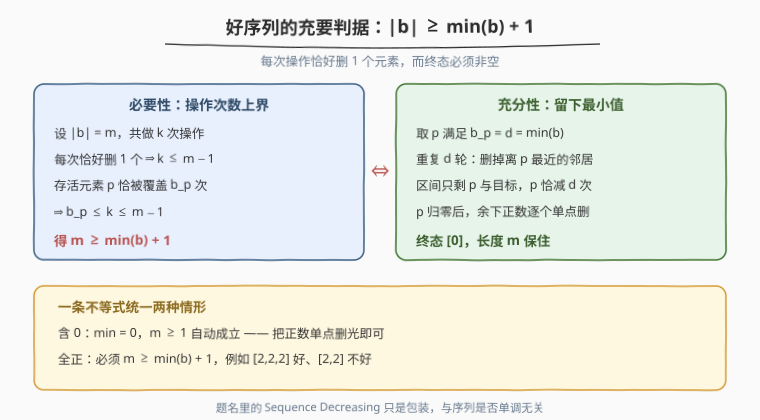
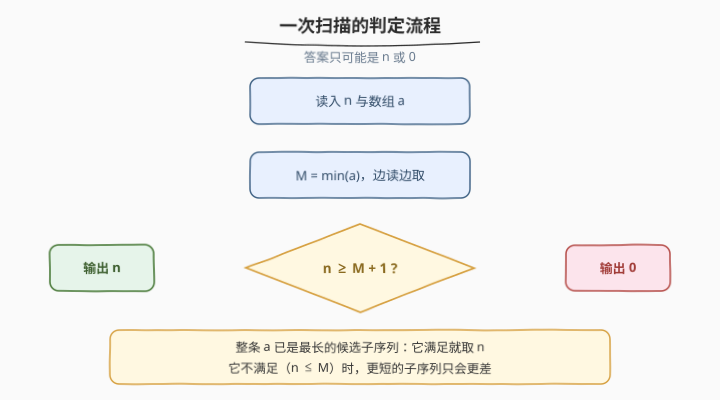
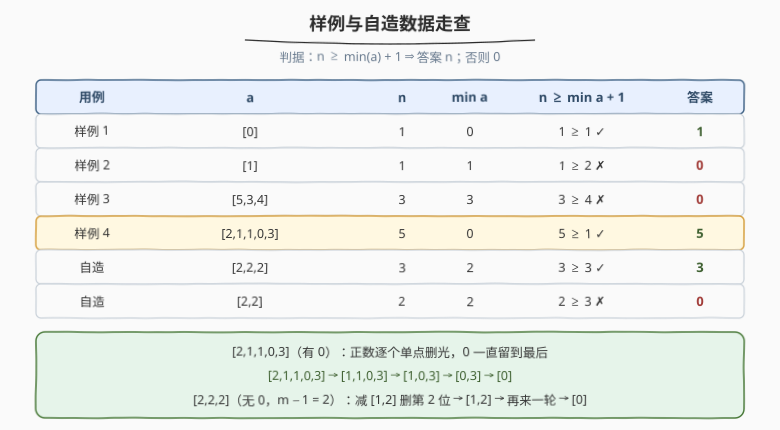

# Codeforces 2277B 递减序列 题解

## 1. 题目概述

- **标题 / 题号**：递减序列（Codeforces 2277B，英文名 Sequence Decreasing）
- **链接**：https://codeforces.com/problemset/problem/2277/B
- **来源**：Codeforces Round 1129 (Div. 2) · Problem B（UTC 2026-10-24）
- **难度**：未评级（750 分 / Div. 2 B，约 1200 档）
- **限制**：时间 1 s / 内存 256 MB
- **标签**：构造，贪心

**题意**：称一个非负整数序列 $b$ 是**好的**，若能把 $b$ 变成「非空且元素全为 0」的序列，操作如下（可以做任意次，包括 0 次）：

1. 在 $b$ 中选出一个**元素全为正**的连续子段；
2. 把该子段内每个元素减 1；
3. 从该子段中选**一个**元素，从 $b$ 中删掉（其余元素保持原顺序）。

给定长度为 $n$ 的非负整数数组 $a$，求 $a$ 的好子序列的**最大长度**；若 $a$ 不存在好子序列则输出 0。多测：第一行是测试组数 $t$，每组给出 $n$ 与 $a_1, a_2, \dots, a_n$，逐组输出一个整数。

**约束**：

- $1 \le t \le 10^4$，$1 \le n \le 2 \times 10^5$，$\sum n \le 2 \times 10^5$
- $0 \le a_i \le 10^9$：值域极大，任何与「值」成正比的复杂度（例如按层数模拟递减）都会爆炸，必须只与 $n$ 有关
- 每次操作恰好删掉 1 个元素，而终态必须非空 ⇒ 操作次数不超过 $n - 1$，这是全题最关键的一条**隐式上界**；子序列可以任取（不要求连续），因此位置完全不影响答案

## 2. 示例与观察
官方样例（输入 / 输出原样）：

```text
输入：
4
1
0
1
1
3
5 3 4
5
2 1 1 0 3

输出：
1
0
0
5
```

逐组对照（判据见 §3.2）：

| # | $a$ | $n$ | $\min a$ | $n \ge \min a + 1$ | 答案 | 说明 |
|---|-----|-----|----------|--------------------|------|------|
| 1 | `[0]` | 1 | 0 | $1 \ge 1$ ✓ | 1 | 本身就是「非空全零」 |
| 2 | `[1]` | 1 | 1 | $1 \ge 2$ ✗ | 0 | 唯一一次操作必然把它删掉 |
| 3 | `[5,3,4]` | 3 | 3 | $3 \ge 4$ ✗ | 0 | 最小值比长度还大，救不回来 |
| 4 | `[2,1,1,0,3]` | 5 | 0 | $5 \ge 1$ ✓ | 5 | 一个 0 就能托住整条数组 |

自造 5 组（覆盖全正、最小值恰好等于长度、极值）：

```text
输入：
5
3
2 2 2
2
2 2
4
10 1 10 10
6
1000000000 1000000000 1000000000 1000000000 1000000000 1000000000
3
1000000000 0 1000000000

输出：
3
0
4
0
3
```

- `[2,2,2]`：$3 \ge 2 + 1$，整体就是好序列——尽管全是正数、一个 0 都没有；`[2,2]` 则因 $2 < 3$ 而不行。
- `[10,1,10,10]`：最小值 1 夹在中间，$4 \ge 2$，一个 1 就能把整条数组救活。
- 6 个 $10^9$：最小值远超长度，答案 0；`[10^9, 0, 10^9]` 含 0 且 $3 \ge 1$，答案是 3。

## 3. 解题思路

### 3.1 暴力思路

最直接的做法：枚举 $a$ 的全部 $2^n$ 个子序列，对每个子序列判断「是否好」。而判断本身还得搜索——状态是当前序列，一步操作有 $O(m^2)$ 种选法（选区间 × 选删除点），状态数指数增长。即便 $n \le 20$ 也很勉强，$n = 2\times10^5$ 完全没戏。正确的切入点是：**先把「好」这个性质压缩成一条只依赖「长度」与「最小值」的不等式**，再考虑怎么取子序列。

### 3.2 核心观察：好 ⟺ 长度 ≥ 最小值 + 1



**必要性（操作次数上界）**。设 $|b| = m$，整个过程共做了 $k$ 次操作。每次操作恰好删掉 1 个元素，而终态要求非空，所以

$$k \le m - 1 .$$

另一方面，只有「被减到 0」的元素才可能留下来。若元素 $p$ 最终留在数组里，它在整个过程中一共被覆盖了 $b_p$ 次（被覆盖一次就减 1），于是 $b_p \le k$。两条合起来：

$$m \ge b_p + 1 \ge \min(b) + 1 .$$

**充分性（构造）**。反过来，只要 $m \ge \min(b) + 1$ 就一定能做成。设 $b_p = d = \min(b)$，把 $p$ 当作「留下来的那个」：

- 重复 $d$ 轮：取当前离 $p$ 最近的剩余元素 $j$，把「$p$ 到 $j$」这一段（此时间隔元素都已被删掉，段内只剩 $p$ 与 $j$，且都为正）整体减 1，再删掉 $j$；
- $d$ 轮后 $p$ 恰被减了 $d$ 次，变成 0；其余元素从未被覆盖，仍是正数；
- 最后把剩下的每个正数用「单点区间」减 1 再删掉，数组只剩 $p = 0$。

$d = 0$（数组含 0）也成立：$p$ 本来就是 0，直接做最后一步，把正数逐个单点删光即可。整个构造唯一的资源要求是「除 $p$ 外还能删掉 $d$ 个元素」，即 $d \le m-1$，而它正是判据 $m \ge \min(b) + 1$ 提供的。

于是得到贯穿全题的判据：

$$\boxed{\ b \text{ 是好序列} \iff |b| \ge \min(b) + 1\ }$$

特别地，「含 0」只是它的特例（$\min = 0$ 时对任何非空序列都成立），**不能**把判据理解成「含 0 就好、全正就不好」——`[2,2,2]` 与 `[10,1,10,10]` 都是反例。

### 3.3 算法流程



有了判据，「取子序列」反而变简单了：子序列当然越长越好，而整条 $a$ 本身就是最长的候选子序列。

1. 顺序读入 $n$ 与 $a$，边读边求 $M = \min(a)$（不必存数组）；
2. 若 $n \ge M + 1$，整条数组满足判据，输出 $n$；
3. 否则输出 $0$。

第 3 步为什么不是「输出某个中间长度」？因为若 $n \le M$，任取长度 $m \le n$ 的子序列 $c$，都有 $\min(c) \ge M \ge n \ge m$，即 $m \ge \min(c) + 1$ 必然不成立，于是**任何**子序列都不好。换句话说，答案只有 $n$ 与 $0$ 两种可能。

### 3.4 示例演算



官方第 4 组 $a = [2,1,1,0,3]$：$M = 0$，$5 \ge 1$，答案 5。构造过程最能说明「有 0 时为什么随便删都行」：

$$[2,1,1,0,3] \to [1,1,0,3] \to [1,0,3] \to [0,3] \to [0]$$

每一步都是「单点区间减 1 后立刻删掉它」，正数被逐个清空；0 永远不参与操作（区间必须全正），稳稳留到最后。

再看没有 0 的自造第 1 组 $[2,2,2]$：$M = 2$，$m - 1 = 2$，预算恰好够用。取 $p$ 为第 1 位（$d = 2$）：

$$[2,2,2] \xrightarrow{\ \text{减 } [1,2],\ \text{删第 } 2 \text{ 位}\ } [1,2] \xrightarrow{\ \text{同上}\ } [0]$$

两轮里 $p$ 各被减 1，共 2 次归零；被删的邻居自身不要求归零，所以它的值原来是 2 也没关系——这正是「删掉的元素可以带着正值离场」带来的自由度。

## 4. 算法细节

1. **不存数组**：边读边维护 `mn`，额外空间 $O(1)$；多测时 `mn` 每组都要重置为 `LLONG_MAX`，不能沿用上一组。
2. **用 `long long` 存最小值**：$a_i \le 10^9$ 用 `int` 存得下，但判据里出现 $\min + 1$，统一用 `long long` 可以彻底免掉「以后放大值域就溢出」的心智负担。
3. **不要在判据上做变形**：`n >= mn + 1` 与 `n > mn` 等价（整数），但写成 `mn + 1 <= n`、`mn < n` 混用容易在改题时把方向写反；保持原式最好读。
4. **答案只有两种取值**：$n$ 或 $0$。不要写「先试 $n$，不行就减 1 再试」的循环——那会退化成 $O(n^2)$，而且逻辑上也是错的。
5. **不需要排序、不需要下标**：判据与元素顺序无关（子序列可以任取），所以既不用像 LIS 那样 DP，也不用关心最小值出现在哪里。
6. **多测与 I/O**：$t$ 可达 $10^4$，逐行输出即可；C++ 关同步，Python 用 `sys.stdin.buffer.read().split()` 一次读完所有 token。算法本身只有一次取最小值，$2\times10^5$ 个数的解析占了几乎全部耗时（见 §6），若担心评测机慢，可换成 `fread` 自建缓冲区的快读。

## 5. 正确性证明

**引理 1（操作计数）**：若 $b$ 经 $k$ 次操作变成非空全零序列，则 $k \le |b| - 1$；且任一元素在过程中被覆盖的次数不超过 $k$。

**证明**：每次操作的第 3 步恰好删掉 1 个元素，序列长度每次减 1。终态非空说明最终长度至少为 1，故 $k \le |b| - 1$。覆盖次数显然不超过操作总数 $k$。∎

**引理 2（必要性）**：若 $b$ 是好序列，则 $|b| \ge \min(b) + 1$。

**证明**：取终态中的任一元素 $p$（终态非空故存在），其终值为 0。元素只在被某次操作的子段覆盖时才减 1，而子段内元素必须为正，故 $p$ 恰被覆盖 $b_p$ 次，特别地 $b_p \le k \le |b| - 1$。于是 $\min(b) \le b_p \le |b| - 1$。∎

**引理 3（充分性）**：若 $|b| \ge \min(b) + 1$，则 $b$ 是好序列。

**证明**：设 $b_p = d = \min(b)$，$m = |b|$，则 $d \le m - 1$。若 $d = 0$：$p$ 已是 0，对每个正元素依次执行「取单点区间 $\{i\}$，减 1 后删除 $i$」，$p$ 从不被覆盖，执行完只剩 $p = 0$，终态非空。若 $d \ge 1$：由 $d \le m-1$ 知除 $p$ 外至少有 $d$ 个元素；做 $d$ 轮，第 $s$ 轮（$1 \le s \le d$）取当前序列中按剩余顺序离 $p$ 最近的元素 $j_s$，选子段为「$p$ 与 $j_s$ 之间」。此前每轮删掉的都是当时离 $p$ 最近的元素，故 $p$ 与 $j_s$ 之间已无剩余元素，子段内只有 $p$ 与 $j_s$；又 $p$ 在前 $s-1$ 轮只被减了 $s-1 < d$ 次仍为正，$j_s$ 从未被覆盖故为正，子段合法。减 1 后删掉 $j_s$。$d$ 轮结束后，被删的 $d$ 个元素互不相同，$p$ 恰被减 $d$ 次变成 0，其余元素从未被覆盖仍为正，再逐个单点删除，终态为 $[0]$，非空。∎

**定理 1（判据）**：$b$ 是好序列 $\iff |b| \ge \min(b) + 1$。**证明**：两个方向分别是引理 2 与引理 3。∎

**定理 2（答案）**：记 $M = \min(a)$。若 $n \ge M + 1$ 则答案为 $n$，否则为 $0$。

**证明**：当 $n \ge M+1$ 时，整条 $a$ 由定理 1 是好序列，长度 $n$ 已是子序列长度的上界，故答案为 $n$。当 $n \le M$ 时，反设存在长度 $m$ 的好子序列 $c$，则 $m \le n \le M \le \min(c)$，即 $m < \min(c) + 1$，与定理 1 矛盾，故不存在好子序列，答案为 $0$。∎

## 6. 复杂度分析

- **时间**：单组 $O(n)$，只做一遍「读入 + 取最小值」的扫描；总量 $O(\sum n) \le 2\times10^5$ 次基本运算。
- **空间**：$O(1)$ 额外空间（不存数组）；Python 版一次性读入所有 token，额外 $O(\sum n)$。
- **实测**（本机 Apple clang + libc++，两条最大约束数据：$n = 2\times10^5$ 全为 $10^9$；以及 $t = 10^4$、$\sum n = 2\times10^5$）：`cin`（`sync_with_stdio(false)`）版约 $0.30$ s（耗时几乎全在 libc++ 的数字解析上，与算法无关）；把读入换成 `fread` 自建缓冲区后整份程序约 $0.005$ s；Python3 版约 $0.04$ s。
- 结论：即使按最保守的本机 `cin` 数字也能在 $1$ s 内跑完（约 $3$ 倍余量），换快读后余量在 $100$ 倍以上；CF 上 g++/libstdc++ 的数字解析比 libc++ 快得多，`cin` 版通常也能稳定在 $0.05$ s 以内。空间远低于 $256$ MB。

## 7. 参考代码

### C++17

```cpp
#include <bits/stdc++.h>
using namespace std;

int main() {
    ios::sync_with_stdio(false);
    cin.tie(nullptr);

    int t;
    if (!(cin >> t)) return 0;
    while (t--) {
        int n;
        cin >> n;
        long long mn = LLONG_MAX;          // 本组最小值，多测每组重置
        for (int i = 0; i < n; ++i) {
            long long x;
            cin >> x;                      // 边读边求 min，不存数组
            mn = min(mn, x);
        }
        // b 是好序列 <=> |b| >= min(b) + 1；整条 a 即最长候选子序列
        cout << (1LL * n >= mn + 1 ? n : 0) << '\n';
    }
    return 0;
}
```

### Python3

```python
import sys


def main() -> None:
    data = sys.stdin.buffer.read().split()
    if not data:
        return
    t = int(data[0])
    pos = 1
    out = []
    for _ in range(t):
        n = int(data[pos])
        pos += 1
        # b 是好序列 <=> len(b) >= min(b) + 1；整条 a 即最长候选子序列
        mn = min(map(int, data[pos:pos + n])) if n else 0
        pos += n
        out.append(str(n if n >= mn + 1 else 0))
    sys.stdout.write("\n".join(out) + "\n")


main()
```

## 8. 边界情况与易错点

1. **$n = 1$**：`[0]` 已经是「非空全零」，答案 1；`[1]` 的唯一一次操作必然删掉它、终态为空，答案 0。判据 `1 >= 2` 不成立，两种情形都自动正确。
2. **全 0 数组**：$M = 0$，$n \ge 1$ 恒成立，答案 $n$，此时一次操作都不做。
3. **最小值恰好等于长度**：`[2,2]`、`[3,3,3]`、`[5,3,4]` 都是 $n = M$，判据取等号不成立，答案是 0。这一类「差一」的边界最容易把 `>=` 写成 `>`。
4. **溢出与多测重置**：$a_i = 10^9$ 时 `mn + 1` 仍远小于 `long long` 上限，但若用 `int` 且值域被改大到 $2^{31}-1$，`mn + 1` 会溢出成负数；另外 `mn` 必须在每组开头重新初始化，写在循环外又忘记赋值会读到上一组的最小值而误判。
5. **输出 0 而不是 -1，也不要枚举子序列**：题目要求「没有好子序列时输出 0」；$2^n$ 与按值域分层都会直接 TLE/MLE，本题答案与元素位置、顺序无关，任何排序/DP 都是多余的。

## 9. 验证记录

- **编译环境与命令**：`clang++ -std=c++17 -O2`（本机无 GNU g++，配 `codeforces/tools/include/bits/stdc++.h` 兼容头；正文代码只用标准库，可原样提交 GNU C++17）；Python 侧为 `Python 3.9.6`。
- **官方样例**：1 / 1 通过（按 Codeforces 标准 checker 的 token 比对，忽略空白与大小写）。
- **复核状态**：audited（2026-11-19 统一回归：编译 + 官方样例；写作期的随机对拍与暴力未重跑）。

## 相关题目与扩展

- [Codeforces 2277A 子集选取](https://codeforces.com/problemset/problem/2277/A)：同场 A 题，同样是「先把合法性写成判据，再一趟扫描」的套路，可对照本文 §3.2 的「先必要条件、后构造充分性」写法。
- [Codeforces 2277C Edge Addeleting](https://codeforces.com/problemset/problem/2277/C)：同场 C 题，树上删边贪心，是本文「用操作次数上界反过来约束结构」思路的进阶版。
- [Codeforces 2272A 最大化单次 MEX](https://codeforces.com/problemset/problem/2272/A)：同样是「用计数/上界推出充要条件」的 800 分档签到题，适合作为热身。
- [LeetCode 2598. 执行操作后的最大 MEX](https://leetcode.cn/problems/smallest-missing-non-negative-integer-after-operations/)：把元素按同余类贪心挪位以最大化 mex，与本题共享「先想清楚合法形态，再贪心取最长」的骨架。

**延伸思考**：

- 若把操作第 3 步改成「删掉子段中**恰好两个**元素」，则操作次数上界变成 $\lfloor (m-1)/2 \rfloor$，存活元素能花掉的「减 1 预算」随之缩小，判据会变成 $2\min(b) + 1 \le m$ 一类的形式。套路完全一样：先数操作次数上界，再让存活元素去花这笔预算。
- 若要求子序列**连续**（即子段），答案变成「最长的窗口，使窗口长度 $\ge$ 窗口最小值 $+ 1$」。这可以用双指针 + 单调队列做到 $O(n)$：窗口右端扩张、左端在违反判据时收缩，维护窗口最小值即可，是本题的自然加强版。
- 若把「好」改成「用**恰好** $k$ 次操作清成非空全零」，则除了 $k \le m-1$ 与幸存者 $b_p \le k$ 之外，还要保证 $k$ 次覆盖足以让所有被删元素在离场前保持为正，判据开始依赖更细的结构（例如元素间的「预算传递」），这也是本题从 Div. 2 B 升级成更难题的常见改法。
