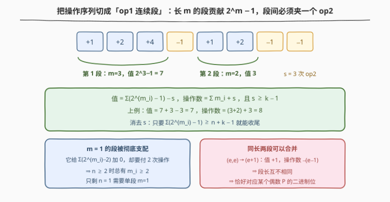
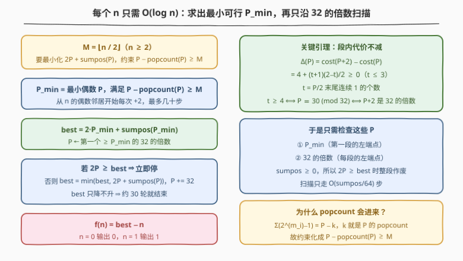
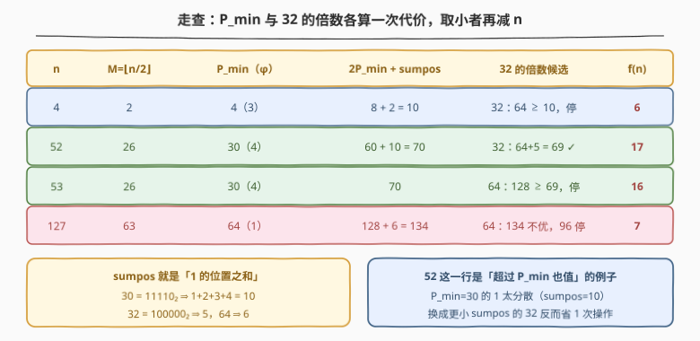

# Codeforces 2277D1 数字操作（简单版） 题解
## 1. 题目概述

- **标题 / 题号**：数字操作（简单版）（Codeforces 2277D1，英文名 Number Operating (Easy Version)）
- **链接**：https://codeforces.com/problemset/problem/2277/D1
- **来源**：Codeforces Round 1129 (Div. 2) · Problem D1
- **难度**：未评级（2000 分 / Div. 2 D1）
- **限制**：时间 3 s / 内存 256 MB
- **标签**：位运算，贪心，暴力枚举，数学

**题意**：变量 $x$ 初始为 $0$，每步可执行两种操作之一：

- **操作 1**：把 $x$ 加上 $2^k$，其中 $k$ 是**本次操作之前连续执行操作 1 的次数**（若这是第一步、或上一步是操作 2，则 $k=0$）；
- **操作 2**：把 $x$ 减 $1$（中间结果允许为负）。

记 $f(n)$ 为把 $x$ 变成 $n$（$n\ge 0$）的最少操作次数，可以证明一定可行。给定 $l\le r$，求

$$\sum_{n=l}^{r} f(n) \bmod 998\,244\,353 .$$

多测：首行 $t$，每组一行 $l,r$，逐组输出答案。简单版与困难版的唯一区别是**简单版保证 $\sum (r-l+1)\le 2\cdot 10^5$**。

**约束**：

- $1\le t\le 10^4$，$0\le l\le r\le 10^{18}$，$\sum (r-l+1)\le 2\cdot 10^5$
- 于是可以**逐个数**计算 $f(n)$，每个 $n$ 只允许 $O(\log n)$ 级别的代价：总体约 $2\cdot10^5\times 60$ 次基本运算
- 时间 3 s，内存 256 MB

## 2. 示例

官方样例（输入 / 输出原样）：

```text
输入：
5
4 4
1 3
127 127
0 1000
999999999999900001 1000000000000000000

输出：
6
6
7
25383
102936941
```

自造示例，方便肉眼核对 $f$ 的前若干项：

```text
输入：
3
0 8
9 15
52 53

输出：
31
45
33
```

即 $f(0..8)=[0,1,3,2,6,5,4,3,7]$，$f(9..15)=[6,9,8,7,6,5,4]$，$f(52)=17,\ f(53)=16$。注意 $f$ **不单调**（$f(8)=7>f(7)=3$），直接把某个"上界构造"当成答案会错。

## 3. 解题思路

### 3.1 暴力思路

最朴素的是在状态 $(x,k)$ 上做 BFS：$k$ 是当前连续操作 1 的次数，转移是 $(x,k)\to(x+2^k,k+1)$ 与 $(x,k)\to(x-1,0)$。对单个 $n$ 它很快（$x\le3000$ 时状态数才几万个），但 $n$ 可达 $10^{18}$，状态数爆炸；而枚举操作序列更是指数级。

必须换个角度：**不看操作顺序，只看操作序列的"形状"**。

### 3.2 核心观察：把序列切成「op1 连续段」



一段连续的操作 1 长度记为 $m$。段内第 $j$ 次操作加的正是 $2^{j-1}$，所以整段给 $x$ 贡献

$$1+2+\cdots+2^{m-1}=2^m-1 .$$

设序列共 $k$ 段，长度 $m_1,\dots,m_k$，操作 2 用了 $s$ 次。则

$$\text{最终值}=\sum_i (2^{m_i}-1)-s,\qquad \text{操作数}=\sum_i m_i+s .$$

两段之间**必须**夹至少一次操作 2（否则两段会并成一段），故 $s\ge k-1$；反过来只要 $s\ge k-1$，把多出来的操作 2 全堆在末尾就能构造出来。于是把 $s$ 用值等式消掉：

$$s=\sum_i(2^{m_i}-1)-n,\qquad f(n)=\min\Bigl\{\sum_i c(m_i)\Bigr\}-n,\quad c(m)=2^m+m-1,$$

约束为 $\sum_i (2^{m_i}-1)\ge n+k-1$，等价于把 $k-1$ 挪到左边：

$$\sum_i (2^{m_i}-2)\ \ge\ n-1 .$$

两条化简（引理 2 详述）：

- $m=1$ 的段给左式加 $0$，却要花 $2$ 次操作，**$n\ge2$ 时一律删掉**；
- 同长的两段 $(e,e)$ 换成一段 $(e+1)$：值多 $1$、操作数少 $e-1$，**永不更差**，所以段长互不相同。

于是把 $e_i=m_i-1\ge 1$ 看成**互不相同的二进制位**，令 $P=\sum_i 2^{e_i}$（偶数、$\operatorname{popcount}(P)=k$），则

$$\sum_i(2^{e_i}-1)=P-\operatorname{popcount}(P),\qquad \sum_i(2^{e_i+1}+e_i)=2P+\operatorname{sumpos}(P),$$

其中 $\operatorname{sumpos}(P)$ 是 $P$ 所有为 1 的二进制位**下标之和**。取 $M=\lfloor n/2\rfloor$，问题变成干净的一句话：

> 求最小的 $\operatorname{cost}(P)=2P+\operatorname{sumpos}(P)$，其中 $P$ 是**偶数**且 $P-\operatorname{popcount}(P)\ge M$；答案 $f(n)=\text{cost}-n$。

### 3.3 算法流程：只检查 $P_{\min}$ 与 32 的倍数



先求 $P_{\min}$：最小的偶数 $P$ 满足 $P-\operatorname{popcount}(P)\ge M$。由于 $\varphi(P)=P-\operatorname{popcount}(P)$ 单调不减，从 $M$（或 $M+1$）开始每次 $+2$ 试探即可，最多几十步。

难点是：$P_{\min}$ 未必最优。**$P$ 稍大、但二进制更"稀疏"**的 $P$ 往往 $\operatorname{sumpos}$ 小得多，总代价反而低（例如 $M=26$：$P_{\min}=30$ 给出 $60+10=70$，而 $P=32$ 给出 $64+5=69$）。

关键引理（右图为直观版，严格证明见引理 3）：对偶数 $P$，令 $t$ 为 $P/2$ 末尾连续 1 的个数，则

$$\operatorname{cost}(P+2)-\operatorname{cost}(P)=5-\frac{t(t-1)}{2}\ \ge 0\iff t\le 3 .$$

而 $t\ge 4$ 恰好等价于 $P\equiv 30\pmod{32}$，也就是 $P+2$ 是 $32$ 的倍数。所以在任意两个相邻 $32$ 的倍数之间，$\operatorname{cost}$ 关于偶数 $P$ 是**单调不减**的：每段的左端点必是候选。于是

1. $P\leftarrow P_{\min}$，$\text{best}\leftarrow 2P+\operatorname{sumpos}(P)$；
2. $P\leftarrow$ 第一个 $\ge P_{\min}$ 的 $32$ 的倍数；
3. 若 $2P\ge\text{best}$ 就结束（因为 $\operatorname{sumpos}\ge0$，之后不可能更优）；否则用 $2P+\operatorname{sumpos}(P)$ 更新 best，$P\mathrel{+}=32$，回到第 3 步；
4. 输出 $f(n)=\text{best}-n$。

由于 best 只降不升、每轮 $P$ 涨 $32$，循环最多约 $\operatorname{sumpos}/64\lesssim 30$ 轮，即 $O(\log^2 n)$。

### 3.4 示例演算



以 $n=52$（$M=26$）为例：

- 偶数 $P$ 从 $26$ 起试：$\varphi(26)=26-3=23<26$，$\varphi(28)=25<26$，$\varphi(30)=30-4=26\ge26$ ⇒ $P_{\min}=30$；
- $\text{best}=2\cdot30+\operatorname{sumpos}(30)=60+(1+2+3+4)=70$；
- 第一个 $32$ 的倍数是 $32$：$2\cdot32\ge 70$ 不成立，算得 $64+\operatorname{sumpos}(32)=64+5=69<70$，更新 best；
- 下一个候选 $64$：$128\ge69$ ⇒ 停。
- $f(52)=69-52=17$（$f(53)=69-53=16$）。

再看 $n=127$（$M=63$）：$\varphi(64)=64-1=63$ 恰好取等 ⇒ $P_{\min}=64$，$\text{best}=128+6=134$；候选 $64$ 给同样的 $134$（不是更优），$96$ 已满足 $192\ge134$ ⇒ 停，$f(127)=134-127=7$。这正是"连续 $7$ 次操作 1 得到 $2^7-1=127$"。

## 4. 算法细节

1. **$n=0,1$ 单独处理**：$f(0)=0$、$f(1)=1$（$1$ 就是一段 $m=1$）。$M=\lfloor n/2\rfloor$ 在 $n\le1$ 时为 $0$，而 $P=0$ 不是合法候选，公式不适用。
2. **求 $P_{\min}$ 时的单调性**：$\varphi(P)=P-\operatorname{popcount}(P)$ 满足 $\varphi(P+1)\ge\varphi(P)$（差值为 $P$ 末尾连续 1 的个数），所以从偶数起点每次 $+2$ 找到的第一个可行值就是最小可行值，不必回退。
3. **$32$ 的倍数起点别写错**：必须取 $\ge P_{\min}$ 的那个，用 `((P + 31) >> 5) << 5`；写成 `(P >> 5) << 5` 会滑到 $P_{\min}$ 之下、可能不可行。
4. **$\operatorname{sumpos}$ 不要写成 $\operatorname{popcount}$**：代价是 $2P+\operatorname{sumpos}(P)$，而约束里才是 $\operatorname{popcount}$；两者差一个 $k$ 项，混用会整体错一位。
5. **溢出与取模**：$P<2^{60}$，$2P+\operatorname{sumpos}\approx 10^{18}$，用 `long long`（上界 $9.2\times10^{18}$）安全；但答案要把 $2\cdot10^5$ 个 $f$ 累加，必须**逐个取模**，且 `best - n` 在取模后要加 `MOD` 再取模。
6. **`sumpos` 打表**：按 $16$ 位分块预处理 `pop16[]`、`sum16[]`（各 $65536$ 项），单次查询 $O(1)$；C++ 里 popcount 直接用 `__builtin_popcountll`。
7. **剪枝就是复杂度保证**：`while (2*c < best)` 让扫描轮数为 $\operatorname{sumpos}/64\le 1770/64\approx 28$，即 $O(\log^2 n)$，不需要额外上界。
8. **多测与 I/O**：$t$ 可达 $10^4$，两张表在 `main` 开头建一次即可，**不要**每组重建；每组只循环 $r-l+1$ 次，总量被 $\sum(r-l+1)\le2\cdot10^5$ 卡住。C++ 关同步流即可，Python 必须整体读入再切分。

## 5. 正确性证明

**引理 1（序列 ↔ 段）**：任一操作序列的值 $=\sum_i(2^{m_i}-1)-s$、操作数 $=\sum_i m_i+s$，其中 $m_i$ 为各 op1 段长度、$s$ 为操作 2 次数，且必有 $s\ge k-1$；反之任给 $m_1..m_k$ 与 $s\ge k-1$ 都能构造出该序列。

**证明**：段内第 $j$ 次操作 1 的 $k$ 值为 $j-1$，故加数依次是 $2^0,2^1,\dots,2^{m-1}$，求和得 $2^m-1$；操作 2 每次恰减 $1$，两部分相加即值公式，操作数显然。两段之间若没有操作 2，前一段的最后一次操作 1 与后一段的第一次操作 1 相邻，$k$ 值连续，两段会并成一段，矛盾，故 $s\ge k-1$。反向按"段 1、op2、段 2、op2、…、段 k、剩余 op2"排列即得。∎

**引理 2（化为 $P$ 的问题）**：对 $n\ge 2$，$f(n)=g(\lfloor n/2\rfloor)-n$，其中

$$g(M)=\min\{2P+\operatorname{sumpos}(P): P \text{ 为偶数},\ P-\operatorname{popcount}(P)\ge M\}.$$

**证明**：由引理 1，$f(n)=\min\bigl(\sum_i(2^{m_i}+m_i-1)\bigr)-n$，约束 $\sum_i(2^{m_i}-2)\ge n-1$。

*（a）去掉 $m=1$ 的段*：$2^1-2=0$ 对左式无贡献，却使代价增加 $2^1+1-1=2$ 并使 $k$ 减 $1$（左式不受影响），故删去不劣；只要还有别的段就这么做。$n\ge2$ 时最优解不可能全是 $m=1$ 的段（此时左式为 $0<n-1$），故可设所有 $m_i\ge2$。

*（b）段长互异*：把两段 $(e,e)$ 换成一段 $(e+1)$（$e=m-1\ge1$）：左式增量为 $(2^{e+1}-2)-2(2^e-2)=2>0$，代价增量为 $(2^{e+2}+e+1)-2(2^{e+1}+e)=1-e\le 0$，即约束更松、代价不增。反复合并后 $e_i$ 互异。

*（c）换成位*：令 $P=\sum_i2^{e_i}$，互异性保证 $\operatorname{popcount}(P)=k$ 且 $P$ 为偶数。则 $\sum_i(2^{m_i}-2)=2\sum_i(2^{e_i}-1)=2(P-k)$，约束 $2(P-k)\ge n-1\iff P-k\ge\lceil (n-1)/2\rceil=\lfloor n/2\rfloor$；代价 $\sum_i(2^{e_i+1}+e_i)=2P+\operatorname{sumpos}(P)$。两方向都可逆，故等价。∎

**引理 3（分段单调）**：设 $P$ 偶、$P/2$ 末尾连续 1 的个数为 $t$，则 $\operatorname{cost}(P+2)-\operatorname{cost}(P)=5-t(t-1)/2$；该值 $<0$ 当且仅当 $t\ge4$，即 $P\equiv30\pmod{32}$。故在任意相邻两个 $32$ 的倍数之间，$\operatorname{cost}$ 沿 $P,P+2,P+4,\dots$ 单调不减。

**证明**：写 $P=2Q$，则 $\operatorname{sumpos}(P)=\operatorname{sumpos}(Q)+\operatorname{popcount}(Q)$。$Q\to Q+1$ 时末尾 $t$ 个 $1$（下标 $0..t-1$）变 $0$、下标 $t$ 变 $1$，于是 $\operatorname{popcount}$ 变化 $1-t$，$\operatorname{sumpos}$ 变化 $t-(0+1+\cdots+t-1)=t-\frac{t(t-1)}{2}$，合计 $\operatorname{sumpos}(P+2)-\operatorname{sumpos}(P)=1-\frac{t(t-1)}{2}$。再加 $2(P+2)-2P=4$ 得 $5-\frac{t(t-1)}{2}$。由 $t(t-1)/2\le10\iff t\le3$ 得符号结论；而 $t\ge4$ 表示 $P/2$ 的低 4 位全为 $1$，即 $2Q\equiv30\pmod{32}$。∎

**定理**：算法输出的 best 等于 $g(M)$，从而 $f(n)=best-n$ 正确。

**证明**：*可行性*：每个候选都 $\ge P_{\min}$，而 $\varphi$ 单调不减，故都满足约束。*最优性*：设 $P^*$ 是任一可行偶数。

- 若 $[P_{\min},P^*]$ 内存在 $32$ 的倍数，取其中最大者 $c$：由引理 3，$\operatorname{cost}$ 在 $[c,P^*]$ 上单调不减，故 $\operatorname{cost}(c)\le\operatorname{cost}(P^*)$，且 $c\ge P_{\min}$ 可行。
- 否则 $P^*<P_{\min}+32$，整段 $[P_{\min},P^*]$ 落在同一个单调段内，$\operatorname{cost}(P_{\min})\le\operatorname{cost}(P^*)$。

两种情形都给出一个 $\le\operatorname{cost}(P^*)$ 且被算法枚举的候选；若该候选因 $2c\ge\text{best}$ 被跳过，则它满足 $\operatorname{cost}(c)\ge2c\ge\text{best}$，同样不构成改进。故 best 恰为 $g(M)$。∎

## 6. 复杂度分析

- **时间**：每个 $n$ 求 $P_{\min}$ 至多约 $30$ 步（$O(\log n)$），扫描至多约 $30$ 轮（$O(\log^2 n)$）；总时间 $O\bigl((r-l+1)\log^2 n\bigr)\le 2\cdot10^5\times60$ 次基本运算。
- **空间**：两张 $2^{16}$ 的表（约 $0.5$ MB）+ 每组的 $O(1)$ 变量，远低于 256 MB。
- **对照时限**：$t=10^4$、共 $2\cdot10^5$ 个数、数值取到 $10^{18}$ 的最坏数据实测：单组 $2\cdot10^5$ 个数 $\approx0.01$ s，$10^4$ 组各 $20$ 个数 $\approx0.1$ s（含读入）；时限 3 s，余量 $25$ 倍以上。同一份 Python 代码在 CPython 3.9 上实测 $4\sim5$ s，**会超时**；PyPy3 对此类纯整数循环通常快 $3$ 倍以上，可望压进时限，提交时请选 PyPy3。

## 7. 参考代码

### C++17

```cpp
#include <bits/stdc++.h>
using namespace std;
typedef long long ll;
typedef unsigned long long ull;
static const ll MOD = 998244353;

static int pop16[1 << 16];
static int sum16[1 << 16];

static inline int pc(ull x) { return __builtin_popcountll(x); }

// 所有为 1 的二进制位的下标之和
static inline ll sumpos(ull x) {
    return (ll)sum16[x & 0xFFFFULL]
         + sum16[(x >> 16) & 0xFFFFULL] + 16LL * pop16[(x >> 16) & 0xFFFFULL]
         + sum16[(x >> 32) & 0xFFFFULL] + 32LL * pop16[(x >> 32) & 0xFFFFULL]
         + sum16[(x >> 48) & 0xFFFFULL] + 48LL * pop16[(x >> 48) & 0xFFFFULL];
}

// g(M) = min{ 2P + sumpos(P) : P 偶, P - popcount(P) >= M }
static inline ll calcG(ll M) {
    ull P = (ull)(M + (M & 1LL));            // 最小的偶数候选
    while ((ll)P - pc(P) < M) P += 2;        // phi 单调，找到第一个可行值
    ll best = 2LL * (ll)P + sumpos(P);
    ull c = ((P + 31ULL) >> 5) << 5;         // 第一个 >= P 的 32 的倍数
    while (2LL * (ll)c < best) {             // sumpos >= 0，故 2c >= best 即可停
        ll v = 2LL * (ll)c + sumpos(c);
        if (v < best) best = v;
        c += 32;
    }
    return best;
}

int main() {
    ios::sync_with_stdio(false);
    cin.tie(nullptr);
    for (int i = 1; i < (1 << 16); i++) {
        pop16[i] = pop16[i >> 1] + (i & 1);
        sum16[i] = sum16[i >> 1] + pop16[i >> 1];
    }
    int t;
    if (!(cin >> t)) return 0;
    while (t--) {
        ll l, r;
        cin >> l >> r;
        ll ans = 0;
        for (ll n = l; n <= r; n++) {
            ll f;
            if (n == 0) f = 0;               // f(0) = 0
            else if (n == 1) f = 1;          // 一段 m = 1
            else f = calcG(n >> 1) - n;
            ans = (ans + f % MOD + MOD) % MOD;
        }
        cout << ans % MOD << '\n';
    }
    return 0;
}
```

### Python3

```python
import sys


def main():
    data = sys.stdin.buffer.read().split()
    MOD = 998244353

    # 16 位分块的 popcount / 位下标和表
    PC = [0] * 65536
    SP = [0] * 65536
    for i in range(1, 65536):
        j = i >> 1
        PC[i] = PC[j] + (i & 1)
        SP[i] = SP[j] + PC[j]

    def popc(x):
        return (PC[x & 65535] + PC[(x >> 16) & 65535]
                + PC[(x >> 32) & 65535] + PC[(x >> 48) & 65535])

    def sumpos(x):
        return (SP[x & 65535]
                + SP[(x >> 16) & 65535] + 16 * PC[(x >> 16) & 65535]
                + SP[(x >> 32) & 65535] + 32 * PC[(x >> 32) & 65535]
                + SP[(x >> 48) & 65535] + 48 * PC[(x >> 48) & 65535])

    def g(m):
        p = m + (m & 1)                     # 最小的偶数候选
        while p - popc(p) < m:              # phi 单调
            p += 2
        best = 2 * p + sumpos(p)
        c = ((p + 31) >> 5) << 5            # 第一个 >= p 的 32 的倍数
        while 2 * c < best:
            v = 2 * c + sumpos(c)
            if v < best:
                best = v
            c += 32
        return best

    out = []
    t = int(data[0])
    pos = 1
    for _ in range(t):
        l = int(data[pos]); r = int(data[pos + 1]); pos += 2
        ans = 0
        for n in range(l, r + 1):
            if n == 0:
                f = 0
            elif n == 1:
                f = 1
            else:
                f = g(n >> 1) - n
            ans += f
        out.append(str(ans % MOD))
    sys.stdout.write("\n".join(out) + "\n")


main()
```

## 8. 边界情况与易错点

1. **$n=0$ 与 $n=1$**：$f(0)=0$、$f(1)=1$，绝不能套 $g(\lfloor n/2\rfloor)-n$（$M=0$ 时公式会给出非零值）。样例 $l=r=0$ 是最容易 RE/WA 的一格。
2. **`32` 的倍数起点**：必须 $\ge P_{\min}$，用 `((P+31)>>5)<<5`。写成向下取整会让候选 $<P_{\min}$，违反 $\varphi(P)\ge M$，答案偏小。
3. **$\operatorname{sumpos}$ 与 $\operatorname{popcount}$ 混用**：代价里是下标和，约束里是 1 的个数。$P=30$ 时二者是 $10$ 与 $4$，错用会让代价整体偏小、答案系统性偏低。
4. **取模与负号**：$f(n)\ge1$ 恒为正，但先取模再做差容易出负数；统一写成 `(ans + f % MOD + MOD) % MOD`。
5. **多测的建表成本**：$t$ 可达 $10^4$，$65536$ 的表只能建一次；放进每组内就是 $1.3\times10^9$ 级操作，必超时。
6. **$r=10^{18}$ 的循环**：`for (n=l; n<=r; n++)` 在 $r=10^{18}$ 时最后一步 `n=r` 之后 `n` 变成 $10^{18}+1$ 退出，$10^{18}+1<9.2\times10^{18}$ 不会溢出 `long long`；但若用无符号且 $r=2^{64}-1$ 就会死循环。
7. **Python 时限**：同一算法 CPython 实测 $4\sim5$ s，会超时；必须选 PyPy3。若只能用 CPython，可把候选集收紧成"$P_{\min}$ + 首个 $32$ 的倍数 + $16384$ 的倍数"（见延伸思考），候选数从约 $30$ 降到 $2\sim3$。

## 相关题目与扩展

- [CF 2277D2 Number Operating (Hard Version)](https://codeforces.com/problemset/problem/2277/D2)：去掉 $\sum(r-l+1)\le2\cdot10^5$ 的限制，必须把"逐个 $n$ 算"升级成按位 DP/记忆化，单次询问 $O(\log n)$ 甚至 $O(1)$。
- [CF 1362C Johnny and Another Rating Drop](https://codeforces.com/problemset/problem/1362/C)：同样是"二进制位对答案的贡献"型计数，适合练手位贡献的拆解。
- [LeetCode 397. 整数替换](https://leetcode.cn/problems/integer-replacement/)：二进制结构 + 贪心，与本文"$P\equiv30\pmod{32}$ 时才值得多走一步"的味道一致。

**延伸思考**：本文的候选集只用了一次分段论证（$32$ 的倍数）。再做一次——对 $c=32h$ 写 $\operatorname{cost}=64h+\operatorname{sumpos}(h)+5\operatorname{popcount}(h)$，同样的差分计算表明只有 $h\equiv0\pmod{512}$（即 $c\equiv0\pmod{16384}$）才可能下降——候选集可再缩到 $\{P_{\min},\ \text{首个 }32\text{ 的倍数}\}\cup\{16384\text{ 的倍数}\}$，常数再降一个量级。抽象地看，$\operatorname{cost}$ 的下降只发生在"跨过 $2^s$ 的倍数"处，本质是**进位把低位 1 全部清零**；这条"跨块重建"的线索正是困难版的入口：非逐点统计时，必须把每位的贡献与进位结构做成按位 DP。
