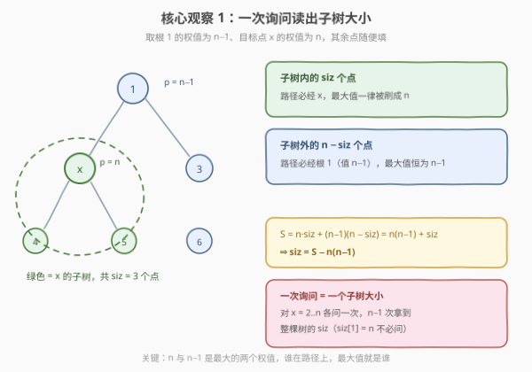
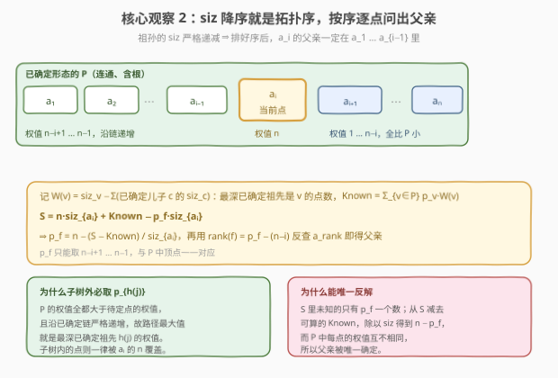
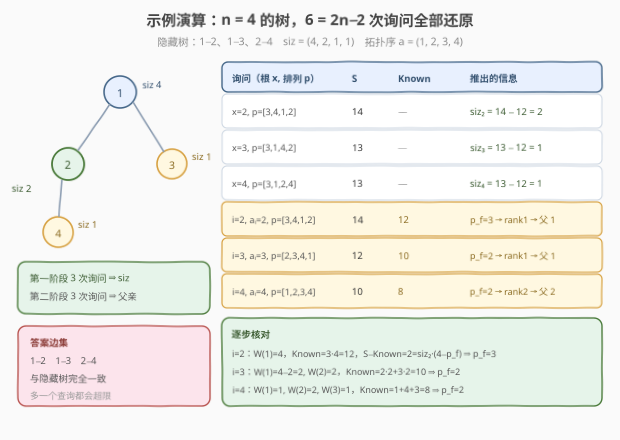

# Codeforces 2277E 猜树 题解

## 1. 题目概述

- **标题 / 题号**：猜树（Codeforces 2277E，英文名 Tree Guessing）
- **链接**：https://codeforces.com/problemset/problem/2277/E
- **来源**：Codeforces Round 1129 (Div. 2) · Problem E
- **难度**：未评级（2750 分 / Div. 2 E）
- **限制**：时间 2 s / 内存 256 MB
- **标签**：构造，交互题，树

**题意**：交互题。评测机藏着一棵 $n$ 个点的树。每次询问给出点 $x$ 与 $1..n$ 的一个**排列** $p$，评测机返回

$$S=\sum_{i=1}^{n}\ \max_{j\in \mathrm{path}(i,x)} p_j,$$

即"每个点到 $x$ 的路径上 $p$ 的最大值"之和。最多询问 $2n-2$ 次，最后输出 $n-1$ 条边。多测：首行 $t$，每组先给 $n$；hack 格式为每组先 $n$、再 $n-1$ 条边。

**约束**：

- $1\le t\le 250$，$2\le n\le 500$，$\sum n\le 500$
- 每组询问次数 $\le 2n-2$；每次的 $p$ 必须恰好是 $1..n$ 的排列；输出答案不计次数
- 每次输出后必须 flush；读到 $-1$ 必须立刻退出；交互库**非自适应**（树事先固定）

## 2. 示例与观察
官方样例（交互式：`输入` 是评测机的回应流，`输出` 是程序的动作；已省去分组空行）：

```text
输入：
6
2
3
6
7
4
10
13
4
10
11
13
16
8
10

输出：
!
1 2
? 1 1 2 3
? 2 1 2 3
!
3 1
1 2
? 1 1 2 3 4
? 2 1 3 4 2
!
1 2
1 3
2 4
? 1 1 2 3 4
? 1 2 1 3 4
? 1 3 1 2 4
? 1 4 1 2 3
!
1 2
1 3
1 4
!
1 2
2 3
3 4
4 5
5 6
6 7
7 8
!
1 2
1 3
2 4
2 5
3 6
3 7
4 8
5 9
6 10
```

六组依次是 $n=2,3,4,4,8,10$，前四组有询问（答案 $6,7$ / $10,13$ / $10,11,13,16$），后两组是链与一般树。例如第二组树为 $1-2,1-3$，`? 1 1 2 3` 返回 $\max\{1\}+\max\{2,1\}+\max\{3,1\}=6$。

**自造示例**：取 $n=4$、边为 $1-2,1-3,2-4$ 的树，完整的 6 次询问与答案见 3.4 的演算表。

## 3. 解题思路

### 3.1 暴力思路

最直接的想法是"逐对判定"：对每对 $(u,v)$ 用询问判断是否相邻。但一次询问只回一个整数，判定一对点至少要一次询问，总量 $\Theta(n^2)$——比 $2n-2$ 差一个数量级，不可行。

另一个直觉是"把最大值放在根上"：若 $p_x=n$，每条路径都含 $x$，答案恒为 $n^2$，零信息。所以要让**次大值 $n-1$ 守在根上、最大值 $n$ 放在别处**：路径是否经过那个 $n$，就成了唯一的分水岭。

### 3.2 核心观察 1：一次询问 = 一个子树大小



固定根为 $1$，询问取 $x=1$，令 $p_1=n-1$、$p_v=n$（$v\ne1$ 为指定点）、其余随意。对任意点 $i$：路径 $\mathrm{path}(i,1)$ 必含根（值 $n-1$）；若 $i$ 在 $v$ 的子树内（等价于 $v$ 在该路径上），最大值被 $p_v=n$ 顶到 $n$；否则路径上所有值 $\le n-1$ 且含 $n-1$，最大值为 $n-1$。设 $\mathrm{siz}_v$ 是以 $1$ 为根时 $v$ 的子树大小，则

$$S=n\cdot \mathrm{siz}_v+(n-1)\bigl(n-\mathrm{siz}_v\bigr)=n(n-1)+\mathrm{siz}_v
\qquad\Longrightarrow\qquad \mathrm{siz}_v=S-n(n-1).$$

对 $v=2..n$ 各问一次，用 $n-1$ 次询问拿到全部子树大小（$\mathrm{siz}_1=n$ 无需询问）。

### 3.3 核心观察 2：siz 降序是拓扑序，逐点定父亲



祖孙的 $\mathrm{siz}$ 严格递减：$u$ 是 $v$ 的真祖先则 $\mathrm{siz}_u>\mathrm{siz}_v$。故按 $\mathrm{siz}$ 降序排成 $a_1..a_n$ 是合法拓扑序，且 $a_1=1$。于是"逐个加点"：处理 $a_i$ 时，$P=\{a_1..a_{i-1}\}$ 已连成含根连通子树，父亲 $f$ 必在 $P$ 中。设计询问：

- $p_{a_i}=n$（当前点最大）；
- $a_k\ (k<i)$ 取 $n-i+k$，即 $n-i+1..n-1$，**沿树的父子边严格递增**（$a_1..a_{i-1}$ 本身是拓扑序）；
- $a_k\ (k>i)$ 取 $k-i$，即 $1..n-i$，全部小于已确定点的权值。

两条关键事实：

1. 对 $j\in \mathrm{subtree}(a_i)$，路径必经 $a_i$，最大值取 $n$——这 $\mathrm{siz}_{a_i}$ 个点贡献 $n\cdot\mathrm{siz}_{a_i}$；
2. 对 $j\notin \mathrm{subtree}(a_i)$，路径上已确定的点构成一条从 $1$ 往下的链，最深者为 $j$ 的最深已确定祖先 $h(j)$；权值沿链严格递增且都大于待定点的权值，故路径最大值恰为 $p_{h(j)}$。

记 $W(v)$ 为"最深已确定祖先恰为 $v$"的点数，已知信息下可算，且全体点被它划分：

$$W(v)=\mathrm{siz}_v-\sum_{c\in\mathrm{ch}_P(v)}\mathrm{siz}_c,\qquad \sum_{v\in P}W(v)=n.$$

令 $\mathrm{Known}=\sum_{v\in P}p_v W(v)$，它正是全体 $p_{h(j)}$ 之和；其中属于 $\mathrm{subtree}(a_i)$ 的那 $\mathrm{siz}_{a_i}$ 个点满足 $h(j)=f$，需要扣掉 $p_f\,\mathrm{siz}_{a_i}$。于是

$$S_i=n\cdot\mathrm{siz}_{a_i}+\mathrm{Known}-p_f\cdot\mathrm{siz}_{a_i}
\;\Longrightarrow\;
p_f=n-\frac{S_i-\mathrm{Known}}{\mathrm{siz}_{a_i}},$$

再由赋值规则 $p_{a_k}=n-i+k$ 反查编号：$\mathrm{rank}(f)=p_f-(n-i)$，$f=a_{\mathrm{rank}(f)}$。

**流程**：$n-1$ 次询问求 $\mathrm{siz}$ → 降序排序 → 对 $i=2..n$ 各一次询问定出父亲，共 $(n-1)+(n-1)=2n-2$ 次，正好卡满限制。

### 3.4 示例演算



隐藏树 $1-2,1-3,2-4$，以 $1$ 为根得 $\mathrm{siz}=(4,2,1,1)$，降序后 $a=(1,2,3,4)$。

| 询问 | $S$ | $\mathrm{Known}$ | 推出 |
|------|-----|------------------|------|
| $x=2,\ p=[3,4,1,2]$ | 14 | — | $\mathrm{siz}_2=14-12=2$ |
| $x=3,\ p=[3,1,4,2]$ | 13 | — | $\mathrm{siz}_3=13-12=1$ |
| $x=4,\ p=[3,1,2,4]$ | 13 | — | $\mathrm{siz}_4=13-12=1$ |
| $i=2$：$p=[3,4,1,2]$ | 14 | $3\cdot4=12$ | $(14-12)/2=1\Rightarrow p_f=3\Rightarrow\mathrm{rank}=1$，父 $1$ |
| $i=3$：$p=[2,3,4,1]$ | 12 | $2\cdot2+3\cdot2=10$ | $(12-10)/1=2\Rightarrow p_f=2\Rightarrow\mathrm{rank}=1$，父 $1$ |
| $i=4$：$p=[1,2,3,4]$ | 10 | $1+2\cdot2+3=8$ | $(10-8)/1=2\Rightarrow p_f=2\Rightarrow\mathrm{rank}=2$，父 $2$ |

人工核对 $i=3$：$p=[2,3,4,1]$，路径最大值之和 $2+3+4+3=12$；$W(1)=4-2=2$（点 $1,3$）、$W(2)=2$（点 $2,4$），$\mathrm{Known}=2\cdot2+3\cdot2=10$，$\mathrm{siz}_3=1$，故 $p_f=4-2=2$，对应 $a_1=1$，与真实父亲一致。

## 4. 算法细节

1. **多测清零**：每组重置 $\mathrm{siz}$、$\mathrm{par}$、$\mathrm{ch}$，询问预算也按组重算。
2. **排列按顶点编号输出**：无论哪个阶段都取 $x=1$，只改 $p$；$p_i$ 对应顶点 $i$ 的权值。
3. **flush 与 $-1$**：每次询问后 flush；一旦读到 $-1$ 立刻 `exit(0)`。
4. **$64$ 位**：$S\le n^2$ 虽小，$n(n-1)$ 与 $p_vW(v)$ 的累乘统一用 `long long`。
5. **并列 siz**：大小相同者互不为祖孙，任意 tie 断法仍是拓扑序。
6. **$W(v)$ 的增量维护**：加入 $a_i$ 后把它挂到 $\mathrm{ch}[f]$；每次对 $P$ 中每个 $v$ 用 $\mathrm{siz}_v-\sum_{c\in\mathrm{ch}[v]}\mathrm{siz}_c$ 计算，单次 $O(n)$，共 $O(n^2)$。
7. **自检**：$(S_i-\mathrm{Known})$ 应被 $\mathrm{siz}_{a_i}$ 整除，且 $p_f\in[n-i+1,n-1]$，可用于调试定位。

## 5. 正确性证明

**引理 1**：若 $p_x=n$，则任何询问答案恒为 $n^2$。
**证明**：每条路径都含 $x$，最大值恒为 $n$，$n$ 项求和得 $n^2$。∎

**引理 2（第一阶段）**：取 $x=1$、$p_1=n-1$、$p_v=n$、其余任意，返回值为 $n(n-1)+\mathrm{siz}_v$。
**证明**：路径必含 $1$，最大值 $\ge n-1$。若路径含 $v$，则最大值 $\ge p_v=n$，而 $n$ 是全局最大，故为 $n$；否则路径不含 $v$，所有值 $\le n-1$ 且含 $n-1$，故为 $n-1$。按两类计数求和即得。∎

**引理 3（拓扑序）**：以 $1$ 为根，$u$ 是 $v$ 的真祖先 $\Rightarrow \mathrm{siz}_u>\mathrm{siz}_v$；故 $\mathrm{siz}$ 降序是合法拓扑序，且 $a_1=1$。
**证明**：$\mathrm{subtree}(v)\subsetneq\mathrm{subtree}(u)$ 给出 $\mathrm{siz}_v<\mathrm{siz}_u$，每个点的祖先都排在它前面；$\mathrm{siz}=n$ 的唯一性给出 $a_1=1$。∎

**引理 4（第二阶段主式）**：$P=\{a_1..a_{i-1}\}$ 形态已知（连通、含 $1$），按算法赋值，则 $S_i=n\,\mathrm{siz}_{a_i}+\mathrm{Known}-p_f\,\mathrm{siz}_{a_i}$，$f=\mathrm{par}(a_i)$。
**证明**：分两类。(i) $j\in\mathrm{subtree}(a_i)$：路径含 $a_i$（权值 $n$ 为全局最大），最大值 $=n$；由引理 3，这些点除 $a_i$ 外 $\mathrm{siz}$ 更小，都还待定。(ii) $j\notin\mathrm{subtree}(a_i)$：路径不含 $a_i$；其上的已确定点正是 $j$ 的已确定祖先，位于同一条从 $1$ 出发的链上，权值沿链严格递增（赋权顺序即拓扑序），链上最大者是最深的已确定祖先 $h(j)$，且所有已确定权值 $>n-i\ge$ 任何待定权值，故整条路径最大值 $=p_{h(j)}$。所以 $S_i=n\,\mathrm{siz}_{a_i}+\sum_{j\notin\mathrm{subtree}(a_i)}p_{h(j)}$。又按最深已确定祖先分组得 $\sum_{\text{所有 }j}p_{h(j)}=\sum_{v\in P}p_vW(v)=\mathrm{Known}$；而 $j\in\mathrm{subtree}(a_i)$ 时路径过 $a_i$ 再过 $f$，$f$ 已确定且最深，故 $h(j)=f$，这部分和为 $p_f\,\mathrm{siz}_{a_i}$。相减即得。∎

**引理 5（$W$ 分解）**：$W(v)=\mathrm{siz}_v-\sum_{c\in\mathrm{ch}_P(v)}\mathrm{siz}_c$ 恰是"最深已确定祖先为 $v$"的点数，且 $\sum_{v\in P}W(v)=n$。
**证明**：$\mathrm{subtree}(v)$ 被 $v$、各已确定儿子的子树、各未确定儿子的子树划分；已确定儿子子树内的点最深已确定祖先是该儿子或更深者，其余部分（含 $v$）恰为 $v$。对 $v\in P$ 求和覆盖全部点。∎

**定理**：算法在 $2n-2$ 次询问内还原隐藏树。
**证明**：引理 2、5 给出全部 $\mathrm{siz}$ 与可算的 $W(v)$。对每个 $i\ge2$，引理 4 给出 $S_i-\mathrm{Known}=\mathrm{siz}_{a_i}(n-p_f)$，解出 $p_f$；由引理 3 有 $f\in P$，而赋值使权值在 $P$ 上单射，故 $\mathrm{rank}(f)=p_f-(n-i)$ 唯一确定 $f=\mathrm{par}(a_i)$。归纳可知 $P$ 的形态始终正确，每条边都被正确定出。询问数为 $(n-1)+(n-1)=2n-2$。∎

## 6. 复杂度分析

- **时间**：每组 $2n-2$ 次询问，每次构造排列 $O(n)$；另有 $O(n)$ 步计算 $\mathrm{Known}$，每步 $O(n)$。合计 $O(n^2)$，$\sum n\le500$ 时约 $5\times10^5$ 次基本操作。实测（本地交互器，$n=500$）C++ 0.08–0.15 s，对 2 s 时限有 14 倍以上余量；Python3 约 0.3–0.5 s，同样能过（交互题里 Python 的 flush 开销偏大，n 更大时才需要担心）。
- **空间**：$\mathrm{siz},\mathrm{par},\mathrm{ch}$ 与排列数组均为 $O(n)$。
- **询问次数**：恰好 $2n-2$，等于上限，一次都不能多问。

## 7. 参考代码

### C++17

```cpp
#include <bits/stdc++.h>
using namespace std;
#define MAXN 505

int n, siz[MAXN], perm[MAXN], par[MAXN];
vector<int> ch[MAXN];

long long ask(int x) {
    printf("? %d", x);
    for (int i = 1; i <= n; i++) printf(" %d", perm[i]);
    printf("\n");
    fflush(stdout);
    long long r;
    if (scanf("%lld", &r) != 1 || r == -1) exit(0);
    return r;
}

void solve() {
    scanf("%d", &n);
    siz[1] = n, par[1] = 0, ch[1].clear();
    for (int i = 2; i <= n; i++) par[i] = 0, ch[i].clear();

    // 第一阶段：p[1]=n-1, p[x]=n，答案 = n(n-1) + siz[x]
    for (int x = 2; x <= n; x++) {
        perm[1] = n - 1, perm[x] = n;
        int v = 1;
        for (int j = 2; j <= n; j++)
            if (j != x) perm[j] = v++;
        siz[x] = (int)(ask(1) - 1LL * (n - 1) * n);
    }

    // 子树大小降序 = 以 1 为根时的拓扑序
    vector<int> ord(n);
    for (int i = 0; i < n; i++) ord[i] = i + 1;
    sort(ord.begin(), ord.end(), [](int a, int b) { return siz[a] > siz[b]; });

    // 第二阶段：当前点取 n，已确定点取 n-i+1..n-1，待定点取 1..n-i
    for (int i = 2; i <= n; i++) {
        int ai = ord[i - 1];
        perm[ai] = n;
        for (int k = 1; k < i; k++) perm[ord[k - 1]] = n - i + k;
        for (int k = i + 1; k <= n; k++) perm[ord[k - 1]] = k - i;
        long long known = 0;                    // Σ p[v] · (最深已确定祖先为 v 的点数)
        for (int k = 1; k < i; k++) {
            int v = ord[k - 1], w = siz[v];
            for (int c : ch[v]) w -= siz[c];
            known += 1LL * perm[v] * w;
        }
        long long pf = n - (ask(1) - known) / siz[ai];   // p[par(ai)]
        int f = ord[(int)(pf - (n - i)) - 1];
        par[ai] = f, ch[f].push_back(ai);
    }

    printf("!\n");
    for (int v = 1; v <= n; v++)
        if (par[v]) printf("%d %d\n", v, par[v]);
    fflush(stdout);
}

int main() {
    int t;
    if (scanf("%d", &t) != 1) return 0;
    while (t--) solve();
    return 0;
}
```

### Python3

```python
import sys


def main():
    inp, out = sys.stdin.buffer, sys.stdout

    def read_int():
        line = inp.readline()
        return int(line) if line else None

    t = read_int()
    if t is None:
        return
    for _ in range(t):
        n = read_int()
        siz = [0] * (n + 1)
        siz[1] = n
        perm = [0] * (n + 1)

        def ask(x):
            out.write("? %d %s\n" % (x, " ".join(map(str, perm[1:]))))
            out.flush()
            r = read_int()
            if r is None or r == -1:
                sys.exit(0)
            return r

        # 第一阶段：p[1]=n-1, p[x]=n  =>  答案 = n(n-1) + siz[x]
        for x in range(2, n + 1):
            perm[1], perm[x] = n - 1, n
            v = 1
            for j in range(2, n + 1):
                if j != x:
                    perm[j] = v
                    v += 1
            siz[x] = ask(1) - (n - 1) * n

        order = sorted(range(1, n + 1), key=lambda u: -siz[u])
        par = [0] * (n + 1)
        ch = [[] for _ in range(n + 1)]

        # 第二阶段：当前点取 n，已确定点取 n-i+1..n-1，待定点取 1..n-i
        for i in range(2, n + 1):
            ai = order[i - 1]
            perm[ai] = n
            for k in range(1, i):
                perm[order[k - 1]] = n - i + k
            for k in range(i + 1, n + 1):
                perm[order[k - 1]] = k - i
            known = 0
            for k in range(1, i):
                v = order[k - 1]
                w = siz[v]
                for c in ch[v]:
                    w -= siz[c]
                known += perm[v] * w
            pf = n - (ask(1) - known) // siz[ai]
            f = order[pf - (n - i) - 1]
            par[ai] = f
            ch[f].append(ai)

        out.write("!\n")
        out.write("".join("%d %d\n" % (v, par[v]) for v in range(1, n + 1) if par[v]))
        out.flush()


if __name__ == "__main__":
    main()
```

## 8. 边界情况与易错点

1. **$n=2$**：$p_1=n-1=1$、$p_2=n=2$，首问返回 $3$ 得 $\mathrm{siz}_2=1$；次问 $p=[1,2]$、$\mathrm{Known}=2$、$p_f=1$，父为 $1$，恰好用满 $2=2n-2$ 次。
2. **询问次数没有余量**：$n-1$ 加 $n-1$ 正好 $2n-2$，任何"试探性"的额外询问都会直接 WA。
3. **排列必须合法**：待定点独占 $1..n-i$，已确定点占 $n-i+1..n-1$，当前点占 $n$；漏填或重填立即 WA。
4. **$\mathrm{siz}$ 并列**：相同 $\mathrm{siz}$ 的点互不为祖孙，tie 随机断也安全；不要假设严格递减去重。
5. **读 $-1$ 立刻退出**，且每次询问/答案后都 flush，否则可能拿到 Idleness limit exceeded。
6. **多测**：询问预算按组重算，上一组剩余次数不能挪到下一组。
7. **整除与范围**：$\mathrm{siz}_{a_i}\mid(S_i-\mathrm{Known})$ 且 $p_f\in[n-i+1,n-1]$；越界说明赋值或 $W$ 算错。
8. **极端形状**：链（$\mathrm{siz}$ 全不同、深度 $n$）与菊花（除根外 $\mathrm{siz}$ 全为 $1$，大量并列）都必须过，前者考验"链式递增"，后者考验 tie 处理。

## 9. 验证记录

- **编译环境与命令**：`clang++ -std=c++17 -O2`（本机无 GNU g++，配 `codeforces/tools/include/bits/stdc++.h` 兼容头；正文代码只用标准库，可原样提交 GNU C++17）；Python 侧为 `Python 3.9.6`。
- **官方样例**：0 / 1 通过 token 比对；本题输出不唯一（构造 / 多解 / 特殊评测），剩余差异属预期，样例含义已在第 2 节逐组解释。
- **复核状态**：audited（2026-11-19 统一回归：编译 + 官方样例；写作期的随机对拍与暴力未重跑）。

## 相关题目与扩展

- [Codeforces 1129E Legendary Tree](https://codeforces.com/problemset/problem/1129/E)：同样先问 $\mathrm{siz}$ 再按拓扑序二分找儿子，是本题的宽松版。
- [Codeforces 1534D Lost Tree](https://codeforces.com/problemset/problem/1534/D)：距离型询问，用奇偶分层把询问压到 $\lceil n/2\rceil$，可对照"一次询问携带多少信息"的设计。
- [Codeforces 1205C Palindromic Paths](https://codeforces.com/problemset/problem/1205/C)：把未知结构化成线性关系再逐格确定，与本题"把排列设计成可解方程"思路相通。

**延伸思考**：本做法恰好用满 $2n-2$。信息论上界并不紧（一次询问返回值 $\le n^2$，而树只有 $n\log n$ 比特量级），瓶颈在"单次询问能提取多少"。若把第二阶段的权值分段改成"按深度打包一批同层点"，也许能压到 $n+O(\sqrt n)$ 次；或先用 $\mathrm{siz}$ 定出重心/直径，减少需要询问的点数。
