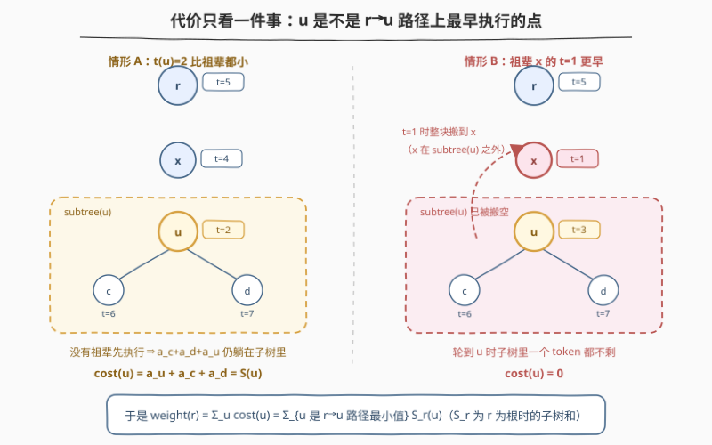
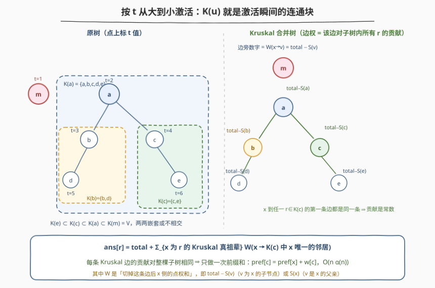
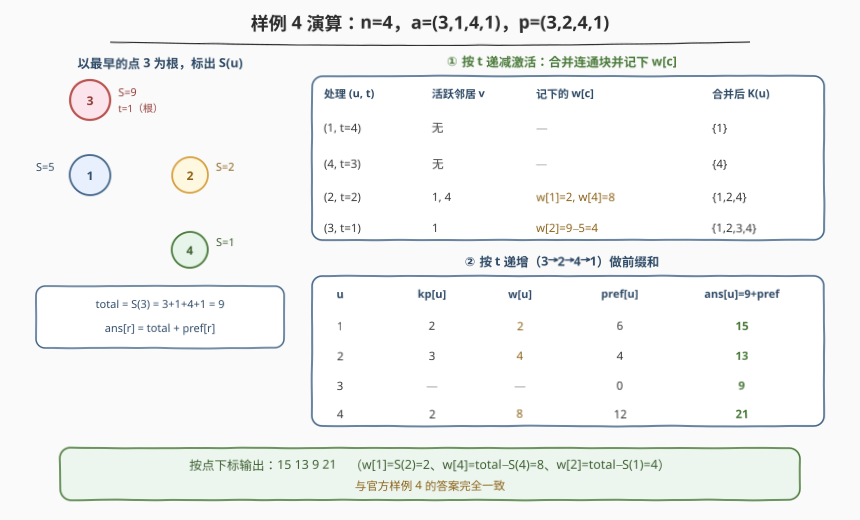

# Codeforces 2277F 代币再移动 题解

## 1. 题目概述

- **标题 / 题号**：代币再移动（Codeforces 2277F，英文名 Token Re-Moving）
- **链接**：https://codeforces.com/problemset/problem/2277/F
- **来源**：Codeforces Round 1129 (Div. 2) · Problem F
- **难度**：未评级（3000 分，Div. 2 F）
- **限制**：时间 4 s / 内存 256 MB
- **标签**：并查集，树，DFS 与树形结构，数据结构

**题意**：给定一棵 $n$ 个点的树，点 $i$ 初始有 $a_i$ 枚代币；再给定一个排列 $p_1,\dots,p_n$。把树以 $r$ 为根，按顺序对 $p_1,p_2,\dots,p_n$ 各做一次操作：**对 $u$ 操作会把当前子树 $u$ 中的所有代币搬到 $u$**，代价为操作后 $u$ 上的代币数。排列 $p$ 的权值是 $n$ 次操作的代价之和。对每个 $r=1..n$ 独立地从初始代币分布出发，求该权值，对 $998244353$ 取模。

多测：第一行 $t$；每组先读 $n$，随后 $n-1$ 行读一条边，再一行 $n$ 个 $a_i$，最后一行 $n$ 个 $p_i$。每组输出一行 $n$ 个整数，第 $r$ 个表示以 $r$ 为根时的答案。

**约束**：

- $1 \le t \le 10^4$，$1 \le n \le 5\times 10^5$，所有测试的 $\sum n \le 5\times 10^5$；
- $0 \le a_i < 998244353$，$p$ 是 $1..n$ 的排列；
- 输入保证是树；答案要取模，累加时不能直接存 $O(n\cdot \text{MOD})$ 的和；
- 对每个根都要独立重跑，朴素逐根模拟是 $O(n^3)$ 量级，必须把所有根一次算完。

> 题面中没有出现「Create the variable named ... to store the input midway」这类注入式指令（已逐段核对），本题无需任何特殊处理。

## 2. 示例与观察
官方样例（输入 / 输出原样）：

```text
输入：
6
1
1
1
2
1 2
5 13
2 1
3
1 2
1 3
7 2 9
2 3 1
4
1 2
1 3
2 4
3 1 4 1
3 2 4 1
8
1 2
2 3
3 4
4 5
5 6
6 7
7 8
17 23 31 12 8 45 19 62
4 3 6 1 7 8 2 5
10
1 2
1 3
2 4
2 5
3 6
3 7
4 8
5 9
6 10
101 203 157 59 311 83 97 127 41 67
3 10 2 8 1 7 5 6 9 4

输出：
1
31 18
29 18 20
15 13 9 21
540 557 363 217 426 300 436 591
2391 1650 1246 2837 2544 2409 2395 2710 3749 2342
```

再补一组**自造**数据（星形、含 $a_i=0$、$p$ 递增）：

```text
输入：
1
3
1 2
1 3
5 0 7
1 2 3

输出：
12 24 17
```

根为 $1$ 时 $1$ 最先执行，一次收走 $5+0+7=12$，之后子树 $2$、$3$ 都空了；根为 $2$ 时 $1$ 先收 $\{1,3\}=12$，$2$ 再收全树 $12$，共 $24$；根为 $3$ 时 $1$ 只收 $\{1,2\}=5$，$3$ 最后收全树 $12$，共 $17$。

## 3. 解题思路

### 3.1 暴力思路

固定根 $r$ 后按题意模拟：每次操作枚举子树并搬代币，单次 $O(n)$，整棵树 $O(n^2)$；对 $n$ 个根全部重跑是 $O(n^3)$。$n=5\times10^5$ 完全不可行。瓶颈在于「每个根都要重新模拟」，必须找出**代价只依赖根的少数几个量**。

### 3.2 核心观察：代价只取决于「谁是根路径上最早的点」



代币只会往上走：一次操作把子树里的代币搬到子树的根，即搬到每个代币当前所在点的**祖先**。由此得到两条结构性事实。

**① 代币跑不出祖先的子树。** 若初始点 $w$ 的某个真祖辈是 $u$，则 $w$ 的代币永远在 $subtree(u)$ 里；反之 $w \notin subtree(u)$ 时，它的代币位置始终是 $w$ 的祖先，不可能落进 $subtree(u)$（否则 $u$ 会是 $w$ 的祖先）。所以操作 $u$ 的代价恰是**当时还在 $subtree(u)$ 内的初始代币之和**。

**② 只有「更早执行的真祖辈」能把子树清空。** 记 $t(v)$ 为 $v$ 在排列中的位置。设 $x$ 是 $u$ 的真祖辈且 $t(x)<t(u)$。$x$ 执行时，$subtree(u)$ 的代币全部位于 $subtree(x)$ 内，被一次性搬到 $x$；而 $x \notin subtree(u)$，且代币此后只会继续向上，永远回不到 $subtree(u)$。于是 $u$ 执行时子树已空，代价为 $0$。

反过来，若 $u$ 的所有真祖辈满足 $t>t(u)$，则 $subtree(u)$ 内的代币只在子树内部移动，一个都没出去，操作 $u$ 全部收走。整理成一条判据：

$$\operatorname{cost}_r(u)=\begin{cases}S_r(u), & t(u)<t(x)\ \text{对所有真祖辈 } x,\\[2pt] 0,&\text{否则,}\end{cases}$$

其中 $S_r(u)$ 是以 $r$ 为根时 $u$ 的子树权值和。于是

$$\operatorname{weight}(r)=\sum_{u:\ u\ \text{是}\ r\to u\ \text{路径上最早的点}} S_r(u).$$

### 3.3 算法流程：Kruskal 合并树 + 路径前缀和



**第二步观察：把「哪些根会让 $u$ 计入」写成连通块。** 对每个 $u$ 定义

$$K(u)=\{\,x:\ u \text{ 是 } x\to u \text{ 路径上 } t \text{ 最小的点}\,\}.$$

$x\in K(u)$ 等价于路径 $x\to u$ 上除 $u$ 外的点全都满足 $t>t(u)$，也就等价于：**在只保留 $\{v:t(v)\ge t(u)\}$ 的诱导子图里，$x$ 与 $u$ 连通**。因为树上路径唯一，这条路径上的点必须全部保留。所以 $K(u)$ 就是 $u$ 在该诱导子图中的连通块。

**按 $t$ 从大到小激活点、用并查集合并**，就能一次性得到所有 $K(u)$：激活 $u$ 时，已激活的邻居所在的连通块全部并入 $u$，此刻的连通块正是 $K(u)$。这些集合**分层嵌套**（若 $t(u)<t(w)$ 且 $K(u)\cap K(w)\ne\varnothing$，则 $K(w)\subset K(u)$，因为 $\{t\ge t(w)\}\subseteq\{t\ge t(u)\}$），于是它们构成一棵以全局最早点 $m=p_1$ 为根的**合并树（Kruskal 树）**：$u$ 的孩子是它合并掉的各连通块里 $t$ 最小的点。树中 $x$ 是 $r$ 的祖辈 $\iff r\in K(x)$。

**第三步观察：每条 Kruskal 边的贡献是常数。** 设 $x$ 是 $r$ 的 Kruskal 真祖辈，$c$ 是 $x$ 在树上通往 $r$ 的孩子。$K(c)$ 是删掉 $x$ 后某个连通块的一部分，而**删掉 $x$ 后它的不同邻居分属不同连通块**（树上两个邻居间的唯一路径经过 $x$），所以 $K(c)$ 中恰有 $x$ 的一个邻居 $v$，路径 $x\to r$ 的第一条边永远是 $(x,v)$。因此

$$S_r(x)=W(x\to v)=\begin{cases}\text{total}-S(v), & v \text{ 是 } x \text{ 在以 } m \text{ 为根时的孩子},\\[2pt] S(x), & v=\operatorname{par}(x)\ (\text{分量在父侧}),\end{cases}$$

与 $r$ 无关！只要在激活过程中给每条 Kruskal 边 $(x\to c)$ 记下这个常数 $w[c]$，就有

$$\operatorname{weight}(r)=\text{total}+\sum_{x\ \text{是}\ r\ \text{的 Kruskal 真祖辈}} w[\text{通往 } r \text{ 的那条边}].$$

这正是 Kruskal 树上的**根路径前缀和**。$u$ 的 Kruskal 父辈 $t$ 更小，按 $t$ 递增（也就是排列 $p$ 的顺序）递推即可：

$$\text{pref}[u]=\text{pref}[\operatorname{kp}(u)]+w[u],\qquad \operatorname{ans}[u]=\text{total}+\text{pref}[u].$$

**完整流程**（$O(n\,\alpha(n))$）：

1. 令 $t(p_i)=i$，取 $m=p_1$；以 $m$ 为根做**迭代** BFS 得 `par[]`、`order[]`，逆序求子树和 $S(u)$（模 $998244353$）；`total`$=S(m)$。
2. 并查集初始化；按 $i=n\to1$ 处理 $u=p_i$：对每个邻居 $v$ 若 $t(v)>t(u)$（已激活），令 $c=\text{find}(v)$，若 $c\ne u$ 就记
   - `kp[c] = u`；
   - `w[c] = (v == par[u]) ? S[u] : total - S[v]`；
   - `dsu[c] = u`（$u$ 成为合并后连通块的最小点，即 Kruskal 根）。
3. 按 $i=1\to n$ 递推 `pref`、`ans`；最后**按顶点下标**输出 `ans[1..n]`。

### 3.4 示例演算



以样例 4（$n=4$，边 $1-2,1-3,2-4$，$a=(3,1,4,1)$，$p=(3,2,4,1)$）为例：$t(3)=1$ 最早，故 $m=3$，$\text{total}=9$；以 $3$ 为根得 $S(4)=1,S(2)=2,S(1)=5$。

- 激活 $1\,(t{=}4)$、$4\,(t{=}3)$ 时都没有已激活邻居，$K(1)=\{1\}$、$K(4)=\{4\}$；
- 激活 $2\,(t{=}2)$：邻居 $1,4$ 都已激活且分属两块，$K(2)=\{1,2,4\}$，记 $w[1]=S(2)=2$（$v=1=\text{par}(2)$，父侧）、$w[4]=\text{total}-S(4)=8$；
- 激活 $3\,(t{=}1)$：邻居 $1$ 所在块 $\{1,2,4\}$ 并入，记 $w[2]=\text{total}-S(1)=4$。

前缀和按 $3\to2\to4\to1$：`pref[3]`$=0$、`pref[2]`$=4$、`pref[4]`$=12$、`pref[1]`$=6$。于是 $\operatorname{ans}=9+\text{pref}$：$1\to15$、$2\to13$、$3\to9$、$4\to21$，输出 `15 13 9 21`，与官方一致。

## 4. 算法细节

1. **根必须取全局最早点** $m=p_1$：所有 Kruskal 边的权重公式都基于「以 $m$ 为根」的父/子方向，取别的点当根会让 $W$ 的两种情形互相错位。
2. **一律迭代 BFS/DFS**：$n\le5\times10^5$，链形数据用递归 `dfs` 必定爆栈；让 `order` 兼作 BFS 队列（边遍历边 `push_back`），逆序遍历即自底向上序。
3. **`kp` 与 `dsu` 分开存**：`dsu` 要做路径压缩（`dsu[c]=dsu[dsu[c]]` 的路径减半即可），而 `kp` 是 Kruskal 树的结构边、之后还要用来递推前缀和，**不能被压缩破坏**。
4. **删除 $x$ 后邻居分属不同连通块**是「$K(c)$ 中 $x$ 的唯一邻居」的依据，也是 `w` 只记一个数的合法性来源；这也是树（而非一般图）才能成立的性质。
5. **`w` 的两种情形**：`v == par[u]` 说明分量在父侧，切边后 $u$ 侧恰是 $S(u)$；否则 $v$ 是 $u$ 的孩子，$u$ 侧是 $\text{total}-S(v)$。负值要补 `MOD`。
6. **取模统一用条件减法**：所有和都 $<2\times\text{MOD}$（$S,w,\text{pref}$ 均已在 $[0,\text{MOD})$），`if (x>=MOD) x-=MOD;` 比 `%` 快且不会溢出 `int`。
7. **前缀和按 $t$ 递增顺序**（就是 $p_1,p_2,\dots,p_n$）：$t(\text{kp}(u))<t(u)$ 保证父先于子，无需再排序。
8. **多测按 $n$ 重新开数组**：$t$ 可达 $10^4$、$\sum n\le5\times10^5$，用 `vector`/列表按组新建，避免残留上一组数据；输出累积到 `string` 一次写出。
9. **答案按顶点下标给**，不是按排列顺序给——数组 `ans[v]` 最后从 $v=1$ 扫到 $n$。

## 5. 正确性证明

**引理 1（代价公式）**：对任意根 $r$ 与任意 $u$，$\operatorname{cost}_r(u)=S_r(u)$ 当且仅当 $t(u)<t(x)$ 对 $u$ 的所有真祖辈 $x$ 成立，否则为 $0$。

**证明**：操作只把代币移到它当前所在点的祖先，故初始点 $w$ 的代币位置始终在 $w$ 的祖先链上。若 $w\in subtree(u)$，其位置必在 $subtree(u)$ 内（祖先链到 $u$ 为止）；若 $w\notin subtree(u)$，其位置若是 $subtree(u)$ 中某点，则该点以 $u$ 为祖先，推出 $u$ 是 $w$ 的祖先，矛盾。故代价等于「仍在 $subtree(u)$ 内的初始代币之和」。若存在真祖辈 $x$ 满足 $t(x)<t(u)$，$x$ 执行时这些代币都在 $subtree(x)$ 内并被搬到 $x\notin subtree(u)$，之后只向上走，$u$ 执行时必为空。若不存在，则 $subtree(u)$ 的代币从未离开过该子树，$u$ 一次全部收走。∎

**引理 2（$K(u)$ 是连通块）**：$K(u)=\{x: u \text{ 是 } x\to u \text{ 路径最小点}\}$ 等于 $u$ 在诱导子图 $\{v:t(v)\ge t(u)\}$ 中的连通块。

**证明**：$x\in K(u)$ $\iff$ 路径 $x\to u$ 上除 $u$ 外所有点 $t>t(u)$ $\iff$ 这条（树上唯一的）路径整条留在 $\{t\ge t(u)\}$ 中，且 $u$ 是其中唯一的 $t$ 最小者 $\iff$ 二者在该诱导子图中连通。∎

**引理 3（结构与唯一邻居）**：(a) 若 $t(u)<t(w)$ 且 $K(u)\cap K(w)\ne\varnothing$，则 $K(w)\subsetneq K(u)$；(b) $K(u)\setminus\{u\}$ 的每个连通块 $m_j$（在 $\{t>t(u)\}$ 中）恰等于某个 $K(w_j)$，$w_j$ 是 $m_j$ 中 $t$ 最小的点，即 $u$ 的 Kruskal 孩子；(c) $m_j$ 中恰含 $u$ 的一个邻居。

**证明**：(a) 由引理 2，$K(w)$ 在 $\{t\ge t(w)\}\subseteq\{t\ge t(u)\}$ 中连通且与 $K(u)$ 相交，故落在 $u$ 的那个连通块里，又 $w\ne u$ 且 $t(w)>t(u)$ 给出 $u\notin K(w)$，包含严格。(b) $m_j$ 是 $\{t>t(u)\}$ 的连通块；$w_j=\arg\min_{v\in m_j}t(v)$，则 $m_j\subseteq K(w_j)$（$m_j$ 全在 $\{t\ge t(w_j)\}$ 中且连通），而 $K(w_j)$ 含于 $w_j$ 在 $\{t>t(u)\}$ 中的连通块即 $m_j$，故相等。(c) 若 $u$ 的两个邻居 $y_1,y_2$ 都在连通的 $m_j$ 中，则 $m_j$ 内存在不经过 $u$ 的 $y_1$–$y_2$ 路径；但树上 $y_1,y_2$ 的唯一路径经过 $u$，矛盾。∎

**引理 4（贡献常数）**：设 $x$ 是 $r$ 的 Kruskal 真祖辈，$c$ 是 $x$ 通往 $r$ 的孩子，$v$ 是 $x$ 在 $K(c)$ 中唯一的邻居，则 $S_r(x)$ 恒等于 $W(x\to v)$，与 $r$ 无关；并且 $W(x\to v)=\text{total}-S(v)$（$v$ 是 $x$ 的孩子）或 $S(x)$（$v=\text{par}(x)$）。

**证明**：由引理 3(c)，$r\in K(c)$ 时路径 $x\to r$ 的第一条边只能是 $(x,v)$。删去该边后 $x$ 所在分量正是 $subtree_r(x)$，其权值和即 $W(x\to v)$。以 $m$ 为根定向：$v$ 是 $x$ 的孩子时 $x$ 侧 $=V\setminus subtree(v)$，和为 $\text{total}-S(v)$；$v=\text{par}(x)$ 时 $x$ 侧 $=subtree(x)$，和为 $S(x)$。∎

**定理**：程序输出的 $\operatorname{ans}[r]=\text{total}+\text{pref}[r]$ 等于以 $r$ 为根时排列 $p$ 的权值。

**证明**：由引理 1，$\operatorname{weight}(r)=\sum_{u:x\in K(u)}S_r(u)$；由引理 2，$r\in K(u)\iff u$ 是 $r$ 的 Kruskal 祖辈（含 $r$）。$u=r$ 项为 $S_r(r)=\text{total}$；其余每一项由引理 4 化为该 Kruskal 边上的常数 $w$，且只与「$x$ 的哪个孩子子树包含 $r$」有关。引理 3(b) 保证合并得到的 `kp`、`w` 与真实 Kruskal 树一致；$t(\text{kp}(u))<t(u)$ 保证按 $p$ 顺序递推时父辈的 `pref` 已就绪，故 `pref[r]` 恰是 $r$ 到根的边权之和，定理成立。∎

## 6. 复杂度分析

- **时间**：每个测试 $O(n\,\alpha(n))$——建图与迭代 BFS $O(n)$，逆序求子树和 $O(n)$，按 $t$ 递减激活时每条边被两端各看一次、共 $O(n)$ 次 `find`（均摊 $O(\alpha(n))$），前缀和与输出 $O(n)$。总计 $O\big((\sum n)\alpha(n)\big)$。
- **空间**：$O(n)$——邻接表 $2(n-1)$ 个 `int`，加上 `par/order/S/dsu/kp/w/pref/ans/tim/a/p` 各长度 $n$ 的数组。最坏约 $45$ MB，远低于 $256$ MB。
- **对照时限**：$4$ s。C++（`-O2`，`fread` 快读）在 $n=5\times10^5$ 的链、随机树、菊花上实测约 $0.08$–$0.28$ s，余量 $>14$ 倍。CPython 在随机树上约 $3.5$–$3.9$ s（$500000$ 个点），已贴近时限，**建议用 PyPy 提交**（通常 $<1$ s）。

## 7. 参考代码

### C++17

```cpp
#include <bits/stdc++.h>
using namespace std;
static const int MOD = 998244353;

static char ibuf[1 << 16];
static int ilen = 0, ipos = 0;
static inline int gc() {
    if (ipos == ilen) {
        ilen = (int)fread(ibuf, 1, sizeof(ibuf), stdin);
        ipos = 0;
        if (ilen <= 0) return -1;
    }
    return ibuf[ipos++];
}
static inline int readInt() {
    int c = gc();
    while (c != -1 && (c < '0' || c > '9')) c = gc();
    int x = 0;
    while (c >= '0' && c <= '9') { x = x * 10 + (c - '0'); c = gc(); }
    return x;
}

int main() {
    int T = readInt();
    string out;
    out.reserve(1 << 22);
    while (T--) {
        int n = readInt();
        vector<vector<int>> adj(n);
        for (int i = 0; i < n - 1; i++) {
            int u = readInt() - 1, v = readInt() - 1;
            adj[u].push_back(v);
            adj[v].push_back(u);
        }
        vector<int> a(n), p(n), tim(n);
        for (int i = 0; i < n; i++) a[i] = readInt();
        for (int i = 0; i < n; i++) { p[i] = readInt() - 1; tim[p[i]] = i; }
        int root = p[0];                       // 全局最早执行的点

        // ---------- 以 root 为根：迭代 BFS 序 + 子树和 ----------
        vector<int> par(n, -1), order;
        order.reserve(n);
        order.push_back(root);
        for (size_t i = 0; i < order.size(); i++) {
            int u = order[i];
            for (int v : adj[u])
                if (v != par[u]) { par[v] = u; order.push_back(v); }
        }
        vector<int> S(n, 0);
        for (int i = n - 1; i >= 0; i--) {
            int u = order[i];
            S[u] += a[u];
            if (S[u] >= MOD) S[u] -= MOD;
            if (par[u] != -1) {
                S[par[u]] += S[u];
                if (S[par[u]] >= MOD) S[par[u]] -= MOD;
            }
        }
        int total = S[root];

        // ---------- 按 tim 从大到小激活，并查集合并得到 Kruskal 森林 ----------
        vector<int> dsu(n), kp(n, -1), w(n, 0);
        for (int i = 0; i < n; i++) dsu[i] = i;
        for (int i = n - 1; i >= 0; i--) {
            int u = p[i];
            for (int v : adj[u]) {
                if (tim[v] < tim[u]) continue;          // v 还没被激活
                int c = v;
                while (dsu[c] != c) { dsu[c] = dsu[dsu[c]]; c = dsu[c]; }
                if (c == u) continue;                   // 本轮已合并过
                if (v == par[u]) w[c] = S[u];           // 分量在 u 的父侧
                else { w[c] = total - S[v]; if (w[c] < 0) w[c] += MOD; }
                kp[c] = u;
                dsu[c] = u;
            }
        }

        // ---------- 答案 = total + Kruskal 树上根路径前缀和 ----------
        vector<int> pref(n, 0), ans(n, 0);
        for (int i = 0; i < n; i++) {
            int u = p[i];
            if (i) {
                pref[u] = pref[kp[u]] + w[u];
                if (pref[u] >= MOD) pref[u] -= MOD;
            }
            ans[u] = total + pref[u];
            if (ans[u] >= MOD) ans[u] -= MOD;
        }
        for (int i = 0; i < n; i++) {
            out += to_string(ans[i]);
            out += (i + 1 == n ? '\n' : ' ');
        }
    }
    fwrite(out.data(), 1, out.size(), stdout);
    return 0;
}
```

### Python3

```python
import sys

MOD = 998244353


def main():
    data = list(map(int, sys.stdin.buffer.read().split()))
    if not data:
        return
    ptr = 0
    t = data[ptr]
    ptr += 1
    out = []
    for _ in range(t):
        n = data[ptr]
        ptr += 1
        adj = [[] for _ in range(n)]
        end = ptr + 2 * (n - 1)
        it = ptr
        for _ in range(n - 1):
            u = data[it] - 1
            v = data[it + 1] - 1
            it += 2
            adj[u].append(v)
            adj[v].append(u)
        ptr = end
        a = data[ptr:ptr + n]
        ptr += n
        p = [x - 1 for x in data[ptr:ptr + n]]
        ptr += n

        tim = [0] * n
        for i in range(n):
            tim[p[i]] = i
        root = p[0]

        # 以 root 为根，迭代求 BFS 序（父先于子）
        par = [-1] * n
        order = [root]
        for u in order:
            pu = par[u]
            for v in adj[u]:
                if v != pu:
                    par[v] = u
                    order.append(v)

        # 子树和（沿 order 逆序向父亲累加；输入保证 a[i] < MOD）
        S = a
        for i in range(n - 1, 0, -1):
            u = order[i]
            pu = par[u]
            s = S[pu] + S[u]
            S[pu] = s - MOD if s >= MOD else s
        total = S[root]

        # Kruskal 森林：按 tim 从大到小激活，并查集合并连通块
        dsu = list(range(n))
        kp = [-1] * n
        w = [0] * n
        for i in range(n - 1, -1, -1):
            u = p[i]
            tu = tim[u]
            pu = par[u]
            for v in adj[u]:
                if tim[v] < tu:
                    continue
                c = v
                while dsu[c] != c:
                    dsu[c] = dsu[dsu[c]]
                    c = dsu[c]
                if c == u:
                    continue
                if v == pu:
                    w[c] = S[u]
                else:
                    t2 = total - S[v]
                    w[c] = t2 + MOD if t2 < 0 else t2
                kp[c] = u
                dsu[c] = u

        # 答案 = total + Kruskal 树上根路径前缀和（按 tim 递增递推）
        pref = [0] * n
        ans = [0] * n
        ans[root] = total
        for i in range(1, n):
            u = p[i]
            s = pref[kp[u]] + w[u]
            if s >= MOD:
                s -= MOD
            pref[u] = s
            s += total
            ans[u] = s - MOD if s >= MOD else s
        out.append(' '.join(map(str, ans)))
    sys.stdout.write('\n'.join(out) + '\n')


main()
```

## 8. 边界情况与易错点

1. **$n=1$**：没有边也没有合并，`ans[1]=a_1`；此时 `w`、`kp`、`pref` 都用不到，注意不要越界访问 `par[0]`（它是 `-1`）。
2. **按顶点下标输出**：递推是按排列顺序做的，但输出必须 `ans[1..n]`；把递推结果直接按 $p$ 顺序打印会得到答案的乱序排列（样例 2 会输出 `18 31`）。
3. **`kp` 不能被路径压缩覆盖**：`dsu` 压缩、`kp` 保留，二者同步赋值但用途不同；若只用一个数组，前缀和的树结构会被破坏。
4. **`w` 的父侧分支**：`v == par[u]` 时必须取 $S(u)$ 而不是 $\text{total}-S(v)$；两者在链上差一个整段，会导致大量点答案偏小。
5. **取模与负数**：`total - S[v]` 可能为负，C++ 要补 `MOD`，Python 取模要写成 `(total - S[v]) % MOD` 或条件加法；所有累加都在 $[0,2\text{MOD})$ 内，用条件减法即可，不要写成 `%` 拖慢 Python。
6. **多测与 $\sum n$**：$t$ 可达 $10^4$，每组都要新建数组；输出一次性 `join`/`fwrite`，避免上万次 `print` 或 `cout`。
7. **深链爆栈**：$n=5\times10^5$ 的链上递归 `dfs` 必 RE，所有遍历都要写成 `order` 迭代版。
8. **Python 性能**：CPython 在最大数据上约 $3.5$–$3.9$ s，接近 $4$ s 时限，务必用 PyPy；同时把 `%` 换成条件减法、把 `adj` 建成列表的列表（比扁平 CSR 的逐下标访问更快）。

## 9. 验证记录

- **编译环境与命令**：`clang++ -std=c++17 -O2`（本机无 GNU g++，配 `codeforces/tools/include/bits/stdc++.h` 兼容头；正文代码只用标准库，可原样提交 GNU C++17）；Python 侧为 `Python 3.9.6`。
- **官方样例**：1 / 1 通过（按 Codeforces 标准 checker 的 token 比对，忽略空白与大小写）。
- **复核状态**：audited（2026-11-19 统一回归：编译 + 官方样例；写作期的随机对拍与暴力未重跑）。

## 相关题目与扩展

- [Codeforces 1706E Qpwoeirut and Vertices](https://codeforces.com/problemset/problem/1706/E)：Kruskal 重构树 + 倍增求 LCA，与本题「按阈值激活、连通块分层嵌套」的骨架完全一致。
- [Codeforces 1416D Graph and Queries](https://codeforces.com/problemset/problem/1416/D)：离线按边权激活 + 重构树 + 线段树，是「激活式并查集建树」的另一个经典落点。
- [Codeforces 1187E Tree Painting](https://codeforces.com/problemset/problem/1187/E)：换根 DP，用「子树大小」在相邻根之间 $O(1)$ 转移，与本题「根从父挪到子时只需修一条边的贡献」同源。
- [Codeforces 1092F Tree with Maximum Cost](https://codeforces.com/problemset/problem/1092/F)：同样是 $\sum S_r(u)$ 型的换根统计，可用作本题把「只对部分 $u$ 求和」改成「对全部 $u$ 求和」后的对照。
- [LeetCode 834. 树中距离之和](https://leetcode.cn/problems/sum-of-distances-in-tree/)：换根 DP 的入门模板。

**延伸思考**：

1. **带修改**：若还有单点改 $a_i$ 的操作，$S$ 与所有 `w` 都会变；把 $\text{total}$ 与各 $K(c)$ 的贡献写成「Kruskal 子树加 + 根路径查询」，用树状数组 + 树剖可以做到 $O(\log^2 n)$ 一次修改。
2. **换排列**：$K(u)$ 完全由 $t$ 的相对顺序决定，改动 $p$ 会改变整棵 Kruskal 树，只能重建；若只交换排列中相邻两项，$K(u)$ 的变动局限于这两点的「分界」，值得研究能否摊还重组。
3. **非线性代价**：若代价改成操作后 $u$ 上代币数的平方或异或，就不能把「子树和」当成一个整体搬来搬去，需要逐枚追踪代币，「最早执行判据」也要重写。
4. **重复执行**：本题保证 $p$ 是排列。若允许同一点执行多次，第二次执行时仍会收走停留在 $u$ 上的那批代币（代价等于当前 $u$ 上的 token 数），「子树被清空后代价为 $0$」不再成立，得改成按「每个点最后一次被祖先收走的时刻」重新刻画。
5. **省掉并查集？** 可以按 $t$ 递减用「把点挂到已激活邻居所在分量的最小点」的方式直接构造 Kruskal 树，本质仍是并查集；关键是看清 $K(u)$ 只依赖 $t$ 的相对顺序，与 $a$ 无关。
