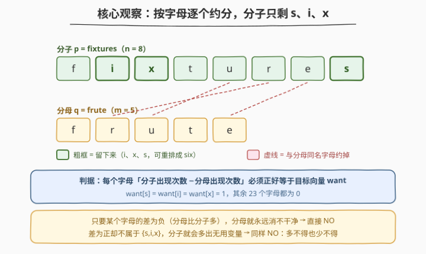
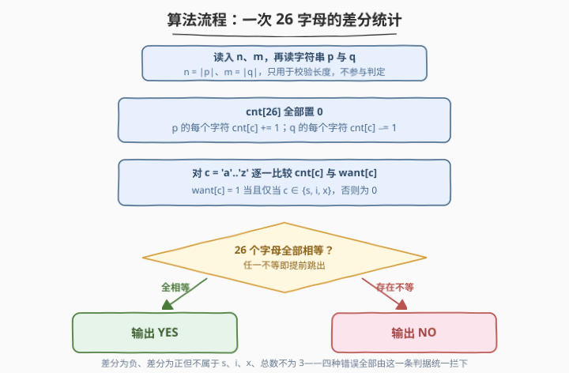
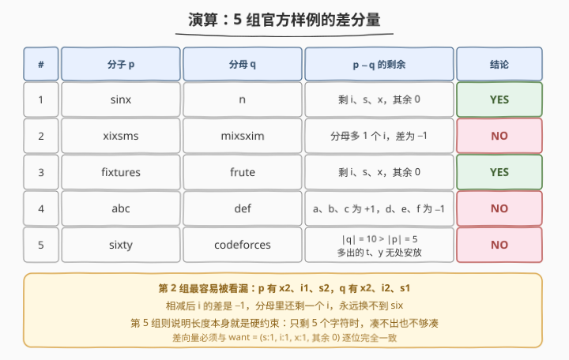

# Codeforces 2278A 分数与 six 题解

## 1. 题目概述

- **标题 / 题号**：分数与 six（Codeforces 2278A，英文名 Fraction and Six）
- **链接**：https://codeforces.com/problemset/problem/2278/A
- **来源**：Codeforces Round 1131 (Div. 3) · Problem A
- **难度**：未评级（Div. 3 签到题，约 800 档）
- **限制**：时间 1 s / 内存 256 MB
- **标签**：实现、排序、字符串

**题意**：给定两个仅含小写字母的字符串 $p$ 与 $q$，把 $p$ 看成分子上若干变量的乘积、$q$ 看成分母上若干变量的乘积，每个字符就是一个变量。乘法可交换，所以两边字母都能任意重排；同时分子与分母中**同名的变量可以相互抵消**，但一个分母字母只能抵消一个分子上的同名字母，反之亦然。问能否通过若干次抵消与重排，使分子剩下的变量恰好拼成字符串 `six`（即 $s,i,x$ 各一个），且分母**一个变量都不剩**。多测：首行组数 $t$，每组给出 $n,m$、字符串 $p$（长 $n$）与 $q$（长 $m$），逐组输出 `YES` / `NO`。

**约束**：

- $1 \le t \le 100$
- $1 \le n, m \le 100$，字符串只含小写英文字母
- 抵消与重排次数不限，但**只能**抵消同名字母；分母必须彻底清空
- 每个字母的净出现次数落在 $[-100, 100]$，`int` 足够；总字符量 $\le 2\times10^4$
- 答案大小写不敏感（`YES` / `yes` / `Yes` 均判对）

## 2. 示例与观察
官方样例（输入 / 输出原样）：

```text
输入：
5
4 1
sinx
n
6 7
xixsms
mixsxim
8 5
fixtures
frute
3 3
abc
def
5 10
sixty
codeforces

输出：
YES
NO
YES
NO
NO
```

再补几组自造数据（非官方，专打「每个字母都要正好对上」这条）：`ssiixx` 配 `six` → `YES`（每字母各剩一个）；`sixq` 配 `q` → `YES`；`sii` 配 `i` → `NO`（缺 `s` 与 `x`）；`six` 配 `six` → `NO`（分母还留着一整套字母）。

## 3. 解题思路

### 3.1 暴力思路

最直接的想法是「真的去试所有抵消方案」：枚举分子里每个字母与分母里哪个字母配对，配对完再检查剩余分子能否重排成 `six`。配对方案数是 $n!/(n-m)!$ 量级，$n=m=100$ 时是天文数字。

即便退一步、只枚举「每个字母各抵消几个」，写法也会退化成对 26 个字母各写一段 if-else 的碎片逻辑，边界多、极易漏判。数据范围告诉我们：这里根本不需要枚举，需要的是把「能约必约」这一事实翻译成**计数**。

### 3.2 核心观察：把变量看成 26 个计数器



两件互相独立的事：

1. **重排**是自由的（乘法交换律），所以「变量在第几位」完全不重要，只有**每个字母出现多少次**重要；
2. **约分**只发生在同名变量之间，且一对一，所以每种字母的抵消量**互相独立**——抵消 `a` 不会影响 `s` 的个数。

于是整个问题坍缩成 26 个整数的比较。记 $\text{diff}[c] = \text{cnt}_p[c] - \text{cnt}_q[c]$（$c$ 取 `a`..`z`），并预先写好目标向量

$$\text{want}[c] = \begin{cases} 1, & c \in \{\texttt{s},\texttt{i},\texttt{x}\} \\ 0, & \text{其他} \end{cases}$$

**关键一步**：终态要求分母为空，意味着分母里的每个 `c` 都必须被抵消掉，所以 `c` 的抵消量被**唯一确定为** $\text{cnt}_q[c]$，没有任何选择余地。因此终态分子中 `c` 的个数只能是

$$\text{cnt}_p[c] - \text{cnt}_q[c] = \text{diff}[c]$$

**判据：对所有 26 个字母都有 $\text{diff}[c] = \text{want}[c]$，当且仅当答案 YES。**

这条判据一次性覆盖了四类错误，所以不需要任何特判：

| 错误类型 | 被哪一位拦住 |
|----------|--------------|
| 分母比分子多的字母 | 该位 $\text{diff}[c] < 0$，而 $\text{want}[c] \ge 0$ |
| 约完还剩无关字母（如 `a`） | 该位 $\text{diff}[c] > 0$，而 $\text{want}[c] = 0$ |
| `s`/`i`/`x` 少了一个 | 该位 $\text{diff}[c] = 0$，而 $\text{want}[c] = 1$ |
| `s`/`i`/`x` 多了一个 | 该位 $\text{diff}[c] \ge 2$，而 $\text{want}[c] = 1$ |

> 💡 换个说法：把 $q$ 的字母从 $p$ 里**逐个划掉**，剩下的多重集合必须恰好是 $\{s,i,x\}$。也可以先把两串排序、再用双指针一一划掉（题目标签里的 sortings 指的就是这条路，复杂度 $O((n+m)\log(n+m))$）；三种偷懒写法都会 WA——只看 $n-m=3$（`aaaa` 减 `a` 也满足）、只看 $q \subseteq p$（`aaab` 减 `a` 剩 `aab`）、只看 $p$ 里有 `s,i,x`（完全不管分母）。

### 3.3 算法流程



1. 读入 $n, m$（只用于确认长度，不参与判定），再读 $p$、$q$；
2. 把计数器 `cnt[26]` 清零；扫 $p$ 时对每个字符 `cnt[c-'a'] += 1`，扫 $q$ 时 `cnt[c-'a'] -= 1`；
3. 对 $c=$ `a`..`z` 逐一比较 `cnt[c]` 与 `want[c]`，一旦不等就置 `ok = false` 并跳出；
4. 输出 `ok ? "YES" : "NO"`；
5. 进入下一组（计数器在第 2 步重新清零）。

每组只有一次 $O(n+m)$ 的扫描，加上固定 26 次比较；没有排序、没有递归、没有额外数组。

### 3.4 示例演算



| 组 | $p$ | $q$ | 差分明细 | 结论 |
|----|-----|-----|----------|------|
| 1 | `sinx` | `n` | `s`、`i`、`x` 各 $1$，其余 $0$ | YES |
| 2 | `xixsms` | `mixsxim` | `i`、`m` 为 $-1$，`s` 为 $+1$ | NO |
| 3 | `fixtures` | `frute` | `s`、`i`、`x` 各 $1$，其余 $0$ | YES |
| 4 | `abc` | `def` | `a`、`b`、`c` 为 $+1$，`d`、`e`、`f` 为 $-1$ | NO |
| 5 | `sixty` | `codeforces` | `s` 为 $0$，`i`、`x`、`t`、`y` 为 $+1$，其余为负 | NO |

第 2 组是本题最隐蔽的坑：$p$ 里 `x` 有 2 个、`i` 有 1 个、`s` 有 2 个，$q$ 里 `x` 有 2 个、`i` 有 2 个、`s` 有 1 个，两边的 `x` 恰好抵消干净、看起来「很像」，但 `i` 在分母多出一个，永远消不掉。第 5 组则说明长度本身就是硬约束：$p$ 只有 5 个字符，光目标就要 3 个，$q$ 还长达 10。

## 4. 算法细节

1. **多测清空**：`cnt` 必须在**每组开头**重新置零。写 `int cnt[26] = {0};` 放在循环体内最安全；若提到循环外，务必用 `memset(cnt, 0, sizeof cnt)` 或 `fill` 手工清零，否则上一组的计数会污染本组。
2. **want 只算一次**：可以预存 `int want[26]`（`want['s'-'a'] = want['i'-'a'] = want['x'-'a'] = 1`），也可以像参考代码那样在循环里用一条三元表达式算出 `want`，两者都只用一次比较。切忌在循环体里摊开成三段 `if (c == ...)`，那样容易把 `s` 与 `z`、`i` 与 `l` 的写法抄错。
3. **先读完再判断**：本题的读入（`p`、`q`）在判断之前完成，所以可以在比较时随时 `break`；若换成边读边判的写法，就必须保证跳过剩余输入，否则后续组会整体错位。
4. **长度可不参与运算**：题面保证字符串长度与 $n, m$ 一致，所以读到 $n,m$ 后可以直接忽略它们。用 `cin >> p >> q` 读字符串本身就会以空白为界，直接读即可；不要用 `getline`（会读到行尾残留的换行）。
5. **整数范围**：$\text{cnt} \in [-100, 100]$，`int` 绰绰有余，不需要 `long long`；也没有任何乘法，不存在溢出。
6. **字符映射**：题面保证只有小写字母，`c - 'a'` 落在 $[0,25]$。若混入大写字母必须先 `tolower`，否则会数组越界——本题不需要，但这是同类题的常见崩点。
7. **I/O**：$t \le 100$、总字符量 $\le 2\times10^4$，计算只有几万次操作，运行时间几乎全被进程启动占据——`std::ios::sync_with_stdio(false)` 加 `cin.tie(nullptr)` 后整份输入毫秒级读完；Python 用 `sys.stdin.buffer.read().split()` 一次读完、列表 `join` 后统一输出，比逐行 `print` 快一个量级。

## 5. 正确性证明

**引理 1（抵消量被唯一确定）**：若存在一系列合法抵消使终态分母为空，则对每个字母 $c$，被抵消掉的 $c$ 的个数必为 $\text{cnt}_q[c]$，从而必须有 $\text{cnt}_q[c] \le \text{cnt}_p[c]$，且终态分子中 $c$ 的个数为 $\text{diff}[c]$。

**证明**：设字母 $c$ 一共被抵消了 $k_c$ 次。每次抵消消耗一个分子上的 $c$ 与一个分母上的 $c$，故分母中 $c$ 的个数由 $\text{cnt}_q[c]$ 变为 $\text{cnt}_q[c] - k_c$。终态分母为空，故 $\text{cnt}_q[c] - k_c = 0$，即 $k_c = \text{cnt}_q[c]$。又每次抵消都要从分子取走一个 $c$，所以 $k_c \le \text{cnt}_p[c]$；终态分子中 $c$ 的个数为 $\text{cnt}_p[c] - k_c = \text{diff}[c]$。∎

**引理 2（重排可达性）**：若终态分子中字母的多重集合为 $A$ 且 $|A| = 3$，则 $A = \{s,i,x\}$ 当且仅当 $A$ 中的字母可以重排成字符串 `six`。

**证明**：字符串 `six` 的字母多重集合正是 $\{s,i,x\}$。（$\Leftarrow$）若可重排成 `six`，则该多重集合就是 $\{s,i,x\}$。（$\Rightarrow$）若 $A = \{s,i,x\}$，取 $s,i,x$ 各一个按此顺序排列即得 `six`，而乘法交换律允许任意重排。∎

**引理 3（判据即循环不变量）**：算法输出 `YES` 当且仅当对一切 $c \in [\texttt{a},\texttt{z}]$ 有 $\text{diff}[c] = \text{want}[c]$。

**证明**：算法先算出全部 $\text{diff}[c]$，随后遍历 26 个下标，仅在每一位都相等时保持 `ok` 为真。任何一位不等都会把 `ok` 置假，且不存在把假改回真的语句，故输出为 `YES` 恰好等价于「26 位全相等」。∎

**定理**：算法输出 `YES` 当且仅当存在合法的抵消与重排序列，使分子恰为 `six`、分母为空。

**证明**：

- （$\Leftarrow$）设存在这样的序列。由引理 1，每个字母都满足 $\text{diff}[c] = \text{cnt}_p[c] - \text{cnt}_q[c] \ge 0$，且终态分子中 $c$ 的个数就是 $\text{diff}[c]$。又终态分子恰为 `six`，故 $\text{diff}[\texttt{s}] = \text{diff}[\texttt{i}] = \text{diff}[\texttt{x}] = 1$，其余字母 $\text{diff}[c] = 0$，即 26 位与 `want` 全等。由引理 3，算法输出 `YES`。
- （$\Rightarrow$）设算法输出 `YES`，则由引理 3 知 $\text{diff}[c] = \text{want}[c]$ 对一切 $c$ 成立，特别地 $\text{diff}[c] \ge 0$，即 $\text{cnt}_q[c] \le \text{cnt}_p[c]$。于是可以把分母中的**每一个**字符都找到一个分子上的同名字母与之抵消（同名配对，逐字母独立，总量刚好够）：抵消后分母为空，分子剩下 $\text{diff}[c]$ 个 $c$，即 $s,i,x$ 各一个、别无他物。由引理 2，这个多重集合可以重排成 `six`。故这样的序列存在。∎

## 6. 复杂度分析

- **时间**：每组 $O(n + m + 26) = O(n + m)$，总复杂度 $O\bigl(\sum (n_i + m_i) + 26t\bigr)$。最大数据（$t=100$、每组 $n=m=100$）下总字符量 $2\times10^4$、比较次数 $2600$；C++ 实测（含进程启动）中位数约 **4.5 ms**，Python 约 **27 ms**，相对 1 s 时限仍有 30 倍以上余量。
- **空间**：$O(26)$ 的计数器（外加存放两个字符串的 $O(n+m)$）。没有任何辅助数据结构、没有排序、没有递归，栈占用可忽略。

## 7. 参考代码

### C++17

```cpp
#include <iostream>
#include <string>
using namespace std;

int main() {
    ios::sync_with_stdio(false);
    cin.tie(nullptr);

    int t;
    if (!(cin >> t)) return 0;               // 空输入防护
    while (t--) {
        int n, m;
        cin >> n >> m;                        // 长度只用于读题面格式，不参与判定
        string p, q;
        cin >> p >> q;

        int cnt[26] = {0};                    // 每组都必须重新清零
        for (char c : p) cnt[c - 'a']++;
        for (char c : q) cnt[c - 'a']--;

        bool ok = true;
        for (int c = 0; c < 26; c++) {
            int want = (c == 's' - 'a' || c == 'i' - 'a' || c == 'x' - 'a') ? 1 : 0;
            if (cnt[c] != want) { ok = false; break; }
        }
        cout << (ok ? "YES" : "NO") << "\n";
    }
    return 0;
}
```

### Python3

```python
import sys


def main() -> None:
    data = sys.stdin.buffer.read().split()
    if not data:
        return
    t = int(data[0])
    pos = 1
    out = []
    for _ in range(t):
        n = int(data[pos])
        m = int(data[pos + 1])
        pos += 2
        p = data[pos].decode()
        q = data[pos + 1].decode()
        pos += 2

        cnt = [0] * 26                       # 每组新建，天然清空
        for ch in p:
            cnt[ord(ch) - 97] += 1
        for ch in q:
            cnt[ord(ch) - 97] -= 1

        ok = True
        for c in range(26):
            want = 1 if chr(97 + c) in "six" else 0
            if cnt[c] != want:
                ok = False
                break
        out.append("YES" if ok else "NO")
    sys.stdout.write("\n".join(out) + "\n")


main()
```

## 8. 边界情况与易错点

1. **分母比分子长**（如样例 5 的 $m=10 > n=5$）：必然有字母 $\text{diff}[c] < 0$，判据自动输出 `NO`；但若改用「从 $p$ 里逐个划掉 $q$ 的字母」的写法却不判存在性，计数会被减成负数，甚至踩到数组边界。
2. **两串完全相同**：此时全部 $\text{diff}[c] = 0$，即使 $p$ 本身就是 `six` 也必须是 `NO`——因为分母还留着一整套字母没消掉。这是「看似成功其实失败」的高频陷阱。
3. **`p` 是 `six` 的重排但 `q` 非空**：如 $p=\texttt{xis}$、$q=\texttt{a}$，$\text{diff}[\texttt{a}] = -1$ → `NO`；只有当 $q$ 中的字母全部能在 $p$ 里找到同名配对时才可能 `YES`。
4. **字母重复**：`sinx` 与 `n`（样例 1）说明重复字母按个数算；`ssiixx` 与 `six` 说明「每个字母都多一个」仍然合法。不要用 `set` 做判定——集合丢掉重数后 `siix` 与 `six` 看起来完全一样，会把本应 `NO` 的输入误判成 `YES`。
5. **误用长度条件**：$n - m = 3$ 只是**必要条件**。`aaaa` 与 `a` 满足 $4-1=3$，但差分是 `a:3`，答案 `NO`。必须逐位比较身份，不能只看长度差。
6. **多测残留**：把 `cnt` 定义在 `while (t--)` 之外又忘了清零，第二组起就会带着上一组的计数，表现为「本地小样例对、多测全错」。
7. **输出格式**：每组恰好一行，组间不要空行；`t` 组必须都输出，不要在 `break` 之后误把整组输入跳过却少打一行输出。
8. **空输入**：个别环境会给空文件，C++ 用 `if (!(cin >> t)) return 0;`、Python 先判 `if not data: return`，避免 `int(b'')` 抛异常。

## 9. 验证记录

- **编译环境与命令**：`clang++ -std=c++17 -O2`（本机无 GNU g++，配 `codeforces/tools/include/bits/stdc++.h` 兼容头；正文代码只用标准库，可原样提交 GNU C++17）；Python 侧为 `Python 3.9.6`。
- **官方样例**：1 / 1 通过（按 Codeforces 标准 checker 的 token 比对，忽略空白与大小写）。
- **复核状态**：audited（2026-11-19 统一回归：编译 + 官方样例；写作期的随机对拍与暴力未重跑）。

## 相关题目与扩展

- [Codeforces 1703A YES or YES?](https://codeforces.com/problemset/problem/1703/A)：Div. 4 签到题，同样考「大小写不敏感的字符串判定」这一类基本功。
- [Codeforces 1760A Medium Number](https://codeforces.com/problemset/problem/1760/A)：同一类「读入 → 一次常数判定 → 逐组输出」的多测热身题。
- [LeetCode 383. 赎金信](https://leetcode.cn/problems/ransom-note/)：判定 $\text{cnt}_q[c] \le \text{cnt}_p[c]$ 对全部字母成立，正是本题判据中「分母不能多」的那一半。
- [LeetCode 242. 有效的字母异位词](https://leetcode.cn/problems/valid-anagram/)：要求两个计数数组**完全相等**，对应本题 $\text{diff} \equiv 0$ 的特例。
- [LeetCode 49. 字母异位词分组](https://leetcode.cn/problems/group-anagrams/)：把「多重集合相等」当作等价关系做分类，是本题判据的直接推广。

**延伸思考**：

1. **目标串任意化**：若目标不是固定的 `six` 而是给定串 $w$，把 `want` 换成 $\text{cnt}_w$ 即可，判据与复杂度一字不变（$O(n+m+|w|+26)$）。
2. **多个候选目标**：若同时接受 `six` 与 `nine` 等若干个候选串，只需在 26 位向量层面把候选逐个比较，仍是常数级开销。
3. **变量带指数**：若输入写成 `a3b2` 表示 $a^3b^2$，则计数器从「次数」升级为「指数和」，判据变成指数向量相等，`int` 仍够用；若指数可到 $10^{18}$，才需要 `long long`。
4. **最少抵消步数**：合法终态下被抵消的总数是 $\sum_c \text{cnt}_q[c] = m$，与顺序无关；若改成「允许分母留字母」的分数形式，则问题变成最大化抵消量 $\sum_c \min(\text{cnt}_p[c], \text{cnt}_q[c])$，那才是真正需要选择的地方。
5. **字母表扩大**：从 26 个小写字母扩到全部 ASCII 只需把桶开到 128；扩到 Unicode 则改用 `unordered_map`，此时「一次扫描」的时间从 $O(26)$ 变成 $O(\text{不同字符数})$。
