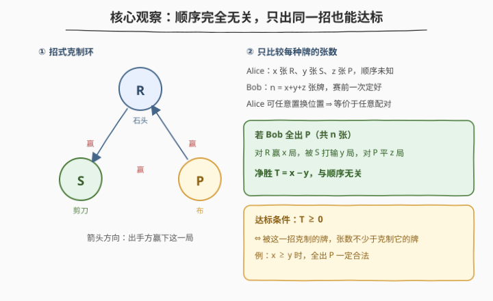
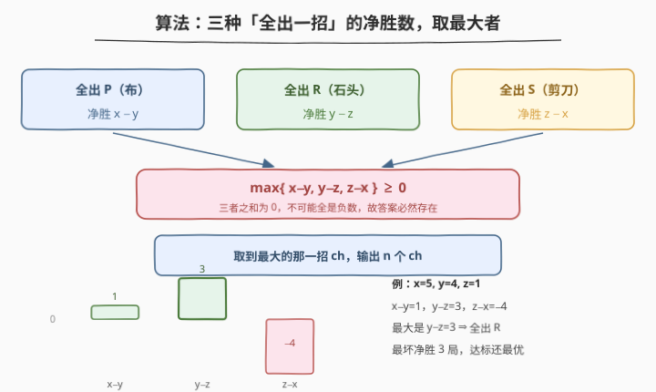
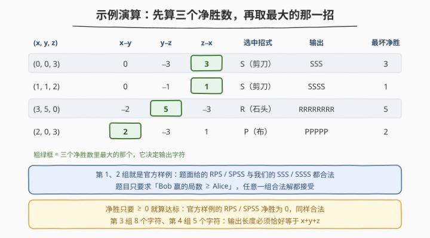

# Codeforces 2278B 赌注与形状 题解

## 1. 题目概述

- **标题 / 题号**：赌注与形状（Codeforces 2278B，英文名 Stakes and Shapes）
- **链接**：https://codeforces.com/problemset/problem/2278/B
- **来源**：Codeforces Round 1131 (Div. 3) · Problem B
- **难度**：未评级（Div. 3 Problem B，rating 未公布）
- **限制**：时间 2 s / 内存 256 MB
- **标签**：构造、贪心、最坏情况分析

**题意**：Alice 与 Bob 玩石头剪刀布，共 $n = x+y+z$ 局。Alice 会出 $x$ 次石头 `R`、$y$ 次剪刀 `S`、$z$ 次布 `P`，但**出场顺序未知**。Bob 必须在开局前把 $n$ 局的出招**一次性全部定好**（写成一个长度为 $n$ 的 `R/S/P` 串），然后 Alice 才按她的某种顺序出牌。要求：无论 Alice 采用哪一种顺序，Bob 赢的局数都**不少于** Alice 赢的局数（平局不计数）。输出任意一个满足要求的字符串；题面保证这样的串一定存在。多测：首行组数 $t$，每组一行三个整数 $x,y,z$，逐组输出一个长度为 $x+y+z$ 的串。

**约束**：

- $1 \le t \le 1000$
- $0 \le x, y, z \le 100$，且 $x+y+z > 0$
- 输出串长度必须**恰好**为 $n$，且只含大写 `R`、`S`、`P`
- 输出总量不超过 $3\times 10^5$ 个字符，$x,y,z$ 本身很小，任何多项式做法都够用
- 关键难点不在数据量，而在「顺序未知 + 一次定好」这两个限定

## 2. 示例

官方样例（输入 / 输出原样）：

```text
输入
2
0 0 3
1 1 2

输出
RPS
SPSS
```

官方样例 1 的说明：Alice 只能出 3 次布，Bob 出 `RPS`——石头输 1 局、剪刀赢 1 局、布平 1 局，净胜 $0$，达标。注意答案是**任意**合法串，`SSS` 同样合法（赢 3 局）。

再补几组自造数据（非官方，我们的构造输出，合法即得分）：

```text
输入
3
3 5 0
2 0 3
1 1 1

输出
RRRRRRRR
PPPPP
SSS
```

- 第 1 组：Alice 有 5 张剪刀、0 张布，全出石头 → 最坏净胜 $5-0=5$；
- 第 2 组：Alice 有 2 张石头、0 张剪刀，全出布 → 最坏净胜 $2-0=2$；
- 第 3 组：三张牌各一张，全出剪刀 → 赢 1（打布）输 1（被石头打），最坏净胜 $0$，**刚刚好达标**。

## 3. 解题思路

### 3.1 暴力思路

最直接的做法是枚举 Bob 的全部 $3^n$ 个串，再对每个串枚举 Alice 的全部顺序（多重集合排列数 $n!/(x!y!z!)$）检验一遍。$n=300$ 时前者是 $3^{300}$、后者是 $10^{140}$ 量级，完全不可行；即便只想「判断某个串是否合法」，也还得先解决「怎么求 Alice 的最坏配对」这个子问题。

真正的出路是两步**降维**：

1. 把「顺序」彻底扔掉——Bob 只关心自己每种牌各出多少张；
2. 把「最坏配对」变成一个只需计数就能算的表。

### 3.2 核心观察：只出同一种牌



**第一步降维（顺序无关）**：Alice 的每一种顺序，等价于把她的 $n$ 张牌在 $n$ 个位置上做一个置换。Bob 的串一旦固定，任何一个「符合 Alice 计数的配对」都能由某个 Alice 顺序实现，反之亦然。所以

> 最坏结果只取决于 Bob 每种牌的张数 $(a,b,c)$，与 Bob 的排列无关。

换句话说，Bob 只要决定「出几张石头、几张剪刀、几张布」，具体顺序怎么排都一样（写答案时随便排即可）。

**第二步：全出同一种牌，净胜数就是一个差**。设 Bob 全出布（$n$ 张）。Bob 的每张布遇到 Alice 的石头就赢（$+1$）、遇到剪刀就输（$-1$）、遇到布就平（$0$）。Alice 的 $x$ 张石头、$y$ 张剪刀、$z$ 张布最终都会被配上，于是**无论怎么配**

$$T = x - y,$$

与 Alice 的顺序**完全无关**。同理：

| Bob 全出 | 打赢谁 | 被打输给谁 | 最坏净胜 $T$ |
|----------|--------|------------|--------------|
| 布 `P` | 石头 `R`（$x$ 张） | 剪刀 `S`（$y$ 张） | $x-y$ |
| 石头 `R` | 剪刀 `S`（$y$ 张） | 布 `P`（$z$ 张） | $y-z$ |
| 剪刀 `S` | 布 `P`（$z$ 张） | 石头 `R`（$x$ 张） | $z-x$ |

这就是本题最省事的一招：**不去搭配，直接把 $n$ 张牌全出成同一种**，净胜数立刻变成两个计数之差。

> 💡 等价说法（鸽巢视角）：设 Alice 出现最多的那一招有 $m$ 张，Bob 就全出「克制它的那一招」。Bob 赢 $m$ 局，而能打输他的那一招出现次数 $\le m$（因为 $m$ 是全局最大值），于是净胜 $= m - (\text{能打输他的那一招张数}) \ge 0$。这条直觉与下面「三个差值取最大」是同一件事的两种讲法：前者已经能保证达标，后者还能顺手把净胜抬到理论最优。

### 3.3 算法流程：三个差值取最大



有了上表，算法只剩三行算术：

1. 算出三个候选净胜：$d_1 = x-y$（全出 `P`）、$d_2 = y-z$（全出 `R`）、$d_3 = z-x$（全出 `S`）；
2. 取三者中最大者，记它对应的招式为 `ch`；
3. 输出 $n$ 个 `ch`。

**为什么一定有解**：三个差值满足 $d_1+d_2+d_3 = (x-y)+(y-z)+(z-x) = 0$。三个数之和为 $0$，不可能全部为负，所以 $\max\{d_1,d_2,d_3\} \ge 0$——这正好解释了题面「保证存在合法串」的承诺，也说明**永远不需要特判无解**。

**顺带一提：这个贪心还是最优的**。不仅合法，它保证的净胜数 $\max\{d_1,d_2,d_3\}$ 已经是任何策略（包括混合出牌）能达到的最大值。直觉是：若 Bob 混合出牌，Alice 随机均匀配对时 Bob 的期望净胜是三种差值的加权平均，加权平均不超过最大者，所以「混合」只会摊薄优势（完整证明见 §5 引理 3 与定理 2）。因此本题答案是「纯策略即最优」的一个干净例子。

### 3.4 示例演算



| $(x,y,z)$ | $x-y$ | $y-z$ | $z-x$ | 选中 | 输出 | 最坏净胜 |
|-----------|-------|-------|-------|------|------|----------|
| $(0,0,3)$ | $0$ | $-3$ | $\mathbf{3}$ | `S` | `SSS` | $3$ |
| $(1,1,2)$ | $0$ | $-1$ | $\mathbf{1}$ | `S` | `SSSS` | $1$ |
| $(3,5,0)$ | $-2$ | $\mathbf{5}$ | $-3$ | `R` | `RRRRRRRR` | $5$ |
| $(2,0,3)$ | $\mathbf{2}$ | $-3$ | $1$ | `P` | `PPPPP` | $2$ |

前两行就是官方样例：题面给的 `RPS`（净胜 $0$）、`SPSS`（净胜 $0$）与我们的 `SSS`（净胜 $3$）、`SSSS`（净胜 $1$）都合法——题目只要求「Bob 赢的局数 $\ge$ Alice 赢的局数」，既不要求唯一答案，也不要求净胜取到最大。第 1 行算出的 $3$ 恰好就是 $D$：全出剪刀时赢下 Alice 的 3 张布，一局不输；第 2 行赢 2 输 1，净胜 $1$，同样等于 $D$。

## 4. 算法细节

1. **多测读入**：每组只读三个整数，用 `cin >> x >> y >> z`（Python 用 `split()` 后的指针）即可，不要用 `getline`，否则行尾换行会导致后续组整体错位；读完立刻计算并输出，不需要存任何数组。
2. **整数范围**：$d_i \in [-100,100]$，`int` 足够，不需要 `long long`，更不要用浮点；用浮点比较三个整数差值是纯粹的自我伤害。
3. **取最大用严格 `>`**：三个 `if` 的顺序不影响正确性（三个差值中最大的那个一定会被选中）；用 `>` 而不是 `>=` 可以在并列时稳定地选第一个，避免「最后一个赋值」带来的隐性依赖。
4. **构造输出**：C++ 用 `string(n, ch)` 一次性申请再输出；Python 用 `ch * n`。千万不要在循环里 `s += ch`（C++ 会反复扩容，Python 会退化成 $O(n^2)$）。
5. **长度必须精确**：输出恰好 $n$ 个字符。`string(n, ch)` 与 `ch * n` 天然保证长度；若手写循环，务必用 `n` 而不是 $x$ 或 $y$ 当上界。
6. **大小写与字符集**：只能输出大写 `R`、`S`、`P`，不要输出小写、数字或空格分隔符；每个测试点一行。
7. **不要特判无解**：由 $d_1+d_2+d_3=0$ 可知 $\max \ge 0$ 恒成立；写 `if (best < 0) ...` 之类的分支纯属多余，还可能掩盖逻辑错误。
8. **I/O 优化**：$t \le 1000$、总输出 $\le 3\times 10^5$ 字符，`std::ios::sync_with_stdio(false)` 加 `cin.tie(nullptr)` 后毫秒级完成；Python 用 `sys.stdin.buffer.read().split()` 一次读完、`"\n".join(out)` 一次写出。
9. **空输入防护**：个别评测环境会给空文件，C++ 用 `if (!(cin >> t)) return 0;`，Python 先判 `if not data: return`，避免 `int(b'')` 抛异常。

## 5. 正确性证明

记 Bob 的串含 $a$ 张 `R`、$b$ 张 `S`、$c$ 张 `P`（$a+b+c=n$），Alice 的计数为 $(x,y,z)$，净胜 $T = (\text{Bob 赢的局数}) - (\text{Alice 赢的局数})$。

**引理 1（顺序无关）**：给定 $(a,b,c)$，Alice 的所有出牌顺序所对应的配对集合，恰好等于所有「把 Bob 的牌与 Alice 的牌一一配对」的方案集合；因此最坏净胜只依赖 $(a,b,c)$，与 Bob 的排列无关。

**证明**：任一 Alice 顺序给出一个双射：第 $i$ 个位置上的 Bob 牌与第 $i$ 个位置上的 Alice 牌配对，且 Alice 侧恰好用了 $x,y,z$ 张。反过来，任给一个满足该计数约束的双射，把配到第 $i$ 个位置的 Alice 牌放在第 $i$ 位，就得到一个合法的 Alice 顺序。两个方向互逆，故两个集合相同，最坏值自然只与计数有关。∎

**引理 2（纯策略的净胜被唯一确定）**：若 Bob 全出 `P`，则对任意配对都有 $T = x-y$；全出 `R` 时 $T = y-z$；全出 `S` 时 $T = z-x$。

**证明**：以全出 `P` 为例。每张 `P` 与 Alice 的 `R` 配对得 $+1$，与 `S` 配对得 $-1$，与 `P` 配对得 $0$。Alice 的 $x$ 张 `R`、$y$ 张 `S`、$z$ 张 `P` 全部被配完，故 $T = x\cdot(+1) + y\cdot(-1) + z\cdot 0 = x-y$，与具体配对无关。其余两行同理（`R` 对 `S` 得 $+1$、对 `P` 得 $-1$；`S` 对 `P` 得 $+1$、对 `R` 得 $-1$）。∎

**引理 3（上界：混合出牌不能更好）**：对任意 $(a,b,c)$，Alice 都存在一种配对使
$$T \le D = \max\{x-y,\; y-z,\; z-x\}.$$

**证明**：令 Alice 在所有合法配对中**均匀随机**地取一个。对 Bob 的任意一张 `R`，它与 Alice 某张 `S` 配对的概率是 $y/n$、与某张 `P` 配对的概率是 $z/n$，故这一张的期望贡献为 $(y-z)/n$；同理每张 `S` 贡献 $(z-x)/n$，每张 `P` 贡献 $(x-y)/n$。由期望的线性性
$$\mathbb{E}[T] = \frac{a(y-z) + b(z-x) + c(x-y)}{n}.$$
三个系数之和为 $(y-z)+(z-x)+(x-y)=0$，而 $a/n,\,b/n,\,c/n$ 非负且和为 $1$，所以上式是三个系数的**加权平均**，不超过其中的最大值 $D$。一个随机变量的期望不超过 $D$，说明至少存在一个取值 $\le D$ 的配对，即最小净胜 $\le D$。∎

**引理 4（一定有非负解）**：$D \ge 0$。

**证明**：$(x-y)+(y-z)+(z-x) = 0$。若三者全部 $<0$，则其和 $<0$，矛盾；故至少一个 $\ge 0$，即 $D \ge 0$。∎

**定理 1（算法输出合法）**：算法输出的串满足「无论 Alice 什么顺序，Bob 赢的局数 $\ge$ Alice 赢的局数」。

**证明**：算法挑出最大的差值 $D$ 及其对应招式 `ch`，输出 $n$ 个 `ch`。由引理 2，该串在最坏配对下的净胜恰为 $D$；由引理 4，$D \ge 0$。而引理 1 说明最坏配对覆盖了 Alice 的所有顺序，故对一切顺序都有 $T \ge 0$，即 Bob 赢的局数不少于 Alice。∎

**定理 2（最优性）**：任何策略能保证的净胜都不超过 $D$，而算法恰好达到 $D$。

**证明**：上界由引理 3 给出（对任意 $(a,b,c)$ 成立，因而不论 Bob 怎么设计混合方案都逃不出 $D$）；达到性由引理 2 给出：若 $D = x-y$ 就全出 `P`，若 $D = y-z$ 就全出 `R`，若 $D = z-x$ 就全出 `S`，算法正是这么做的。两边夹住，最优值为 $D$。∎

## 6. 复杂度分析

- **时间**：每组 $O(1)$ 次算术 + $O(n)$ 的输出构造，合计 $O(n)$；总时间 $O\bigl(\sum (x_i+y_i+z_i)\bigr) \le 3\times 10^5$ 次字符写入。$O(n)$ 是**输出本身的长度下界**，不可能更优。
- **空间**：除输出缓冲（C++ 的一个 `string`、Python 的列表）外只用 $O(1)$ 个整数，即 $O(n)$ 输出空间、$O(1)$ 额外空间。
- **实测**：最大约束（$t=1000$，每组 $x=y=z=100$，共 $3\times10^5$ 个输出字符）下，C++ 多次运行 **6–16 ms**、Python **28–60 ms**（均含进程启动），相对 2 s 时限有 30 倍以上余量。

## 7. 参考代码

### C++17

```cpp
#include <iostream>
#include <string>
using namespace std;

int main() {
    ios::sync_with_stdio(false);
    cin.tie(nullptr);

    int t;
    if (!(cin >> t)) return 0;                       // 空输入防护
    while (t--) {
        int x, y, z;
        cin >> x >> y >> z;
        int n = x + y + z;

        // 三种「全出一招」方案的最坏净胜：P -> x-y，R -> y-z，S -> z-x
        int best = x - y;
        char bob = 'P';                             // 全出布：赢 x 局石头，输 y 局剪刀
        if (y - z > best) { best = y - z; bob = 'R'; }   // 全出石头
        if (z - x > best) { best = z - x; bob = 'S'; }   // 全出剪刀
        cout << string(n, bob) << "\n";
    }
    return 0;
}
```

### Python3

```python
import sys


def main() -> None:
    data = sys.stdin.buffer.read().split()
    if not data:
        return
    t = int(data[0])
    pos = 1
    out = []
    for _ in range(t):
        x = int(data[pos]); y = int(data[pos + 1]); z = int(data[pos + 2])
        pos += 3
        n = x + y + z
        # 三种「全出一招」方案的最坏净胜：P -> x-y，R -> y-z，S -> z-x
        best, bob = x - y, 'P'
        if y - z > best:
            best, bob = y - z, 'R'
        if z - x > best:
            best, bob = z - x, 'S'
        out.append(bob * n)
    sys.stdout.write("\n".join(out) + "\n")


main()
```

## 8. 边界情况与易错点

1. **净胜为 0 也算达标**：$(1,1,1)$ 输出 `SSS` 时赢 1 输 1，很多人在赛场上会误以为必须严格多赢而去加特判，反而写错。题目只要 $\ge$。
2. **某个计数为 0**：如 $(0,0,3)$、$(3,0,0)$。此时对应差值是 $0$ 或正数，算法照常输出纯串即可；不要写「三种牌都必须出现」这类想当然的构造。
3. **三个计数相等**：$(m,m,m)$ 的三个差值都是 $0$，$D=0$，输出任意纯串都合法但净胜只有 $0$——这正是本题的答案下界，别期待更高。
4. **并列最大不会出错**：差值并列时严格 `>` 只保留先出现的那个，仍是最大者，仍最优；若改成 `>=` 也只是换了答案，不影响正确性。
5. **输出长度必须精确**：长度少一个字符会留下 Alice 的牌没配完、多一个字符则违背回合数；两种都是 WA，且往往只错个别测试点，很难用样例发现。
6. **字符必须大写、无分隔**：`rsp` 小写、`R S P` 带空格、每行输出多组答案都是格式错误（Presentation Error / WA）。
7. **多测残留与漏读**：$t$ 组必须逐组输出，不要用 `break` 提前跳出循环；用 `getline` 与 `>>` 混读会把换行当成数据，导致后续组整体错位。
8. **输出量**：$t=1000$、每组 300 字符时共 $3\times10^5$ 字节，Python 若逐字符 `print` 会明显变慢，必须 `join` 后一次写出。
9. **溢出**：本题所有中间量在 $[-100,100]$，不存在溢出；若把「净胜」改成「赢的局数减输的局数乘权重」之类才需要担心 `int` 范围。

## 相关题目与扩展

- [Codeforces 2278A 分数与 six](https://codeforces.com/problemset/problem/2278/A)：同一场次的签到题，都是「把题面翻译成计数」的套路。
- [Codeforces 2278C Math and Physics](https://codeforces.com/problemset/problem/2278/C)：同场 C 题，纯贪心定价，可与本题的「纯策略最优」对照阅读。
- [LeetCode 486. 预测赢家](https://leetcode.cn/problems/predict-the-winner/)：零和博弈的区间 DP，是「对手取最坏」的标准模型；本题把对手的任意性化成了计数差。
- [LeetCode 877. 石子游戏](https://leetcode.cn/problems/stone-game/)：另一个「先手必不败」的零和博弈，结论同样来自奇偶与计数层面。
- [LeetCode 2335. 装满杯子需要的最短总时长](https://leetcode.cn/problems/minimum-amount-of-time-to-fill-cups/)：三个计数上做贪心（配对 vs 多出来的部分），与本题「三个差值取最大」是同一类思维。

**延伸思考**：

1. **要求严格多赢**（Bob 的胜局 $>$ Alice 的胜局）：只需把判据从 $\max d_i \ge 0$ 改成 $\max d_i \ge 1$，即 $x,y,z$ **不全相等**。若三者全相等，则最优净胜恰为 $0$，此时无解——题面的「保证有解」就不再成立。
2. **招式数推广到 $k$ 个成环**：若 $k$ 种招式首尾相克（每招只克一招、只被一招克），则「全出第 $i$ 招」的净胜为「被它克制的招式张数 $-$ 克制它的招式张数」，$k$ 个差值之和仍为 $0$，故 $\max \ge 0$ 仍成立，纯策略依然最优；引理 3 的随机配对期望论证可以原样搬过去。
3. **克制关系不是环而是任意有向图**：随机配对的期望公式依然成立，但差值之和不再为 $0$，$\max \ge 0$ 可能失败，此时纯策略可能无解、必须混合出牌，问题从构造升级为矩阵博弈（可用线性规划求解）。
4. **Alice 能边打边看**：若改成 Bob 每轮看到 Alice 之前的出牌后再决定本轮的招（在线博弈），Bob 的信息更多、能保证的净胜更大，本题的顺序无关性不再适用。
5. **放大数据**：若 $x,y,z$ 可到 $10^{18}$，由于只需输出净胜值（而不必输出长度 $n$ 的串），公式与证明完全不变，$O(1)$ 即可回答。
