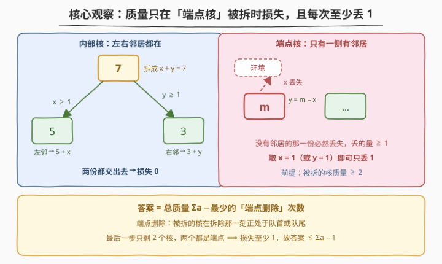
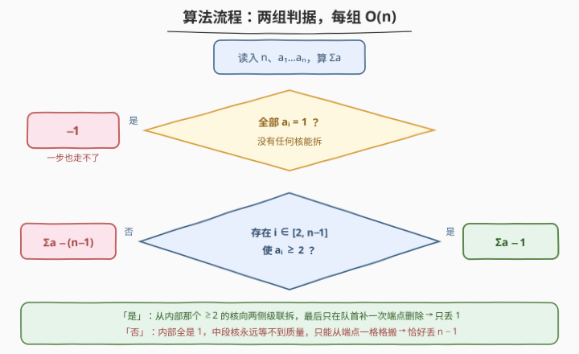
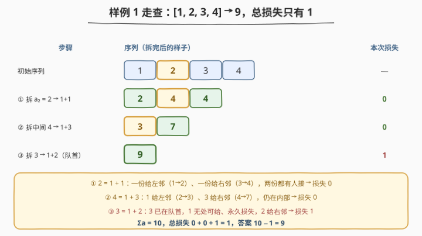

# Codeforces 2278C 数学与物理 题解

## 1. 题目概述

- **标题 / 题号**：数学与物理（Codeforces 2278C，英文名 Math and Physics）
- **链接**：https://codeforces.com/problemset/problem/2278/C
- **来源**：Codeforces Round 1131 (Div. 3) · Problem C（UTC 2026-10-31）
- **难度**：未评级（Div. 3 C，约 1200 档；场次数据未给 rating / points）
- **限制**：时间 2 s / 内存 256 MB
- **标签**：贪心

**题意**：一行上有 $n$ 个核，第 $i$ 个初始质量为 $a_i$。一次操作可以挑一个**当前质量 $\ge 2$** 的核，把它拆成两个正整数部分 $x,y$（$x+y=a_i$），该核消失、序列立刻收拢；$x$ 加到它的左邻居上、$y$ 加到右邻居上，若某一侧没有邻居，那一份就**永久损失**。当没有任何核可拆时过程停止。问能否最终恰好剩下一个核：能则输出这个核的**最大可能质量**，不能输出 `-1`。多测：首行 $t$，每组给出 $n$ 与 $a_1..a_n$，逐组输出一行答案。

**约束**：

- $1 \le t \le 10^4$，$2 \le n \le 2\times 10^5$，$\sum n \le 2\times 10^5$
- $1 \le a_i \le 1000$，所以总质量 $\sum a_i \le 2\times 10^8$（`int` 恰好够，仍建议 `long long`）
- 只有质量 $\ge 2$ 的核能拆；$x \ge 1, y \ge 1$，因此拆一个质量恰为 $2$ 的核只能取 $1+1$
- 答案要么是 `-1`，要么落在 $[1, \sum a_i]$ 内

## 2. 示例与观察
官方样例（输入 / 输出原样）：

```text
输入：
3
4
1 2 3 4
5
1 1 1 1 1
2
6 7

输出：
9
-1
12
```

再补几组自造数据（非官方，专打「内部有没有 $\ge 2$ 的核」这条分界线）：`1 1 2` → `2`（内部全 $1$，损失 $n-1=2$）；`1 1 5 1 1` → `8`（内部有 $5$，损失 $1$）；`1000 1 1000` → `1999`（内部只有一个 $1$，损失 $2$，答案 $2001-2$）。

## 3. 解题思路

### 3.1 暴力思路

最直白的搜索：状态是当前的质量序列，每步枚举「拆哪个核」以及「$x$ 取几」，递归到只剩一个核时取最大值。一步的分支数就有 $\sum (a_i-1)$，再乘上删除顺序，状态空间随 $n$ 指数爆炸——$n=2\times10^5$ 时连一个样例都跑不完。

而且「拆哪个」其实是个假选择：$x$ 的取值只影响**质量怎么分**，不影响**总质量**。真正需要决策的只有「哪个核在什么位置被拆」，这把问题从搜索拉回计数。

### 3.2 核心观察：把「最大化质量」换成「最小化损失」



**只看质量会计。** 拆一个核时 $x+y=a_i$，两份要么进了邻居、要么（且仅当那一侧没有邻居时）离开序列。所以：

1. **内部核**（左右邻居都在）：两份都交出去，**损失 $0$**。只要质量 $\ge 2$，$x=1,y=a_i-1$ 一定合法；
2. **端点核**（在队首或队尾）：有一份必然送不出去，其量 $\ge 1$，即**损失 $\ge 1$**；取那一份为 $1$（$x=1$ 或 $y=1$）就**恰好损失 $1$**。

于是总损失 $L$ 的数值恰好等于**「端点删除」的次数**，而最终质量 $=\sum a_i-L$。最大化最终质量 $\iff$ 最小化端点删除次数。这里没有任何「拆分比例」的自由度需要枚举，问题彻底变成组合结构问题。

再补一条下界：$n\ge 2$ 时最后的操作之前恰好剩 $2$ 个核，它们**都是端点**，被拆的那个必然损失 $\ge 1$。所以 $L\ge 1$，即答案 $\le \sum a_i-1$。

剩下的关键就一句话：**这一条损失能不能撑住全局？** 取决于内部有没有一个质量 $\ge 2$ 的核当「种子」。

### 3.3 算法流程：两种情形与两种构造



记 $S=\sum a_i$。

**情形 1：所有 $a_i=1$。** 每个核都 $<2$，第一步就走不动，永远停在 $n$ 个核上，输出 `-1`。

**情形 2：存在 $i\in[2,n-1]$ 使 $a_i\ge 2$（内部有种子）→ 答案 $S-1$。** 由 3.2 的下界已知不可能更好，只需构造「只丢 $1$」的过程。设种子位置为 $s$，令最终保留最右端（原 $a_n$）：

1. 拆种子：$x=1$ 给左邻、$y=a_s-1$ 给右邻（种子在内部，两份都有人接）；
2. **向右级联**：依次拆原 $s+1,\,s+2,\dots,n-1$ 号核，每次都取 $x=1$ 给左邻、其余给右邻；
3. **向左级联**：依次拆原 $s-1,\,s-2,\dots,2$ 号核，同样取 $x=1$、其余给右邻；
4. 最后只剩「$1$ 号核」与「$n$ 号核」两枚，拆 $1$ 号核：$1$ 丢给环境（这唯一的一次损失）、其余全部推给 $n$ 号核。

为什么每一步都拆得动？种子质量 $\ge 2$ 保证邻居各自至少 $+1$（即质量 $\ge 2$）；之后每一枚被拆的核都刚从「上一个被拆的邻居」那里拿到 $\ge 1$，所以拆之前质量恒 $\ge 2$。全部质量只在最后一步丢掉 $1$，最终质量 $=S-1$。

**情形 3：内部全 $1$，但端点有 $\ge 2$ 的核 → 答案 $S-(n-1)$。** 此时中段核永远等不到质量：质量只能由「被拆的邻居」送入，而中段第一个被拆的核在拆之前质量只能是它的初始值 $1$，拆不动。所以中段必须被清空到只剩一个核，也就是前缀 $1..m$ 与后缀 $n-m'+1..n$ 之外只剩 $f$，端点删除次数必然 $=n-1$（第 5 节给出严格论证）。构造同样简单：从有质量的那一端出发，每次拆**当前端点**、把 $\text{质量}-1$ 推给唯一的邻居，质量就一格一格被搬到另一端，每搬一格恰好丢 $1$。

![内部全 1：[1,1,1,5] 只能从右端一路往左搬](../../../images/cf2278c_ones_cascade.svg)

一句话总结判据：

$$\text{ans}=\begin{cases}-1, & \max a_i=1\\ S-1, & \exists\, i\in[2,n-1],\ a_i\ge 2\\ S-(n-1), & \text{其它}\end{cases}$$

### 3.4 示例演算



以 $[1,2,3,4]$（$S=10$）为例：

| 步骤 | 操作 | 序列 | 是否端点 | 本次损失 |
|------|------|------|----------|----------|
| 0 | 初始 | $[1,2,3,4]$ | — | — |
| 1 | 拆 $a_2=2\to 1+1$ | $[2,4,4]$ | 内部 | $0$ |
| 2 | 拆中间 $4\to 1+3$ | $[3,7]$ | 内部 | $0$ |
| 3 | 拆 $3\to 1+2$ | $[9]$ | 队首 | $1$ |

内部 $a_2=2\ge 2$ 命中情形 2，所以答案 $S-1=9$，与表格里的走查一致。再看两个反例的直觉：$[1,1,2]$ 的内部只有一个 $1$，质量只能从右端一路左搬，$2$ 每搬一格掉 $1$，最终 $2=4-2$；$[1,1,1,1,1]$ 连一次操作都发起不了，输出 `-1`。

## 4. 算法细节

1. **多测清空**：`sum`、`allOne`、`inner` 三个量每组都要重新初始化。写在 `while (t--)` 循环体内声明最稳妥，别提到循环外复用。
2. **内部区间的下标**：用 $0$-indexed 存数组时，「内部」是下标 $1..n-2$。若误写成 $0..n-1$，把端点 $a_1$ 或 $a_n\ge 2$ 也算成种子，就会把情形 3 的 $S-(n-1)$ 错答成 $S-1$，误差高达 $n-2$。
3. **$n=2$ 自动覆盖**：此时内部区间为空，只要有一个数 $\ge 2$ 就落进情形 3，答案 $S-1$（也等于 $n-1=1$ 次损失）。不必给 $n=2$ 单独写分支，但要知道它走的是哪条路。
4. **全 $1$ 的判定**：等价于 `max(a) == 1`。可以边读边维护 `allOne = allOne && (a[i] == 1)`，省掉一次 `max` 扫描；$n \ge 2$ 保证数组非空，不存在空集取 max 的问题。
5. **求和用 `long long`**：$n\cdot a\le 2\times10^8$ 在 `int` 范围内，但 $S-1$、$S-(n-1)$ 建议统一在 `long long` 上做，零成本且不怕题面把 $a_i$ 上限调大；Python 无此问题。
6. **「恰好丢 $1$」的前提**：被拆的端点核质量必须 $\ge 2$，否则取不出 $x=1,y=\text{质量}-1\ge 1$。质量恰为 $2$ 时只能 $1+1$，仍然合法——这也是为什么判据里从来不需要区分 $a_i=2$ 与 $a_i$ 更大。
7. **I/O**：$t$ 可达 $10^4$、$\sum n=2\times10^5$，输入量本身不大但行数多。C++ 关同步 `std::ios::sync_with_stdio(false)` + `cin.tie(nullptr)`；Python 用 `sys.stdin.buffer.read().split()` 一次读完再按 $n$ 切片，逐行 `input()` 会明显更慢。
8. **一次扫描即可**：读入时同时累加 `sum` 与维护 `allOne`，再用一次 $O(n)$ 扫描找 `inner`，不需要排序、不需要辅助数组（甚至可以只留 $O(1)$ 额外空间）。

## 5. 正确性证明

**引理 1（质量会计）**：一次操作使总质量减少 $0$ 或 $1$；减少 $1$ 当且仅当被拆的核在操作那一刻处于队首或队尾，且此时可以做到恰好减少 $1$。

**证明**：设被拆的核质量为 $a$，拆成 $x+y=a$。若它同时有左右邻居，$x$ 与 $y$ 都留在序列里，总质量不变；若它缺左邻居，$x\ge 1$ 离开序列（$y$ 是否离开取决于右邻居），若缺右邻居则 $y\ge 1$ 离开序列，故损失 $\ge 1$。端点情形下取离开的那一份为 $1$（如缺左邻时取 $x=1$），就恰好损失 $1$，且 $y=a-1\ge 1$ 合法。∎

**引理 2（下界）**：$n\ge 2$ 时任何成功过程的端点删除次数 $\ge 1$，因此最终质量 $\le \sum a_i-1$。

**证明**：成功过程要做 $n-1\ge 1$ 次操作。最后一次操作前恰剩 $2$ 个核，被拆的那个既无左邻又无右邻（相对只剩两枚而言），由引理 1 损失 $\ge 1$。∎

**引理 3（种子可级联）**：若存在 $s\in[2,n-1]$ 使 $a_s\ge 2$，则存在恰好损失 $1$ 的合法过程。

**证明**：按 3.3 的构造执行。先拆种子 $s$（它在内部，$x=1$ 给左邻、$a_s-1\ge 1$ 给右邻），此后：

- 右邻（原 $s+1$）质量变为 $a_{s+1}+(a_s-1)\ge 2$；右级联中，每次拆完当前核，其右侧下一枚核都从这次拆分拿到 $\ge 1$，故拆之前质量 $\ge a_i+1\ge 2$；
- 左邻（原 $s-1$）同理拿到 $1$，左级联中每枚核都从右侧被拆的邻居拿到 $\ge 1$，拆之前质量 $\ge 2$；
- 每一步被拆的核都同时有左右邻居：右级联期间左端 $1$ 号核尚在，左级联期间右端 $n$ 号核尚在，故这些操作全是内部操作，损失 $0$；

最后 $1$ 号核已被喂到质量 $\ge 2$，拆它时它是队首，丢 $1$、其余全给 $n$ 号核。全过程中只有这一步损失 $1$，故最终质量 $=\sum a_i-1$。∎

**引理 4（内部全 $1$ 时损失被钉死）**：设 $a_i=1$ 对一切 $2\le i\le n-1$ 成立，且某个成功过程存在。记 $m$ 为「以队首身份被删」的核数、$m'$ 为「以队尾身份被删」的核数，则 $m+m'=n-1$。

**证明**：先看队首删除集合：$1$ 号核只要被删，删时必然是队首；而 $i$ 号核被删时若是队首，说明 $1..i-1$ 都已先被删。所以队首删除集合恰是前缀 $\{1,\dots,m\}$，且按 $1,2,\dots,m$ 递增顺序删除；对称地，队尾删除集合恰是后缀 $\{n-m'+1,\dots,n\}$，按递减顺序删除。其余被删的核（集合 $M=\{m+1,\dots,n-m'\}$ 中除最终核 $f$ 以外的那些）都是内部删除。

接下来证明「前缀/后缀的质量只能送进 $f$」。$m$ 号核是前缀里最后被删的，它被删时 $1..m-1$ 已全消失、$1..m$ 此后不再有核；若此时 $M$ 里还有除 $f$ 之外的核活着，取其中最靠左者 $j$，它左边已无任何核，之后被删时必以队首身份被删，与「队首删除集合恰为 $\{1..m\}$」矛盾——所以 $m$ 被删时 $M$ 中只有 $f$ 可能还活着，前缀质量至多进入 $f$。后缀同理。

于是 $M\setminus\{f\}$ 中的核只能从中段**被删的核**获得质量。若 $M\setminus\{f\}\neq\varnothing$，取其中**最先被删**的核 $i$：它此前没收到任何质量（中段没有更早被删的核，$f$ 从不被删，前缀/后缀送不进），故拆前质量 $=a_i=1<2$，与「合法操作要求质量 $\ge 2$」矛盾。因此 $M=\{f\}$，即 $m+m'=n-1$，损失恰为 $n-1$。∎

**定理**：3.3 的三分支判据给出的正是最大可能的最终质量。

**证明**：分三种情形。

1. **全 $1$**：引理 1 的每次操作都要求被拆核质量 $\ge 2$，而初始全 $1$ 且没有任何操作能凭空增加某个核的质量（操作只把质量从被删的核搬到邻居，且搬之前该核必须已 $\ge 2$），所以一步也做不了，永远剩 $n\ge 2$ 个核，输出 `-1` 正确。
2. **内部有种子**：引理 3 给出损失 $1$ 的可行过程，引理 2 说明损失不可能为 $0$，故最优值 $=\sum a_i-1$。
3. **内部全 $1$、端点有 $\ge 2$**：引理 4 说明任何成功过程的损失都 $=n-1$；可行性由 3.3 的端点级联构造给出（每步被拆核质量 $\ge 2$：起点质量 $\ge2$，之后每枚核都从上一枚拿到 $\ge 1$；且只在端点拆，恰好损失 $n-1$）。故最优值 $=\sum a_i-(n-1)$。

三种情形互斥且穷尽（$\max a_i=1$ / 内部有 $\ge 2$ / 内部全 $1$ 但 $\max a_i>1$），证毕。∎

## 6. 复杂度分析

- **时间**：每组一次 $O(n)$ 的读入累加 + 一次 $O(n)$ 的区间扫描，总 $O\bigl(\sum n\bigr)=O(2\times10^5)$，与 $a_i$ 的大小无关（不做任何模拟）。实测 C++（含读入 $2\times10^5$ 个数）最慢用例 **0.18 s**，Python **0.05 s**，相对 2 s 时限有 10 倍以上余量。
- **空间**：存数组 $O(n)$；$n$ 在读到质量之前就已给出，所以也可以完全不存数组——只在读到下标 $1..n-2$ 的元素时更新 `inner`，额外空间 $O(1)$。无递归，栈占用可忽略。

## 7. 参考代码

### C++17

```cpp
#include <bits/stdc++.h>
using namespace std;

int main() {
    ios::sync_with_stdio(false);
    cin.tie(nullptr);

    int t;
    if (!(cin >> t)) return 0;                 // 空输入防护
    while (t--) {
        int n;
        cin >> n;
        vector<int> a(n);
        long long sum = 0;
        bool allOne = true;                    // 每组重新初始化
        for (int i = 0; i < n; ++i) {
            cin >> a[i];
            sum += a[i];
            if (a[i] > 1) allOne = false;
        }
        if (allOne) {                          // 情形 1：一步都走不了
            cout << -1 << "\n";
            continue;
        }
        bool inner = false;                    // 情形 2：内部（下标 1..n-2）有 >= 2 的种子
        for (int i = 1; i + 1 < n; ++i)
            if (a[i] >= 2) { inner = true; break; }
        cout << (inner ? sum - 1 : sum - (n - 1)) << "\n";  // 情形 3 见 else 分支
    }
    return 0;
}
```

### Python3

```python
import sys


def main() -> None:
    data = sys.stdin.buffer.read().split()
    if not data:                               # 空输入防护
        return
    t = int(data[0])
    pos = 1
    out = []
    for _ in range(t):
        n = int(data[pos]); pos += 1
        a = list(map(int, data[pos:pos + n])); pos += n

        total = sum(a)
        if max(a) == 1:                        # 情形 1
            out.append(-1)
            continue
        # 情形 2：内部 a[1..n-2] 存在 >= 2；a[1:-1] 在 n == 2 时为空，自动落到情形 3
        if any(x >= 2 for x in a[1:-1]):
            out.append(total - 1)
        else:
            out.append(total - (n - 1))
    sys.stdout.write("\n".join(map(str, out)) + "\n")


main()
```

## 8. 边界情况与易错点

1. **全 $1$ 输出 `-1` 而不是 $0$ 或 $n$**：$[1,1]$、$[1,1,1,1,1]$ 都走这一支。注意判据顺序——必须先判「全 $1$」：漏掉它时 $S=n$ 会算出 $S-(n-1)=1$，与正确答案 `-1` 只差一个符号位，非常隐蔽。
2. **$n=2$ 没有内部核**：内部区间为空，只要有一个 $\ge 2$ 就落进情形 3，答案 $S-1$（也正好是「只剩一次端点删除」）。正确区间是 $0$-indexed 的 $a[1..n-2]$；写成 $[0,n-1]$ 或 $[1,n-1]$ 会把端点当成种子，答案从 $S-(n-1)$ 变成 $S-1$，误差 $n-2$。
3. **端点 $\ge 2$ 不等于有种子**：$[1,1000,1]$、$[1000,1,1]$、$[2,1,1,2]$ 这三种形态的内部全是 $1$，答案是 $S-(n-1)$。别看到 `max(a) > 1` 就直接输出 $S-1$。
4. **减法溢出/下溢**：$S$ 最大 $2\times10^8$，$S-(n-1)$ 最小可能到 $1$（如 $[1,1,1000]$ 的 $1002-2=1000$），不会为负；但用 `int` 时若题面把 $a_i$ 上限放大到 $10^9$ 就会溢出，统一 `long long` 更稳。
5. **误以为要真的模拟**：本题 $O(\sum n\cdot a)$ 的模拟会 TLE（还有状态爆炸风险），但把「损失」抽象成端点删除次数后，答案只依赖三个布尔量。
6. **多测复用变量**：`allOne` / `inner` 忘记在新一组重置，是这类多测题最常见的 WA——表现为「单测全对、多测从第二组起全错」。
7. **输出格式**：每组恰好一行、组间不要空行；`-1` 是数字不是字符串 `"-1"` 以外的任何变形；Python 用 `"\n".join` 统一输出，避免 $10^4$ 次 `print` 的刷新开销。
8. **空输入**：个别环境会给空文件，C++ 用 `if (!(cin >> t)) return 0;`、Python 先判 `if not data: return`，避免 `int(b'')` 抛异常。

## 9. 验证记录

- **编译环境与命令**：`clang++ -std=c++17 -O2`（本机无 GNU g++，配 `codeforces/tools/include/bits/stdc++.h` 兼容头；正文代码只用标准库，可原样提交 GNU C++17）；Python 侧为 `Python 3.9.6`。
- **官方样例**：1 / 1 通过（按 Codeforces 标准 checker 的 token 比对，忽略空白与大小写）。
- **复核状态**：audited（2026-11-19 统一回归：编译 + 官方样例；写作期的随机对拍与暴力未重跑）。

## 相关题目与扩展

- [Codeforces 2278A Fraction and Six](https://codeforces.com/problemset/problem/2278/A)：同场签到题，同样是「把操作过程抽象成计数/判定」的入门练习。
- [Codeforces 2278B Stakes and Shapes](https://codeforces.com/problemset/problem/2278/B)：同场构造 + 贪心，可以和本题的「先猜下界再构造函数」对照着读。
- [Codeforces 2278D Lock and Unlock](https://codeforces.com/problemset/problem/2278/D)：同场另一道贪心，训练「最优策略是局部最保守的选择」这一直觉。
- [LeetCode 1000. 合并石头的最低成本](https://leetcode.cn/problems/minimum-cost-to-merge-stones/)：合并的镜像问题，代价来自「合并」而非「丢弃」，是区间 DP 的经典形态。
- [LeetCode 1547. 切棍子的最小成本](https://leetcode.cn/problems/minimum-cost-to-cut-a-stick/)：把「切开」的代价记在切口长度上，与本题「每次端点删除固定丢 $1$」形成有趣对比。
- [LeetCode 1563. 石子游戏 V](https://leetcode.cn/problems/stone-game-v/)：同样在一行上反复切分取最优，但两边都要保留，考察区间 DP 而非贪心。

**延伸思考**：

1. **若要求最终质量最小**：损失口径不变，只是目标反向——此时要尽量多走端点删除；答案会是「能否把质量恰好耗到 $1$」的子问题，比本题更难，因为要控制拆分比例。
2. **若允许一次拆成 $k$ 份**（$k\ge 2$，中间那些份直接消失）：端点核的损失从 $1$ 变成「送不出去的份数」，判据会变成按 $k$ 分段的前后缀讨论。
3. **若 $a_i$ 可以任意大**：判据一字不变（只依赖 $a_i\ge 2$ 与否和 $\sum a_i$），但求和必须 `long long`，这是本题最容易被忽略的规模假设。
4. **若要求恰好剩 $k$ 个核**：损失下界变成 $k$ 次端点删除还是更多，取决于这 $k$ 个核能否把中段填满——把 3.3 的「内部全 $1$」论断推广成「$k$ 段中段」即可。
5. **若拆分后两份必须都非零且方向可交换**：本题已允许 $x,y$ 任意分配，所以「方向可交换」不带来新自由度；真正会改变答案的是**限制每枚核最多被拆一次**，那时质量搬运能力受限，需要重新刻画可达性。
