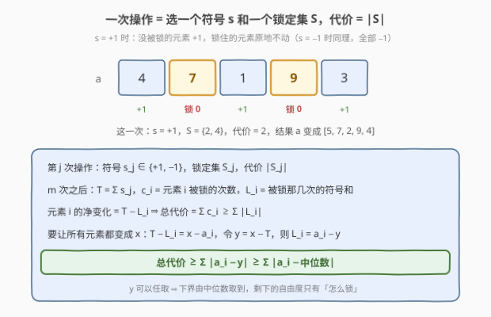
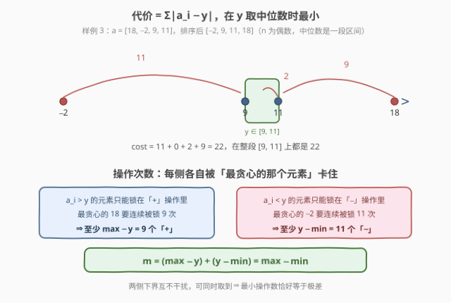
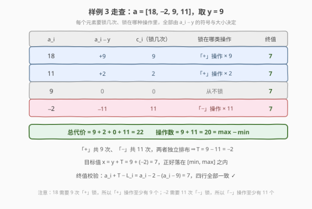

# Codeforces 2278D 锁与解锁 题解

## 1. 题目概述

- **标题 / 题号**：锁与解锁（Codeforces 2278D，英文名 Lock and Unlock）
- **链接**：https://codeforces.com/problemset/problem/2278/D
- **来源**：Codeforces Round 1131 (Div. 3) · Problem D（UTC 2026-10-31）
- **难度**：未评级（Div. 3 Problem D，评测数据中无 rating）
- **限制**：时间 2 s / 内存 256 MB
- **标签**：贪心，构造，排序，中位数

**题意**：给出长度为 $n$ 的整数数组 $a$，初始所有位置都是"未锁定"。可以任意次（含 $0$ 次）执行一次操作，一次操作包含三步：

1. 选整数 $k$（$1\le k\le n$），再选**恰好 $k$ 个不同下标**锁定，本步花费 $k$；
2. 让**所有未锁定**的元素同时 $+1$ 或同时 $-1$（二选一），本步不额外花钱；
3. 全部解锁，不额外花钱。

总花费是各次操作花费之和。求：(1) 让所有元素相等所需的**最小总花费**；(2) 在总花费最小的所有方案中，**最少需要几次操作**。多测，每组输出这两个数。

**约束**：

- $1\le t\le 2\cdot 10^4$，$2\le n\le 2\cdot 10^5$，$\sum n\le 2\cdot 10^5$
- $-10^9\le a_i\le 10^9$，含负数与大量重复值（排序后取中位数即可）
- 单组花费上界 $2\cdot 10^5\times 2\cdot 10^9=4\cdot 10^{14}$，必须 64 位整数

## 2. 示例与观察
```text
输入
5
3
1 2 3
2
-1 -1
4
18 -2 9 11
9
9 9 8 2 4 4 3 5 3
3
6 67 7

输出
2 2
0 0
22 20
19 7
61 61
```

逐组核对（后文会证）：代价 = $\sum_i |a_i-\mathrm{med}|$，操作数 = $\max-\min$。

- 第 1 组 $[1,2,3]$：中位数 $2$，代价 $1+0+1=2$；极差 $3-1=2$。
- 第 2 组 $[-1,-1]$：已相等，代价与操作数都是 $0$（极差也是 $0$）。
- 第 3 组 $[18,-2,9,11]$：排序 $[-2,9,11,18]$，$n$ 为偶数，中位数是整段 $[9,11]$；取 $y=9$ 得代价 $11+0+2+9=22$，极差 $20$。
- 第 4 组 $[9,9,8,2,4,4,3,5,3]$：排序后中位数 $4$，代价 $2+1+1+0+0+1+4+5+5=19$，极差 $7$。
- 第 5 组 $[6,67,7]$：中位数 $7$，代价 $1+0+60=61$，极差 $61$。

补充一组**自造**数据（答案按公式手算）：

```text
输入
1
4
1 2 2 3

输出
2 2
```

## 3. 解题思路

### 3.1 暴力思路

直接搜索操作序列是不可能的：每一步要选 $k$、选下标子集、选方向，状态是"当前数组 + 当前花费"，而数组元素在 $[-10^9,10^9]$ 上，值域和分支数都爆炸。

更麻烦的是"代价"的定义：一次操作花的是**被锁人数**，而不是"步数"。所以"每个元素要变多少"和"总花费"之间不是简单相乘，必须先找到一个能把操作序列压缩成少数几个统计量的等价刻画。

观察样例可以发现两个独立的量：最小花费 $22$ 与"每个元素到中位数的距离之和"吻合，最少操作数 $20$ 恰好是极差 $18-(-2)$。下面把这个猜测变成证明。

### 3.2 核心观察：一次操作 = 一个符号 + 一个锁定集



把第 $j$ 次操作的符号记作 $s_j\in\{+1,-1\}$，锁定集记作 $S_j$。对元素 $i$ 来说，一次操作只有两种命运：被锁 ⇒ 不动；没被锁 ⇒ 加上 $s_j$。于是设：

- $m$ = 操作次数，$T=\sum_{j=1}^m s_j$（所有符号之和）；
- $c_i$ = 元素 $i$ 被锁的次数，$L_i$ = 它被锁的那 $c_i$ 次操作的**符号和**。

则元素 $i$ 的净变化是 $T-L_i$，而总花费 $\sum_j |S_j|=\sum_i c_i$。因为 $L_i$ 是 $c_i$ 个 $\pm 1$ 的和，必有 $c_i\ge |L_i|$，于是

$$\text{花费}=\sum_i c_i\ \ge\ \sum_i |L_i|.$$

若最终全部等于 $x$，则 $T-L_i=x-a_i$，即 $L_i=x-a_i-T$。记 $y=x-T$，下界变成

$$\text{花费}\ \ge\ \sum_i |a_i-y|.$$

这一步是全题的枢纽：**"锁定"只是让元素在这一次里少走一步，而少走的量必须是 $\pm1$；所以元素 $i$ 的"少走总量" $a_i-y$ 恰好等于它被锁次数的下界，花费就是这些下界之和**。$y$ 是自由的（$x$ 和 $T$ 都可选），故

$$\text{花费}\ \ge\ \min_y\sum_i|a_i-y|\ =\ \sum_i|a_i-\mathrm{med}|,$$

即"到中位数的绝对偏差和"。$n$ 为偶数时，最优 $y$ 恰好是整段 $[a_{n/2-1},a_{n/2}]$（下标从 0 开始，数组已排序）。

### 3.3 算法流程：两侧分解与最小操作数



把 3.2 的结论直接装配成算法，只有三步：

1. 排序，取中位数 $y=\mathrm{med}$（$n$ 为偶数时取 $a_{n/2}$）；
2. $cost=\sum_i|a_i-y|$；
3. $ops=\max-\min$。

第 1、2 步在 3.2 已经证完，剩下的唯一问题是"操作次数能压到多小"。有了 $y$ 之后，锁定方式也被唯一确定：$a_i>y$ 的元素只能锁在 **"+" 操作**里（$L_i>0$ 要求符号和为正），且恰需 $c_i=a_i-y$ 次；$a_i<y$ 的元素对称地锁在 **"−" 操作**里，需 $c_i=y-a_i$ 次；$a_i=y$ 的元素一次都不锁。

设"+"操作有 $P$ 个、"−"操作有 $N$ 个，$m=P+N$，$T=P-N$。约束只有两条：

- 每个"+"操作必须至少锁一个人，而它只能锁 $a_i>y$ 的元素，所以 $P\le \sum_{a_i>y}(a_i-y)$；
- 同一个元素一次操作只能被锁一次，所以需要 $c_i$ 个**不同**的"+"操作，即 $P\ge \max_{a_i>y}(a_i-y)=\max-y$。

两条夹在一起得到 $P\ge\max-y$；对称地 $N\ge y-\min$。于是

$$m=P+N\ \ge\ (\max-y)+(y-\min)\ =\ \max-\min .$$

而取 $P=\max-y$、$N=y-\min$ 时构造可行：把 $P$ 个"+"操作编号、让每个正侧元素任选 $c_i$ 个"+"槽（$c_i\le P$）；因为 $a_i=\max$ 的元素恰好 $c_i=P$，它一个人就占满所有"+"槽，所以每个"+"操作都至少锁了一个人，$k\ge 1$ 合法；"−"侧同理。**两侧下界同时取到，故最少操作数恰为极差** $\max-\min$。

顺带得到目标值：$T=P-N$，所以 $x=y+T=\min+\max-y$，总落在 $[\min,\max]$ 内。

### 3.4 示例演算



以样例 3 的 $[18,-2,9,11]$ 为例，排序后 $[-2,9,11,18]$，取 $y=9$：

| $a_i$ | $a_i-y$ | $c_i$ | 锁在哪类操作 | 终值 |
|-------|---------|-------|--------------|------|
| $18$ | $+9$ | $9$ | "+"操作 ×9 | $7$ |
| $11$ | $+2$ | $2$ | "+"操作 ×2 | $7$ |
| $9$ | $0$ | $0$ | 从不锁 | $7$ |
| $-2$ | $-11$ | $11$ | "−"操作 ×11 | $7$ |

总花费 $9+2+0+11=22$；操作数 $9+11=20$；$T=9-11=-2$，目标 $x=y+T=7$。校验：$a_i+T-L_i=a_i-2-(a_i-9)=7$，四行一致 ✓。

再看样例 1 的 $[1,2,3]$（$y=2$）：正侧只有 $3$ 要 $1$ 次"+"、负侧只有 $1$ 要 $1$ 次"−"，于是 $P=N=1$、$T=0$、$x=2$。具体两步就是题目 note 里写的：先锁下标 1 做"−1"（$[1,2,3]\to[1,1,2]$），再锁下标 3 做"$+1$"（$\to[2,2,2]$），花费 $1+1=2$。

## 4. 算法细节

1. **只统计两个量**：排序后取中位数 $\mathrm{med}=a_{\lfloor n/2\rfloor}$，算 $\sum_i|a_i-\mathrm{med}|$ 与 $a_{n-1}-a_0$，直接输出。不需要真的构造操作序列。
2. **偶数长度的中位数**：取 $a_{n/2}$（上中位数）即可，取 $a_{n/2-1}$ 答案完全相同（$n$ 为偶数时区间 $[a_{n/2-1},a_{n/2}]$ 内任意实数都最优）。**不要**取平均值——它可能不是整数，也不是最小化绝对偏差和的点。
3. **64 位整数**：单组代价可达 $2\cdot10^5\times 2\cdot10^9=4\cdot10^{14}$，`int` 必然溢出；极差最大 $2\cdot10^9$ 也在 `int` 边缘，统一用 `long long`。绝对值用 `llabs` 或 `std::abs(long long)` 重载。
4. **多测**：$t$ 最大 $2\cdot10^4$，$\sum n\le 2\cdot10^5$，所以每组都要重新读入、排序；把累加变量声明在循环体内，避免上一组残留。
5. **I/O 开销**：输入最多 $2\cdot10^4+2\cdot10^5$ 个数，C++ 关同步即可；Python 必须用 `sys.stdin.buffer.read().split()` 一次性读入，逐行 `input()` 在这个量级会慢。
6. **输出顺序**：先"最小花费"、后"最少操作次数"，这两个数在样例 1、3、5 里数值不同，写反会立刻 WA。
7. **无需前缀和/二分**：排序是唯一的重活，$n\log n$ 足够；若想省常数可用 `nth_element` 求中位数，但排序还能顺带拿到极差，实际没必要。

## 5. 正确性证明

**引理 1（花费下界）**：对任意一组能把 $a$ 变成全 $x$ 的操作序列，设 $T=\sum_j s_j$、$y=x-T$，则总花费 $\ge\sum_i|a_i-y|$。

**证明**：元素 $i$ 的净变化为 $T-L_i$，等于 $x-a_i$，故 $L_i=a_i-y$。又 $L_i$ 是 $c_i$ 个 $\pm1$ 之和，于是 $|L_i|\le c_i$。对 $i$ 求和得总花费 $\sum_i c_i\ge\sum_i|a_i-y|$。∎

**引理 2（花费可达到下界）**：取 $y=\mathrm{med}$、$P=\max-y$、$N=y-\min$，存在合法操作序列，其总花费恰为 $\sum_i|a_i-\mathrm{med}|$。

**证明**：当 $y=\mathrm{med}$ 时 $y\in[\min,\max]$，故 $P,N\ge0$。先放 $P$ 个"+"操作、$N$ 个"−"操作（顺序任意）。对每个 $a_i>y$，在 $P$ 个"+"操作中任选 $c_i=a_i-y$ 个锁定它（因 $c_i\le P$ 可选足）；对每个 $a_i<y$，在 $N$ 个"−"操作中任选 $y-a_i$ 个锁定它；$a_i=y$ 的不锁。由于 $a_i=\max$ 的元素需要 $P$ 次"+"锁，它盖住全部"+"操作，同理最小值元素盖住全部"−"操作，所以每个操作的锁定数 $k\ge1$，参数合法。此时该元素被锁的符号和恰为 $a_i-y=L_i$，净变化为 $T-L_i=y+T-a_i=x$，所有元素终值同为 $x=y+P-N=\min+\max-y$；总花费 $\sum_i c_i=\sum_i|a_i-y|$。∎

**引理 3（操作次数下界）**：任意合法操作序列的次数 $m\ge\max-\min$。

**证明**：设"+"操作 $P$ 个、"−"操作 $N$ 个，$m=P+N$。对 $a_i>y$ 的元素，被锁次数 $c_i\ge L_i=a_i-y$，而 $c_i$ 次锁定中"+"操作个数为 $(c_i+L_i)/2\ge L_i$，故 $P\ge a_i-y$；取 $a_i=\max$ 得 $P\ge\max-y$（若 $\max\le y$ 则 $P\ge0\ge\max-y$）。对称地 $N\ge y-\min$（若 $y\le\min$ 则 $N\ge0\ge y-\min$）。两式相加即得 $m\ge\max-\min$。∎

**定理**：最小总花费为 $\sum_i|a_i-\mathrm{med}|$；在最小花费方案中，最少操作次数为 $\max-\min$。

**证明**：由引理 1，任何方案花费 $\ge\sum_i|a_i-y|\ge\min_y\sum_i|a_i-y|=\sum_i|a_i-\mathrm{med}|$（中位数是最小化绝对偏差和的点）；由引理 2 该下界可取到，故最小花费成立。再由引理 3，任何方案（包括最小花费方案）操作数 $\ge\max-\min$；而引理 2 的构造恰好用 $P+N=\max-\min$ 次操作且花费最小，故最少操作数为 $\max-\min$。∎

## 6. 复杂度分析

- **时间**：$O(n\log n)$ 每组，瓶颈是排序；$\sum n\le2\cdot10^5$ 时总计约 $2\cdot10^5\log_2 2\cdot10^5\approx3.6\cdot10^6$ 次比较，加上 $O(n)$ 的绝对值求和与极差。
- **空间**：$O(n)$ 存数组（C++ 一个 `vector<long long>`，Python 一个列表）；无额外结构。
- **对照时限**：2 s 非常宽松。实测（Apple clang 21, `-std=c++17 -O2`）单组 $n=2\cdot10^5$ 含输入输出 0.32 s，$t=2\cdot10^4$ 组 $n=2$ 共 0.07 s，余量约 6 倍；Python3 单组 $n=2\cdot10^5$ 约 0.08 s，同样安全。

## 7. 参考代码

### C++17

```cpp
#include <bits/stdc++.h>
using namespace std;

int main() {
    ios::sync_with_stdio(false);
    cin.tie(nullptr);

    int t;
    if (!(cin >> t)) return 0;
    while (t--) {
        int n;
        cin >> n;
        vector<long long> a(n);
        for (long long &x : a) cin >> x;
        sort(a.begin(), a.end());
        long long med = a[n / 2];
        long long cost = 0;
        for (long long x : a) cost += llabs(x - med);
        cout << cost << ' ' << a[n - 1] - a[0] << '\n';
    }
    return 0;
}
```

### Python3

```python
import sys


def main():
    data = sys.stdin.buffer.read().split()
    if not data:
        return
    pos = 0
    t = int(data[pos]); pos += 1
    out = []
    for _ in range(t):
        n = int(data[pos]); pos += 1
        a = list(map(int, data[pos:pos + n])); pos += n
        a.sort()
        med = a[n // 2]
        cost = sum(abs(x - med) for x in a)
        out.append("%d %d" % (cost, a[-1] - a[0]))
    sys.stdout.write("\n".join(out) + "\n")


main()
```

## 8. 边界情况与易错点

1. **全相等**：如样例 2 的 $[-1,-1]$，答案必须是 `0 0`；此时中位数就是元素本身，代价与极差同时为 $0$，即使两个量算反了也能过，所以务必用样例 3、5 自查。
2. **$n=2$**：中位数取 $a_1$，代价与操作数都是 $|a_1-a_0|$，例如 $[0,5]$ 输出 `5 5`（锁住 $0$ 做 $5$ 次"$+1$"）。两种量数值相同，别误以为"操作数 = 花费"是通例。
3. **偶数 $n$ 的中位数**：$[0,0,0,10]$ 的答案是 `10 10`；用平均值 $2.5$ 会得到 $11+(0.5+0.5+0.5+7.5)$ 这种既非整数也不最优的结果，而中位数区间 $[0,0]$ 的端点都正确。
4. **溢出**：$\sum|a_i-\mathrm{med}|$ 最大 $4\cdot10^{14}$，`int` 溢出；C++ 里 `abs` 对 `long long` 要走 `llabs`/`std::abs` 重载，写 `abs(int)` 会截断。
5. **多测与 I/O**：$t=2\cdot10^4$ 时不要用 `endl` 刷新、不要在循环内 `memset` 大数组；Python 逐行 `input()` 在 $2\cdot10^5$ 个数上会明显变慢，务必一次性 `read().split()`。
6. **输出顺序**：先代价后次数；样例 3（`22 20`）与样例 5（`61 61`）是自查这两列有没有对调的好例子。
7. **负数**：$a_i$ 可为负，排序、求差都正常，但手写快读时别把负号漏掉。

## 9. 验证记录

- **编译环境与命令**：`clang++ -std=c++17 -O2`（本机无 GNU g++，配 `codeforces/tools/include/bits/stdc++.h` 兼容头；正文代码只用标准库，可原样提交 GNU C++17）；Python 侧为 `Python 3.9.6`。
- **官方样例**：1 / 1 通过（按 Codeforces 标准 checker 的 token 比对，忽略空白与大小写）。
- **复核状态**：audited（2026-11-19 统一回归：编译 + 官方样例；写作期的随机对拍与暴力未重跑）。

## 相关题目与扩展

- [LeetCode 462. 最小操作次数使数组元素相等 II](https://leetcode.cn/problems/minimum-moves-to-equal-array-elements-ii/)：答案就是 $\sum|a_i-\mathrm{med}|$，正是本题"代价"部分的原型。
- [Codeforces 1520E. Arranging The Sheep](https://codeforces.com/problemset/problem/1520/E)：同样把"各自移动的距离"化成中位数代价，是"多个元素朝一个位置聚拢"的经典款。
- [Codeforces 1201C. Maximum Median](https://codeforces.com/problemset/problem/1201/C)：中位数贪心 + 二分，练习"只动上半部分"的代价计算。

**延伸思考**：

- **要求输出方案**：按 3.4 的表把"+"操作编号 $1..P$、"−"操作编号 $P+1..P+N$，每个正侧元素占前 $c_i$ 个"+"槽（负侧对称）。因为最大值元素恰好占满全部 $P$ 个槽，覆盖性自动成立，输出规模 $O(\sum c_i)=O(n\cdot\max|a_i|)$——注意这个规模可能远大于 $n$，所以题目才只问两个数。
- **只允许 $+1$（不能减）**：此时每次操作的符号和恒为正，$L_i\ge0$ 强迫 $y\le\min$，代价的最优点从"中位数"塌到最小值，答案变成 $\sum_i(a_i-\min)$ 与极差。这说明 3.2 里"两个方向都能走"才是中位数结论成立的原因。
- **锁一次的价格变成 $w_i$**：总花费变为 $\sum_i w_ic_i\ge\sum_i w_i|a_i-y|$，最优 $y$ 换成**加权中位数**，其余推导（包括操作数 $=\max-\min$）一字不改，可以直接照搬。
- **代价改成 $k^2$**：总花费 $\sum_j|S_j|^2$ 不再是 $\sum_i c_i$ 这种"按元素可分离"的形式，平方会引入同一次操作内部的交叉项，3.2 的分解失效——这也是本题选 $k$ 而非 $k^2$ 的关键。
