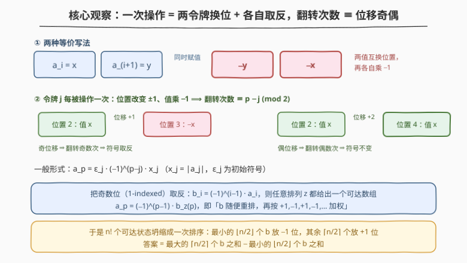
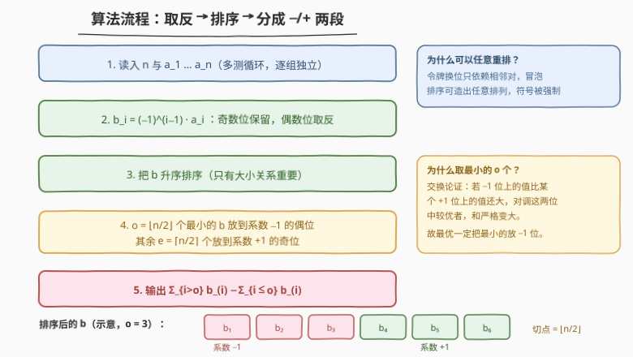
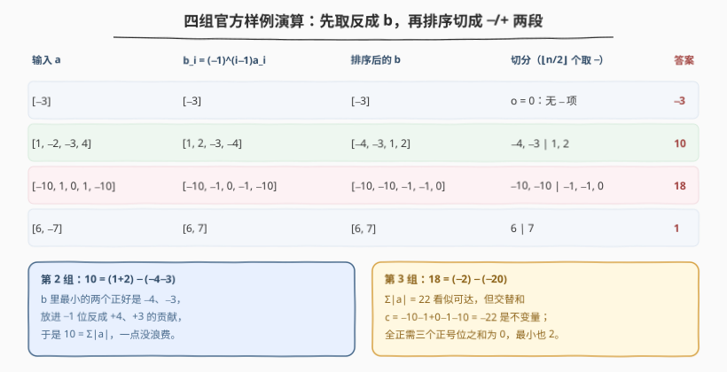

# Codeforces 2278E 交换与取反 题解

## 1. 题目概述

- **标题 / 题号**：交换与取反（Codeforces 2278E，英文名 Swap and Negate）
- **链接**：https://codeforces.com/problemset/problem/2278/E
- **来源**：Codeforces Round 1131 (Div. 3) · Problem E
- **难度**：未评级（Div. 3 E，约 1600–1800 档；官方未标 rating）
- **限制**：时间 2 s / 内存 256 MB
- **标签**：构造、贪心、排序、不变量

**题意**：给定长度为 $n$ 的数组 $a$。可以任意次（含 $0$ 次）执行下面的操作：选一个下标 $i$（$1 \le i < n$），**同时**令 $a_i := -a_{i+1}$、$a_{i+1} := -a_i$（两式右边都取操作前的旧值）。问经过若干次操作后，数组元素和的最大可能值。多测：第一行组数 $t$，每组先给 $n$，再给 $n$ 个整数，逐组输出一个整数。

**约束**：

- $1 \le t \le 10^4$，$1 \le n \le 2\cdot10^5$，且所有测试的 $n$ 之和 $\le 2\cdot10^5$
- $-10^9 \le a_i \le 10^9$（$a_i$ 可以为 $0$）
- 答案绝对值上界 $2\cdot10^5 \times 10^9 = 2\cdot10^{14}$，**必须**用 64 位整数
- 操作次数不限，但每一步只作用于一对**相邻**位置

## 2. 示例

官方样例（输入 / 输出原样）：

```text
输入：
4
1
-3
4
1 -2 -3 4
5
-10 1 0 1 -10
2
6 -7

输出：
-3
10
18
1
```

第 2 组的官方解释：对 $i=2$ 操作得 $[1,3,2,4]$，和为 $10$。注意它把 $-2,-3$ 变成了 $3,2$，同时把两个元素交换了位置——这正是本题的钥匙：**操作 = 交换位置 + 两者取反**。第 3 组更值得警惕：$\sum|a_i| = 22$ 看似可达，官方答案却只有 $18$。

## 3. 解题思路

### 3.1 暴力思路

最朴素的做法是把整个数组当成状态做 BFS：一步最多 $n-1$ 种转移，把访问过的数组全部存下来，取访问到的最大和。状态数极多——后面会证明，单是「哪个值在哪个位置」的排列就有 $n!$ 个（$n=8$ 已是 $40320$ 起步），$n=2\cdot10^5$ 时完全不可行。

也不能凭直觉贪心「把负数都变正」：一次操作同时翻转两个数，翻着翻着位置也被打乱，哪几个数能变成正数、代价是多少，需要先把可达状态刻画清楚。

### 3.2 核心观察：符号翻转次数 = 位移奇偶性



把每个元素看成一张**令牌**：令牌 $j$ 携带绝对值 $x_j = |a_j|$ 与初始符号 $\varepsilon_j \in \{+1,-1\}$，一开始站在位置 $j$ 上。一次操作恰好做两件事：

1. 两个令牌**互换位置**（值互换）；
2. 两个令牌**各自乘 $-1$**。

于是令牌 $j$ 每参与一次操作，位置改变 $\pm 1$、值乘一次 $-1$。若它最终站在位置 $p$，参与的次数 $k$ 满足 $k \equiv p-j \pmod 2$（每次参与恰好挪一格），所以

$$a_p = \varepsilon_j\,(-1)^{p-j}\,x_j .$$

这条式子说明**排列与符号并不独立**：给定最终排列，每个令牌的符号就被唯一钉死了。

反过来，任何排列都可达：对目标排列做冒泡排序，把每次相邻交换都实现成一次操作即可；由上式，结束时每个令牌的值必然就是 $\varepsilon_j(-1)^{p-j}x_j$，所以这个排列对应的那个（唯一的）状态一定被访问到。两者合起来：

$$\text{可达数组} = \Bigl\{\, a_p = (-1)^{p-1}\, b_{z_p} \;\Big|\; z \text{ 是 } 1..n \text{ 的任意排列} \,\Bigr\},\qquad b_j = (-1)^{j-1}a_j .$$

也就是说：**先把奇数位（1-indexed）取反得到 $b$，再把 $b$ 任意重排、按 $+1,-1,+1,-1,\dots$ 的系数放回位置**，就得到全部可达数组。$n!$ 个状态坍缩成「一次排序」。

### 3.3 算法流程



因为 $a_p = (-1)^{p-1}b_{z_p}$，总和

$$S = \sum_{p=1}^{n}(-1)^{p-1}b_{z_p} = \sum_{p\ \text{奇}} b_{z_p} - \sum_{p\ \text{偶}} b_{z_p}.$$

奇数位有 $e = \lceil n/2 \rceil$ 个（系数 $+1$），偶数位有 $o = \lfloor n/2 \rfloor$ 个（系数 $-1$）；而 $z$ 可以任意取，所以只要把**最大的 $e$ 个 $b$ 放进 $+1$ 位、最小的 $o$ 个放进 $-1$ 位**即可。排序一次就能定下最优解：

1. 读入 $n$ 与 $a_1,\dots,a_n$；
2. 构造 $b_i = (-1)^{i-1}a_i$（奇数位保持原号、偶数位取反）；
3. 把 $b$ 升序排序；
4. 前 $o = \lfloor n/2 \rfloor$ 个（最小）贡献 $-b$，其余 $e = \lceil n/2 \rceil$ 个贡献 $+b$；
5. 输出 $\displaystyle\sum_{i>o} b_{(i)} - \sum_{i\le o} b_{(i)}$。

真实实现里连「重排」都不用做：直接排序后按上式求和。写成 $ans = \sum_i b_i - 2\sum_{i\le o} b_{(i)}$ 也完全等价。

### 3.4 示例演算



| 组 | 输入 $a$ | $b_i=(-1)^{i-1}a_i$ | 排序后的 $b$ | 切分（前 $\lfloor n/2\rfloor$ 个取 $-$） | 答案 |
|----|----------|----------------------|----------------|------------------------------------------|------|
| 1 | $[-3]$ | $[-3]$ | $[-3]$ | $o=0$，无负项 | $-3$ |
| 2 | $[1,-2,-3,4]$ | $[1,2,-3,-4]$ | $[-4,-3,1,2]$ | $-4,-3 \mid 1,2$ | $3-(-7)=10$ |
| 3 | $[-10,1,0,1,-10]$ | $[-10,-1,0,-1,-10]$ | $[-10,-10,-1,-1,0]$ | $-10,-10 \mid -1,-1,0$ | $(-2)-(-20)=18$ |
| 4 | $[6,-7]$ | $[6,7]$ | $[6,7]$ | $6 \mid 7$ | $7-6=1$ |

第 3 组是关键：$b$ 里有三个负数，但 $-1$ 槽只有 $o=2$ 个，于是 $-1,-1,0$ 只能待在 $+1$ 槽上「倒贴」，最终 $18$ 而不是 $22$。用不变量看更直接：$c=\sum(-1)^{i-1}a_i=-22$ 是永远不变的，而全正排列要求三个正号位的元素之和为 $0$，这在 $\{0,1,1,10,10\}$ 里最小也只能凑到 $2$，所以必然要丢掉 $4$。

## 4. 算法细节

1. **下标约定**：$b_i=(-1)^{i-1}a_i$ 只与位置奇偶有关。代码里若用 0-indexed 循环 $i$，条件写成 `i % 2 == 0 ? x : -x`（因为 $i$ 为偶数对应 1-indexed 的奇数位），写成 `i % 2 == 1` 会全盘反转。
2. **不必真的重排**：只有「哪些 $b$ 落在 $-1$ 槽」重要，取最小的 $o$ 个即可；用 `sort` 一次搞定，$O(n\log n)$。
3. **两种等价写法**：$\sum_{i>o}b_{(i)}-\sum_{i\le o}b_{(i)}$，或先全加再修正 $\sum_i b_i - 2\sum_{i\le o}b_{(i)}$。后者少一个分支，且 $\sum_i b_i = c$ 正好是不变量，便于自检。
4. **溢出**：单个 $|b_i|\le 10^9$、总和 $\le 2\cdot10^{14}$，`int` 必爆；C++ 用 `long long`（`vector<long long>`），Python 原生大整数无需处理。
5. **多测清空**：每个测试新建 `vector`（长度随 $n$ 变化），或复用容器后严格只写前 $n$ 个位置；不要留下上一组的尾部元素，否则排序会把脏数据一起算进去。
6. **读入量**：$t \le 10^4$、$\sum n \le 2\cdot10^5$。C++ 用 `ios::sync_with_stdio(false)` + `cin.tie(nullptr)`；Python 用 `sys.stdin.buffer.read().split()` 一次切分再按下标游走，比逐行 `input()` 快一个量级。
7. **别把操作读成顺序赋值**：题目强调「同时」，右边都用旧值，等价于「交换 + 各自取反」。若按顺序理解，$a_{i+1}$ 会算成 $-(-a_{i+1})=a_{i+1}$ 原地不动，模型完全错。
8. **无需模拟任何一步**：模型一旦建立，答案就是排序统计量，不存在「操作次数」这一维。

## 5. 正确性证明

**引理 1（位移引理）**：把元素视作令牌，令牌 $j$ 初始在位置 $j$、初始值 $a_j$。若某操作序列后它位于位置 $p$，则它的值恰为 $(-1)^{p-j}a_j$。

**证明**：每次操作都让参与的两个令牌各移动一个位置、各乘 $-1$，所以令牌 $j$ 的参与次数 $k_j$ 满足 $k_j \equiv p-j \pmod 2$（每次参与恰好改变位置 $1$，$k_j$ 次后位移为 $p-j$），而它的值被乘了 $k_j$ 次 $-1$，即为 $(-1)^{k_j}a_j = (-1)^{p-j}a_j$。注意 $a_j$ 带符号，即 $\varepsilon_j x_j$，与 3.2 节一致。$a_j=0$ 时两边都是 $0$，结论平凡成立。∎

**引理 2（可达状态刻画）**：记 $b_j=(-1)^{j-1}a_j$。数组 $A$ 可达，当且仅当存在 $1..n$ 的排列 $z$ 使 $A_p = (-1)^{p-1}b_{z_p}$ 对一切 $p$ 成立。

**证明**：

- （$\Rightarrow$）设某序列把令牌 $j$ 送到位置 $p$，由引理 1 得 $A_p=(-1)^{p-j}a_j=(-1)^{p-1}\cdot(-1)^{j-1}a_j=(-1)^{p-1}b_j$（用到 $(-1)^{p-j}=(-1)^{p-1}(-1)^{1-j}=(-1)^{p-1}(-1)^{j-1}$）。令牌到位置的映射是一个排列 $z$，故 $A_p=(-1)^{p-1}b_{z_p}$。
- （$\Leftarrow$）任给 $1..n$ 的排列 $z$，即给每个令牌 $j$ 指定一个两两不同的目标位置 $p_j$。对目标排列做冒泡排序，把每次相邻交换实现成一次操作。该过程合法，结束时由引理 1 令牌 $j$ 的值必为 $(-1)^{p-j}a_j$，即整个数组恰为 $A_p=(-1)^{p-1}b_{z_p}$，故 $A$ 可达。∎

**引理 3（最优分配）**：在引理 2 的所有可达数组中，和的最大值为「最大的 $e=\lceil n/2\rceil$ 个 $b$ 之和减去最小的 $o=\lfloor n/2\rfloor$ 个 $b$ 之和」。

**证明**：由引理 2，$S=\sum_p (-1)^{p-1}b_{z_p}$ 就是把 $b_1..b_n$ 分配给 $e$ 个系数 $+1$ 的槽与 $o$ 个系数 $-1$ 的槽。设某分配中某个 $-1$ 槽上放着值 $u$、某个 $+1$ 槽上放着值 $v$，且 $u>v$。对调后两槽的贡献由 $(-u)+(+v)$ 变为 $(-v)+(+u)$，变化量为 $2(u-v)>0$，即总和严格变大。因此最优分配中每个 $-1$ 槽的值都不大于每个 $+1$ 槽的值，这正是「最小的 $o$ 个放 $-1$ 槽」；取等号时达到上界，故该分配就是最大值。∎

**定理**：对任意输入，上述算法输出的整数等于题目所求的最大可能元素和。

**证明**：由引理 3，所有可达数组的和都不超过算法给出的 $ans$，且存在可达数组取到 $ans$（把 $b$ 排序后按上述方式摆放，再按引理 2 的构造实现它）。故 $ans$ 即为最大值。∎

## 6. 复杂度分析

- **时间**：单组 $O(n\log n)$（构造 $b$ 是 $O(n)$，排序是主项，求和 $O(n)$）；总计 $O\bigl(\sum n_i \log n_i\bigr) \le 2\cdot10^5\times 18$ 量级比较，2 s 时限绰绰有余。实测（本机文件 I/O 偏慢）：$n=2\cdot10^5$ 单组 C++ 约 $0.31$ s（几乎全在读入，排序仅 $4$ ms），Python 约 $0.12$ s，相对 2 s 时限余量充足。
- **空间**：$O(n)$，只存一个 `b` 数组；没有任何哈希表、递归或模拟状态。

## 7. 参考代码

### C++17

```cpp
#include <algorithm>
#include <iostream>
#include <vector>
using namespace std;

int main() {
    ios::sync_with_stdio(false);
    cin.tie(nullptr);

    int t;
    if (!(cin >> t)) return 0;                 // 空输入防护
    while (t--) {
        int n;
        cin >> n;
        vector<long long> b(n);
        for (int i = 0; i < n; i++) {
            long long x;
            cin >> x;
            // 0-indexed 的 i 为偶数 <=> 1-indexed 的 i+1 为奇数位，保持原号
            b[i] = (i % 2 == 0) ? x : -x;
        }
        sort(b.begin(), b.end());
        int o = n / 2;                         // 系数为 -1 的槽位个数（1-indexed 偶数位）
        long long ans = 0;
        for (int i = 0; i < n; i++) {
            if (i < o) ans -= b[i];            // 最小的 o 个放 -1 槽
            else       ans += b[i];            // 其余放 +1 槽
        }
        cout << ans << "\n";
    }
    return 0;
}
```

### Python3

```python
import sys


def main() -> None:
    data = sys.stdin.buffer.read().split()
    if not data:
        return
    t = int(data[0])
    pos = 1
    out = []
    for _ in range(t):
        n = int(data[pos])
        pos += 1
        b = []
        for i in range(n):                       # i 为 0-indexed：偶数 -> 1-indexed 奇数位
            x = int(data[pos + i])
            b.append(x if i % 2 == 0 else -x)
        pos += n
        b.sort()
        o = n // 2
        ans = sum(b[o:]) - sum(b[:o])            # 最大的 ⌈n/2⌉ 个减去最小的 ⌊n/2⌋ 个
        out.append(str(ans))
    sys.stdout.write("\n".join(out) + "\n")


main()
```

## 8. 边界情况与易错点

1. **$n=1$**：没有任何操作可做，答案必须是 $a_1$。公式给出 $o=\lfloor 1/2\rfloor=0$、$e=1$，答案 $=b_1=a_1$，自动正确。注意 $n=1$ 时偶数位个数必须是 $0$，别把「奇数位」当成 $\lceil n/2\rceil$ 之外的东西另算一遍。
2. **全为同一个值**：例如五个 $5$，$b=[5,-5,5,-5,5]$，排序后 $[-5,-5,5,5,5]$，答案 $15=5n$。若误以为「必须保留一个负数」写成 $5n-10$ 就错了。
3. **含 $0$**：$0$ 的符号无意义，取反还是 $0$，公式不受影响（样例 3 就含 $0$）。不要给 $0$ 特判，也不要把它从 $b$ 里剔除——它会占掉一个槽位，影响 $o$ 与 $e$ 的切分。
4. **溢出**：$\sum|a_i|$ 可达 $2\cdot10^{14}$，`int` 直接溢出成负数；C++ 全程 `long long`，Python 无所谓。
5. **奇偶自检**：答案与 $\sum a_i$ 同奇偶（因为 $-a_i\equiv a_i \pmod 2$，而答案 $\equiv\sum b_i=\sum(-1)^{i-1}a_i\equiv\sum a_i$）。若手算结果奇偶不符，一定是下标奇偶用反了。
6. **把「同时」读成「顺序」**：若顺序执行，$a_{i+1}$ 会被算成 $-(-a_{i+1})=a_{i+1}$ 原地不动，等价于只把 $a_i$ 改成 $-a_{i+1}$。此时样例 4 的 $[6,-7]$ 只能变成 $[7,-7]$（和为 $0$），与正确答案 $1$ 不符——这类误读会让整题模型崩掉。
7. **多测残留**：复用容器却不按 $n$ 覆盖，上一组更长的数据会混进排序；本题长度逐组不同，这类 bug 表现为「小数据对、大数据错」。
8. **输出格式**：每组恰好一行，组间不要空行；$t$ 组必须全部输出，不要在提前 `break` 时少打一行。

## 相关题目与扩展

- [Codeforces 1788A One and Two](https://codeforces.com/problemset/problem/1788/A)：只统计「乘积里 2 的个数」就能判定所有前缀条件，和本题一样是先用不变量/守恒量把问题化简的套路。
- [Codeforces 1363A Odd Selection](https://codeforces.com/problemset/problem/1363/A)：从 $n$ 个数里挑固定个数的元素凑出指定奇偶性，与本题「挑 $\lfloor n/2\rfloor$ 个元素放到负号位」的取舍结构同源。
- [LeetCode 561. 数组拆分](https://leetcode.cn/problems/array-partition/)：把 $2n$ 个数配成 $n$ 对、取每对 $\min$ 后求和最大化，最优解就是排序后相邻配对，靠的正是本题引理 3 的交换论证。
- [LeetCode 462. 最小操作次数使数组元素相等 II](https://leetcode.cn/problems/minimum-moves-to-equal-array-elements-ii/)：排序后取中位数的最优性同样来自逐对交换论证，可作为「排序 + 位置分配」这一类题的热身。

**延伸思考**：

1. **任意位置对**：若允许对**任意** $i<j$ 执行「交换并各自取反」，可达集合会立刻膨胀——此时只剩「绝对值的重排 + 符号多重集」约束，答案退化为 $\sum|a_i|$（当 $\prod a_i\ge 0$ 或存在 $0$ 时）或 $\sum|a_i|-2\min|a_i|$，本题的交替和 $c$ 不再守恒。
2. **只能操作固定的一对**：若只允许对某个固定 $i$ 操作，则只剩「原数组」与 $[\dots,-a_{i+1},-a_i,\dots]$ 两个状态，取两者和中较大者即可。
3. **求最小和**：把「最大的 $e$ 个放 $+1$ 槽」改成放最小即可得最小值；注意 $n$ 为奇数时最小值不等于 $-$最大值（多出的那一个槽位不对称）。
4. **统计不同可达和**：由引理 2，这等于「$b$ 的所有重排按 $+1,-1$ 交替加权」能得到多少个不同值，是个带重复元素的分配计数问题，比本题难得多。
