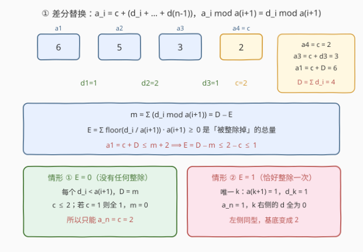
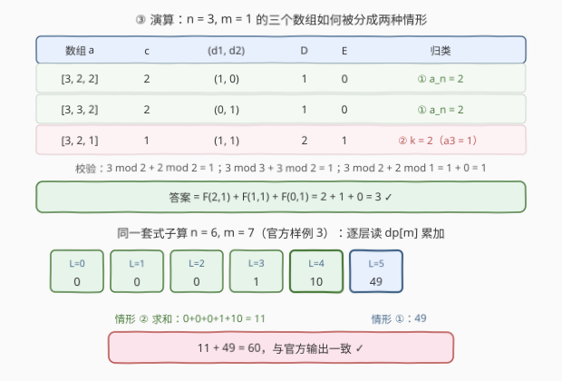

# Codeforces 2278F 取模与计数 题解

## 1. 题目概述

- **标题 / 题号**：取模与计数（Codeforces 2278F，英文名 Modulo and Counting）
- **链接**：https://codeforces.com/problemset/problem/2278/F
- **来源**：Codeforces Round 1131 (Div. 3) · Problem F
- **难度**：未评级（Div. 3 后半段计数题，tags：dp / math / number theory）
- **限制**：时间 2 s / 内存 512 MB
- **标签**：动态规划、数学、数论、差分、前缀和、计数

**题意**：给定 $n,m$，统计长度为 $n$ 的数组 $a$ 的个数，其中 $a$ 被称作「好的」当且仅当

1. $m+2\ge a_1\ge a_2\ge\cdots\ge a_{n-1}\ge a_n\ge 1$；
2. $(a_1\bmod a_2)+(a_2\bmod a_3)+\cdots+(a_{n-1}\bmod a_n)=m$。

输出个数对 $998\,244\,353$ 取模。多测：首行 $t$，之后每组一行两个整数 $n,m$，逐组输出一行答案。

**约束**：

- $1\le t\le 2000$；$2\le n\le 4000$；$1\le m\le 4000$
- $\sum n\le 4000$ 且 $\sum m\le 4000$ —— 注意是**和**而不是积，由此 $\sum n_im_i\le 4000\times4000=1.6\times10^7$
- 上界是 $m+2$ 而不是 $m$（题面里这个 $m+2$ 标了红色），这一个 $\mathbf{+2}$ 正是全题的钥匙；模数 $998\,244\,353$，只用到加减法

## 2. 示例与观察
官方 6 组样例（输入 / 输出原样）：

```text
输入：
6
3 1
3 2
6 7
41 67
998 244
353 420

输出：
3
1
60
972763487
288208692
566410295
```

第 1 组的三个好数组为 $[3,2,2]$、$[3,3,2]$、$[3,2,1]$：$3\bmod 2+2\bmod 2=1$，$3\bmod 3+3\bmod 2=1$，$3\bmod 2+2\bmod 1=1+0=1$。第 2 组唯一解是 $[4,3,2]$。

另补 5 组自造小数据（已与暴力对拍，覆盖 $n=2$、$m=1$、$n$ 远大于 $m$ 三类边界）：

```text
输入：5 组，(n,m) 依次为 (2,1) (2,3) (5,1) (4,4) (7,3)
输出：1  0  10  2  70
```

## 3. 解题思路

### 3.1 暴力思路

先枚举所有非增序列：值域 $m+2$、长度 $n$，方案量级是 $\binom{m+n+1}{n}$，$n=m=4000$ 时是天文数字。

退一步写 DP：状态取「第 $i$ 位填 $v$、前 $i-1$ 个取模和 $s$」，转移还要枚举 $a_{i+1}$，共 $n\cdot(m+2)\cdot(m+1)\approx6.4\times10^{10}$ 个状态；即便用前缀和把转移压到 $O(1)$，$O(nm^2)$ 仍是 $6.4\times10^{10}$，离 2 s 差着三个数量级。瓶颈在于 $a_i$ 与 $a_{i+1}$ 是「任意整数倍」关系，取模把它们死死耦合——必须换一组变量，把倍数关系显式抽出来。

### 3.2 核心观察：换成差分，「被整除掉的总量」不超过 1



记相邻差与尾项
$$d_i=a_i-a_{i+1}\ (1\le i\le n-1),\qquad c=a_n,\qquad D=\sum_{i=1}^{n-1}d_i .$$
则 $d_i\ge0$、$c\ge1$，且 $a_i=c+\sum_{j=i}^{n-1}d_j$、$a_1=c+D$。关键一步是**取模只和差有关**：
$$a_i\bmod a_{i+1}=(a_{i+1}+d_i)\bmod a_{i+1}=d_i\bmod a_{i+1}.$$
把条件 2 的每一项按 $d_i=q_ia_{i+1}+(d_i\bmod a_{i+1})$ 拆开，得到恒等式
$$m=\sum_{i=1}^{n-1}\bigl(d_i\bmod a_{i+1}\bigr)=D-E,\qquad E=\sum_{i=1}^{n-1}\Bigl\lfloor\frac{d_i}{a_{i+1}}\Bigr\rfloor a_{i+1}\ \ge 0 ,$$
$E$ 度量「被整个儿除掉的部分」总量。再由条件 1 的 $a_1\le m+2$：
$$E=D-m=(a_1-c)-m\le (m+2-c)-m=2-c\le 1 .$$
于是 **$E$ 只有 $0$ 和 $1$ 两种可能**，整道题只剩两种形态：

- **情形 ①** $E=0$：每项 $\lfloor d_i/a_{i+1}\rfloor=0$，即**所有** $d_i<a_{i+1}$，且 $D=m$。又 $c\le2$；若 $c=1$，则 $d_{n-1}<a_n=1$ 逼出 $d_{n-1}=0$，于是 $a_{n-1}=1$，一路归纳得 $a$ 全为 $1$、$m=0$，与 $m\ge1$ 矛盾。故 **$c=a_n=2$**。
- **情形 ②** $E=1$：$E$ 是若干「$a_{i+1}$ 的非负整数倍」之和，要等于 $1$，只能**恰有一项为 $1$**、其余为 $0$。设该项下标为 $k$，则 $a_{k+1}=1$、$\lfloor d_k/1\rfloor=d_k=1$，其余 $d_i<a_{i+1}$；又 $D=m+1$ 与 $D\le m+2-c$ 逼出 $c=1$，由非增性 $a_{k+1}=\cdots=a_n=1$，即 $d_{k+1}=\cdots=d_{n-1}=0$。

附带一个漂亮的自检点：两种情形都有 $a_1=c+D=m+2$，**上界 $\boldsymbol{m+2}$ 永远取等**。而两种情形都归结为同一个子问题：**尾部基底固定为 $2$ 时，把总和 $m$ 摊到 $L$ 个差分变量上**（情形 ② 中那个 $a_{k+1}=1$ 与 $d_k=1$ 已并入后缀，左侧前缀的约束同样是「差 $<$ 基底 $2$」）。

### 3.3 算法流程与状态转移

![DP 状态转移：后缀和 T，新状态落在区间 [T, min(m, 2T+1)]，用前缀和每层 O(m)](../../../images/cf2278f_dp_transition.svg)

定义 $F(L,m)$ 为满足下述条件的序列 $(d_1,\dots,d_L)$ 的个数：
$$d_i\ge 0,\qquad \sum_{i=1}^{L}d_i=m,\qquad d_i<2+\sum_{j=i+1}^{L}d_j\quad(\forall i).$$

**答案公式**
$$\operatorname{ans}=F(n-1,m)+\sum_{L=0}^{n-2}F(L,m)\qquad(m\ge1,\ n\ge2).$$
第一项是情形 ①（$a_n=2$，共 $n-1$ 个差分变量）；第二项是情形 ② 按唯一特殊位置 $k=1..n-1$ 分类，$k$ 左侧有 $k-1=L$ 个变量、约束同型。

**DP**：从右往左放变量，令 $T$ 为「已放好的后缀之和」。放 $d_i$ 时 $a_{i+1}=2+T$，约束是
$$0\le d_i\le\min\bigl(m-T,\ (2+T)-1\bigr)\iff T\le T'=T+d_i\le\min(m,\ 2T+1),$$
即新状态落在连续区间 $[T,\min(m,2T+1)]$ 内，于是
$$dp_{l+1}[T']=\sum_{T=\lceil(T'-1)/2\rceil}^{T'}dp_l[T]=P[T']-P[T'//2-1],$$
其中 $P$ 为 $dp_l$ 的前缀和、$P[-1]=0$；实现上等价于「对每个非零 $T$ 在 $[T,\min(m,2T+1)]$ 上区间加」，差分数组 $O(1)$ 打标记再求一次前缀和，单层 $O(m)$。累加也很省：同一个 $c=2$ 的 DP 里**每层读一次 $dp[m]$ 累加**就是 $\sum_{L\le n-2}F(L,m)$，跑满 $n-1$ 层后的 $dp[m]$ 就是 $F(n-1,m)$，一趟搞定。

### 3.4 示例演算



**$n=3,m=1$**（$L=2$）：$\operatorname{ans}=F(2,1)+F(0,1)+F(1,1)$。

| 数组 | $c=a_n$ | $(d_1,d_2)$ | $D$ | $E$ | 归类 |
|---|---|---|---|---|---|
| $[3,2,2]$ | 2 | $(1,0)$ | 1 | 0 | 情形 ① |
| $[3,3,2]$ | 2 | $(0,1)$ | 1 | 0 | 情形 ① |
| $[3,2,1]$ | 1 | $(1,1)$ | 2 | 1 | 情形 ②，$k=2$ |

$F(2,1)=2$（前两行），$F(1,1)=1$（第三行），$F(0,1)=0$，合计 $3$ ✓。

**$n=6,m=7$**：$F(5,7)=49$，$\sum_{L=0}^{4}F(L,7)=0+0+0+1+10=11$，合计 $60$ ✓，与官方输出一致。上界也如约取等：$a_1=m+2=9$。

## 4. 算法细节

1. **只跑一遍 DP**：情形 ① 的 $F(n-1,m)$ 与情形 ② 的 $\sum_{L\le n-2}F(L,m)$ 共用同一个 $c=2$ 的 DP，边推边累加 $dp[m]$，不要为两种情形各写一份。
2. **数组大小与清空**：$dp$ 开 $m+1$；差分数组必须开 $m+2$，因为要写 `diff[hi+1]` 且 $hi$ 可以等于 $m$。$m$ 逐组变化，按当前 $m$ 重新开 `vector`（或整体 `fill`），别让上一组残留污染本组。
3. **取模姿势**：`diff[hi+1] -= v` 会变负，先 `+MOD` 再取模；前缀和累加时两项都落在 $[0,MOD)$，写 `if (cur >= MOD) cur -= MOD` 即可，不必用 `%`。
4. **上界截断**：所有和只增不减，$T>m$ 的状态永远回不到 $m$，可直接截掉——这正是单层只有 $m+1$ 个状态的原因。
5. **区间端点的推导**：$d\le m-T$ 来自「总和恰为 $m$」，$d\le T+1$ 来自「$d_i<a_{i+1}=2+T$」；取小得 $hi=\min(m,2T+1)$，两条都不能漏（漏掉 $d\le T+1$ 会把 $E>0$ 的非法解也数进来）。
6. **下标换算**：公式里 $d$ 用 $1$ 下标；代码里用 $l=0..L-1$ 表示「已放好 $l$ 个」，对应特殊位置 $k=l+1$，求和上限是 $L-1=n-2$，不要写成 $n-1$。
7. **I/O**：$t\le2000$，C++ 用 `scanf` 足够；Python 用 `sys.stdin.buffer.read().split()` 一次读完，输出收集到列表再 `join`。

## 5. 正确性证明

**引理 1（取模只依赖差）**：设 $a$ 非增，$c=a_n$、$d_i=a_i-a_{i+1}\ge0$，则 $a_i=c+\sum_{j=i}^{n-1}d_j$，且 $a_i\bmod a_{i+1}=d_i\bmod a_{i+1}$。

**证明**：第一式由 $a_i=a_n+\sum_{j=i}^{n-1}(a_j-a_{j+1})$ 逐项相消得到；第二式因 $a_i=a_{i+1}+d_i$ 且 $a_{i+1}$ 是自身的倍数，故 $(a_{i+1}+d_i)\bmod a_{i+1}=d_i\bmod a_{i+1}$。∎

**引理 2（进位恒等式与 $E\le1$）**：令 $E=\sum_i\lfloor d_i/a_{i+1}\rfloor a_{i+1}$，则 $m=D-E$，$E\ge0$，且 $E\le 2-a_n\le1$。

**证明**：由 $d_i\bmod a_{i+1}=d_i-\lfloor d_i/a_{i+1}\rfloor a_{i+1}$ 对 $i$ 求和即得 $m=D-E$；每项非负故 $E\ge0$。又 $D=a_1-a_n$、$a_1\le m+2$，故 $E=D-m\le 2-a_n\le 1$。∎

**引理 3（情形 ① 的形态）**：若 $E=0$，则所有 $d_i<a_{i+1}$、$D=m$、$a_n=2$。

**证明**：$E=0$ 而每项非负 $\Rightarrow$ 每项为 $0$ $\Rightarrow$ $\lfloor d_i/a_{i+1}\rfloor=0$ $\Rightarrow$ $d_i<a_{i+1}$，此时 $m=D$。由引理 2 的 $E\le2-a_n$ 与 $E=0$ 得 $a_n\le2$。若 $a_n=1$：由 $d_{n-1}<a_n=1$ 得 $d_{n-1}=0$，即 $a_{n-1}=a_n=1$；对 $i=n-2,\dots,1$ 重复同一论证（此时 $a_{i+1}=1$）得所有 $a_i=1$，于是 $m=0$，与 $m\ge1$ 矛盾。故 $a_n=2$。∎

**引理 4（情形 ② 的形态）**：若 $E=1$，则存在唯一 $k$ 使 $a_{k+1}=1$、$d_k=1$，且 $a_n=1$、$d_j=0\ (j>k)$、$d_j<a_{j+1}=2+\sum_{j+1\le l<k}d_l\ (j<k)$。

**证明**：$E$ 的每项都是 $a_{i+1}\ge1$ 的非负整数倍，和为 $1$ $\Rightarrow$ 恰有一项等于 $1$、其余为 $0$。设该项下标为 $k$：$\lfloor d_k/a_{k+1}\rfloor a_{k+1}=1$，由 $a_{k+1}\mid1$ 得 $a_{k+1}=1$，进而 $\lfloor d_k/1\rfloor=d_k=1$。又 $D=m+1$，由 $D\le m+2-a_n$ 得 $a_n\le1$，即 $a_n=1$；由非增性 $a_{k+1}=\cdots=a_n=1$，故 $d_j=0\ (j>k)$。对 $j<k$ 相应项为 $0$，故 $\lfloor d_j/a_{j+1}\rfloor=0$ 即 $d_j<a_{j+1}$，而 $a_{j+1}=a_n+\sum_{l=j+1}^{n-1}d_l=1+1+\sum_{j+1\le l<k}d_l$。∎

**引理 5（DP 正确）**：设 $dp_l$ 由 3.3 的递推得到，则 $dp_l[T]$ 恰为「把 $d_{L-l+1},\dots,d_L$ 这 $l$ 个变量填好、和为 $T$、且这 $l$ 个变量各自的约束都满足」的方案数。

**证明**：对 $l$ 归纳。$l=0$ 只有空方案、和为 $0$，$dp_0[0]=1$ 成立。设 $dp_l$ 正确，考虑新变量 $d_i\ (i=L-l)$：其约束 $d_i<a_{i+1}=2+T$ 与总量约束 $T+d_i\le m$ 合起来正是 $T'\in[T,\min(m,2T+1)]$，且只涉及已确定的后缀和 $T$，故按 $T'$ 精确相加即得 $dp_{l+1}[T']$；用前缀和实现区间求和不改变数值。∎

**定理**：$\operatorname{ans}=F(n-1,m)+\sum_{L=0}^{n-2}F(L,m)$ 等于好数组个数。

**证明**：映射 $a\mapsto(c,d_1,\dots,d_{n-1})$ 与 $(c,d)\mapsto a_i=c+\sum_{j\ge i}d_j$ 互逆，故为双射；由引理 3、4，好数组恰好分成两类且互不重叠（$E$ 的值唯一确定类别）：① 类即 $c=2$、$d_i<2+\text{后缀}$、$\sum d_i=m$，计数为 $F(n-1,m)$；② 类即 $a_n=1$、唯一 $k$ 处 $d_k=1$、$j>k$ 处 $d_j=0$、$j<k$ 处 $d_j<2+\text{后缀}$、$\sum_{j<k}d_j=m$（因 $D=m+1,d_k=1$），固定 $k$ 后计数恰为 $F(k-1,m)$，$k$ 取遍 $1..n-1$ 且各 $k$ 对应的 $d$ 互不相同，故求和即可。最后两类都有 $a_1=c+D=m+2$，满足上界。∎

## 6. 复杂度分析

- **时间**：单组 $O(nm)$——外层 $n-1$ 层，每层一次 $O(m)$ 差分打标记 + 一次 $O(m)$ 前缀和 + $O(1)$ 累加；由 $\sum n\le4000$、$\sum m\le4000$ 得总代价 $\sum n_im_i\le\left(\sum n_i\right)\left(\sum m_i\right)\le1.6\times10^7$。
- **实测**：极限单组 $n=m=4000$ 时 C++（Apple clang 21，`-O2`）约 $0.07$ s，相对 2 s 有 20 倍以上余量；最坏多测组合（$t=2000$、每组 $2\ 2$）不足 $0.01$ s。
- **空间**：$O(m)$，只有 $dp$、$ndp$、$diff$ 三个长度 $m+1$ 的数组，几十 KB，远低于 512 MB。
- **Python**：极限数据约 $1.9$ s（CPython 3.9），贴着 2 s 时限；代码把内层写成 `itertools.accumulate` + 切片 + 列表推导以避免逐元素循环，实际提交建议用 PyPy3。

## 7. 参考代码

### C++17

```cpp
#include <bits/stdc++.h>
using namespace std;

static const int MOD = 998244353;

int main() {
    int t;
    if (scanf("%d", &t) != 1) return 0;
    while (t--) {
        int n, m;
        scanf("%d %d", &n, &m);
        int L = n - 1;  // 差分变量 d_1..d_{n-1} 的个数
        // dp[T]：已放好靠右的 l 个变量、后缀和为 T 的方案数（基底 c = a_n = 2）
        vector<int> dp(m + 1, 0), ndp(m + 1, 0), diff(m + 2, 0);
        dp[0] = 1;
        long long ans = 0;
        for (int l = 0; l < L; ++l) {
            ans += dp[m];  // 情形 ②：唯一特殊位置 k = l+1，左侧 k-1 个变量同型
            ans %= MOD;
            // 放一个新变量 d：新和 T' = T + d ∈ [T, min(m, 2T+1)]
            fill(diff.begin(), diff.end(), 0);
            for (int T = 0; T <= m; ++T) {
                int v = dp[T];
                if (!v) continue;
                int hi = min(m, 2 * T + 1);
                diff[T] = (diff[T] + v) % MOD;                 // 区间加
                diff[hi + 1] = (diff[hi + 1] - v + MOD) % MOD;
            }
            int cur = 0;
            for (int T = 0; T <= m; ++T) {                     // 差分前缀和即新一层
                cur += diff[T];
                if (cur >= MOD) cur -= MOD;
                ndp[T] = cur;
            }
            dp.swap(ndp);
        }
        ans = (ans + dp[m]) % MOD;  // 情形 ①：a_n = 2，共 n-1 个变量
        printf("%lld\n", ans);
    }
    return 0;
}
```

### Python3

```python
import sys
from itertools import accumulate


def main():
    data = sys.stdin.buffer.read().split()
    if not data:
        return
    MOD = 998244353
    t = int(data[0])
    pos = 1
    out = []
    for _ in range(t):
        n = int(data[pos]); m = int(data[pos + 1]); pos += 2
        L = n - 1                     # 差分变量个数
        dp = [0] * (m + 1)            # dp[T]：后缀和为 T 的方案数（基底 2）
        dp[0] = 1
        ans = 0
        for _l in range(L):
            ans += dp[m]              # 情形 ②（k = l+1）
            P = list(accumulate(dp))  # P[T'] = sum_{T <= T'} dp[T]
            sub = [0] * (m + 1)
            sub[2::2] = P[0:m // 2]        # 偶 T'：减 P[T'//2 - 1]
            sub[3::2] = P[0:(m - 1) // 2]  # 奇 T'：减 P[T'//2 - 1]
            dp = [(x - y) % MOD for x, y in zip(P, sub)]
        ans = (ans + dp[m]) % MOD     # 情形 ①（a_n = 2）
        out.append(str(ans))
    sys.stdout.write("\n".join(out) + "\n")


main()
```

## 8. 边界情况与易错点

1. **$n=2$**：只有 1 个差分变量，求和项只剩 $F(0,m)=0$（$m\ge1$），答案即 $F(1,m)=[m=1]$；若把 $k$ 的范围写成 $1..n$，会数出不存在的位置。
2. **$m=1$**：由 $F(L,1)=L$ 得 $\operatorname{ans}=(n-1)+\sum_{L=1}^{n-2}L=\binom{n}{2}$，可作第一个自检点（$n=3\to3$，$n=5\to10$，$n=4000\to7\,998\,000$）。
3. **上界的 $+2$ 不能丢**：若误读成 $a_1\le m$，则 $D\le m-a_n<m$ 与 $E\ge0$ 矛盾，答案恒为 0，样例全挂；记住两种情形都取等 $a_1=m+2$。
4. **$c=a_n=1$ 不要单独计数**：引理 3 已证它在 $m\ge1$ 时不可能（会被 $d_{n-1}<1$ 一路压成全 1）；情形 ② 里出现的 $a_n=1$ 来自 $E=1$，是另一支。
5. **越界与负数取模**：$hi$ 可等于 $m$，故 `diff[hi+1]` 会访问下标 $m+1$，数组必须开 $m+2$；且 `diff[hi+1] -= v` 后为负，C++ 要先 `+MOD`，Python 的 `%` 天然非负但也要保证 $dp$ 始终落在 $[0,MOD)$，否则前缀和会膨胀成大整数。
6. **$n-1>m$ 时不能提前结束**：大量 $d_i=0$ 但每层仍要扫一遍 $T$，DP 必须跑满 $n-1$ 层，别用「最多 $\log m$ 层」的错误直觉。
7. **多测与模数**：$m$ 变化时数组长度跟着变，务必重新分配；模数是 $998\,244\,353$ 而非 $10^9+7$，抄模板易错。

## 9. 验证记录

- **编译环境与命令**：`clang++ -std=c++17 -O2`（本机无 GNU g++，配 `codeforces/tools/include/bits/stdc++.h` 兼容头；正文代码只用标准库，可原样提交 GNU C++17）；Python 侧为 `Python 3.9.6`。
- **官方样例**：1 / 1 通过（按 Codeforces 标准 checker 的 token 比对，忽略空白与大小写）。
- **复核状态**：audited（2026-11-19 统一回归：编译 + 官方样例；写作期的随机对拍与暴力未重跑）。

## 相关题目与扩展

- [Codeforces 1542C Strange Function](https://codeforces.com/problemset/problem/1542/C)：同样按「能否整除」分层统计，用 $\operatorname{lcm}$ 的倍增结构把状态压到 $O(\log n)$，与本题「$E\le1$ 所以只有两种形态」是同一种降维思路。
- [LeetCode 1735. 生成乘积数组的方案数](https://leetcode.cn/problems/count-ways-to-make-array-with-product/)：把总量拆到有序位置上，本质是「带约束的插板法 + 质因数分解」，和本题把 $m$ 摊到 $n-1$ 个差分变量上同构。
- [Codeforces 1327E Count The Blocks](https://codeforces.com/problemset/problem/1327/E)：相邻关系计数，靠「枚举一段长度 + 乘边界自由度」把 $O(n^2)$ 降到 $O(n)$，可对照本题「后缀和」状态的设计。

**延伸思考**：

1. 若把上界 $m+2$ 换成 $m+K$，则 $E\le K-c\le K-1$，需要按 $E$ 的取值分类，复杂度变成 $O(K\cdot n\cdot m)$；$K$ 很大时该如何把 $E$ 这一维也压掉？
2. 若要求 $a$ 严格递减（$d_i\ge1$），状态含义不变，只是转移区间变成 $[T+1,\min(m,2T+1)]$，答案是否退化到只与 $\log m$ 有关？若把「和 $=m$」松弛为「和 $\le m$」，能否用一次前缀和把 $\sum_L F(L,m)$ 也省掉，做到 $O(n+m)$？
