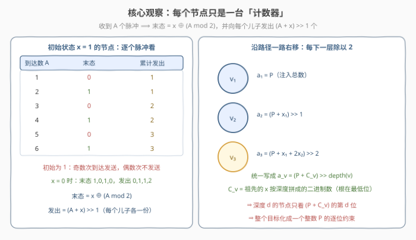
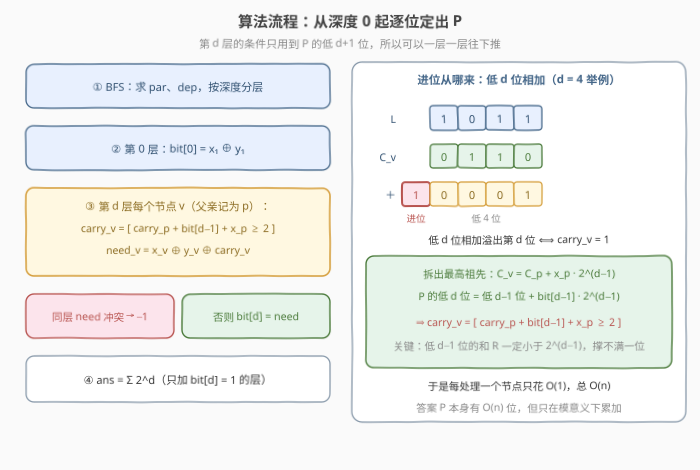
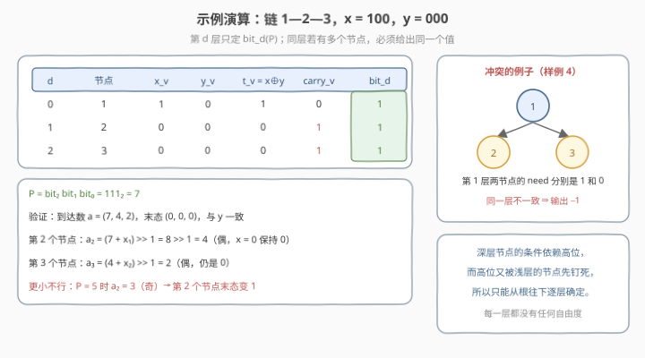

# Codeforces 2278G 0 与 1 题解

## 1. 题目概述

- **标题 / 题号**：0 与 1（Codeforces 2278G，英文名 0s and 1s）
- **链接**：https://codeforces.com/problemset/problem/2278/G
- **来源**：Codeforces Round 1131 (Div. 3) · Problem G
- **难度**：未评级（Div. 3 的 G 题，题面未给分值；思路是"看穿模型"，代码只有几十行）
- **限制**：时间 2 s / 内存 256 MB
- **标签**：树、位运算与进位、BFS/DFS、二进制计数、模意义求幂

**题意**：给一棵以 $1$ 为根的树，节点 $v$ 有初态 $x_v\in\{0,1\}$ 与目标态 $y_v\in\{0,1\}$。每次可以从根注入一个脉冲，脉冲到达节点 $v$ 时：若 $v$ 当前是 $0$，则变成 $1$ 且脉冲**消失**；若 $v$ 当前是 $1$，则变成 $0$ 并向**它的每个儿子各发一个**脉冲（叶子则脉冲直接消失）。问能否让所有节点都等于目标态；能则输出**最少**注入次数对 $998244353$ 取模，否则输出 `-1`。多测：首行 $t$，每组给出 $n$、$n-1$ 条无向边、长度为 $n$ 的串 $x$ 与串 $y$。

**约束**：

- $1\le t\le 10^{4}$，$1\le n\le 2\times 10^{5}$，$\sum n\le 2\times 10^{5}$；
- $x_i,y_i\in\{0,1\}$；边不保证父亲在前，需要自己从 $1$ 号点定向；
- 最优注入次数可达 $2^{n-1}$ 量级，**必须取模**；但判定过程必须精确，不能拿取模后的数比较。

## 2. 示例

官方样例（输入 / 输出原样）：

```text
输入
5
1
0
0
1
0
1
3
1 2
1 3
000
011
3
1 2
1 3
000
010
3
1 2
2 3
000
001

输出
0
1
2
-1
4
```

依次是：无需操作、单点翻一次、根与两个孩子同时点亮、同层要求冲突（`-1`）、三节点链要 $4$ 次。

再补一组自造数据，专打"初态为 $1$ 的节点会不会多发送"这个坑：

```text
输入（自造）
1
2
1 2
10
00

输出
3
```

第 1 次注入根 $1\to0$ 并送一个脉冲给儿子（儿子 $0\to1$）；第 2 次让根 $0\to1$，脉冲停住；第 3 次根 $1\to0$ 再送一个给儿子，儿子 $1\to0$。共 $3$ 次。若误以为儿子只收到 $\lfloor P/2\rfloor$ 个脉冲（忽略 $+x_v$），就会错答 $1$。

## 3. 解题思路

### 3.1 暴力思路

枚举注入次数 $P=0,1,2,\dots$，每次用栈把脉冲沿树推一遍再检查。单次注入最坏跑满整棵树，而 $P$ 可以是指数级（长链上目标只差最深那个点，答案就是 $2^{n-1}$），总代价 $O(nP)$ 完全不可行。必须把"脉冲怎么流"压成每个点的常数级信息。

### 3.2 核心观察：每个节点只是一台计数器



设节点 $v$ 共收到 $A_v$ 个脉冲。到达顺序无关紧要：每来一个脉冲，状态必然翻转一次（$0\to1$ 与 $1\to0$ 都是翻转），所以末态为 $x_v\oplus(A_v\bmod 2)$；而它向每个儿子发出的个数，等于"到达时当前状态为 $1$"的次数——初态为 $1$ 时是第 $1,3,5,\dots$ 个到达，初态为 $0$ 时是第 $2,4,6,\dots$ 个，两者统一为

$$
A_c=\left\lfloor\frac{A_v+x_v}{2}\right\rfloor=(A_v+x_v)\gg 1 ,
$$

与是哪个儿子无关，故兄弟收到的脉冲数完全相同。

> ⚠️ 常见错误：直接写成 $A_c=A_v\gg 1$（漏掉 $+x_v$）。它只在 $x_v=0$ 时成立；$x_v=1$ 的节点在奇数次到达时也会发送，§2 的自造样例就是反例。

### 3.3 算法流程：沿路径右移，按位定出 P



把 $A_v$ 沿根到 $v$ 的路径展开。设 $v$ 深度为 $d$、祖先链为 $u_0=1,u_1,\dots,u_{d-1}$，令 $C_v=\sum_{k<d}x_{u_k}2^{k}$，即把祖先的 $x$ 按深度拼成的二进制数（根在最低位）。由 $A_c=(A_v+x_v)\gg1$ 与嵌套取整恒等式 $\left\lfloor\frac{\lfloor N/2^d\rfloor+x}{2}\right\rfloor=\left\lfloor\frac{N+x2^d}{2^{d+1}}\right\rfloor$ 归纳得

$$
A_v=(P+C_v)\gg d\qquad(P=A_1\ \text{是注入总数}).
$$

目标条件 $x_v\oplus(A_v\bmod2)=y_v$ 于是变成对 $P$ 的逐位约束：记 $t_v=x_v\oplus y_v$，$b_d=\text{bit}_d(P)$，则需 $\text{bit}_d(P+C_v)=t_v$。低 $d$ 位相加最多往第 $d$ 位进一个 $1$，记 $carry_v=[\,(P\bmod2^d)+C_v\ge 2^d\,]$，就有 $b_d=t_v\oplus carry_v$。

**关键是 $carry_v$ 能 $O(1)$ 递推**：设 $p$ 是 $v$ 的父亲，把 $C_v=C_p+x_p2^{d-1}$ 与 $P$ 的低 $d$ 位拆开，

$$
(P\bmod2^d)+C_v=(L_{d-1}+C_p)+(b_{d-1}+x_p)2^{d-1},\qquad L_{d-1}+C_p=carry_p\cdot2^{d-1}+R,
$$

其中 $R<2^{d-1}$ 永远撑不满一位，于是只有 $carry_p+b_{d-1}+x_p\ge 2$ 才进位：

$$
carry_v=[\,carry_p+b_{d-1}+x_p\ge 2\,].
$$

于是整条算法是：

1. $b_0=t_1=x_1\oplus y_1$（根的进位视为 $0$）；
2. 按深度从小到大，对第 $d$ 层每个 $v$ 算 $carry_v$ 与 $need_v=t_v\oplus carry_v$；同层必须全部相等，否则输出 `-1`；相等则令 $b_d=need_v$；
3. 答案 $P=\sum_{b_d=1}2^{d}$，在模 $998244353$ 下累加。

每层都没有任何选择余地：第 $d$ 层只能决定 $b_d$，而它用到的进位只依赖更低的位，所以整个 $P$ 被唯一确定（冲突即无解）。

### 3.4 示例演算



取链 $1-2-3$，$x=\texttt{100}$、$y=\texttt{000}$，故 $t=(1,0,0)$：

| $d$ | 节点 | $x_v$ | $y_v$ | $t_v$ | $carry_v$ | $b_d$ |
|-----|------|-------|-------|-------|-----------|-------|
| 0 | 1 | 1 | 0 | 1 | 0 | 1 |
| 1 | 2 | 0 | 0 | 0 | $[0+1+1\ge2]=1$ | $0\oplus1=1$ |
| 2 | 3 | 0 | 0 | 0 | $[1+1+0\ge2]=1$ | $0\oplus1=1$ |

得 $P=111_2=7$。验证：到达数 $A=(7,4,2)$，末态 $(0,0,0)$ 正确；更小的 $P=5$ 会让第 2 个节点收到 $3$ 个（奇）而变成 $1$，不行。再看官方样例 4（根带两个儿子，$x=\texttt{000},y=\texttt{010}$）：第 1 层两节点的进位都是 $0$，$t$ 却是 $1$ 与 $0$，$need$ 冲突 ⇒ `-1`。样例 5（链，$000\to001$）：$b_0=b_1=0,b_2=1$ ⇒ 答案 $4$。

## 4. 算法细节

1. **迭代 BFS，不递归**：$n=2\times10^5$ 的链深度就是 $199999$，递归必爆栈；BFS 顺带给出父亲、深度，且出队顺序天然按深度非降。
2. **只要两个数组**：`bit[d]`（长度 $n$ 足够，深度 $\le n-1$）与 `carry[v]`。$C_v$ 完全不必显式计算，进位递推把它消化掉了。
3. **同层判冲突不必分组**：用 `curD`/`curNeed` 两个变量，出队时深度变了就重置；第一个节点定下 $b_d$，后面的只做比较。比较对象是 $t_v\oplus carry_v$，不是 $t_v$。
4. **幂表只算一次**：开头把 $2^d\bmod 998244353$ 预处理到 $2\times10^5$，避免 $t=10^4$ 组各跑一次快速幂。
5. **累加用 `long long`**：每层至多加一个 $<998244353$ 的数，$2\times10^5$ 层总和不超过 $2\times10^{14}$，不会溢出，最后统一取模。
6. **多测不清空大数组**：用每组局部 `vector`，总复杂度 $O(\sum n)$；若每组 `memset` 一个 $2\times10^5$ 的数组，$t=10^4$ 会超时。
7. **I/O**：$2\times10^5$ 条边加两条长串，关掉同步流后 `cin >>` 足够；串内无空格，按 `string` 读。

## 5. 正确性证明

**引理 1（计数器）**：若节点 $v$ 共收到 $A$ 个脉冲，则末态为 $x_v\oplus(A\bmod 2)$，且它向每个儿子发出的脉冲数恰为 $(A+x_v)\gg1$。

**证明**：每到达一个脉冲状态必然翻转，故末态等于初态异或"翻转次数奇偶"。发送发生在"到达时状态为 $1$"的时刻：初态 $0$ 时状态序列为 $0,1,0,1,\dots$，第 $2,4,6,\dots$ 次到达发送，计 $\lfloor A/2\rfloor$ 次；初态 $1$ 时序列为 $1,0,1,0,\dots$，第 $1,3,5,\dots$ 次到达发送，计 $\lceil A/2\rceil$ 次。两者合并恰为 $\lfloor(A+x_v)/2\rfloor$。∎

**引理 2（展开式）**：深度为 $d$ 的节点 $v$ 收到 $A_v=(P+C_v)\gg d$ 个脉冲，其中 $C_v=\sum_{k<d}x_{u_k}2^{k}$。

**证明**：对 $d$ 归纳。$d=0$ 时 $A_1=P$、$C_1=0$。设对深度 $d$ 的 $v$ 成立，其儿子 $c$ 满足 $C_c=C_v+x_v2^{d}$，由引理 1 与嵌套取整恒等式

$$
A_c=\left\lfloor\frac{(P+C_v)\gg d\;+x_v}{2}\right\rfloor=\left\lfloor\frac{P+C_v+x_v2^{d}}{2^{d+1}}\right\rfloor=(P+C_c)\gg(d+1).
$$

∎

**引理 3（进位递推）**：设 $v$ 深度 $d\ge1$、父亲为 $p$，则 $[\,(P\bmod2^d)+C_v\ge2^d\,]=[\,carry_p+b_{d-1}+x_p\ge2\,]$，其中 $carry_p=[\,(P\bmod2^{d-1})+C_p\ge2^{d-1}\,]$。

**证明**：记 $R_d=P\bmod2^d$，则 $R_d=R_{d-1}+b_{d-1}2^{d-1}$，于是 $R_d+C_v=(R_{d-1}+C_p)+(b_{d-1}+x_p)2^{d-1}$。由 $R_{d-1},C_p<2^{d-1}$ 可写 $R_{d-1}+C_p=carry_p\cdot2^{d-1}+R$ 且 $0\le R<2^{d-1}$。令 $m=carry_p+b_{d-1}+x_p$，则 $R_d+C_v=m2^{d-1}+R$：$m\ge2$ 时不小于 $2^d$；$m=1$ 时等于 $2^{d-1}+R<2^d$；$m=0$ 时更小。故进位当且仅当 $m\ge2$。∎

**定理**：算法输出 `-1` 当且仅当目标不可达；否则输出的 $P$ 是所有可行注入次数中的最小值。

**证明**：设 $P$ 可行。由引理 2，第 $d$ 层节点 $v$ 的末态为 $x_v\oplus\text{bit}_d(P+C_v)$，等于 $y_v$ 迫使 $\text{bit}_d(P+C_v)=t_v$，即 $b_d=t_v\oplus carry_v$；而 $carry_v$ 只由 $P$ 的低 $d$ 位与路径上的 $x$ 决定（引理 3），与更高位无关。于是对 $d$ 归纳：$b_0$ 由根唯一确定；若 $b_0..b_{d-1}$ 已定，则第 $d$ 层每个节点都给出同一个必须的 $b_d$——不一致时不存在可行 $P$（输出 `-1`），一致时 $b_d$ 唯一确定。因此所有可行 $P$ 在模 $2^{D+1}$（$D$ 为最大深度）下同余于同一个值，算法取的是它的最小非负代表，把更高位取 $0$ 只会更小，故它不超过任何可行 $P$，即最小。反之取这个 $P$ 时每个 $v$ 都满足 $\text{bit}_d(P+C_v)=t_v$，由引理 2 得末态 $=x_v\oplus t_v=y_v$，确实可行。∎

## 6. 复杂度分析

- **时间**：每组 BFS 一次 $O(n)$，每个节点常数次整数运算，最后 $O(n)$ 累加幂表；单组 $O(n)$，总体 $O(\sum n)\le2\times10^5$，常数极小。
- **空间**：邻接表与 `par`/`dep`/`carry`/`bit`/幂表各 $O(n)$，合计 $O(n)$，$n=2\times10^5$ 时约十几 MB，远低于 256 MB。
- **实测**（本机 Apple clang 17 / Python 3.9，取最好成绩）：$n=2\times10^5$ 的链 C++ $0.49$ s、星形 $0.41$ s、随机树 $0.51$ s、$10^4$ 组小数据 $0.31$ s；Python3 对应 $0.31$/$0.28$/$0.50$/$0.25$ s。时限 2 s，余量 3 倍以上。

## 7. 参考代码

### C++17

```cpp
#include <bits/stdc++.h>
using namespace std;
const int MOD = 998244353, MAXN = 200005;

int main() {
    ios::sync_with_stdio(false);
    cin.tie(nullptr);
    vector<int> pw(MAXN);
    pw[0] = 1;
    for (int i = 1; i < MAXN; ++i) pw[i] = (int)(2LL * pw[i - 1] % MOD);
    int T;
    cin >> T;
    while (T--) {
        int n;
        cin >> n;
        vector<vector<int>> adj(n);
        for (int i = 0; i < n - 1; ++i) {
            int u, v;
            cin >> u >> v; --u; --v;
            adj[u].push_back(v); adj[v].push_back(u);
        }
        string x, y;
        cin >> x >> y;
        vector<int> par(n, -1), dep(n, 0), carry(n, 0), bit(n, 0), order{0};
        vector<char> seen(n, 0);
        seen[0] = 1;
        bool ok = true;
        int curD = -1, curNeed = -1;
        for (size_t qi = 0; qi < order.size(); ++qi) {
            int v = order[qi], d = dep[v];
            if (d != curD) { curD = d; curNeed = -1; }
            int need;
            if (d == 0) need = (x[0] - '0') ^ (y[0] - '0');
            else {
                int p = par[v];
                carry[v] = (carry[p] + bit[d - 1] + (x[p] - '0') >= 2);
                need = (x[v] - '0') ^ (y[v] - '0') ^ carry[v];
            }
            if (curNeed < 0) { curNeed = need; bit[d] = need; }
            else if (curNeed != need) ok = false;
            for (int to : adj[v]) if (!seen[to]) {
                seen[to] = 1; par[to] = v; dep[to] = d + 1; order.push_back(to);
            }
        }
        if (!ok) { cout << -1 << '\n'; continue; }
        long long ans = 0;
        for (int d = 0; d < n; ++d) if (bit[d]) ans += pw[d];
        cout << ans % MOD << '\n';
    }
    return 0;
}
```

### Python3

```python
import sys


def main():
    data = sys.stdin.buffer.read().split()
    if not data:
        return
    MOD, MAXN = 998244353, 200005
    pw = [1] * MAXN
    for i in range(1, MAXN):
        pw[i] = pw[i - 1] * 2 % MOD
    pos, out = 1, []
    for _ in range(int(data[0])):
        n = int(data[pos]); pos += 1
        adj = [[] for _ in range(n)]
        for _ in range(n - 1):
            u = int(data[pos]) - 1; v = int(data[pos + 1]) - 1; pos += 2
            adj[u].append(v); adj[v].append(u)
        xs = [c - 48 for c in data[pos]]
        ys = [c - 48 for c in data[pos + 1]]
        pos += 2
        par, dep, carry, bit = [-1] * n, [0] * n, [0] * n, [0] * n
        seen = bytearray(n); seen[0] = 1
        order = [0]
        ok, cur_d, cur_need, qi = True, -1, -1, 0
        while qi < len(order):
            v = order[qi]; qi += 1; d = dep[v]
            if d != cur_d:
                cur_d, cur_need = d, -1
            if d == 0:
                need = xs[0] ^ ys[0]
            else:
                p = par[v]
                carry[v] = 1 if carry[p] + bit[d - 1] + xs[p] >= 2 else 0
                need = xs[v] ^ ys[v] ^ carry[v]
            if cur_need < 0:
                cur_need = need; bit[d] = need
            elif cur_need != need:
                ok = False
            for to in adj[v]:
                if not seen[to]:
                    seen[to] = 1; par[to] = v; dep[to] = d + 1; order.append(to)
        if not ok:
            out.append("-1"); continue
        ans = 0
        for d in range(n):
            if bit[d]:
                ans += pw[d]
        out.append(str(ans % MOD))
    sys.stdout.write("\n".join(out) + "\n")


main()
```

## 8. 边界情况与易错点

1. **漏掉 $+x_v$**：$A_c=(A_v+x_v)\gg1$ 中的 $x_v$ 不能省，否则 $x=\texttt{10},y=\texttt{00}$ 会答 $1$ 而不是 $3$。
2. **同层比较的是 $need$ 而非 $t$**：必须比 $t_v\oplus carry_v$；若把 $t_v$ 直接当成 $P$ 的第 $d$ 位（漏掉进位），链 $100\to000$ 会答 $1$ 而不是 $7$。
3. **必须按深度递增处理**：$carry_v$ 用到 $b_{d-1}$，它由上一层决定；普通 DFS 的任意顺序会拿未定的位去算错进位。
4. **$n=1$**：没有边，紧跟着就是两行字符；答案即 $x_1\oplus y_1$（$0$ 或 $1$），读边循环要写成 `i < n-1`。
5. **答案是 $0$ 不是 `-1`**：初态已等于目标时输出 $0$，别把"不需要操作"判成不可行。
6. **取模与"最小"混用**：$P$ 的真值可达 $2^{199999}$，绝不能先取模再比大小；本题判定全在位上进行，取模只出现在最后累加。
7. **多测开销**：$t\le10^4$、$\sum n\le2\times10^5$，只在组内申请 `vector`；每组清空定长 $2\times10^5$ 数组会退化成 $2\times10^9$。
8. **链会爆栈**：深度最大 $199999$，递归 DFS 在多数环境下直接 RE，务必用 BFS 或手写栈。

## 相关题目与扩展

- [Codeforces 1325D. Ehab the Xorcist](https://codeforces.com/problemset/problem/1325/D)：由逐位约束反推最小整数，与本题"按位定出 $P$ 并说明最小性"是同一套动作。
- [Codeforces 280C. Game on Tree](https://codeforces.com/problemset/problem/280/C)：把"对整棵树的操作"摊成"每个节点被操作多少次"，与把脉冲摊成 $A_v$ 的思路一致。
- [LeetCode 136. 只出现一次的数字](https://leetcode.cn/problems/single-number/)：异或只看奇偶的入门题，可对照"末态只取决于 $A_v\bmod2$"。

**延伸思考**：

- **改成 $m$ 进制**：节点状态取 $0..m-1$、规则改成"加 $1$ 模 $m$，溢出时向儿子发送"，则 $\gg$ 换成除以 $m$，进位条件变成 $carry_p+b_{d-1}+x_p\ge m$，其余推导一字不改。
- **允许在任意点注入**：若每个节点可单独注入 $P_v$ 个脉冲，各子树互不影响，问题分解成每个节点上的一次同余判定，答案变为 $\sum P_v$。
- **改成计数**：由定理证明中的唯一性，$P\in[0,2^{D+1})$ 与可达目标态一一对应，故恰好有 $2^{D+1}$ 个可达态，其中注入次数 $\le K$ 的恰有 $\min(K+1,2^{D+1})$ 个。
