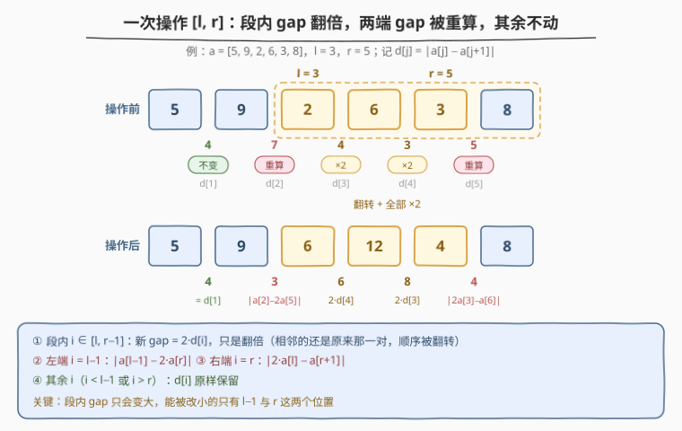
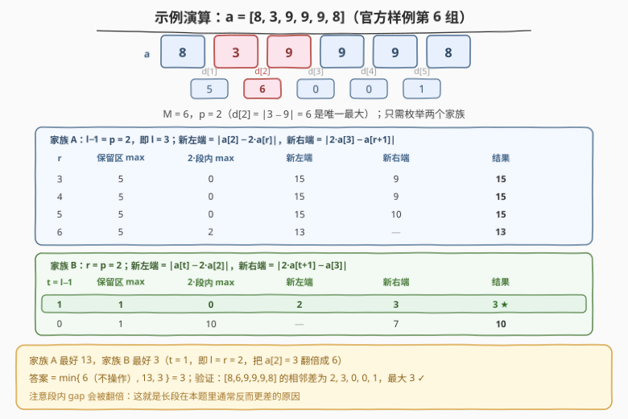

# Codeforces 2279A 翻转并翻倍 题解

## 1. 题目概述

- **标题 / 题号**：翻转并翻倍（Codeforces 2279A，英文名 Reverse and Double）
- **链接**：https://codeforces.com/problemset/problem/2279/A
- **来源**：Codeforces Round 1133 (Div. 1) · Problem A（UTC 2026-11-07）
- **难度**：未评级（750 分，Div. 1 的签到题）
- **限制**：时间 2 s / 内存 256 MB
- **标签**：二分查找、暴力枚举、数据结构、实现

**题意**：给定长度为 $n$ 的正整数数组 $a$。一次操作选一对下标 $l \le r$，把子段 $a_l,\dots,a_r$ **原地翻转并整体翻倍**，操作后数组变为

$$[a_1,\dots,a_{l-1},\ 2a_r,\ 2a_{r-1},\ \dots,\ 2a_l,\ a_{r+1},\dots,a_n]$$

数组的 **gap 值**定义为 $\max_{1 \le i < n}\lvert a_i - a_{i+1}\rvert$。求**至多**做一次操作（可以不做）之后，gap 值的最小可能值。多测：第一行是组数 $t$，每组给出 $n$ 与 $n$ 个整数，逐组输出一个整数。

**约束**：

- $1 \le t \le 10^4$，且 $\sum n \le 3\times 10^5$
- $2 \le n \le 3\times 10^5$，$1 \le a_i \le 10^6$
- 值域上界：$2a_i \le 2\times 10^6$，任何 gap 都小于 $2\times 10^6$，`int` 装得下，但实现里统一用 `long long` 更省心
- 目标复杂度：单组 $O(n)$，总计 $O(\sum n)$；$O(n^2)$ 在 $n=3\times 10^5$ 时约 $9\times 10^{10}$，必然超时

> 💡 题面 tags 里有 binary search。二分答案确实可做（判定思路见文末延伸思考），但本题存在更直接的 $O(n)$ 枚举，本文按 $O(n)$ 讲解。

## 2. 示例与观察
官方 6 组样例（输入 / 输出原样）：

```text
输入：
6
9
9 9 8 2 4 4 3 5 3
2
5 6
5
1 7 4 1 10
2
10 16
5
5 2 6 5 3
6
8 3 9 9 9 8

输出：
4
1
6
4
2
3
```

逐组对照（只列一组最优操作）：

| 组 | $n$ | 最优操作 | 结果数组 | 相邻差 | 答案 |
|----|-----|----------|----------|--------|------|
| 1 | 9 | $[4,5]$ | $9,9,8,8,4,4,3,5,3$ | $0,1,0,4,0,1,2,2$ | 4 |
| 2 | 2 | 不操作 | $5,6$ | $1$ | 1 |
| 3 | 5 | $[3,4]$ | $1,7,2,8,10$ | $6,5,6,2$ | 6 |
| 4 | 2 | $[1,1]$ | $20,16$ | $4$ | 4 |
| 5 | 5 | $[2,2]$ | $5,4,6,5,3$ | $1,2,1,2$ | 2 |
| 6 | 6 | $[2,2]$ | $8,6,9,9,9,8$ | $2,3,0,0,1$ | 3 |

第 2 组说明「不操作」必须被允许：任何操作都只会把 $5,6$ 的差 $1$ 变大。第 3、6 组说明好操作往往落在**很短的段**上——段一长，段内每个 gap 都要翻倍。

自造一组补充样例（检验「最大值并列时不操作最优」）：

```text
输入：
1
4
1 11 1 11

输出：
10
```

此时 $d = (10,10,10)$ 三个 gap 并列最大，任选一段都会让段内 gap 变成 $20$ 或让端点差被拉大，所以答案是原样的 $10$。

## 3. 解题思路

### 3.1 暴力思路

枚举所有 $l \le r$（$O(n^2)$ 对），每次重建数组并扫描求 gap（$O(n)$），总 $O(n^3)$；即使借助前后缀最大值把单次评估压到 $O(1)$，仍是 $O(n^2)$ 对候选。$n = 3\times 10^5$ 时不可行，必须把候选数量降下来。

### 3.2 核心观察：最大 gap 必须站在边界上



记 $d_j = \lvert a_j - a_{j+1}\rvert$（$1 \le j \le n-1$）。对 $[l,r]$ 操作后，只需要看 $d$ 怎么变：

- **段内** $j \in [l, r-1]$：这一对相邻元素都乘了 $2$，所以新 gap $= 2d_u$（$u$ 是原来那一对的位置）。也就是说段内这些 gap **只是乘 2**，同时顺序被翻转，最大值不变；
- **左端** $j = l-1$（$l>1$ 时）：被替换成 $\lvert a_{l-1} - 2a_r\rvert$；
- **右端** $j = r$（$r<n$ 时）：被替换成 $\lvert 2a_l - a_{r+1}\rvert$；
- **其余** $j$：原样保留。

其中段内 gap 只会**变大或保持不变**，所以「可能被改小」的位置只有 $l-1$ 与 $r$ 这两个。


注意一个细节：段内是「整段乘 $2$ 后重排」，所以**单个** $d'_j$ 未必不小于 $d_j$（被乘 $2$ 的可能是原本较小的那个）。但把不在这两个边界上的所有位置**放在一起看**，结论就成立：

$$\text{新的 gap 值} = \max_{1 \le j \le n-1} d'_j \ \ge\ \max_{j \notin \{l-1,\,r\}} d'_j \ \ge\ \max_{j \notin \{l-1,\,r\}} d_j$$

因为段外的位置原值不动，段内的位置全部乘 $2$（下标重排不改变集合里的最大值，只会让最大值变大）。

设 $M = \max_j d_j$，$p$ 是任一取到最大值的位置。**如果 $p$ 不是边界**，上式右边就 $\ge d_p = M$；而「不操作」本来就给出 $M$。所以：

> 想让答案严格小于 $M$，$p$ 必须当边界。

这把 $O(n^2)$ 个候选砍成了两条扫描线：$p$ 当左边界、$p$ 当右边界。

### 3.3 算法流程

**预处理**（下标 1-based）：$d_j = \lvert a_j - a_{j+1}\rvert$；求前缀最大值 $pref_i = \max(d_1..d_i)$ 与后缀最大值 $suf_i = \max(d_i..d_{n-1})$（空区间记 $0$）；取 $M = \max d_j$ 及某个最大值位置 $p$；令 $ans \leftarrow M$（不操作）。

**家族 A —— $p$ 当左边界**：$l-1 = p$，即 $l = p+1$，让 $r$ 从 $p+1$ 扫到 $n$：

$$v_r = \max\Bigl(pref_{p-1},\ suf_{r+1},\ 2\max_{p<j<r} d_j,\ \lvert a_p - 2a_r\rvert,\ \mathbf{1}_{r<n}\cdot\lvert 2a_{p+1} - a_{r+1}\rvert\Bigr)$$

**家族 B —— $p$ 当右边界**：$r = p$，让 $t = l-1$ 从 $p-1$ 扫到 $0$：

$$u_t = \max\Bigl(pref_{t-1},\ suf_{p+1},\ 2\max_{t<j<p} d_j,\ \mathbf{1}_{t \ge 1}\cdot\lvert a_t - 2a_p\rvert,\ \lvert 2a_{t+1} - a_{p+1}\rvert\Bigr)$$

最后 $ans = \min\bigl(M,\ \min_r v_r,\ \min_t u_t\bigr)$。

式子里**前两项合成保留区**（段外左右两段、未被波及的 gap），第三项是**段内翻倍后的最大值**，后两项是两个被重写的端点；**任何一项对应的区间为空时一律记 $0$**（空区间取 $\max$ 的约定值）。段内最大值不必用 RMQ：$r$ 递增时把 $d_{r-1}$ 并进来，$t$ 递减时把 $d_{t+1}$ 并进来，一次线性扫描就够。图 3 会把这些项逐行算给你看。

### 3.4 示例演算



以第 6 组 $a = [8,3,9,9,9,8]$ 为例：$d = (5,6,0,0,1)$，$M = 6$，$p = 2$。

- **家族 A**（$l = 3$，$r = 3,4,5,6$）：保留区最大恒为 $5$，新左端 $\lvert a_2 - 2a_r\rvert = \lvert 3 - 2a_r\rvert$ 依次是 $15,15,15,13$，新右端依次是 $9,9,10$（$r=6$ 时不存在），段内翻倍最大是 $0,0,0,2$。四个候选值为 $15,15,15,13$。
- **家族 B**（$r = 2$）：$t=1$ 时 $l = r = 2$，把 $a_2 = 3$ 翻倍成 $6$，得到 $[8,6,9,9,9,8]$，相邻差 $2,3,0,0,1$，候选值 $3$；$t=0$ 时整段前缀翻倍，候选值 $10$。
- 汇总：$ans = \min(6,\ 13,\ 3) = 3$，与官方输出一致。

这个例子也说明为什么**长段通常更差**：段内 gap 统统乘 $2$，而本题的收益只来自「重写那两个端点」。

## 4. 算法细节

1. **统一 1-based 下标**：读入 $a_1..a_n$，$d_j$ 对应 $a_j, a_{j+1}$；边界位置是 $l-1$ 与 $r$，**不是** $l$ 与 $r$，写错这一处会全盘错。
2. **空区间取 0，不要取 $-\infty$**：$pref_0 = 0$、$suf_n = 0$、段内为空时也记 $0$。这样「保留区 / 段内 / 端点」四类项都能无特判地直接进 $\max$；用一个越界下标去取 $-\infty$ 反而容易数组越界。
3. **段内最大值递推维护**：家族 A 里 $r$ 每加 $1$，新增的内部 gap 正好是 $d_{r-1}$；家族 B 里 $t$ 每减 $1$，新增的是 $d_{t+1}$。于是每个候选 $O(1)$，整族 $O(n)$，不需要线段树或稀疏表。
4. **保留区最大值**：$j < l-1$ 用 $pref_{l-2}$、$j > r$ 用 $suf_{r+1}$；两边都为空就是 $0$，所以写 $\max(pref, suf)$ 时把越界值当 $0$ 即可。
5. **端点项的存在性**：$l = 1$ 时没有左端 gap，$r = n$ 时没有右端 gap；家族 A 用 `r < n` 判断右端，家族 B 用 `t >= 1` 判断左端，缺的一侧记 $0$。
6. **$ans$ 的初值必须是 $M$**：至少可以不操作。若初值写成 `INF` 而漏掉「不操作」这一支，第 2、6 组这类「操作只会更差」的数据会直接错。
7. **多测清空**：所有 `vector` 都按当前的 $n$ 重新构造（或 `assign` 成正确长度），不要复用上一组残留的尾部元素；$t$ 可达 $10^4$，反复 `memset` 全量数组反而慢。
8. **溢出**：$2a_i \le 2\times 10^6$、$\lvert a_i - 2a_j\rvert < 2\times 10^6$，`int` 够，但 `2 * a[i]` 一旦遇到更大的值域就会溢出，所以代码统一用 `long long`。
9. **I/O**：$t$ 大、单组元素多，务必 `std::ios::sync_with_stdio(false); cin.tie(nullptr);`；Python 用 `sys.stdin.buffer.read().split()` 一次读入，比逐行 `input()` 快一个数量级。

## 5. 正确性证明

**引理 1（操作后的 gap 结构）**：设对 $[l,r]$ 操作，记操作后第 $j$ 个相邻差为 $d'_j$（$1 \le j \le n-1$）。则

$$d'_j = \begin{cases} d_j, & j < l-1 \ \text{或}\ j > r \\ 2\,d_{l+r-1-j}, & l \le j \le r-1 \\ \lvert a_{l-1} - 2a_r\rvert, & j = l-1 \\ \lvert 2a_l - a_{r+1}\rvert, & j = r \end{cases}$$

**证明**：操作后位置 $l..r$ 上的元素依次是 $2a_r, 2a_{r-1}, \dots, 2a_l$，即位置 $j \in [l,r]$ 上是 $2a_{l+r-j}$。$j \in [l, r-1]$ 时它的右邻居是 $2a_{l+r-j-1}$，差为 $2\lvert a_{l+r-j} - a_{l+r-j-1}\rvert = 2d_{l+r-j-1}$，把下标改成 $l+r-1-j$ 即得第二行。$j = l-1$ 时左邻是 $a_{l-1}$、右邻是 $2a_r$；$j = r$ 时左邻是 $2a_l$、右邻是 $a_{r+1}$；其余位置两侧元素都没动。逐类直接计算即得。∎

**引理 2（非边界位置的最大值不降）**：对任意操作 $[l,r]$，记 $\mathcal{S} = \{j : 1 \le j \le n-1,\ j \notin \{l-1,\ r\}\}$，则

$$\max_{j \in \mathcal{S}} d'_j \ \ge\ \max_{j \in \mathcal{S}} d_j .$$

**证明**：$\mathcal{S}$ 按位置分成两段：**段外** $\mathcal{S}_{out} = [1, l-2] \cup [r+1, n-1]$ 与**段内** $\mathcal{S}_{in} = [l, r-1]$，二者无交且并为 $\mathcal{S}$。由引理 1：$j \in \mathcal{S}_{out}$ 时 $d'_j = d_j$；$j \in \mathcal{S}_{in}$ 时 $d'_j = 2d_{\pi(j)}$，其中 $\pi(j) = l+r-1-j$ 是 $[l,r-1]$ 到自身的双射。于是

$$\max_{j \in \mathcal{S}} d'_j = \max\Bigl(\max_{j \in \mathcal{S}_{out}} d_j,\ 2\!\!\max_{j \in \mathcal{S}_{in}} d_j\Bigr) \ \ge\ \max\Bigl(\max_{j \in \mathcal{S}_{out}} d_j,\ \max_{j \in \mathcal{S}_{in}} d_j\Bigr) = \max_{j \in \mathcal{S}} d_j .$$

其中不等号用了 $d \ge 0 \Rightarrow 2d \ge d$，等号用了「双射不改变多重集的最大值」。∎

**引理 3（最大 gap 必须当边界）**：设 $M = \max_j d_j$，$p$ 为任一满足 $d_p = M$ 的位置。若某次操作后的 gap 值 $< M$，则该操作满足 $p \in \{l-1,\ r\}$。

**证明**：反设 $p \notin \{l-1, r\}$，则 $p \in \mathcal{S}$。由引理 2 与其最大值定义，$\max_{j\in\mathcal{S}} d_j \ge d_p = M$，故操作后的 gap 值 $\ge M$，与假设矛盾。∎

**引理 4（两个家族覆盖全部候选）**：任何满足 $p \in \{l-1,\ r\}$ 的操作恰好属于家族 A 或家族 B，并且 3.3 中的 $v_r$、$u_t$ 公式**精确等于**该操作后的 gap 值。

**证明**：$p \in \{l-1, r\}$ 分两种情形。若 $p = l-1$，则 $l = p+1$、$r \ge p+1$，正是家族 A 的枚举范围；若 $p = r$，则 $t = l-1 \le p-1$ 且 $t \ge 0$，正是家族 B 的枚举范围，且 $t = p$ 不可能（会给出 $l = p+1 > r$）。至于数值：以家族 A 为例，$d$ 的下标集合被划分成 $[1,p-1]$（段外，取 $pref_{p-1}$）、$\{p\}$（左端，取 $\lvert a_p - 2a_r\rvert$）、$[p+1, r-1]$（段内，取 $2\max d$）、$\{r\}$（右端，取 $\lvert 2a_{p+1} - a_{r+1}\rvert$）、$[r+1, n-1]$（段外，取 $suf_{r+1}$），五部分无交且覆盖全部 $j$，故 $v_r$ 就是该操作后所有 gap 的最大值。家族 B 的划分同理。∎

**定理**：算法输出的 $ans$ 等于最优解 $OPT$。

**证明**：先证 $ans \ge OPT$：$M$ 对应「不操作」，每个 $v_r$、$u_t$ 由引理 4 都对应一个真实操作的 gap 值，所以 $ans$ 是若干个**可达**值的 $\min$，故 $ans \ge OPT$（$OPT$ 是所有可达值的下确界）。

再证 $ans \le OPT$：取达到 $OPT$ 的操作（若最优是「不操作」，则 $OPT = M \ge ans$）。若其 gap 值 $= OPT \ge M$，则 $ans \le M \le OPT$。否则 $OPT < M$，由引理 3 有 $p \in \{l-1, r\}$，由引理 4 该操作被某个 $v_r$ 或 $u_t$ 精确重现，于是 $ans \le$ 该候选值 $= OPT$。两方向合并得 $ans = OPT$。∎

## 6. 复杂度分析

- **时间**：单组 $O(n)$——求 $d$、$pref$、$suf$ 各 $O(n)$，家族 A、B 各扫描一次也是 $O(n)$，每个候选 $O(1)$。总计 $O(\sum n) \le 3\times 10^5$ 次基本运算。实测 C++ 单组 $n = 3\times 10^5$ 最坏约 $0.36$ s（含进程启动约 $4$ ms），Python3 约 $0.50$ s；时限 $2$ s，C++ 余量 $>5$ 倍，Python 余量约 $4$ 倍。
- **空间**：$O(n)$。需要 $a$、$d$、$pref$、$suf$ 以及两条扫描线的内部前缀数组，约 $6n$ 个 `long long`；$n = 3\times10^5$ 时约 $14$ MB，远低于 $256$ MB。若改用 `int` 可降到约 $7$ MB。
- **对照时限**：最大的开销是读入 $3\times10^5$ 个整数；计算部分完全线性，不存在需要卡常的瓶颈。

## 7. 参考代码

### C++17

```cpp
#include <algorithm>
#include <cstdio>
#include <cstdlib>
#include <iostream>
#include <vector>
using namespace std;

int main() {
    ios::sync_with_stdio(false);
    cin.tie(nullptr);

    int T;
    if (!(cin >> T)) return 0;              // 空输入防护
    while (T--) {
        int n;
        cin >> n;
        vector<long long> a(n + 1);
        for (int i = 1; i <= n; i++) cin >> a[i];
        if (n <= 1) { cout << 0 << "\n"; continue; }

        int m = n - 1;                       // d[1..m]，d[i] = |a[i]-a[i+1]|
        vector<long long> d(m + 1);
        long long M = -1;
        int p = 1;                           // 最大的 d 的位置（并列任取）
        for (int i = 1; i <= m; i++) {
            d[i] = llabs(a[i] - a[i + 1]);
            if (d[i] > M) { M = d[i]; p = i; }
        }

        vector<long long> pref(m + 2, 0), suf(m + 3, 0);
        for (int i = 1; i <= m; i++) pref[i] = max(pref[i - 1], d[i]);
        for (int i = m; i >= 1; i--) suf[i] = max(suf[i + 1], d[i]);

        // R[i] = max d[p+1..i]，L[i] = max d[i..p-1]，空区间为 0
        vector<long long> R(m + 2, 0), L(m + 2, 0);
        for (int i = p + 1; i <= m; i++) R[i] = max(R[i - 1], d[i]);
        for (int i = p - 1; i >= 1; i--) L[i] = max(L[i + 1], d[i]);

        long long ans = M;                   // 方案 0：不操作

        // 方案 A：p 是左边界，l = p+1，r 取 [p+1, n]
        for (int r = p + 1; r <= n; r++) {
            long long v = pref[p - 1];
            if (r + 1 <= m) v = max(v, suf[r + 1]);           // 段右外侧
            v = max(v, 2 * R[max(r - 1, p)]);                 // 段内 [p+1, r-1] 翻倍
            v = max(v, llabs(a[p] - 2 * a[r]));               // 新左端
            if (r < n) v = max(v, llabs(2 * a[p + 1] - a[r + 1]));  // 新右端
            ans = min(ans, v);
        }

        // 方案 B：p 是右边界，r = p，t = l-1 取 [0, p-1]
        for (int t = 0; t <= p - 1; t++) {
            long long v = suf[p + 1];
            if (t >= 2) v = max(v, pref[t - 1]);              // 段左外侧
            v = max(v, 2 * L[min(t + 1, p)]);                 // 段内 [t+1, p-1] 翻倍
            if (t >= 1) v = max(v, llabs(a[t] - 2 * a[p]));   // 新左端
            v = max(v, llabs(2 * a[t + 1] - a[p + 1]));       // 新右端
            ans = min(ans, v);
        }

        cout << ans << "\n";
    }
    return 0;
}
```

### Python3

```python
import sys


def solve_case(n, a):
    m = n - 1
    d = [0] * (m + 1)
    M, p = -1, 1
    for i in range(1, m + 1):
        d[i] = abs(a[i] - a[i + 1])
        if d[i] > M:
            M, p = d[i], i

    pref = [0] * (m + 2)
    suf = [0] * (m + 3)
    for i in range(1, m + 1):
        pref[i] = max(pref[i - 1], d[i])
    for i in range(m, 0, -1):
        suf[i] = max(suf[i + 1], d[i])

    R = [0] * (m + 2)          # R[i] = max d[p+1..i]
    L = [0] * (m + 2)          # L[i] = max d[i..p-1]
    for i in range(p + 1, m + 1):
        R[i] = max(R[i - 1], d[i])
    for i in range(p - 1, 0, -1):
        L[i] = max(L[i + 1], d[i])

    ans = M                    # 不操作

    # 家族 A：p 是左边界，l = p+1，r 从 p+1 到 n
    for r in range(p + 1, n + 1):
        v = pref[p - 1]
        if r + 1 <= m:
            v = max(v, suf[r + 1])
        v = max(v, 2 * R[max(r - 1, p)])
        v = max(v, abs(a[p] - 2 * a[r]))
        if r < n:
            v = max(v, abs(2 * a[p + 1] - a[r + 1]))
        ans = min(ans, v)

    # 家族 B：p 是右边界，r = p，t = l-1 从 p-1 到 0
    for t in range(0, p):
        v = suf[p + 1]
        if t >= 2:
            v = max(v, pref[t - 1])
        v = max(v, 2 * L[min(t + 1, p)])
        if t >= 1:
            v = max(v, abs(a[t] - 2 * a[p]))
        v = max(v, abs(2 * a[t + 1] - a[p + 1]))
        ans = min(ans, v)

    return ans


def main():
    data = sys.stdin.buffer.read().split()
    if not data:
        return
    t = int(data[0])
    pos = 1
    out = []
    for _ in range(t):
        n = int(data[pos]); pos += 1
        a = [0] + [int(x) for x in data[pos:pos + n]]
        pos += n
        out.append(str(solve_case(n, a) if n > 1 else 0))
    sys.stdout.write("\n".join(out) + "\n")


main()
```

## 8. 边界情况与易错点

1. **$n = 2$**：只有一个 gap，$m = 1$。$p = 1$ 时家族 A 只有 $r = 2$（$l = r = 2$，即把 $a_2$ 翻倍），家族 B 只有 $t = 0$（把 $a_1$ 翻倍）；此时 $suf_{p+1} = suf_2$、$pref_{t-1}$ 的下标会越界到 $0$ 甚至 $-1$，必须统一按「空区间 $=0$」处理。
2. **所有 $a_i$ 相同**：$M = 0$，$ans$ 初值 $0$，任何操作都只会把 gap 变大，所以答案恒为 $0$（例如 $[1,1,\dots,1]$ 输出 `0`）。若把 $ans$ 初始化成 `INF` 又忘了最小化「不操作」，这里就会错。
3. **最大值并列**：例如 $[1,11,1,11]$ 的 $d = (10,10,10)$。任取一个最大值位置 $p$ 当边界即可：另一个并列者要么也落在边界上（此时被家族 A 中以该位置为 $r$ 的那次枚举精确覆盖），要么落在 $\mathcal{S}$ 里，由引理 2 结果 $\ge 10 = M$，最优解就是「不操作」。所以**不必枚举所有最大值位置**，取任意一个都正确。
4. **段长为 1（$l = r$）**：没有段内 gap，两个端点都被重写。本题不少最优解就是单元素操作（样例 5、6 都是），千万不要把 $l = r$ 当成「不操作」跳过。
5. **整段操作（$l = 1,\ r = n$）**：两侧端点都不存在，公式里对应的项记 $0$；代码里要靠 `r < n`、`t >= 1` 两个判断兜住，写死 `a[0]` 或 `a[n+1]` 会越界读到垃圾值。
6. **端点下标错位**：边界是 $l-1$ 和 $r$，而 $l-1$ 对应的数组元素却是 $a_{l-1}$、$r$ 对应的是 $a_{r+1}$，很容易把 $\lvert a_p - 2a_r\rvert$ 写成 $\lvert a_{p+1} - 2a_r\rvert$。
7. **多测残留**：$t$ 可达 $10^4$，务必按当前 $n$ 重建数组；只在旧数组上覆盖前 $n$ 个位置时，$pref$、$suf$ 的尾部可能带着上一组的旧值。
8. **输出格式**：每组一行、不要空行；答案是非负整数，溢出时（若放宽到 $a_i \le 10^9$）会变成负数，务必上 `long long`。

## 9. 验证记录

- **编译环境与命令**：`clang++ -std=c++17 -O2`（本机无 GNU g++，配 `codeforces/tools/include/bits/stdc++.h` 兼容头；正文代码只用标准库，可原样提交 GNU C++17）；Python 侧为 `Python 3.9.6`。
- **官方样例**：1 / 1 通过（按 Codeforces 标准 checker 的 token 比对，忽略空白与大小写）。
- **复核状态**：audited（2026-11-19 统一回归：编译 + 官方样例；写作期的随机对拍与暴力未重跑）。

## 相关题目与扩展

- [Codeforces 1772D Absolute Sorting](https://codeforces.com/problemset/problem/1772/D)：选一个 $x$ 把每个元素换成 $\lvert a_i - x\rvert$ 后使序列非降，同样是「在 gap/相邻关系上做文章」的推式子题。
- [Codeforces 1455D Sequence and Swaps](https://codeforces.com/problemset/problem/1455/D)：只能把大于 $x$ 的元素与 $x$ 交换，问能否让序列非降，关键同样是判断哪些位置必须被改动。
- [LeetCode 910. 最小差值 II](https://leetcode.cn/problems/smallest-range-ii/)：每个数可以 $+k$ 或 $-k$，最小化极差，是「改写端点值来压最大值」的经典题。
- [LeetCode 1509. 三次操作后最大值与最小值的最小差](https://leetcode.cn/problems/minimum-difference-between-largest-and-smallest-value-after-three-moves/)：允许改动至多 3 个元素，枚举「改哪几端」得到 $O(n)$ 解法，与本题「只有两个端点有用」异曲同工。

**延伸思考**：

1. **二分答案视角**：固定阈值 $X$，凡 $d_j > X$ 的下标都必须落在 $\{l-1, r\}$ 内——若有一个落在段内 $[l, r-1]$，则段内最大值 $\ge d_j > X$，操作后段内最大值变成它的两倍，依然 $> X$，直接不可行。于是 $d_j > X$ 的位置超过 $2$ 个就必然失败；恰有 $2$ 个时 $l, r$ 被唯一确定，$O(1)$ 判定；恰有 $1$ 个时还要判断「某个下标窗口内是否存在落在 $[2a-X,\, 2a+X]$ 的值」，需要值域 + 位置的两维查询（归并树 / 值域线段树），整体 $O(n\log^2 n)$，反而不如本文的 $O(n)$ 干净。
2. **恰好一次操作**：若不允许「不操作」，把 $ans$ 的初值从 $M$ 换成一个足够大的数即可——两个家族覆盖了所有非空段，所以只删掉「不操作」这一支不会漏解。
3. **允许 $k$ 次操作**：结论会完全改变。可以反复翻倍同一个元素，把它逐步调到接近邻居的量级：例如 $[100,1,100]$ 做一次最好只能到 $98$，做两次（先翻倍中间的 $1$，再翻倍成 $4$）能到 $96$，继续翻倍还能更小。所以「至多一次」是本题可解的前提，$k$ 次的情形需要另建 DP / 搜索。
4. **改成只翻转、不翻倍**：段内 gap 的**值和多重集都不变**（只是顺序反了），依旧只有两个端点被重写成 $\lvert a_{l-1} - a_r\rvert$ 与 $\lvert a_l - a_{r+1}\rvert$。同样的「最大 gap 必须当边界」论证仍然成立，把代码里乘 $2$ 的地方去掉就是 $O(n)$ 解法。
5. **改成需要输出具体方案**：做法不变，只要在更新 $ans$ 时顺便记下 $(l, r)$（家族 A/B 各自对应一个），并列最优时输出任意一组即可。
