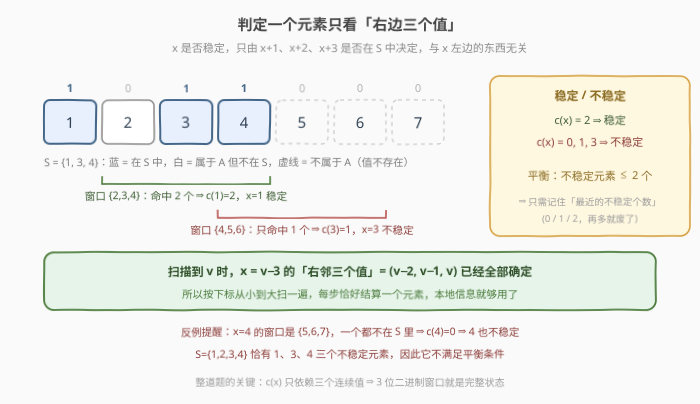
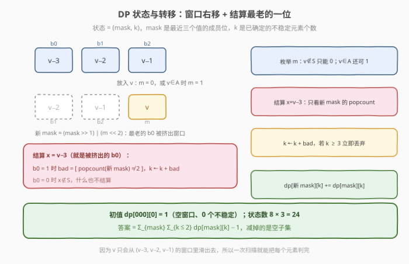
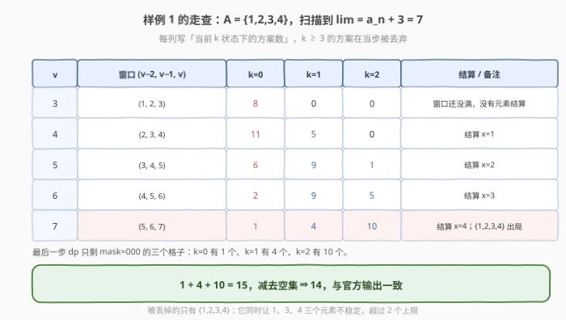

# Codeforces 2279B 平衡子集 题解

## 1. 题目概述

- **标题 / 题号**：平衡子集（Codeforces 2279B，英文名 Balanced Subsets）
- **链接**：https://codeforces.com/problemset/problem/2279/B
- **来源**：Codeforces Round 1133 (Div. 1) · Problem B（UTC 2026-11-07）
- **难度**：未评级（1000 分）
- **限制**：时间 2 s / 内存 256 MB
- **标签**：位掩码、动态规划、组合计数

**题意**：给定 $n$ 个互不相同正整数组成的集合 $A$（按升序给出）。对 $A$ 的任意非空子集 $S$：

- 称元素 $x \in S$ 是**稳定的**，当且仅当 $x+1,\ x+2,\ x+3$ 这三个值中**恰好有两个**也属于 $S$；否则称 $x$ **不稳定**；
- 若 $S$ 中不稳定元素不超过 $2$ 个，则称 $S$ 是**平衡的**。

求 $A$ 的平衡非空子集个数，对 $998244353$ 取模。

多测：第一行 $t$ 组数据。每组第一行 $n$，第二行 $n$ 个升序整数 $a_1 < a_2 < \dots < a_n$，对每组输出一行答案。

**约束**：

- $1 \le t \le 10^4$，$\sum n \le 2\times 10^5$
- $1 \le n \le 2\times 10^5$，$1 \le a_1 < a_2 < \dots < a_n \le 3n$
- 模数 $998244353$

两条信息合起来才是关键：$\sum n \le 2\times 10^5$ 说明**总复杂度只能是 $O(\sum n)$ 级别**；而 $a_i \le 3n$ 说明**值域也是 $O(n)$ 的**，于是可以按「值」扫描，而不是按「元素」扫描。

## 2. 示例与观察
```text
输入
4
4
1 2 3 4
10
1 2 4 6 7 8 10 11 15 16
6
1 2 3 15 17 18
1
3

输出
14
66
23
1
```

- 第 1 组：$A=\{1,2,3,4\}$ 共 $2^4-1=15$ 个非空子集，只有 $S=\{1,2,3,4\}$ 不合法（$1,3,4$ 三个元素都不稳定），答案 $15-1=14$。
- 第 2 组：答案 $66$，说明「相距很远的两簇拼在一起」大多仍然合法——不稳定的个数是可以累加的，但必须守住 $\le 2$。
- 第 3 组：题面特别指出 $\{15,17,18\}$ 合法：$15$ 的窗口 $\{16,17,18\}$ 命中 $17,18$ 两个（稳定），$17,18$ 各只命中 $1$ 个和 $0$ 个（不稳定），共计 $2$ 个，刚好压线。
- 第 4 组：$n=1$，唯一子集 $\{3\}$ 中 $3$ 的窗口 $\{4,5,6\}$ 全空，$c(3)=0$，$3$ 不稳定，但 $1 \le 2$，答案 $1$。

## 3. 解题思路

### 3.1 暴力思路

最直接的做法：枚举 $A$ 的全部 $2^n$ 个子集，每个子集用哈希集合在 $O(n)$ 时间内判定（对每个 $x \in S$ 查 $x+1,x+2,x+3$ 是否在 $S$）。总复杂度 $O(2^n n)$，$n=2\times10^5$ 时完全不可行。

就算把判定优化到 $O(1)$ 摊还，瓶颈仍卡在「枚举子集」。要搬掉这个指数，必须找到**局部性**：每个元素的判定只用很少的信息，而且这些信息靠近值轴上相邻的位置。

### 3.2 核心观察：稳定性是一个「只看右边三位」的局部函数



把 $S$ 看成值轴上的 01 串，$b_v = 1 \iff v \in S$。记

$$c(x) = b_{x+1} + b_{x+2} + b_{x+3}$$

那么「$x$ 稳定 $\iff c(x) = 2$」。这里有两个要点：

1. **判定是单边的**：只用到 $x+1, x+2, x+3$ 这三个**具体数值**，与 $x$ 左边的内容完全无关；
2. **窗口很短**：只有 3 位。因此沿值轴从小到大扫描时，只需记住最近 3 位 $\{b_{v-2},b_{v-1},b_v\}$；扫到 $v$ 的那一刻，$x=v-3$ 的右邻三值全部已知，**恰好可以就地结算 $x$**。

（顺便得到一个有用的直觉：若 $S$ 中出现连续 4 个值 $v,v+1,v+2,v+3$，那么 $v$ 的三个邻居全命中，$c(v)=3$，必然不稳定。所以「长连续块」是产生不稳定元素的主要来源，平衡子集在结构上很受限制。）

还剩一个障碍：题目限制的是**全局**的「不稳定元素 $\le 2$ 个」。注意到不稳定个数**只增不减**，于是再开一维 $k \in \{0,1,2\}$ 记录「已结算的不稳定元素个数」，一旦它要变成 $3$ 就把这条路径丢弃。

### 3.3 算法流程：24 个状态的状态机



记 $V = a_n$（$S \subseteq A \subseteq [1,V]$），扫描上界取 $M = V+3$——最右元素 $V$ 的窗口延伸到 $V+3$，必须扫到那里才能把它结算完。

**状态**：$dp[\text{mask}][k]$。$\text{mask} \in [0,7]$ 编码「处理完 $v-1$ 之后」的最近三位

$$\text{mask} = b_{v-3} + 2\,b_{v-2} + 4\,b_{v-1}$$

即 bit0 是最老的 $v-3$、bit2 是最新的 $v-1$（这三位正是**尚未结算**的元素）；而 $k$ 是**已经结算**过的不稳定元素个数，此时恰好结算完所有 $x \le v-4$。

**初值**：$dp[000][0] = 1$（约定 $b_v = 0$ 对 $v \le 0$ 成立），即从「什么都没选」这一个状态出发。

**转移**（加入第 $v$ 位，取 $m = b_v$）：$v \notin A$ 时只能 $m=0$；$v \in A$ 时 $m \in \{0,1\}$ 均合法。

$$\text{new} = (\text{mask} \gg 1) \mid (m \ll 2) = b_{v-2} + 2\,b_{v-1} + 4\,b_v$$

窗口右移后，被挤出的正好是 $x = v-3$：

- 若 $\text{mask} \ \&\ 1 = 0$，则 $x \notin S$，没有元素需要结算，$k' = k$；
- 若 $\text{mask} \ \&\ 1 = 1$，则 $x \in S$，且它的右邻三个值就是新窗口的三位，于是

$$k' = k + [\,\operatorname{popcount}(\text{new}) \ne 2\,]$$

$k' \ge 3$ 的转移直接丢弃；否则 $dp[\text{new}][k'] \mathrel{+}= dp[\text{mask}][k]$。

**收尾**：扫完 $v=1\dots M$ 后所有元素都已结算，窗口退化为 $000$，答案

$$\text{ans} = \left(\sum_{\text{mask}}\sum_{k=0}^{2} dp[\text{mask}][k]\right) - 1$$

减掉的 $1$ 是空集：它没有不稳定元素，落在 $k=0$ 里，必然被统计。

状态数仅 $24$，每步至多 $2$ 个分支，单组复杂度 $O(a_n) = O(n)$。

### 3.4 示例演算



取样例 1：$A=\{1,2,3,4\}$，$V=4$，$M=7$。前 3 步窗口还没装满，没有元素可结算，每个 mask 各累计 $1$ 条路径：

| $v$ | 窗口 $(v-2,v-1,v)$ | $k=0$ | $k=1$ | $k=2$ | 本步结算 |
|-----|--------------------|-------|-------|-------|----------|
| 3 | $(1,2,3)$ | 8 | 0 | 0 | 窗口未满 |
| 4 | $(2,3,4)$ | 11 | 5 | 0 | $x=1$ |
| 5 | $(3,4,5)$ | 6 | 9 | 1 | $x=2$ |
| 6 | $(4,5,6)$ | 2 | 9 | 5 | $x=3$ |
| 7 | $(5,6,7)$ | 1 | 4 | 10 | $x=4$ |

最后一行 $1+4+10=15$，减去空集得 $14$，与官方输出一致。被剪掉的路径正是 $S=\{1,2,3,4\}$：在 $v=7$ 结算 $x=4$ 时，$4$ 的窗口 $\{5,6,7\}$ 命中 $0$ 个，$k$ 从 $2$ 涨到 $3$，于是出局。

## 4. 算法细节

1. **扫描上界取 $a_n+3$，不要取 $3n$**：$v>a_n$ 的位置必然不在 $A$ 中（只能 $m=0$），窗口会保持 $000$，多扫纯属浪费。本题 $\sum a_n \le 3\sum n$，所以总量本身就是 $O(n)$。
2. **mask 的方向必须自洽**：本文约定 bit0 最老，于是新窗口是 `(mask >> 1) | (m << 2)`。若错写成 `(mask << 1) | m`，`mask & 1` 检查的位就与 popcount 检查的窗口错位，会静默地重复计数（自测时曾因此把样例 1 算成 $15$）。
3. **$k$ 维只要 3 个格子**：$k=3$ 永远回不到合法状态，所以在转移处用 `k' < 3` 过滤，省空间又天然剪枝。
4. **取模用条件减法**：每个格子每步最多并入两个 $<\text{MOD}$ 的值，`r += cur; if (r >= MOD) r -= MOD;` 一次减法即可，比 `%` 快一个数量级。
5. **多测只清 24 个格子**：$dp$、$ndp$ 是定长的 $8\times3$ 数组，`memset` 一次就够；**不要**按 $3n$ 去清空标记数组，否则 $t=10^4$ 时光是清空就超时。
6. **下标与溢出**：`inA` 至少要 $V+4$，因为最后一次查询的是 `inA[V+3]`；答案累加用 `long long`（至多 $24$ 个 $<10^9$ 的数相加）。
7. **I/O**：$t \le 10^4$、元素总数 $2\times10^5$，C++ 关同步即可；Python 必须一次性 `sys.stdin.buffer.read().split()`，逐行 `input()` 会被 $10^4$ 组拖慢。
8. **Python 的常数优化**：把 $24$ 个格子压成一维列表，并**预计算**「$v\notin A$」与「$v\in A$」两张转移表（每格至多 2 个后继），内层只做加法与条件减法。

## 5. 正确性证明

约定 $V=a_n$、$b_v = [v \in S]$，由 $S \subseteq A \subseteq [1,V]$ 知 $v>V$ 或 $v\le 0$ 时 $b_v = 0$。

**引理 1（判定的局部性）**：对任意整数 $x$，$x$ 稳定当且仅当 $b_{x+1}+b_{x+2}+b_{x+3}=2$，即稳定性只由这三个连续成员位决定。

**证明**：$c(x)$ 的定义就是 $x+1,x+2,x+3$ 中属于 $S$ 的个数，稳定定义为 $c(x)=2$。∎

**引理 2（状态语义）**：设扫描完 $v$（$0\le v\le M$）后处于状态 $(\text{mask},k)$，其中 mask 的 bit0/1/2 分别是 $b_{v-2},b_{v-1},b_v$，$k$ 是 $\{x\in S: x\le v-3\}$ 中不稳定元素的个数。则 $dp[\text{mask}][k]$ 恰等于满足下述条件的子集个数：它在 $[1,v]$ 上的成员位与 mask 一致，且 $\{x\in S: x\le v-3\}$ 中恰有 $k$ 个不稳定元素（更右的元素尚未判定）。

**证明**：对 $v$ 归纳。$v=0$ 时三个位都是 $0$（位置 $\le 0$ 不属于 $S$），$k$ 统计的集合 $x\le -3$ 为空，$k=0$，符合 $dp[000][0]=1$。设结论对 $v-1$ 成立（此时 mask 的 bit0/1/2 为 $b_{v-3},b_{v-2},b_{v-1}$，$k$ 统计 $x\le v-4$），考虑第 $v$ 位：$v\notin A$ 时 $m$ 只能为 $0$，$v\in A$ 时 $m\in\{0,1\}$，两种情形恰好穷尽了「$S$ 在第 $v$ 个值上的选择」，且不同选择得到不同子集。窗口右移使 $x=v-3$ 离开窗口，它的三个右邻 $v-2,v-1,v$ 此时已全部确定，由引理 1，$x$ 不稳定 $\iff \operatorname{popcount}(\text{new})\ne 2$；又 $x\in S \iff$ 旧 mask 的 bit0 为 $1$。因此 $k$ 的更新恰好在 $x\in S$ 时把 $x$ 计入，结算范围从 $x\le v-4$ 扩展为 $x\le v-3$，其余元素不受影响。于是每条转移路径与一个子集一一对应，$dp$ 的计数正确。∎

**引理 3（收尾完备）**：$v=M=a_n+3$ 之后，$S$ 中所有元素都已被结算，且 mask 必为 $000$。

**证明**：任一 $x\in S$ 满足 $x\le V$，它在第 $x+3\le V+3=M$ 步离开窗口并被结算；而 $v>V$ 时 $b_v=0$，故扫描结束时窗口三位全为 $0$。∎

**定理**：算法输出等于 $A$ 的平衡非空子集个数。

**证明**：由引理 2、3，$\sum_{\text{mask}}\sum_{k\le 2}dp[\text{mask}][k]$ 统计的是全部「不稳定元素 $\le 2$ 个」的子集，其中恰有一个是空集（$k=0$，且它是唯一不含任何元素的子集），故减去 $1$ 即为所求。又因 $k$ 单调不减，被丢弃的 $k\ge 3$ 路径不可能对应任何合法子集，剪枝不会误删。∎

## 6. 复杂度分析

- **时间**：每组扫描 $M = a_n+3 \le 3n+3$ 个值，每步 $8\times 3$ 个状态、每状态至多 $2$ 次转移，约 $48(a_n+3)$ 次加法。对所有测试求和，$\sum(a_n+3)\le 3\sum n+3t\le 6\times10^5+3\times10^4$，总运算量约 $3\times10^7$。实测最大数据（$n=2\times10^5$，$a_i=3i$）：C++ 约 $0.28$ s，相对 $2$ s 时限余量约 $7$ 倍。
- **空间**：`inA` 是 $O(a_n)$ 的字节数组（最大约 $6\times10^5$ 字节），DP 只有常量 $24$ 个 `int`；总计 $O(\max a_n)$，约 $1$ MB，远小于 $256$ MB。
- **Python**：同样的 $O(\sum a_n)$ 步数，实测最坏约 $1.0\sim1.3$ s，能通过；若想更稳，可用 PyPy 或把转移表进一步展开。

## 7. 参考代码

### C++17

```cpp
#include <bits/stdc++.h>
using namespace std;

static const int MOD = 998244353;
static int dp[8][3], ndp[8][3];

int main() {
    ios::sync_with_stdio(false);
    cin.tie(nullptr);

    int pc[8];                                  // popcount 表
    for (int i = 0; i < 8; i++) pc[i] = __builtin_popcount(i);

    int T;
    cin >> T;
    while (T--) {
        int n;
        cin >> n;
        vector<int> a(n);
        for (int i = 0; i < n; i++) cin >> a[i];

        int V = a[n - 1], M = V + 3;            // 扫到最右元素的窗口末端
        vector<char> inA(M + 2, 0);
        for (int x : a) inA[x] = 1;

        memset(dp, 0, sizeof(dp));
        dp[0][0] = 1;                           // 空窗口、0 个不稳定

        for (int v = 1; v <= M; v++) {
            memset(ndp, 0, sizeof(ndp));
            for (int mask = 0; mask < 8; mask++) {
                int nm0 = mask >> 1;            // 窗口右移，丢弃最老的 bit0
                int nm1 = nm0 | 4;              // v 作为最新的 bit2 加入
                int bad0 = (pc[nm0] != 2), bad1 = (pc[nm1] != 2);
                bool dropped = (mask & 1);      // x = v-3 是否在 S 中
                for (int k = 0; k < 3; k++) {
                    int cur = dp[mask][k];
                    if (!cur) continue;
                    int nk = dropped ? k + bad0 : k;   // m = 0：v 不进 S
                    if (nk < 3) {
                        int &r = ndp[nm0][nk];
                        r += cur; if (r >= MOD) r -= MOD;
                    }
                    if (inA[v]) {                      // m = 1：v 进 S
                        int nk1 = dropped ? k + bad1 : k;
                        if (nk1 < 3) {
                            int &r = ndp[nm1][nk1];
                            r += cur; if (r >= MOD) r -= MOD;
                        }
                    }
                }
            }
            memcpy(dp, ndp, sizeof(dp));
        }

        long long ans = 0;
        for (int mask = 0; mask < 8; mask++)
            for (int k = 0; k < 3; k++) ans += dp[mask][k];
        ans = (ans % MOD - 1 + MOD) % MOD;      // 减去空集
        cout << ans << '\n';
    }
    return 0;
}
```

### Python3

```python
import sys

MOD = 998244353


def main():
    data = sys.stdin.buffer.read().split()
    if not data:
        return
    t = int(data[0])
    p = 1

    # bad[m] = 1  <=>  popcount(m) != 2  <=>  该元素不稳定
    bad = [0 if bin(m).count('1') == 2 else 1 for m in range(8)]

    # 预计算转移表：状态编号 = mask * 3 + k
    # trans[0]：v 不在 A 中（只能 m = 0）；trans[1]：v 在 A 中（m = 0 / 1）
    trans = []
    for take in (0, 1):
        tab = []
        for mask in range(8):
            nm0 = mask >> 1          # 窗口右移，最老的 bit0 被挤出
            nm1 = nm0 | 4            # v 作为最新一位加入
            dropped = mask & 1       # 被挤出的 x = v-3 是否在 S 中
            for k in range(3):
                row = []
                k0 = k + bad[nm0] if dropped else k
                if k0 < 3:
                    row.append(nm0 * 3 + k0)
                if take:
                    k1 = k + bad[nm1] if dropped else k
                    if k1 < 3:
                        row.append(nm1 * 3 + k1)
                tab.append(row)
        trans.append(tab)

    out = []
    for _ in range(t):
        n = int(data[p])
        p += 1
        a = list(map(int, data[p:p + n]))
        p += n

        V = a[-1]
        M = V + 3
        inA = bytearray(M + 2)
        for x in a:
            inA[x] = 1

        dp = [0] * 24
        dp[0] = 1
        for v in range(1, M + 1):
            tab = trans[inA[v]]
            ndp = [0] * 24
            for s in range(24):
                cur = dp[s]
                if cur:
                    for j in tab[s]:
                        w = ndp[j] + cur
                        ndp[j] = w - MOD if w >= MOD else w
            dp = ndp

        out.append(str((sum(dp) - 1) % MOD))

    sys.stdout.write('\n'.join(out) + '\n')


main()
```

## 8. 边界情况与易错点

1. **空集必须减掉**：全零路径被算作「$0$ 个不稳定元素」而计入 $k=0$，忘减 $1$ 会让样例 1 输出 $15$。
2. **扫描上界写错**：只扫到 $a_n$ 会漏判最右边 3 个元素（$a_n-2,a_n-1,a_n$ 的窗口还没填满）；必须扫到 $a_n+3$。
3. **`inA` 越界**：最后一次查询的是 `inA[V+3]`，数组长度要 $V+4$；按本组 $a_n$ 动态开，不要用固定的 $3n+5$（$\sum n$ 是全局的，单组 $a_n$ 可能正好等于 $3n$）。
4. **$n=1$**：唯一子集必有 $1$ 个不稳定元素（$c=0$），不超过 $2$，答案恒为 $1$；$k$ 维不会被推到 $3$，无需特判。
5. **mask 移位方向**：`mask >> 1` 必须配「bit0 = 最老」。写反后样例 1 会得到 $15$ 或 $13$ 这类错误值，这组样例是最好的自检数据。
6. **多测污染**：$dp$ 每步整体覆盖（先 `memset(ndp)` 再 `memcpy`），只需在每组开始前清零一次；漏掉会带来跨组污染，且小数据下极难发现。
7. **Python 的 I/O**：$t$ 可达 $10^4$，逐个 `input()` 会明显拖慢；用 `read().split()`。本题无递归，不需要调 `setrecursionlimit`。
8. **不要用哈希表暴力判定**：既然状态里已存了最近三位，判定只剩一次 `popcount`；改成 `unordered_set` 会把 $O(1)$ 位运算变成常数很大的哈希操作。

## 9. 验证记录

- **编译环境与命令**：`clang++ -std=c++17 -O2`（本机无 GNU g++，配 `codeforces/tools/include/bits/stdc++.h` 兼容头；正文代码只用标准库，可原样提交 GNU C++17）；Python 侧为 `Python 3.9.6`。
- **官方样例**：1 / 1 通过（按 Codeforces 标准 checker 的 token 比对，忽略空白与大小写）。
- **复核状态**：audited（2026-11-19 统一回归：编译 + 官方样例；写作期的随机对拍与暴力未重跑）。

## 相关题目与扩展

- [LeetCode 552. 学生出勤记录 II](https://leetcode.cn/problems/student-attendance-record-ii/)：状态 = 末尾连续 `L` 的个数 + 已用 `A` 的个数（上限 1），与本题「3 位窗口 + 不稳定个数上限 2」完全同构。
- [LeetCode 600. 不含连续 1 的非负整数](https://leetcode.cn/problems/non-negative-integers-without-consecutive-ones/)：数位 DP，只关心最近一位的取值，是「短窗口」的最简版本。
- [LeetCode 198. 打家劫舍](https://leetcode.cn/problems/house-robber/)：窗口长度为 1 的相邻依赖 DP，可作为本题的入门对照。
- [Codeforces 2279A. Reverse and Double](https://codeforces.com/problemset/problem/2279/A)：同场 A 题，可对比 Div.1 前两题设台阶的方式。

**延伸思考**：

1. 把「至多 2 个不稳定」换成「至多 $K$ 个」，只需把 $k$ 维开到 $K+1$，复杂度变成 $O(8K\cdot a_n)$；即使 $K=O(n)$ 也仍然可做。
2. 若稳定的定义改成「$x-1,x-2,x-3$ 中恰有两个在 $S$ 中」，把扫描方向反过来即可；若改成两侧混合的窗口（如 $x-2$ 与 $x+1$），状态要扩成 5 位，$2^5$ 个 mask，思路不变。
3. 观察「两簇元素相距 $\ge 4$ 时中间至少插入 3 个 $0$，窗口被清成 $000$」，于是值轴被切成若干独立簇，簇间只通过 $k$ 的卷积耦合——这给出把复杂度从 $O(a_n)$ 降到 $O(n)$ 的写法（按簇做 $3\times3$ 卷积），在值域远大于 $n$ 时才必要。
4. 若允许 $A$ 中出现重复值，「同一个值是否在 $S$ 中」不再是 01 变量，稳定性定义必须重写——这也是原题特意声明 $A$ 中元素互不相同的原因。
