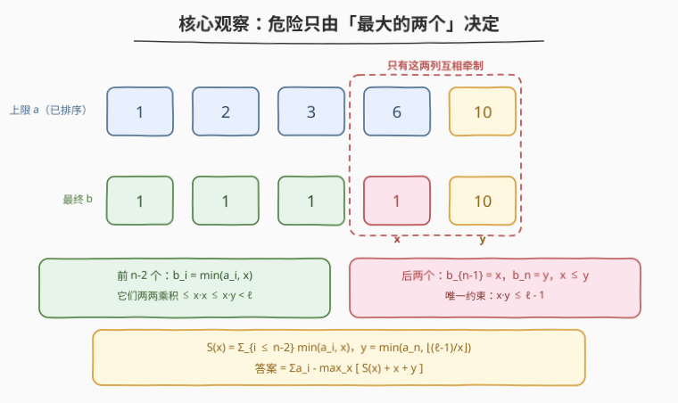
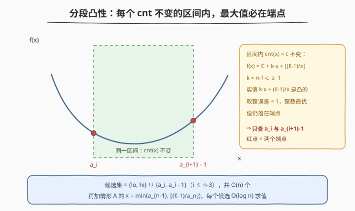
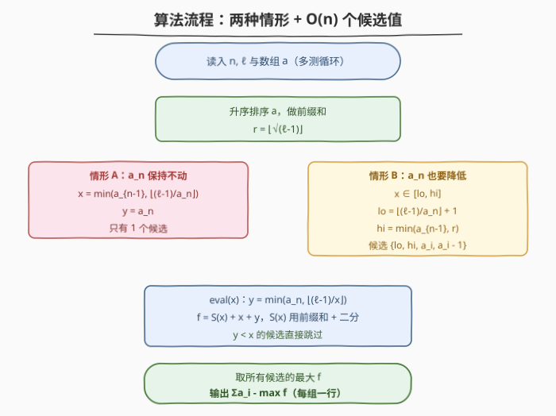
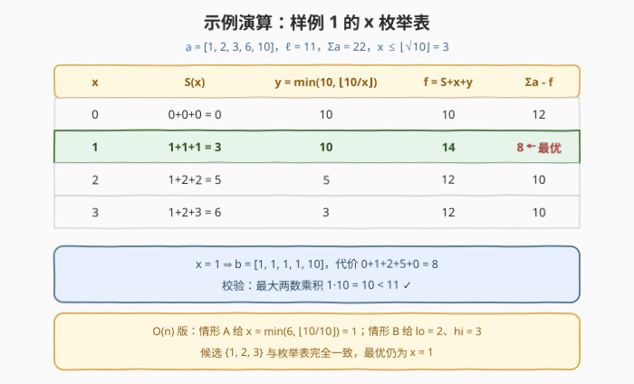

# Codeforces 2279C 反生产力 题解

## 1. 题目概述

- **标题 / 题号**：反生产力（Codeforces 2279C，英文名 Anti-Productive）
- **链接**：https://codeforces.com/problemset/problem/2279/C
- **来源**：Codeforces Round 1133 (Div. 1) · Problem C（UTC 2026-11-07）
- **难度**：未评级（1250 分）
- **限制**：时间 2 s / 内存 256 MB
- **标签**：暴力枚举、贪心、数学、排序

**题意**：给定长度为 $n$ 的数组 $a$ 与上界 $\ell$。若 $i<j$ 且 $a_i\cdot a_j\ge \ell$，则下标对 $(i,j)$ **危险**。一次操作可任选下标把 $a_i$ 减 $1$（可减到 $0$ 甚至负数）。求最少操作次数，使操作后不存在任何危险的下标对。多测：首行 $t$，每组给出 $n,\ell$ 与数组，对每组输出一个整数。

**约束**：

- $1 \le t \le 10^3$，$2 \le n \le 5\cdot 10^5$，$\sum n \le 5\cdot 10^5$
- $1 \le \ell \le 10^9$，$1 \le a_i \le 10^9$
- 答案量级可达 $\sum a_i \le 5\cdot 10^{14}$，须 64 位整数（样例 5 的答案已是 $3999999997$）

## 2. 示例与观察
```text
输入：
5
5 11
10 2 6 3 1
4 5
1 2 3 3
2 13
3 4
4 9
1 1 1 9
6 1000000000
1000000000 1000000000 1 1000000000 1000000000 1000000000

输出：
8
2
0
1
3999999997
```

解释：样例 1 把 $2,6,3$ 降到 $1$，代价 $1+5+2=8$，最大乘积 $1\cdot 10<11$；样例 2 两个 $3$ 各降 $1$，代价 $2$；样例 3 的 $3\cdot 4=12<13$ 本就安全；样例 4 把 $9$ 降到 $8$，代价 $1$；样例 5 把四个 $10^9$ 压到 $1$、一个 $10^9$ 降到 $999999999$，最大乘积 $999999999<10^9$，代价 $4\cdot 999999999+1=3999999997$。

## 3. 解题思路

### 3.1 暴力思路

直接枚举每个下标的最终值 $b_i\in\{0,\dots,a_i\}$ 再判定所有对，方案数 $\prod(a_i+1)$ 是指数级。退一步：只要固定「最终第二大的值」$x$，其余元素的最优值就被贪心唯一确定，于是复杂度变成「枚举 $x$」——但 $x$ 有 $10^9$ 种取值，仍不可行。突破口在下面两个观察：$x$ 的可行范围其实只有 $\sqrt{\ell}$ 量级，再借分段凸性压到 $O(n)$ 个候选。

### 3.2 核心观察：只有最大的两个数会「危险」



**观察 1（不必减到负数）**：若某 $b_i<0$，改成 $0$ 只会减少操作数，且此后含 $i$ 的每一对乘积都是 $0<\ell$，必然安全。故只需考虑 $0\le b_i\le a_i$。

**观察 2（排序匹配）**：约束只取决于最终值的**集合**。把 $a$ 升序排序后可假设最终值也升序且 $b_i\le a_i$（升序对位分配；若某位超限，说明该集合根本不可行）。

**观察 3（只看两个最大）**：最终值升序为 $b_1\le\cdots\le b_n$ 时

$$\text{所有对都安全}\iff b_{n-1}\cdot b_n<\ell$$

因为任取 $i<j$，$i,j$ 中至少有一个 $\le n-1$，故 $b_ib_j\le b_{n-1}b_n$；而 $(n-1,n)$ 这一对本身必须安全。

**观察 4（固定 $x=b_{n-1}$ 的最优填法）**：其余元素只受 $b_i\le a_i$ 与 $b_i\le x$ 限制，取上界最优：

$$b_i=\min(a_i,x)\ (i\le n-2),\qquad y:=b_n=\min\!\big(a_n,\lfloor (\ell-1)/x\rfloor\big)$$

**观察 5（$x$ 的上界）**：由 $x\le y$、$xy\le \ell-1$ 得 $x\le\lfloor\sqrt{\ell-1}\rfloor\le 31622$。于是每组只需枚举如此多的 $x$，用

$$F(x)=S(x)+x+y,\qquad S(x)=\sum_{i=1}^{n-2}\min(a_i,x)$$

求最大总和，答案 $=\sum a_i-\max_x F(x)$。$t=10^3$ 时最坏 $\sqrt{\ell}\cdot t\approx 3.2\cdot 10^{7}$ 次求值，C++ 能过，但 Python 吃力，故再优化一步。

**观察 6（分段凸性 $\Rightarrow$ 只需 $O(n)$ 个候选）**：$S(x)$ 只在 $x$ 跨过某个 $a_i$ 时改变。令 $cnt(x)=\#\{i\le n-2:a_i\le x\}=c$，则在 $cnt$ 保持不变的区间上

$$F(x)=P_c+k\cdot x+\big\lfloor (\ell-1)/x\big\rfloor,\qquad k=n-1-c\ge 1$$

实值 $g(x)=P_c+kx+(\ell-1)/x$ 满足 $g''=2(\ell-1)/x^3>0$，是**凸函数**，闭区间上最大值必在端点；又 $F\le g<F+1$，取整误差不足 $1$，整数最优值同样只在端点取到。两端点形如 $a_i$ 或 $a_{i+1}-1$，加上取值范围边界即得全部候选。



由此把 $x$ 的取值分成两种情形：

- **情形 A**：$y=a_n$（最大元素不动）。此时 $x\le\lfloor(\ell-1)/a_n\rfloor$，$F(x)=S(x)+x+a_n$ 关于 $x$ 单调不减，只需取 $x_A=\min\big(a_{n-1},\lfloor(\ell-1)/a_n\rfloor\big)$ 一个候选。
- **情形 B**：$y=\lfloor(\ell-1)/x\rfloor<a_n$，即 $x\in[lo,hi]$，其中 $lo=\lfloor(\ell-1)/a_n\rfloor+1$，$hi=\min(a_{n-1},\lfloor\sqrt{\ell-1}\rfloor)$。区间内按观察 6 只查 $\{lo,hi\}\cup\{a_i,a_i-1\}$。

### 3.3 算法流程



1. 读入 $n,\ell,a$，把 $a$ **升序排序**、做前缀和 $P$，记 $total=\sum a_i$，$r=\lfloor\sqrt{\ell-1}\rfloor$。
2. **情形 A**：$lo_A=\lfloor(\ell-1)/a_n\rfloor$，取 $x=\min(a_{n-1},lo_A)$ 求值。
3. **情形 B**：$lo=lo_A+1$，$hi=\min(a_{n-1},r)$；若 $lo\le hi$，对 $lo$、$hi$ 及每个 $a_i,a_i-1\;(i\le n-3)$ 夹到 $[lo,hi]$ 后求值。
4. **求值** $eval(x)$：$x=0$ 时 $y=a_n$，否则 $y=\min(a_n,\lfloor(\ell-1)/x\rfloor)$；若 $y<x$ 则 $x$ 不可能是第二大的值，跳过；否则二分求出 $cnt$，$S(x)=P_{cnt}+(n-2-cnt)x$，更新 $best=\max(best,S(x)+x+y)$。
5. 输出 $total-best$。

### 3.4 示例演算



样例 1：$a=[1,2,3,6,10]$，$\ell=11$，$\sum a=22$，$r=\lfloor\sqrt{10}\rfloor=3$，故 $x$ 只需试 $0\sim 3$：$x=0,1,2,3$ 对应 $F=10,14,12,12$，代价 $22-F=12,8,10,10$，最优 $x=1$，代价 $8$，最终数组 $[1,1,1,1,10]$，最大乘积 $10<11$。

用 $O(n)$ 候选集复核：情形 A 给 $x=\min(6,\lfloor 10/10\rfloor)=1$，情形 B 给 $lo=2,hi=3$，候选 $\{1,2,3\}$，与整表一致。再看样例 5 的极端数据：最优竟是 $x=1$（拿那个 $1$ 当第二大的上限，其余四个 $10^9$ 全压到 $1$），$F=4+1+999999999$，代价 $3999999997$。

## 4. 算法细节

1. **多测清空**：`best`、`has` 与所有容器每组重建；`upper_bound` 的右端点不要带上上一组的规模。
2. **溢出**：答案上界 $\sum a_i\approx 5\cdot 10^{14}$，前缀和、`total - best`、$x+y$ 必须 `long long`；$\lfloor(\ell-1)/x\rfloor$ 用整数除法，不要转 `double`。
3. **$x=0$ 要特判**：$\lfloor(\ell-1)/0\rfloor$ 未定义。$x=0$ 的语义是「除最大元素外全降到 $0$」，此时 $y=a_n$、$S=0$，代价 $\sum_{i<n}a_i$——正是 $\ell=1$ 的最优解。
4. **整数开方要修正**：`(long long)sqrt((long double)lm)` 可能差 $1$，用 `while (r*r > lm) --r;` 与 `while ((r+1)*(r+1) <= lm) ++r;` 校正；错一位就会漏掉 $x=\lfloor\sqrt{\ell-1}\rfloor$ 这个常见最优端。
5. **前缀和区间**：$S(x)$ 只涉及前 $n-2$ 个元素，右端点写 `a.begin() + max(0, n-2)`，$n=2$ 时为空区间、$cnt=0$。
6. **候选裁剪**：$a_i-1$ 可能 $<lo$ 或 $>hi$，统一夹紧后再求值；重复候选不必去重，`eval` 只有 $O(\log n)$。
7. **I/O 常数**：最多 $5\cdot 10^5$ 个整数，用 `fread` 快读、输出攒进字符串一次写出。本机实测 `cin` 同步流读 $5\cdot 10^5$ 个数就要 $0.9$ s，快读只需 $0.05$ s（含全部计算）。
8. **可选简化版**：直接枚举 $x=0..\min(a_{n-1},r)$，并让指针随 $x$ 递增前移，$S(x)$ 均摊 $O(1)$，总复杂度 $O(n\log n+\sqrt{\ell})$，C++ 也能过。

## 5. 正确性证明

**引理 1（可假设非负）**：若最优方案含 $b_i<0$，把 $b_i$ 改为 $0$ 后仍合法且操作数更少。

**证明**：操作数即 $\sum(a_i-b_i)$，$b_i$ 由负变 $0$ 使总和减少 $|b_i|>0$。含 $i$ 的每对乘积变成 $0<\ell$（$\ell\ge 1$），必安全；不含 $i$ 的对不受影响。∎

**引理 2（排序匹配不失最优）**：设 $a$ 升序，任意可行最终值集合 $B$ 升序排成 $c$，则 $c_i\le a_i$ 对一切 $i$ 成立。

**证明**：反设有 $c_i>a_i$，则 $c$ 中至少 $n-i+1$ 个值 $>a_i$。这些值须落在满足 $a_j\ge$ 该值 $>a_i$ 的下标上，而 $a$ 升序使 $a_j>a_i$ 的下标至多 $n-i$ 个，矛盾。∎

**引理 3（固定 $x$ 的最优补全）**：设 $x\le a_{n-1}$ 且 $y^\star=\min(a_n,\lfloor(\ell-1)/x\rfloor)\ge x$。在 $b_{n-1}=x$、$b$ 升序、$0\le b_i\le a_i$ 下，总和最大值为 $S(x)+x+y^\star$，由 $b_i=\min(a_i,x)\,(i\le n-2)$、$b_n=y^\star$ 取到。

**证明**：对 $i\le n-2$，$b_i$ 只受 $b_i\le a_i$、$b_i\le x$ 限制（与 $b_n$ 的乘积 $\le x y^\star\le\ell-1$ 自动安全），上界 $\min(a_i,x)$ 可达；$b_n$ 只受 $b_n\le a_n$ 与 $xb_n\le\ell-1$ 限制，上界 $y^\star$ 可达且 $y^\star\ge x$ 保证升序。∎

**引理 4（分段凸性）**：在使 $cnt(x)=c$ 恒定的整数区间 $[L,R]$（$1\le L\le R$）上，$F(x)=P_c+kx+\lfloor(\ell-1)/x\rfloor$（$k=n-1-c\ge 1$）的最大值在 $x=L$ 或 $x=R$ 取到。

**证明**：$g(x)=P_c+kx+(\ell-1)/x$ 在 $x>0$ 上二阶导 $2(\ell-1)/x^3>0$，为凸函数，闭区间上最大值在端点，故 $g(x)\le\max(g(L),g(R))$。又 $F(x)\le g(x)<F(x)+1$，于是 $F(x)\le g(x)\le\max(g(L),g(R))<\max(F(L),F(R))+1$，两边为整数，得 $F(x)\le\max(F(L),F(R))$。∎

**定理**：算法输出最少操作数。

**证明**：由引理 1、2，最优解可写成升序的 $c$，代价 $\sum a_i-\sum c_i$，只需在 $c_{n-1}\le a_{n-1}$、$c_{n-1}\le c_n$、$c_{n-1}c_n\le\ell-1$ 下最大化 $\sum c_i$。由引理 3，固定 $x=c_{n-1}$ 的最大总和恰为 $F(x)$，故最优值 $=\max_x F(x)$，$x$ 取遍 $[0,\min(a_{n-1},\lfloor\sqrt{\ell-1}\rfloor)]$。情形 A 覆盖 $y=a_n$ 的全部 $x$ 且 $F$ 单调不减，端点 $x_A$ 已取到最大值；情形 B 覆盖 $y=\lfloor(\ell-1)/x\rfloor$ 的 $x\in[lo,hi]$，由引理 4 只需各 $cnt$ 恒定区间的端点，而 $\{lo,hi\}\cup\{a_i,a_i-1\}$ 恰含 $[lo,hi]$ 内全部这样的端点。故 $best=\max_x F(x)$，输出 $\sum a_i-best$ 即最少操作数；跳过 $y<x$ 的 $x$ 也正确，因它不可能成为第二大的值。∎

## 6. 复杂度分析

- **时间**：每组排序 $O(n\log n)$；候选 $O(n)$ 个、每个 $O(\log n)$ 求 $S(x)$，故 $O(n\log n)$，总计 $O(\sum n\log n)$（约 $5\cdot 10^5\times 19$ 次运算）。实测 $n=5\cdot 10^5$ 用时 $0.05$ s，$t=10^3,\sum n=5\cdot 10^5$ 的批量用时 $0.02$ s，对 $2$ s 时限有 $40$ 倍以上余量。
- **空间**：$O(n)$，仅数组、前缀和与读入缓冲，$256$ MB 下无压力。
- **对照**：$O(\sqrt{\ell})$ 暴力枚举每组至多 $31622$ 次，$t=10^3$ 时 $3.2\cdot 10^7$ 次，C++ 亦在时限内；本文的 $O(n)$ 候选版对 Python 友好（$n=5\cdot 10^5$ 实测约 $1.1$ s），更稳。

## 7. 参考代码

### C++17

```cpp
#include <bits/stdc++.h>
using namespace std;
typedef long long ll;

static char buf[1 << 23];
int bl = 0, bp = 0;
inline int gc() {
    if (bp == bl) { bl = (int)fread(buf, 1, sizeof(buf), stdin); bp = 0; if (bl <= 0) return -1; }
    return buf[bp++];
}
inline ll rd() {
    int c = gc(), sgn = 1; ll x = 0;
    while (c != '-' && (c < '0' || c > '9')) { if (c < 0) return 0; c = gc(); }
    if (c == '-') { sgn = -1; c = gc(); }
    while (c >= '0' && c <= '9') { x = x * 10 + (c - '0'); c = gc(); }
    return sgn * x;
}

int main() {
    int T = (int)rd();
    string out;
    while (T--) {
        int n = (int)rd(); ll l = rd();
        vector<ll> a(n);
        for (int i = 0; i < n; i++) a[i] = rd();
        sort(a.begin(), a.end());
        vector<ll> pre(n + 1, 0);
        for (int i = 0; i < n; i++) pre[i + 1] = pre[i] + a[i];
        ll total = pre[n], lm = l - 1;
        ll r = (ll)sqrt((long double)lm);
        while (r > 0 && r * r > lm) r--;                  // r = floor(sqrt(l-1))
        while ((r + 1) * (r + 1) <= lm) r++;

        // S(x) = sum_{i <= n-3} min(a[i], x)，只涉及前 n-2 个元素
        auto sumMin = [&](ll x) {
            int c = (int)(upper_bound(a.begin(), a.begin() + max(0, n - 2), x) - a.begin());
            return pre[c] + (ll)(n - 2 - c) * x;
        };
        ll best = 0; bool has = false;
        auto eval = [&](ll x) {                           // x = 最终第二大的值
            ll y = (x == 0) ? a[n - 1] : min(a[n - 1], lm / x);
            if (y < x) return;                            // 该 x 无法成为第二大的值
            ll v = (n >= 3 ? sumMin(x) : 0LL) + x + y;
            if (!has || v > best) { best = v; has = true; }
        };
        ll loA = lm / a[n - 1];                           // 情形 A：a[n-1] 保持不动
        eval(min(a[n - 2], loA));
        ll loB = loA + 1;                                 // 情形 B：y = (l-1)/x
        ll hiB = min(a[n - 2], r);
        if (loB <= hiB) {
            eval(loB); eval(hiB);
            for (int i = 0; i + 2 < n; i++) {              // cnt(x) 的断点：a[i]、a[i]-1
                for (ll c : {a[i], a[i] - 1}) {
                    c = max(c, loB); c = min(c, hiB);
                    eval(c);
                }
            }
        }
        out += to_string(total - best); out += '\n';
    }
    fwrite(out.data(), 1, out.size(), stdout);
    return 0;
}
```

### Python3

```python
import sys
from bisect import bisect_right

def main():
    d = list(map(int, sys.stdin.buffer.read().split()))
    p = 0
    t = d[p]; p += 1
    out = []
    for _ in range(t):
        n, l = d[p], d[p + 1]; p += 2
        a = sorted(d[p:p + n]); p += n
        pre = [0] * (n + 1)
        for i, v in enumerate(a):
            pre[i + 1] = pre[i] + v
        lm = l - 1
        r = int(lm ** 0.5)
        while r > 0 and r * r > lm:
            r -= 1
        while (r + 1) * (r + 1) <= lm:
            r += 1
        head = a[:n - 2] if n >= 3 else []            # 永不进入「最大的两个」的元素
        best, has = 0, False

        def ev(x):
            nonlocal best, has
            y = a[n - 1] if x == 0 else min(a[n - 1], lm // x)
            if y < x:
                return
            c = bisect_right(head, x)
            val = pre[c] + (len(head) - c) * x + x + y
            if not has or val > best:
                best, has = val, True

        loA = lm // a[n - 1]                          # 情形 A
        ev(min(a[n - 2], loA))
        loB, hiB = loA + 1, min(a[n - 2], r)          # 情形 B
        if loB <= hiB:
            ev(loB); ev(hiB)
            for v in head:                            # cnt(x) 的断点
                for c in (v, v - 1):
                    ev(loB if c < loB else (hiB if c > hiB else c))
        out.append(str(pre[n] - best))
    sys.stdout.write("\n".join(out) + "\n")

main()
```

## 8. 边界情况与易错点

1. **$\ell=1$**：任意两个正整数乘积 $\ge 1$，只能留一个正数；最优是留下 $a_n$、其余压到 $0$，答案 $\sum_{i<n}a_i$，由 $x=0$ 分支（$y=a_n$、$S=0$）给出。此时 $r=\lfloor\sqrt{0}\rfloor=0$，情形 B 为空。
2. **$n=2$**：没有「前 $n-2$ 个」，$S(x)\equiv 0$；`upper_bound` 右端点必须写成 `a.begin() + max(0, n-2)`，否则越界；Python 侧 `head` 取空列表。
3. **$x=0$ 的除法**：$\lfloor(\ell-1)/0\rfloor$ 未定义，必须特判；$\ell=1$ 时 $lm=0$，开方与除法都要能承受 $r=0$。
4. **答案溢出**：$\sum a_i$ 可达 $5\cdot 10^{14}$，样例 5 的答案已 $3.99\cdot 10^9$；C++ 用 `int` 必错。
5. **开方误差**：完全平方数附近 `(ll)sqrt` 可能偏 $1$，必须两次 `while` 校正，否则会漏掉 $x=\lfloor\sqrt{\ell-1}\rfloor$ 这个常见最优端。
6. **候选越界 / 空区间**：$a_i-1$ 可能落到 $[lo,hi]$ 之外（$a_i=1$ 时给 $0$），必须先夹紧；$lo>hi$ 时不要硬跑情形 B。
7. **多测格式**：每组输出一行、组间无空行；输出量大时用缓冲一次写出，避免逐组刷新。

## 9. 验证记录

- **编译环境与命令**：`clang++ -std=c++17 -O2`（本机无 GNU g++，配 `codeforces/tools/include/bits/stdc++.h` 兼容头；正文代码只用标准库，可原样提交 GNU C++17）；Python 侧为 `Python 3.9.6`。
- **官方样例**：1 / 1 通过（按 Codeforces 标准 checker 的 token 比对，忽略空白与大小写）。
- **复核状态**：audited（2026-11-19 统一回归：编译 + 官方样例；写作期的随机对拍与暴力未重跑）。

## 相关题目与扩展

- [Codeforces 2279A. Reverse and Double](https://codeforces.com/problemset/problem/2279/A)：同场 A 题，同样是「小数据量暴力 + 单调性」的签到思路。
- [Codeforces 2279B. Balanced Subsets](https://codeforces.com/problemset/problem/2279/B)：同场 B 题，位掩码 + 组合计数，可对照体会「先找结构再枚举」的取舍。
- [LeetCode 1464. 数组中两元素的最大乘积](https://leetcode.cn/problems/maximum-product-of-two-elements-in-an-array/)：本题「最大值只看最大的两个」的最简版本。
- [LeetCode 628. 三个数的最大乘积](https://leetcode.cn/problems/maximum-product-of-three-numbers/)：排序后分类讨论最大乘积，与本题「排序 + 只看末尾几个」同源。

**延伸思考**：
1. 若把「减 $1$ 记一次操作」改成「改成任意值记一次操作」，问题立刻变成「选一个阈值 $x$ 能保住多少元素」的计数问题，结构完全不同。
2. 若允许**增加**元素（代价按变化量计），最优会把元素齐刷刷推向 $\sqrt{\ell}$ 附近，$F$ 不再分段凸，需重新分析。
3. 若 $\ell$ 有多组询问而数组固定，可把 $S(x)$ 的 $n$ 个断点预处理，配合离线排序把每组询问压到 $O(\log n)$，总 $O((n+q)\log n)$。
