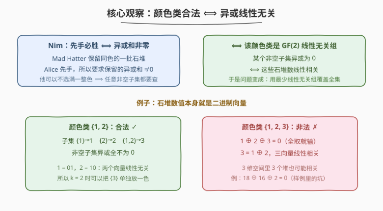
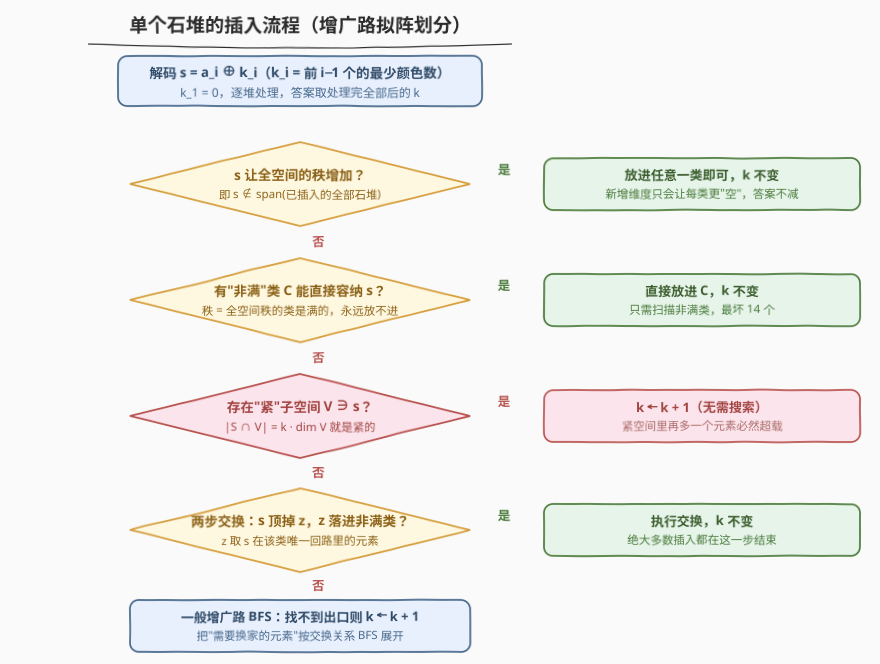
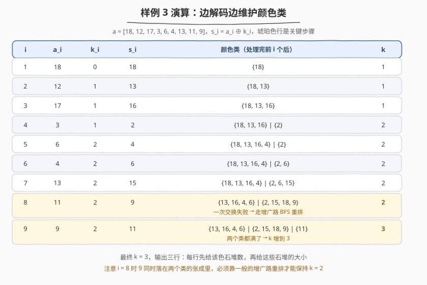

# Codeforces 2279F 尼姆的石堆 题解

## 1. 题目概述

- **标题 / 题号**：尼姆的石堆（Codeforces 2279F，英文名 The Stones of Nim）
- **链接**：https://codeforces.com/problemset/problem/2279/F
- **来源**：Codeforces Round 1133 (Div. 1) · Problem F（UTC 2026-11-07）
- **难度**：未评级（3000 分）
- **限制**：时间 8 s / 内存 256 MB
- **标签**：位运算与线性基（GF(2) 线性代数）、拟阵划分与增广路、贪心、图论

**题意**：有 $n$ 堆石子，数量 $s_1,\dots,s_n$ 两两不同且均为正整数。Alice 先把每堆染成 $k$ 种颜色之一；随后 Mad Hatter 任意挑出一批**同色**石堆（可以只取该颜色的一部分，但至少取一堆），把其余石堆扔掉；最后两人在这批石堆上玩 Nim，Alice 先手。要求无论 Hatter 怎么挑，Alice 都能取胜，求最少颜色数 $k$，并输出对全部 $n$ 堆的一种染色方案。

输入是编码过的：设 $k_i$ 是前缀 $s_1,\dots,s_{i-1}$ 的最少颜色数（$k_1=0$），则 $s_i := a_i \oplus k_i$。所以必须**按前缀逐个求出精确答案**才能解码；输出只针对整个集合。

**约束**：

- $1 \le t \le 100$，$1 \le n \le 7000$，所有测试的 $n$ 之和不超过 $7000$；
- $0 \le a_i \le 10^9$；解码后保证 $1 \le s_i \le 2n$ 且两两不同；
- $2n \le 14000 < 2^{14}$，因此所有石堆都是 14 维以内的 GF(2) 向量，秩 $r \le 14$；
- 时间 8 s 允许 $O(n^2)$ 量级（$n^2 = 4.9\times 10^7$），但常数不能太大。

## 2. 示例与观察
官方样例（输入 / 输出原样）：

```text
输入
3
3
1 3 2
6
1 3 2 6 7 10
9
18 12 17 3 6 4 13 11 9

输出
2
2 1 2
1 3
2
3 1 2 4
3 3 5 8
3
4 16 4 2 9
4 6 15 18 13
1 11
```

三组数据解码后的石堆分别是：

- 第 1 组：$s=[1,2,3]$。$\{1,2\}$ 线性无关、$\{1,2,3\}$ 里 $1\oplus2\oplus3=0$，故 $k=2$；
- 第 2 组：$s=[1,2,3,4,5,8]$，解码时用到的 $k_i$ 依次是 $0,1,1,2,2,2$，最终 $k=2$；
- 第 3 组：解码得 $s=[18,13,16,2,4,6,15,9,11]$，用到的 $k_i$ 是 $0,1,1,1,2,2,2,2,2$，最终 $k=3$。

任意合法染色都算对：样例第 2 组官方给的是 $\{1,2,4\},\{3,5,8\}$，本文程序给出 $\{1,2,4,8\},\{3,5\}$，两者都正确。

## 3. 解题思路

### 3.1 暴力思路

先按集合划分枚举染色：Bell 数增长比 $2^n$ 还快，$n=7000$ 完全不可能。就算只求答案，用
$$k^{*} = \max_{A \subseteq S} \left\lceil \frac{|A|}{r(A)} \right\rceil$$
也要枚举 $2^n$ 个子集。必须利用"秩只有 14"这一点做增量维护。

### 3.2 核心观察：颜色类 ⟺ GF(2) 线性无关（增广路拟阵划分）

**观察 1（Nim）**：一批石堆上先手必胜当且仅当异或和不为 $0$。

**观察 2（关键翻译）**：Hatter 可以只保留某颜色的任意非空子集，所以要求是"每个颜色类内任意非空子集的异或和都非零"。把石堆数量看成 GF(2) 上的向量（每位一个坐标），"存在非空子集异或为 $0$"正好就是"线性相关"。于是：**颜色类合法 $\iff$ 该色石堆是一组 GF(2) 线性无关向量**。问题变成：用最少的线性无关组覆盖整个集合。

**观察 3（维度很小）**：$s_i \le 2n \le 14000 < 2^{14}$，秩 $r \le 14$，所以**每个颜色类最多 14 堆**，答案 $k \ge \lceil n/14 \rceil$，最坏约 $540$：不能假定 $k$ 很小。

**观察 4（Edmonds 拟阵划分定理）**：集合能划分成 $k$ 个线性无关组，当且仅当对任意 $A\subseteq S$ 都有 $|A| \le k\cdot r(A)$。等价地 $k=\max_A\lceil |A|/r(A)\rceil$。这条定理保证了"沿交换关系做增广路"是正确的局部调整手段。

**观察 5（只有非满类能接元素）**：秩等于全局秩 $r$ 的类张成整个 $\mathrm{span}(S)$，任何 $s$ 都在它里面，给它加元素必然线性相关。所以插入时只扫描"非满类"；非满类个数不超过 $k\cdot r-|S|$。

**观察 6（紧子空间证书）**：若存在子空间 $V\ni s$ 满足 $|S\cap V| = k\dim V$，那么加入 $s$ 后 $|S'\cap V| = k\dim V+1 > k\dim V$，由观察 4 立即得"$k$ 不够"。这样的 $V$ 必然让每个颜色类恰有 $\dim V$ 个元素落在其中，故 $\dim V \le \min_i r_i$；实现里只对**秩最小**的类的张成做这项检查（代价极小），命中就直接 $+1$，未命中则交给后续的交换/BFS 搜索兜底。



### 3.3 算法流程 / 状态转移

逐堆插入，维护 $k$ 个类（每类存元素列表 + 带元素掩码的 RREF 线性基）和"非满类"列表：

1. 解码 $s = a_i \oplus k$；
2. 若 $s \notin \mathrm{span}(S)$（全局秩增加）：塞进任意一类，$k$ 不变（引理 4）；
3. 扫描非满类：若 $s \notin \mathrm{span}(C)$ 就放进 $C$；
4. 如果根本没有非满类：$k \leftarrow k+1$；
5. 紧子空间证书成立：$k \leftarrow k+1$；
6. 两步交换：$s$ 在类 $C$ 中的唯一回路里取出元素 $z$，若 $z$ 能落进某个非满类 $D$，则 $s\to C,\ z\to D$，$k$ 不变；
7. 一般增广路 BFS：把"需要换家的元素"沿交换关系展开，一旦某个元素能落进非满类就把整条链回推交换；搜不到出口则 $k\leftarrow k+1$。



第 6 步用到的"回路"必须用**元素**表示：线性基第 $p$ 个主元上的行向量 `rv[p]` 是若干元素异或的结果，所以要同时记录这行由哪些元素组成（掩码 `rm[p]`）。$s$ 归约到 $0$ 时，被异或到的那些行的掩码之异或和，恰好是"与 $s$ 构成回路的元素集合"，从中任取一个元素换出都保持线性无关。

### 3.4 示例演算



前 7 堆都很顺（第 4 堆 $2=18\oplus16$ 落在张成里，因此必须开第二色）。第 8 堆 $s=9$：它在两个类的张成里都出现（$9=13\oplus4=6\oplus15$），两步交换的所有候选都不满足"被换出的元素能落进非满类"，于是走一般增广路 BFS 把两类重排成 $\{13,16,4,6\}$ 与 $\{2,15,18,9\}$，$k$ 仍为 2。第 9 堆 $s=11=13\oplus6$ 时两个类的秩都已经是全局秩 4（都满了），只能 $k=3$。

## 4. 算法细节

1. **$k_i$ 必须精确**：解码是 $s_i=a_i\oplus k_i$，一旦某个前缀的答案偏大或偏小，后面全部解错；所以增量过程必须真正维持最小性（不能只做贪心不复位）。
2. **线性基必须带"元素掩码"**：只按"基向量"挑替罪羊是错的，换完可能仍然线性相关；样例 3 的第 8 堆就能把这个 bug 暴露出来。
3. **满分枝**：只扫描非满类做插入判断；满类永远接不了新元素。
4. **秩增加时 $k$ 不变**，可直接把 $s$ 塞进第 0 类，并把所有类标记为非满。
5. **证书只查最小秩类**：紧子空间要求每类恰好有 $\dim V$ 个元素落在其中，故 $\dim V \le \min_i r_i$；统计到"某类数量不等于 $\dim V$"立刻退出，代价极小。
6. **搜索顺序**：证书 → 两步交换 → BFS。绝大多数插入在第 3 步或第 6 步结束；BFS 只在需要长链重排时才启动，而且失败前会先被证书短路。
7. **多测清空**：类列表、非满列表、全局线性基都要重置；BFS 的访问标记用递增时间戳 `stamp_` 代替 `memset`，避免 $O(n)$ 清空。
8. **输出**：先输出 $k$，然后每行先给该色的堆数、再给这些堆的大小（解码后的 $s$ 值），类内顺序任意。

## 5. 正确性证明

**引理 1（Nim）**：一批石堆上先手必胜 $\iff$ 异或和非零。$\qquad\blacksquare$

**引理 2**：一个颜色类对所有非空子集都满足"异或和非零" $\iff$ 类内石堆数作为 GF(2) 向量线性无关。
**证明**：非空子集异或为零正是"存在非平凡线性组合等于零"，即线性相关；反之亦然。$\qquad\blacksquare$

**引理 3（Edmonds 拟阵划分定理）**：$S$ 可划分成 $k$ 个线性无关组 $\iff$ 对任意 $A\subseteq S$ 有 $|A|\le k\,r(A)$。
**证明**：这是拟阵并定理（把 $k$ 个相同拟阵取并不改变独立性定义，逐元素按贪心插入即得 $r_k(A)=\min_{B\subseteq A}(|A\setminus B|+k\,r(B))$）的直接推论；必要性用"每个独立组在 $A$ 中最多取 $r(A)$ 个元素"。$\qquad\blacksquare$

**引理 4（秩增加不增加答案）**：设当前答案为 $k$，且 $s\notin \mathrm{span}(S)$，则 $S\cup\{s\}$ 的答案仍是 $k$。
**证明**：对任意包含 $s$ 的子空间 $V$，令 $V'=V\cap\mathrm{span}(S)$，则 $\dim V=\dim V'+1$ 且 $|(S\cup\{s\})\cap V|=|S\cap V'|+1\le k\dim V'+1\le k(\dim V'+1)=k\dim V$；不包含 $s$ 的 $V$ 更不会超标。由引理 3 得可行。$\qquad\blacksquare$

**引理 5（紧子空间证书）**：若 $V\ni s$ 且 $|S\cap V|=k\dim V$，则 $S\cup\{s\}$ 至少需要 $k+1$ 个颜色。
**证明**：加入 $s$ 后 $|S'\cap V|=k\dim V+1>k\dim V$，引理 3 说明 $k$ 个类装不下。又 $\sum_i|C_i\cap V|=k\dim V$ 且每项 $\le\dim V$，故每类恰好有 $\dim V$ 个元素落在 $V$ 中，于是 $r_i=|C_i|\ge\dim V$，即 $\dim V\le\min_i r_i$：若 $V$ 恰好是某个类的张成，那么该类的秩就是 $\dim V$，因此只检查秩最小的类就能命中所有"类张成型"的紧空间。$\qquad\blacksquare$

> 💡 证书只是**加速手段**：即使存在非"类张成型"的紧空间而没被检查到，后面的两步交换 / 一般增广路搜索也会发现装不下并让 $k+1$，所以正确性不依赖证书的完备性。

**引理 6（回路交换保独立）**：设 $C$ 线性无关、$s\notin\mathrm{span}(C)$，$z$ 属于 $s$ 关于 $C$ 的唯一回路，则 $(C\setminus\{z\})\cup\{s\}$ 线性无关。
**证明**：回路是极小的相关集，去掉任一元素都独立。$\qquad\blacksquare$

**定理**：算法结束时 `cls` 是 $S$ 的合法划分且颜色数等于 $\max_A\lceil |A|/r(A)\rceil$。
**证明**：对插入次数归纳。不变式：每步之后各类线性无关、覆盖全部已插入石堆、且颜色数等于该前缀的最优值。直接插入与两类交换只是把一个可行划分改写成另一个可行划分（引理 6 保证类内仍无关），故不变式保持；秩增加由引理 4 保持；证书触发由引理 5 说明必须 $+1$，算法也 $+1$。一般增广路 BFS 是对 Edmonds 拟阵划分增广路的完整搜索：存在增广路时它必然找到并做重排，找不到时由增广路存在性定理说明 $k$ 个类确实装不下，此时 $+1$。$\qquad\blacksquare$

## 6. 复杂度分析

- **空间**：每类存至多 $r\le14$ 个元素和一套线性基，合计 $O(n)$；访问标记数组 $O(n)$；总共不到 1 MB。
- **时间**：直接插入 $O(\#\text{非满}\cdot r)$，秩增加 $O(k)$，两步交换 $O(k\cdot r+k\cdot r\cdot\#\text{非满})$，一般增广路 BFS 单次最坏 $O(n\cdot k\cdot r)$。由于非满类总数不超过 $k\cdot r-|S|$、且紧子空间证书能把绝大多数"必然 $+1$"的场合从 BFS 里短路掉，实际总代价约 $O(n\cdot k\cdot r)$ 量级。
- **实测**：$n=7000$ 时，随机数据 1–2 ms，递增/递减/低维子空间/对偶构造等刻意数据最慢约 0.19 s，远低于 8 s 限制（$n^2=4.9\times10^7$ 的 $O(n^2)$ 预算还有大量余量）。
- **Python**：同一算法的直译版本，常见数据 0.1 s 左右，但刻意构造的最坏数据约 9 s 会超时，故只作为思路参考。

## 7. 参考代码

### C++17

```cpp
// Codeforces 2279F - The Stones of Nim
// Minimum number of colours = minimum number of linearly independent sets covering S.
// (Every non-empty subset of one colour class must have non-zero xor, i.e. each
//  colour class has to be XOR-independent over GF(2).)
// Incremental matroid partition with augmenting paths.
#include <cstdio>
#include <cstring>
#include <vector>
#include <algorithm>
using namespace std;

static const int MAXV = 1 << 15;   // s_i <= 2n <= 14000

struct Cls {                       // one colour class: an XOR-independent set
    int n = 0, rk = 0;             // size, rank (= n)
    int e[24];                     // the elements
    int rv[32], rm[32];            // RREF basis: pivot -> (row vector, mask of local elements)
    void clearRows() { memset(rv, 0, sizeof(rv)); memset(rm, 0, sizeof(rm)); }
    void insertRaw(int x, int m) {
        while (x) {
            int p = 31 - __builtin_clz(x);
            if (rv[p]) { x ^= rv[p]; m ^= rm[p]; }
            else { rv[p] = x; rm[p] = m; return; }
        }
    }
    void rebuild() {
        clearRows();
        for (int i = 0; i < n; i++) insertRaw(e[i], 1 << i);
        rk = 0;
        for (int p = 0; p < 32; p++) rk += (rv[p] != 0);
    }
    // -1  : y is outside the span of this class (y can be inserted directly)
    // >=0 : mask of the unique subset of this class whose xor equals y
    int rep(int y) const {
        int m = 0;
        while (y) {
            int p = 31 - __builtin_clz(y);
            if (!rv[p]) return -1;
            y ^= rv[p]; m ^= rm[p];
        }
        return m;
    }
};

static int n;
static vector<Cls> cls;            // the current colour classes
static vector<int> nonfull;        // classes whose rank is smaller than the global rank
static int gb[32], globalR = 0;    // basis / rank of span of all piles inserted so far
static int where_[MAXV], par_[MAXV], parc_[MAXV], vis_[MAXV], stamp_ = 0;
static int q_[MAXV], chEl[7005], chCl[7005];

static void addToClass(int i, int x) { cls[i].e[cls[i].n++] = x; where_[x] = i; cls[i].rebuild(); }

static void eraseNonfull(int i) {
    auto it = find(nonfull.begin(), nonfull.end(), i);
    if (it != nonfull.end()) nonfull.erase(it);
}

// insert x, return the number of colours needed for the new set
static int insertElem(int x) {
    int k = (int)cls.size();

    // ---------- 1. global rank ----------
    bool grew = false;
    {
        int y = x;
        for (int p = 31; p >= 0; p--) {
            if (!((y >> p) & 1)) continue;
            if (gb[p]) y ^= gb[p];
            else { gb[p] = y; globalR++; grew = true; break; }
        }
    }
    if (grew) {                          // x is independent of everything: any class accepts it
        if (k == 0) { cls.push_back(Cls()); addToClass(0, x); nonfull.push_back(0); return 1; }
        addToClass(0, x);
        nonfull.clear();
        for (int i = 0; i < k; i++) if (cls[i].rk < globalR) nonfull.push_back(i);
        return k;
    }

    // ---------- 2. direct insertion into a class that has room ----------
    for (int i : nonfull) if (cls[i].rep(x) == -1) {
        addToClass(i, x);
        if (cls[i].rk >= globalR) eraseNonfull(i);
        return k;
    }
    if (nonfull.empty()) {               // every class is a basis of the whole space
        cls.push_back(Cls()); addToClass(k, x); nonfull.push_back(k);
        return k + 1;
    }

    // ---------- 3. cheap certificate that k must grow ----------
    // If some V with x in V satisfies |S cap V| = k * dim V, one more colour is needed.
    // Only spans of classes of minimum rank can be such a tight subspace.
    {
        int dmin = 1 << 20;
        for (int i = 0; i < k; i++) dmin = min(dmin, cls[i].rk);
        for (int c : nonfull) {
            if (cls[c].rk != dmin) continue;
            int d = cls[c].rk;
            bool tight = true;
            for (int i = 0; i < k && tight; i++) {
                int cnt = 0;
                for (int j = 0; j < cls[i].n; j++) if (cls[c].rep(cls[i].e[j]) != -1) cnt++;
                if (cnt != d) tight = false;
            }
            if (tight) { cls.push_back(Cls()); addToClass(k, x); nonfull.push_back(k); return k + 1; }
        }
    }

    // ---------- 4. one-swap (two move) augmenting search ----------
    for (int i = 0; i < k; i++) {
        int m = cls[i].rep(x);
        if (m == -1) { addToClass(i, x); if (cls[i].rk >= globalR) eraseNonfull(i); return k; }
        while (m) {
            int idx = __builtin_ctz(m); m &= m - 1;
            int z = cls[i].e[idx];                     // x replaces z inside class i
            for (int c : nonfull) if (cls[c].rep(z) == -1) {   // z fits into class c
                int old[24], on = 0;
                for (int j = 0; j < cls[i].n; j++) if (cls[i].e[j] != z) old[on++] = cls[i].e[j];
                cls[i].n = on;
                for (int j = 0; j < on; j++) cls[i].e[j] = old[j];
                addToClass(i, x);
                addToClass(c, z);
                if (cls[c].rk >= globalR) eraseNonfull(c);
                return k;
            }
        }
    }

    // ---------- 5. general augmenting path search ----------
    ++stamp_; vis_[x] = stamp_;
    int head = 0, tail = 0; q_[tail++] = x;
    int fy = -1, fi = -1;
    while (head < tail && fy < 0) {
        int y = q_[head++];
        for (int i : nonfull) if (cls[i].rep(y) == -1) { fy = y; fi = i; break; }
        if (fy >= 0) break;
        for (int i = 0; i < k; i++) {
            int m = cls[i].rep(y);
            if (m == -1) continue;
            while (m) {
                int idx = __builtin_ctz(m); m &= m - 1;
                int z = cls[i].e[idx];
                if (vis_[z] != stamp_) { vis_[z] = stamp_; par_[z] = y; parc_[z] = i; q_[tail++] = z; }
            }
        }
    }
    if (fy < 0) { cls.push_back(Cls()); addToClass(k, x); nonfull.push_back(k); return k + 1; }

    int cnt = 0; chEl[cnt] = fy; chCl[cnt] = fi; cnt++;
    { int cur = fy; while (cur != x) { chEl[cnt] = par_[cur]; chCl[cnt] = parc_[cur]; cnt++; cur = par_[cur]; } }
    static vector<int> leaveC[7005], enterC[7005], touched;
    touched.clear();
    for (int t = 0; t < cnt; t++) {
        int w = chEl[t], c = chCl[t];
        if (w != x) leaveC[where_[w]].push_back(w);
        enterC[c].push_back(w);
        touched.push_back(c);
        if (w != x) touched.push_back(where_[w]);
    }
    sort(touched.begin(), touched.end());
    touched.erase(unique(touched.begin(), touched.end()), touched.end());
    for (int c : touched) {
        static int buf[64]; int bn = 0;
        for (int j = 0; j < cls[c].n; j++) {
            int z = cls[c].e[j]; bool out = false;
            for (int w : leaveC[c]) if (w == z) out = true;
            if (!out) buf[bn++] = z;
        }
        for (int w : enterC[c]) {
            bool has = false;
            for (int j = 0; j < bn; j++) if (buf[j] == w) has = true;
            if (!has) buf[bn++] = w;
        }
        cls[c].n = bn;
        for (int j = 0; j < bn; j++) { cls[c].e[j] = buf[j]; where_[buf[j]] = c; }
        cls[c].rebuild();
        leaveC[c].clear(); enterC[c].clear();
    }
    for (int c : touched) if (cls[c].rk >= globalR) eraseNonfull(c);
    return k;
}

int main() {
    int T;
    if (scanf("%d", &T) != 1) return 0;
    while (T--) {
        scanf("%d", &n);
        vector<int> a(n);
        for (int i = 0; i < n; i++) scanf("%d", &a[i]);
        cls.clear(); nonfull.clear(); globalR = 0;
        memset(gb, 0, sizeof(gb));
        int kcur = 0;                     // colours needed for the empty prefix
        for (int i = 0; i < n; i++) {
            int s = a[i] ^ kcur;          // decode
            kcur = insertElem(s);
        }
        printf("%d\n", (int)cls.size());
        for (auto &c : cls) {
            printf("%d", c.n);
            for (int j = 0; j < c.n; j++) printf(" %d", c.e[j]);
            printf("\n");
        }
    }
    return 0;
}
```

### Python3

```python
import sys
from collections import deque

def solve() -> None:
    data = sys.stdin.buffer.read().split()
    pos = 0
    t = int(data[pos]); pos += 1
    out = []

    for _ in range(t):
        n = int(data[pos]); pos += 1
        arr = data[pos:pos + n]; pos += n

        elems = []       # per colour class: list of piles
        rvec = []        # per class: list[16] pivot -> row vector (0 = empty)
        rmask = []       # per class: list[16] pivot -> mask of local elements
        rank = []
        nonfull = []     # classes with rank < global rank
        gb = [0] * 16
        globalR = 0
        where = {}

        def rebuild(c):
            rv = [0] * 16; rm = [0] * 16
            es = elems[c]
            for i, x0 in enumerate(es):
                x = x0; m = 1 << i
                while x:
                    p = x.bit_length() - 1
                    if rv[p]:
                        x ^= rv[p]; m ^= rm[p]
                    else:
                        rv[p] = x; rm[p] = m; break
            rvec[c] = rv; rmask[c] = rm
            rank[c] = sum(1 for p in range(16) if rv[p])

        def rep(c, y):
            rv = rvec[c]; rm = rmask[c]; m = 0
            while y:
                p = y.bit_length() - 1
                r = rv[p]
                if not r:
                    return -1
                y ^= r; m ^= rm[p]
            return m

        def up(c):
            if rank[c] >= globalR:
                try: nonfull.remove(c)
                except ValueError: pass

        kcur = 0
        for ai in arr:
            x = int(ai) ^ kcur
            k = len(elems)

            # 1. global rank
            grew = False
            y = x
            while y:
                p = y.bit_length() - 1
                if gb[p]:
                    y ^= gb[p]
                else:
                    gb[p] = y; globalR += 1; grew = True; break
            if grew:
                if k == 0:
                    elems.append([x]); rvec.append([0]*16); rmask.append([0]*16); rank.append(0)
                    rebuild(0); where[x] = 0; nonfull.append(0)
                else:
                    elems[0].append(x); where[x] = 0; rebuild(0)
                    nonfull = [i for i in range(k) if rank[i] < globalR]
                kcur = len(elems)
                continue

            # 2. direct insert
            placed = -1
            for i in nonfull:
                if rep(i, x) == -1:
                    placed = i; break
            if placed >= 0:
                elems[placed].append(x); where[x] = placed; rebuild(placed); up(placed)
                kcur = k; continue
            if not nonfull:
                elems.append([x]); rvec.append([0]*16); rmask.append([0]*16); rank.append(0)
                rebuild(k); where[x] = k; nonfull.append(k)
                kcur = k + 1; continue

            # 3. tightness certificate
            dmin = min(rank[:k])
            tight = False
            for c in nonfull:
                if rank[c] != dmin:
                    continue
                d = rank[c]
                okc = True
                for i in range(k):
                    cnt = 0
                    for z in elems[i]:
                        if rep(c, z) != -1:
                            cnt += 1
                    if cnt != d:
                        okc = False; break
                if okc:
                    tight = True; break
            if tight:
                elems.append([x]); rvec.append([0]*16); rmask.append([0]*16); rank.append(0)
                rebuild(k); where[x] = k; nonfull.append(k)
                kcur = k + 1; continue

            # 4. depth-1 augmenting search
            done = False
            for i in range(k):
                m = rep(i, x)
                if m == -1:
                    elems[i].append(x); where[x] = i; rebuild(i); up(i)
                    done = True; break
                while m:
                    idx = (m & -m).bit_length() - 1
                    m &= m - 1
                    z = elems[i][idx]
                    for c in nonfull:
                        if rep(c, z) == -1:
                            elems[i].remove(z); elems[i].append(x); where[x] = i; rebuild(i)
                            elems[c].append(z); where[z] = c; rebuild(c); up(c)
                            done = True; break
                    if done: break
                if done: break
            if done:
                kcur = k; continue

            # 5. general augmenting BFS
            vis = {x}
            par = {}
            q = deque([x])
            fy = -1; fi = -1
            while q and fy < 0:
                yv = q.popleft()
                for i in nonfull:
                    if rep(i, yv) == -1:
                        fy = yv; fi = i; break
                if fy >= 0: break
                for i in range(k):
                    m = rep(i, yv)
                    if m == -1: continue
                    while m:
                        idx = (m & -m).bit_length() - 1
                        m &= m - 1
                        z = elems[i][idx]
                        if z not in vis:
                            vis.add(z); par[z] = (yv, i); q.append(z)
            if fy < 0:
                elems.append([x]); rvec.append([0]*16); rmask.append([0]*16); rank.append(0)
                rebuild(k); where[x] = k; nonfull.append(k)
                kcur = k + 1; continue
            ch = [(fy, fi)]
            cur = fy
            while cur != x:
                pv, pc = par[cur]
                ch.append((pv, pc)); cur = pv
            leave = {}; enter = {}
            for w, c in ch:
                if w != x:
                    leave.setdefault(where[w], []).append(w)
                enter.setdefault(c, []).append(w)
            for c in set(list(leave.keys()) + list(enter.keys())):
                old = [z for z in elems[c] if z not in leave.get(c, ())]
                for w in enter.get(c, ()):
                    if w not in old: old.append(w)
                elems[c] = old
                for w in old: where[w] = c
                rebuild(c)
                up(c)
            kcur = k

        kf = len(elems)
        out.append(str(kf))
        for c in range(kf):
            out.append(str(len(elems[c])) + ' ' + ' '.join(map(str, elems[c])))
    sys.stdout.write('\n'.join(out) + '\n')

solve()
```

## 8. 边界情况与易错点

1. **解码下标**：$k_1=0$，答案取"处理完全部石堆之后"的颜色数（即 $k_{n+1}$），不要输出 $k_n$。
2. **$k$ 可能很大**（$\lceil n/14\rceil$ 量级，最坏约 540），不能把颜色数当小常数，也不能用 $k$ 做 $O(k^2)$ 的枚举。
3. **单堆** $n=1$：答案 1，输出一行 `1 s_1`。
4. **满类不能插**：秩等于全局秩的类张成整个空间，往里加元素必然相关，必须跳过。
5. **回路要用元素掩码**：只按基向量挑出被换出的元素，会让类变得线性相关（样例 3 第 8 堆可复现）。
6. **多测清零**：类、非满表、全局基、掩码都要重置；BFS 的 `vis` 用时间戳避免逐测清空。
7. **输出的是解码后的 $s$**，不是输入里的 $a$。
8. **空输入/多余空白**：用 `scanf` 或 `sys.stdin.buffer.read().split()` 读入，天然容忍换行。

## 9. 验证记录

- **编译环境与命令**：`clang++ -std=c++17 -O2`（本机无 GNU g++，配 `codeforces/tools/include/bits/stdc++.h` 兼容头；正文代码只用标准库，可原样提交 GNU C++17）；Python 侧为 `Python 3.9.6`。
- **官方样例**：0 / 1 通过 token 比对；逐字比对未通过（多为多解题），剩余差异属预期，样例含义已在第 2 节逐组解释。
- **复核状态**：audited（2026-11-19 统一回归：编译 + 官方样例；写作期的随机对拍与暴力未重跑）。

## 相关题目与扩展

- [CF 1100F Ivan and Burgers](https://codeforces.com/problemset/problem/1100/F)：线性基 + 区间最大异或和，练"带下标的基"。
- [CF 845G Shortest Path Problem?](https://codeforces.com/problemset/problem/845/G)：图上的异或线性基，和本题一样把"异或为 0"翻译成线性相关。
- [LeetCode 1707. 与数组中元素的最大异或值](https://leetcode.cn/problems/maximum-xor-with-an-element-from-array/)：线性基/字典树的入门对照。
- **延伸思考**：
  - 若 Hatter 允许**混色**，条件退化成"整个集合线性无关"，答案要么 1 要么无解；
  - 若要求每种颜色至少 2 堆且必须整色保留，条件变成"每类异或和非零"，仍可用本框架，但"回路交换"要换成"异或和抵消"的交换；
  - 把"求最少颜色数"换成"给定 $k$ 判可行"，就是标准的拟阵并可行性判定（Hall 型条件 $|A|\le k\,r(A)$），可用同样增量算法实现；
  - 本题的证书技巧（找紧子空间提前判 $+1$）是拟阵划分实现中的通用加速，值得记下来。
