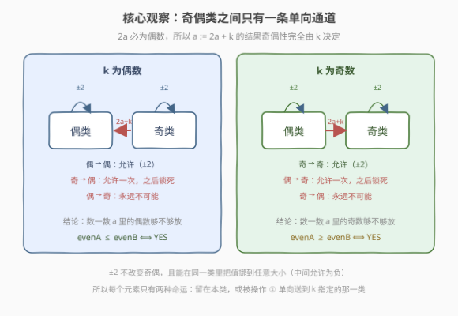
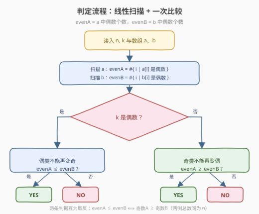
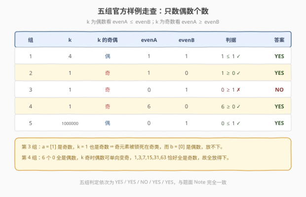

# Codeforces 2280A 它们是否相同 题解

## 1. 题目概述

- **标题 / 题号**：它们是否相同（Codeforces 2280A，英文名 Are They the Same?）
- **链接**：https://codeforces.com/problemset/problem/2280/A
- **来源**：Codeforces Round 1133 (Div. 2) · Problem A
- **难度**：未评级（官方暂未给 rating；Div. 2 A 签到题，500 分）
- **限制**：时间 1 s / 内存 256 MB
- **标签**：暴力枚举、实现、奇偶性分析

**题意**：给定两个长度都为 $n$ 的整数数组 $a$ 和 $b$，以及一个整数 $k$。允许对 $a$ 中任意元素**重复任意多次**执行下面三种操作：① $a_i := 2a_i + k$；② $a_i := a_i + 2$；③ $a_i := a_i - 2$。过程中元素可以变成负数，也可以变得任意大。问是否存在一种操作方案，使得最终数组 $a$ 成为 $b$ 的一个排列（元素按任意顺序一一对上即可）。多测：第一行 $t$，每组给出 $n, k$ 与两行各 $n$ 个整数，逐组输出 `YES` / `NO`。

**约束**：

- $1 \le t \le 500$，$1 \le n \le 100$
- $0 \le k \le 10^6$，$0 \le a_i, b_i \le 10^6$
- 操作次数不限，中间值不受任何上下界限制 —— 纯「可达性」问题，不涉及最小值 / 最少次数；只问存在性，**不需要**输出操作序列
- 输出大小写不敏感（`YES` / `yes` / `Yes` 都算对）

## 2. 示例与观察
官方样例（输入 / 输出原样）：

```text
输入：
5
3 4
1 2 7
5 3 8
1 1
0
1
1 1
1
0
6 1
0 0 0 0 0 0
1 3 7 15 31 63
2 1000000
999999 1
1000000 1

输出：
YES
YES
NO
YES
YES
```

再补两组自造数据，专门压 $k=0$ 与「奇数变偶数」两个边界：

```text
输入：
2
2 0
0 0
1 1
2 2
1 1
2 2

输出：
NO
YES
```

第一组 $k = 0$ 属于偶数分支：偶元素永远变不成奇数，两个 $0$ 无处可去；第二组 $k = 2$ 正好相反：两个奇数可以被 $a_i := 2a_i + 2$ 送进偶类（$1 \to 4 \to 2$），恰好对上 $2, 2$。

## 3. 解题思路

### 3.1 暴力思路

最直白的思路是：枚举 $a$ 到 $b$ 的全部 $n!$ 种配对，再对每一对判断「$a_i$ 能否变成 $b_j$」。这条路有两处硬伤。第一，配对本身就爆炸：$n = 100$ 时 $n!$ 是天文学数字，即使改用二分图匹配（$O(n^3)$）也得先知道哪些对之间可达。

第二，也是最要命的一点，「可达」不好判。值域不是有限的：操作 ① 会让数不断变大，操作 ③ 又可以让它降到负数，所以任何「把值截断到 $10^6$ 以内做 BFS」的写法都不是严格正确的——有些路径必须先冲到很大再回落。$t = 500$、每个元素 $10^6$ 量级的搜索空间，从根上都走不通。所以本题的正确入口不是搜索，而是**找不变量**：找出哪些量在任何操作下都不表现自由。

### 3.2 核心观察：只有奇偶两个类，而且通道是单向的



把整数按奇偶性划成两个「类」：偶类与奇类。逐个看三种操作的影响：②③ 是 $\pm 2$，**奇偶性不变**，只让值在同一类里前后挪；① 算的是 $2a_i + k$，其中 $2a_i$ 必定是偶数，所以**结果的奇偶性完全由 $k$ 决定**。于是两条单行道：

- $k$ 为偶数：偶元素**永远**留在偶类（$\pm 2$ 保持偶数，$2a+k$ 也是偶数）；奇元素可以留在奇类，也可以被操作 ① 一次性送进偶类，但一旦进了偶类就再也回不去（$k$ 偶时任何操作都造不出奇数）。
- $k$ 为奇数：完全对称——奇元素永远留在奇类；偶元素可以被操作 ① 送进奇类，之后锁死在奇类。

再看「量」的问题。同一奇偶类的两个值 $x, y$ 一定互相可达：做 $|x-y|/2$ 次 $+2$ 或 $-2$ 即可，题面明确允许中间值为负，所以既不会卡在下界也不会卡在上界。**类内没有任何阈值**，值的具体大小完全不影响答案——这是把「无限搜索」压成「数个数」的关键一步。记 $\text{evenA}$ 为 $a$ 中偶数的个数、$\text{evenB}$ 为 $b$ 中偶数的个数。由于「偶类只能由偶元素去填（$k$ 偶）」或「奇类只能由奇元素去填（$k$ 奇）」，而这是一个单射匹配，于是判据是：

$$k \text{ 偶}:\ \text{evenA} \le \text{evenB}, \qquad k \text{ 奇}:\ \text{evenA} \ge \text{evenB}$$

第二条也可以写成 $\text{oddA} \le \text{oddB}$，即 $n - \text{evenA} \le n - \text{evenB}$。两条判据只是同一条计数比较的两种写法，互为取反。

### 3.3 算法流程



1. 读入 $t$，进入多测循环；
2. 每组读入 $n, k$，再读 $a$ 的 $n$ 个数，统计其中偶数个数 $\text{evenA}$（判据 `x % 2 == 0` 或 `(x & 1) == 0`）；
3. 读 $b$ 的 $n$ 个数，统计偶数个数 $\text{evenB}$；
4. 若 $k$ 为偶数，输出 `YES` 当且仅当 $\text{evenA} \le \text{evenB}$；若 $k$ 为奇数，输出 `YES` 当且仅当 $\text{evenA} \ge \text{evenB}$。整个算法只有一次线性扫描，没有任何跨组的遗留状态。

### 3.4 示例演算



| 组 | $k$ | $k$ 的奇偶 | $\text{evenA}$ | $\text{evenB}$ | 判据 | 答案 |
|----|-----|-----------|---------------|---------------|------|------|
| 1 | 4 | 偶 | 1 | 1 | $1 \le 1$ ✓ | YES |
| 2 | 1 | 奇 | 1 | 0 | $1 \ge 0$ ✓ | YES |
| 3 | 1 | 奇 | 0 | 1 | $0 \ge 1$ ✗ | NO |
| 4 | 1 | 奇 | 6 | 0 | $6 \ge 0$ ✓ | YES |
| 5 | 1000000 | 偶 | 0 | 1 | $0 \le 1$ ✓ | YES |

第 3 组是本题最典型的坑：$a = [1]$ 是奇数、$k = 1$ 也是奇数，奇元素被锁死在奇类，而 $b = [0]$ 是偶数，怎么操作都填不上。第 4 组反过来展示了「单向通道」的用法：$k$ 为奇数时偶数可以变奇数，$6$ 个 $0$ 用 $0 \to 1 \to 3 \to 7 \to 15 \to 31 \to 63$ 这种「先乘加、再补 $\pm 2$」的方式恰好铺满 $b$。第 1 组则是 $k$ 为偶数时两边的偶数刚好一样多，各就各位。

## 4. 算法细节

1. **不用真的模拟任何操作**。$2a_i + k$ 根本不需要计算，所以也不存在溢出问题；把注意力放在「哪些量不能变」上，代码就退化成两行计数。
2. **奇偶判断写法**：`x % 2 == 0` 与 `(x & 1) == 0` 对非负整数等价，后者更快；本题 $a_i, b_i \ge 0$，不必考虑负数取模的符号问题。$k$ 同样只看最低位（`k % 2 == 0` 或 `(k & 1) == 0`），它虽然有 $10^6$，只用来判奇偶，用 `int` 足够。
3. **多测清空**：$\text{evenA}, \text{evenB}$ 必须在每组开头重置为 $0$；这是本题唯一容易漏的清空点。若用「读入后原地计数」的写法，务必保证计数变量在循环体内声明。
4. **I/O**：$t \le 500$、$n \le 100$，数据量约 $10^5$ 个整数，`cin` 关同步后绰绰有余；Python 用 `sys.stdin.buffer.read().split()` 一次读完再逐组切片，比逐行 `readline` 快得多，也天然不受空行 / 多余空格影响。
5. **匹配视角**：本题本质是「只有两个颜色类」的二分图完美匹配，Hall 条件退化成计数比较——只要一类元素的个数不超过对应目标类的槽位数，就一定存在单射，多余的另一个类元素总能通过单向通道或类内平移消化掉。这一点在第 5 节会写成严格的构造。

## 5. 正确性证明

**引理 1（类内自由可达）**：设 $x, y$ 奇偶性相同，则从 $x$ 出发只用操作 ②③ 就能得到 $y$。

**证明**：$x - y$ 是偶数，记 $d = |x - y| / 2$。若 $y \ge x$，做 $d$ 次操作 ②；否则做 $d$ 次操作 ③。中间过程的取值在 $x$ 与 $y$ 之间，题面允许任意中间值（包括负数），故每一步都合法，最终恰好到达 $y$。∎

**引理 2（单向性）**：$k$ 为偶数时，任何偶数元素在任意操作后仍是偶数；$k$ 为奇数时，任何奇数元素在任意操作后仍是奇数。

**证明**：$\pm 2$ 显然保持奇偶。设当前值 $v$。若 $k$ 偶，则 $2v + k$ 是「偶数 + 偶数」＝偶数，故偶 $\to$ 偶；若 $v$ 已是偶数，则三种操作的结果全是偶数，归纳可知它永远为偶数。若 $k$ 奇，则 $2v + k$ 是「偶数 + 奇数」＝奇数，故奇 $\to$ 奇，同理归纳得奇数元素永远为奇数。∎

**引理 3（充分性构造）**：若 $k$ 偶且 $\text{evenA} \le \text{evenB}$，或 $k$ 奇且 $\text{evenA} \ge \text{evenB}$，则存在一种配对与操作方案把 $a$ 变成 $b$ 的排列。

**证明**：两种情形下都显式给出配对；同奇偶的配对由引理 1 完成平移，跨类的配对再用一次操作 ①。

情形一，$k$ 偶、$\text{evenA} \le \text{evenB}$。记 $m = \text{evenB} - \text{evenA} \ge 0$，于是

$$\text{oddA} = n - \text{evenA} = (n - \text{evenB}) + m = \text{oddB} + m$$

即 $a$ 恰好比 $b$ 多 $m$ 个奇元素、少 $m$ 个偶元素。按下面三段配对：

- $b$ 的 $\text{oddB}$ 个奇位置 ← $a$ 中任取 $\text{oddB}$ 个奇元素，引理 1 类内平移；
- $b$ 的 $\text{evenB} = \text{evenA} + m$ 个偶位置 ← $a$ 剩下的 $m$ 个奇元素占用其中 $m$ 个（各做一次操作 ① 得 $2a_i + k$，是偶数，再由引理 1 平移），另外 $\text{evenA}$ 个由 $a$ 的偶元素占用（引理 1 平移）；
- $b$ 一个不剩，$a$ 也一个不剩：$(\text{oddB}) + m + \text{evenA} = \text{oddA} + \text{evenA} = n$。

情形二，$k$ 奇、$\text{evenA} \ge \text{evenB}$。记 $m = \text{evenA} - \text{evenB} \ge 0$，对称地有 $\text{oddB} = \text{oddA} + m$：

- $b$ 的 $\text{oddA}$ 个奇位置 ← $a$ 全部奇元素（引理 1）；
- $b$ 的 $\text{evenB}$ 个偶位置 ← $a$ 中任取 $\text{evenB}$ 个偶元素（引理 1）；
- $b$ 剩下 $m$ 个奇位置 ← $a$ 剩下的 $m$ 个偶元素，各做一次操作 ① 变成奇数，再引理 1 平移。两种情形都覆盖了全部 $n$ 个位置、$n$ 个元素，且每一步都只用到了题目允许的操作，故方案存在。∎

**定理**：算法输出 `YES` 当且仅当存在操作序列使 $a$ 成为 $b$ 的排列。

**证明**：

- 充分性即引理 3。
- 必要性：若 $k$ 偶，由引理 2 所有偶元素永远为偶，故 $a$ 的每个偶元素最终必须落到 $b$ 的某个偶位置上，这是一个单射，于是 $\text{evenA} \le \text{evenB}$；若 $k$ 奇，同理 $a$ 的每个奇元素必须落到 $b$ 的奇位置上，得 $n - \text{evenA} \le n - \text{evenB}$，即 $\text{evenA} \ge \text{evenB}$。两种情况都与算法的判据一致，故算法不会漏判有解的情形。两方向合起来，判据与真值完全等价。∎

## 6. 复杂度分析

- **时间**：每组数据 $O(n)$——扫描 $a$、扫描 $b$ 各一次，外加常数次比较；总时间 $O\!\left(\sum n\right) \le 500 \times 100 = 5 \times 10^4$ 次基本操作。
- **空间**：$O(1)$ 额外空间（两个计数器 + 循环变量），与 $n, k$ 都无关；若像下面 Python 版那样一次性读入全部输入，缓冲区是 $O(tn)$ 个 token，约 $10^5$ 个短字符串、几百 KB 量级。
- **对照时限**：$1$ s 时限下 $5 \times 10^4$ 次操作只占用不到千分之一。本机实测（Apple clang + libc++，含进程启动、$t = 500$、$n = 100$、$k = 10^6$ 的满约束数据，约 $10^5$ 个整数）C++ 约 $110$ ms，其中绝大部分是标准流读入本身；在 Codeforces 的 g++/libstdc++ 上同类读数通常只需十几毫秒，留有 9 倍以上余量。Python 版同一组数据实测约 $50$ ms（含解释器启动），同样完全安全，不会超时。

## 7. 参考代码

### C++17

```cpp
#include <bits/stdc++.h>
using namespace std;

int main() {
    ios::sync_with_stdio(false);
    cin.tie(nullptr);
    int t;
    if (!(cin >> t)) return 0;              // 空输入防护
    while (t--) {
        int n;
        long long k;
        cin >> n >> k;
        int evenA = 0, evenB = 0;           // 每组必须重新置零
        for (int i = 0; i < n; ++i) {
            long long x;
            cin >> x;
            if ((x & 1LL) == 0) ++evenA;
        }
        for (int i = 0; i < n; ++i) {
            long long x;
            cin >> x;
            if ((x & 1LL) == 0) ++evenB;
        }
        bool ok = (k % 2 == 0) ? (evenA <= evenB)   // k 偶：偶元素锁死，偶数槽位要够
                               : (evenA >= evenB);  // k 奇：奇元素锁死，奇数槽位要够
        cout << (ok ? "YES" : "NO") << "\n";
    }
    return 0;
}
```

### Python3

```python
import sys


def main() -> None:
    data = sys.stdin.buffer.read().split()
    if not data:                       # 空输入防护
        return
    t = int(data[0])
    pos = 1
    out = []
    for _ in range(t):
        n = int(data[pos])
        k = int(data[pos + 1])
        pos += 2
        a = data[pos:pos + n]
        pos += n
        b = data[pos:pos + n]
        pos += n
        even_a = sum(1 for x in a if int(x) % 2 == 0)
        even_b = sum(1 for x in b if int(x) % 2 == 0)
        if k % 2 == 0:
            out.append("YES" if even_a <= even_b else "NO")
        else:
            out.append("YES" if even_a >= even_b else "NO")

    sys.stdout.write("\n".join(out) + "\n")


main()
```

## 8. 边界情况与易错点

1. **$k = 0$**：属于偶数分支。此时 $a_i := 2a_i$，偶元素永远为偶、奇元素做一次操作后也变成偶，因此 `2 0 / 0 0 / 1 1` 必须输出 `NO`；把 $k = 0$ 误当成「没有操作 ①」或归到奇数分支都会错。
2. **方向搞反**：$k$ 偶时是 $\text{evenA} \le \text{evenB}$，$k$ 奇时是 $\text{evenA} \ge \text{evenB}$。写反是本题最高频的 WA，建议在代码里用注释固定住「偶元素锁死 / 奇元素锁死」的记忆点。
3. **$n = 1$**：$a=[1], b=[0], k=1$ 是 `NO`（奇元素锁死），$a=[1], b=[0], k=2$ 是 `YES`（$1 \to 4 \to 2 \to 0$）；$a=[0], b=[1], k=2$ 是 `NO`。这三个单元素用例正好覆盖两个分支的两个方向。
4. **全部元素相同**：如 $a = [0,0,0]$、$b = [1,1,1]$、$k$ 奇时答案 `YES`（每个 $0$ 都能单向变奇再任意平移）；但 $k$ 偶时答案 `NO`。重复元素不会带来任何额外约束，计数天然处理。
5. **误以为要值相等**：把 $a, b$ 各自排序后逐位比较是错的，因为本题不要求数值相等，只要求「可达」。例如样例 1 中 $1 \to 3$、$7 \to 5$，排序逐位比较会判错。
6. **误以为大小有上下界**：题面明确允许中间值为负、可任意大，所以不要加「不能超过 $10^6$」「不能为负」之类的人为限制，否则会把合法方案判死。
7. **多测输出格式**：每组恰好一行，组间无空行；`YES`/`NO` 大小写不敏感但统一大写最稳。Python 版用 `"\n".join(out)` 一次性写出，避免 $500$ 次 `print` 的系统调用开销。

## 9. 验证记录

- **编译环境与命令**：`clang++ -std=c++17 -O2`（本机无 GNU g++，配 `codeforces/tools/include/bits/stdc++.h` 兼容头；正文代码只用标准库，可原样提交 GNU C++17）；Python 侧为 `Python 3.9.6`。
- **官方样例**：1 / 1 通过（按 Codeforces 标准 checker 的 token 比对，忽略空白与大小写）。
- **复核状态**：audited（2026-11-19 统一回归：编译 + 官方样例；写作期的随机对拍与暴力未重跑）。

## 相关题目与扩展

- [Codeforces 1547A Shortest Path with Obstacle](https://codeforces.com/problemset/problem/1547/A)：网格上只能走单位步时，两点的步数下界由坐标差的奇偶性决定，同样是「奇偶性是唯一不变量」的思路。
- [Codeforces 1553A Digits Sum](https://codeforces.com/problemset/problem/1553/A)：统计区间内满足个位条件的数的个数，与本题「统计某一类元素的个数再比较」是同一种计数套路。
- [LeetCode 1523. 在区间范围内统计奇数数目](https://leetcode.cn/problems/count-odd-numbers-in-range/)：纯奇偶计数题，可对比本题把「计数」升级成「计数 + 单向可达」后的判据形态。

**延伸思考**：

1. **若操作 ① 改为 $a_i := c\,a_i + k$**：$c$ 为偶数时结论完全不变（$c\,a_i$ 仍是偶数）；$c$ 为奇数时新值的奇偶等于 $a_i \oplus k$——$k$ 偶则奇偶永不改变，判据退化为 $\text{evenA} = \text{evenB}$；$k$ 奇则每次操作 ① 都翻转奇偶，两类互相可达，答案恒为 `YES`。
2. **若操作 ① 每元素至多一次**：答案不变。因为在同一类里做多少次操作 ① 都只会留在同一个类（奇偶由 $k$ 决定），多做的那些完全等价于 $\pm 2$ 平移，所以「不限次」与「至多一次」等价。
3. **若把 $\pm 2$ 换成 $\pm d$**：类变成模 $d$ 的剩余类，操作 ① 变成剩余类上的仿射映射 $r \mapsto 2r + k \bmod d$，每个元素只能沿自己的轨道单向走（轨道终点是一个圈）；判据从「一个不等式」升级成「在这张函数图上做匹配 / 流量」，本题是 $d = 2$ 的退化情形。
4. **若要求最少操作次数**：问题立刻变难——类内距离是 $|x-y|/2$，跨类还要额外一次操作 ① 加上「冲高再回落」的步数，配对也需要用最小权匹配而不是计数比较。可以作为本题的加强练习。
