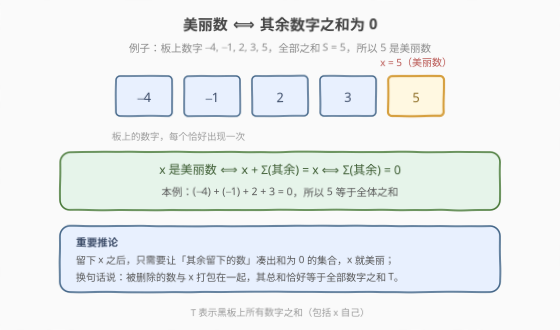
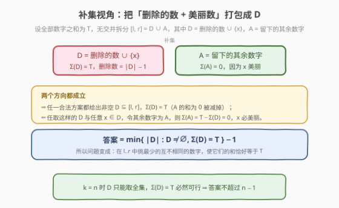
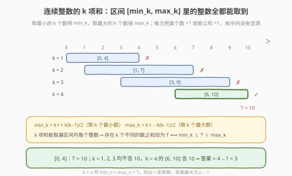

# Codeforces 2283A 黑板上的数字 题解

## 1. 题目概述

- **标题 / 题号**：黑板上的数字（Codeforces 2283A，英文名 Numbers on the Board）
- **链接**：https://codeforces.com/problemset/problem/2283/A
- **来源**：Educational Codeforces Round 196 (Rated for Div. 2) · Problem A
- **难度**：未评级（Educational Round A 题，无 rating / points 字段，约 800 档）
- **限制**：时间 2 s / 内存 512 MB
- **标签**：贪心，数学，双指针

**题意**：黑板上写着 $l, l+1, \dots, r$ 每个整数恰好一次。若板上某个数 $x$ 等于**板上所有数字之和（把 $x$ 自身也算进去）**，则称 $x$ 是**美丽数**。例如板上是 $-4, -1, 2, 3, 5$ 时总和为 $5$，所以 $5$ 是美丽数。你可以擦掉任意多个数，但**至少要留下一个**。求最少擦掉几个数，使擦完后板上至少有一个美丽数；如果本来就有，答案是 $0$。多测：第一行 $t$，之后每行两个整数 $l, r$，逐组输出一个整数。

**约束**：

- $1 \le t \le 10^4$
- $-100 \le l \le r \le 100$，故板上数字个数 $n = r-l+1 \le 201$
- 总和 $T = \frac{(l+r)\,n}{2}$ 满足 $|T| \le 5050$（$[1,100]$ 与 $[-100,-1]$ 取到 $5050$）
- 至少保留一个数；答案范围是 $0 \le \text{ans} \le n-1$
- 标准输入输出，时间 2 s、内存 512 MB

## 2. 示例

官方样例（输入 / 输出原样）：

```text
输入：
8
0 0
2 6
-5 -3
-2 2
-2 3
-2 5
-6 2
0 4

输出：
0
4
2
0
0
2
3
3
```

逐组说明（$T$ 为擦除前总和，最后一行是「擦完留下的集合之和 = 那个美丽数」）：

| # | $l\ r$ | $n$ | $T$ | 最优操作 | 答案 |
|---|---------|-----|-----|----------|------|
| 1 | `0 0` | 1 | 0 | 只留 $0$，$0$ 等于总和 | 0 |
| 2 | `2 6` | 5 | 20 | 擦 $2,3,4,5$，只留 $6$ | 4 |
| 3 | `-5 -3` | 3 | $-12$ | 擦 $-4,-3$，只留 $-5$ | 2 |
| 4 | `-2 2` | 5 | 0 | 不擦：总和 $0$，$0$ 美丽 | 0 |
| 5 | `-2 3` | 6 | 3 | 不擦：总和 $3$，$3$ 美丽 | 0 |
| 6 | `-2 5` | 8 | 12 | 擦 $4,5$，留 $-2..3$，和 $=3$ | 2 |
| 7 | `-6 2` | 9 | $-18$ | 擦 $-6,-5,-3$，留 $-4,-2..2$，和 $=-4$ | 3 |
| 8 | `0 4` | 5 | 10 | 擦 $1,2,3$，留 $\{0,4\}$，和 $=4$ | 3 |

自造一组极端数据（校验「全正 / 全负 / 跨零」三种形态）：

```text
输入：
4
-100 100
0 100
50 100
-100 -1

输出：
0
99
50
99
```

`-100 100` 的总和恰为 $0$，$0$ 自己就是美丽数；后两组区间全同号，除「只留一个数」外没有任何办法让其余数字之和为 $0$，只能擦到只剩一个。

## 3. 解题思路

### 3.1 暴力思路

最朴素：枚举「留下哪些数」的所有子集 $S'$（$2^n$ 种），对每个 $S'$ 检查是否存在 $x \in S'$ 满足 $x = \sum_{y \in S'} y$，取合法中 $|S'|$ 最大的。$n \le 201$ 时子集数完全不可行。

稍进一步：固定美丽数 $x$，问题变成「在剩下的数里挑出和为 $0$ 的子集」，这是子集和问题。物品只有 $n \le 201$ 个、值域只有 $[-100,100]$，用 $O(n \cdot |T|)$ 的背包 DP（$|T| \le 5050$）能做单组，但 $t = 10^4$ 组就是 $10^{10}$ 量级，超时。必须利用「数字是连续整数」这一结构。

### 3.2 核心观察：美丽 $\iff$ 其余数字之和为 $0$



设擦除前全体为 $[l,r]$、总和为 $T$；擦除后留下非空集合 $S'$，$x \in S'$。则

$$x \text{ 是美丽数} \iff x = \sum_{y \in S'} y = x + \sum_{y \in S' \setminus \{x\}} y \iff \sum_{y \in S' \setminus \{x\}} y = 0 .$$

也就是说，**「$x$ 美丽」与「$x$ 之外留下来的数字之和为 $0$」完全等价**，与 $x$ 本身多大无关。这一步把「维护一个总和、反复比较」换成了「控制一组数字的和」，是后面所有推导的支点。

### 3.3 归约：最少擦除数 = 最小「和为 $T$ 的子集」大小减一



把全体 $[l,r]$ 做一个无交拆分：$D = \text{被擦掉的数} \cup \{x\}$，$A = [l,r] \setminus D$（留下的其余数字）。

- **正向**：合法方案里 $\sum A = 0$（3.2），于是 $\sum D = T - \sum A = T$ 且 $D \ne \varnothing$；擦除数 $= |D| - 1$。
- **反向**：任取非空 $D \subseteq [l,r]$ 使 $\sum D = T$。从 $D$ 里随便挑一个 $x$，令其余为 $A$，则 $\sum A = T - \sum D = 0$，所以留下的 $A \cup \{x\}$ 之和 $= 0 + x = x$，$x$ 是美丽数，只需擦 $|D| - 1$ 个。

两个方向合起来，问题精确地变成一个纯组合问题：

$$\boxed{\ \text{ans} = \min\bigl\{|D| : D \subseteq [l,r],\ D \ne \varnothing,\ \textstyle\sum_{d \in D} d = T\bigr\} - 1\ }$$

即：**在 $l, l+1, \dots, r$ 中挑最少的互不相同的数，使它们的和恰为 $T$。**

### 3.4 子问题：连续整数的 $k$ 项和恰好填满一个区间



记 $k$ 个最小数之和为 $\min_k$、$k$ 个最大数之和为 $\max_k$，都是闭式：

$$\min_k = k\,l + \frac{k(k-1)}{2}, \qquad \max_k = k\,r - \frac{k(k-1)}{2}.$$

**关键引理（$k$ 项和的连续性）**：从 $[l,r]$ 中任取 $k$ 个不同数，其和恰好取遍整数区间 $[\min_k, \max_k]$，中间没有空洞。

直观理由：从最小的 $k$ 元集 $\{l, \dots, l+k-1\}$ 出发，只要还不是最大的 $k$ 元集 $\{r-k+1, \dots, r\}$，总能找到某个元素把它 $+1$、且不与其他元素撞车（严格论证见 §5 引理 2）。每次操作让和 $+1$，一路走到 $\max_k$，于是 $\min_k, \min_k+1, \dots, \max_k$ 每个值都被走到过。

由此得到判定：**存在 $k$ 个不同数之和为 $T$ $\iff \min_k \le T \le \max_k$**。从小到大枚举 $k$，第一个满足该不等式的 $k$ 就是最小 $|D|$，答案为 $k-1$。$k=n$ 时 $\min_n = \max_n = T$ 恒成立，所以循环一定能命中，绝不会无解。

### 3.5 示例演算

以 $[0,4]$、$[2,6]$、$[-6,2]$ 为例，逐行对比每个 $k$ 的可行区间（粗体为第一个包含 $T$ 的区间）：

| 用例 | $T$ | $k=1$ | $k=2$ | $k=3$ | $k=4$ | $k=5$ | 首个可行 $k$ | 答案 |
|------|-----|-------|-------|-------|-------|-------|--------------|------|
| $[0,4]$ | 10 | $[0,4]$ | $[1,7]$ | $[3,9]$ | $\mathbf{[6,10]}$ | — | 4 | 3 |
| $[2,6]$ | 20 | $[2,6]$ | $[5,11]$ | $[9,15]$ | $[14,18]$ | $\mathbf{[20,20]}$ | 5 | 4 |
| $[-6,2]$ | $-18$ | $[-6,2]$ | $[-11,3]$ | $[-15,3]$ | $\mathbf{[-18,2]}$ | … | 4 | 3 |

三组结果 $3, 4, 3$ 与官方样例一致。再看「全同号」的 $[1,100]$：$T=5050$，而 $k<100$ 时 $\max_k = 5050 - (1+2+\dots+(100-k)) < 5050$，只有 $k=100$ 可行，答案 $99$——与直觉「必须擦到只剩一个数」吻合。

## 4. 算法细节

1. **总和 $T$ 的写法**：$T = (l+r) \cdot n / 2$，先乘后除。$n(l+r)$ 一定是偶数（因为 $T$ 是整数），故不会截断；即使 $l+r<0$，C++ 的整数除法对偶数被除数也是精确的，无需额外处理符号。
2. **线性枚举 $k$，不要二分**：$\min_k = kl + k(k-1)/2$ 关于 $k$ 在 $l<0$ 时先减后增，可行性不具备可直接利用的单调形式；而 $n \le 201$，直接 $k = 1 \to n$ 扫描每次 $O(1)$，总代价可忽略。
3. **只算 $\min_k, \max_k$**：不需要真的构造子集，也不需要背包；两个闭式即可完成判定，这是把 $O(n|T|)$ 的 DP 压到 $O(n)$ 的原因。
4. **兜底 `ans = n-1`**：$k=n$ 时 $\min_n = \max_n = T$，循环必命中，输出上界 $n-1$ 也永远合法（只留一个数，它必然等于自己的总和）。
5. **多测清空**：本题没有跨测试用例的数组或全局状态，每组独立计算，不需要 `memset`；保持循环内定义变量即可。
6. **I/O**：$t \le 10^4$、输出仅 $10^4$ 行，C++ 开 `sync_with_stdio(false)` 即可；Python 用 `sys.stdin.buffer.read().split()` 一次性读完，避免逐行 `input()` 的开销。
7. **统一用 `long long`**：本题中间量不超过 $2\times 10^4$，`int` 也够，但用 `long long` 可以省去「乘法是否溢出、负数是否取整出错」的心智负担。

## 5. 正确性证明

**引理 1（美丽判定）**：设擦除后留下非空集合 $S'$，$x \in S'$，则 $x$ 是美丽数 $\iff \sum_{y \in S' \setminus \{x\}} y = 0$。

**证明**：$x$ 美丽即 $x = \sum_{y\in S'} y = x + \sum_{y \in S'\setminus\{x\}} y$，两边减去 $x$ 得 $\sum_{y\in S'\setminus\{x\}} y = 0$；反之亦然。∎

**引理 2（$k$ 项和连续）**：对 $1 \le k \le n$，集合 $\bigl\{\sum_{y \in B} y : B \subseteq [l,r],\ |B| = k\bigr\}$ 恰好等于整数区间 $[\min_k, \max_k]$。

**证明**：任取 $k$ 元集，其和不超过取最大的 $k$ 个数时的 $\max_k$、不小于取最小的 $k$ 个数时的 $\min_k$，故左端包含于右端。

反过来，把 $k$ 元集按升序写成 $a_1 < a_2 < \dots < a_k$。若它不是最大的 $k$ 元集，令 $j$ 为满足 $a_j + 1 \le r$ 且（$j = k$ 或 $a_j + 1 < a_{j+1}$）的最大下标。这样的 $j$ 一定存在：若 $a_k < r$ 则 $j = k$ 合格；若 $a_k = r$，因该集合不是 $\{r-k+1,\dots,r\}$，必有某个 $i$ 使 $a_i < r-k+i$，取最大的这种 $i$（若 $i = k$ 则 $a_k < r$，已属前一种情形，故 $i < k$），则 $a_{i+1} > a_i + 1$ 且 $a_i + 1 \le r$，$j = i$ 合格。把 $a_j$ 换成 $a_j + 1$：由 $a_{j-1} \le a_j - 1 < a_j + 1$ 与 $a_j + 1 < a_{j+1}$（或 $j=k$）知仍是严格递增的 $k$ 元子集，且和恰好 $+1$。于是从 $\{l,\dots,l+k-1\}$ 出发，可以每次让和 $+1$，直到 $\{r-k+1,\dots,r\}$，途经 $\min_k$ 到 $\max_k$ 的每一个整数，故右端的每个值都能取到。∎

**引理 3（归约）**：设 $k^* = \min\{|D| : D \subseteq [l,r],\ D \neq \varnothing,\ \sum_{d\in D} d = T\}$，则最少擦除数为 $k^* - 1$。

**证明**：任取一个合法方案，设擦除集合为 $E$、留下 $S'$、美丽数为 $x \in S'$，取 $D = E \cup \{x\}$。则 $|D| = |E| + 1$，且由引理 1 得 $\sum_{d \in D} d = T - \sum_{y \in S'} y + x = T - x + x = T$，$D$ 非空，故 $|E| \ge k^* - 1$。反向，取达到 $k^*$ 的 $D$，任选 $x \in D$，令 $A = [l,r]\setminus D$，则 $\sum A = T - \sum D = 0$，留下 $A \cup \{x\}$ 时总和为 $x$，$x$ 美丽，擦除数 $= |D| - 1 = k^* - 1$。两个方向合起来即得结论。∎

**引理 4（存在性判定）**：存在 $|D| = k$、$\sum D = T$ 的非空 $D$ $\iff \min_k \le T \le \max_k$。

**证明**：由引理 2 直接得到（$D$ 就是那个 $k$ 元子集）。∎

**定理**：算法对每组输入输出最少擦除数。

**证明**：由引理 3，答案等于 $k^* - 1$；由引理 4，$k^*$ 恰是第一个满足 $\min_k \le T \le \max_k$ 的 $k$，这正是算法的循环变量。又 $k = n$ 时 $\min_n = \max_n = T$，条件必然成立，循环一定终止并 break，故输出 $k^*-1$，正确。∎

## 6. 复杂度分析

- **时间**：每组 $O(n) = O(r-l+1) \le 201$，内层全是常数次四则运算；总计 $O(t\,n) \le 2.01 \times 10^6$ 次迭代。实测最大规模（$t = 10^4$，全部取最坏的 `1 100`，需扫满 $k$）时 C++ 约 $20$ ms（含进程启动），Python 约 $0.23$ s，都远低于 2 s。
- **空间**：除输入输出缓冲外，额外空间 $O(1)$（只保存 $l, r, n, T, k, \min_k, \max_k$ 等常数个变量）。Python 一次性读入输入并缓存 $10^4$ 行输出，这部分是 $O(t)$。

## 7. 参考代码

### C++17

```cpp
#include <iostream>

int main() {
    std::ios::sync_with_stdio(false);
    std::cin.tie(nullptr);

    int t;
    if (!(std::cin >> t)) return 0;
    while (t--) {
        long long l, r;
        std::cin >> l >> r;
        long long n = r - l + 1;
        long long T = (l + r) * n / 2;          // 板上全部数字之和
        long long ans = n - 1;                  // k = n 必然可行，兜底
        for (long long k = 1; k <= n; ++k) {
            long long mn = k * l + k * (k - 1) / 2;   // k 个最小数之和 min_k
            long long mx = k * r - k * (k - 1) / 2;   // k 个最大数之和 max_k
            if (mn <= T && T <= mx) { ans = k - 1; break; }
        }
        std::cout << ans << '\n';
    }
    return 0;
}
```

### Python3

```python
import sys


def main() -> None:
    data = sys.stdin.buffer.read().split()
    if not data:
        return
    t = int(data[0])
    pos = 1
    out = []
    for _ in range(t):
        l = int(data[pos]); r = int(data[pos + 1]); pos += 2
        n = r - l + 1
        T = (l + r) * n // 2                    # 板上全部数字之和
        for k in range(1, n + 1):
            lo = k * l + k * (k - 1) // 2       # k 个最小数之和 min_k
            hi = k * r - k * (k - 1) // 2       # k 个最大数之和 max_k
            if lo <= T <= hi:
                out.append(str(k - 1))
                break
    sys.stdout.write("\n".join(out) + "\n")


main()
```

## 8. 边界情况与易错点

1. **$l = r$**：$n = 1$，$T = l$，唯一留下来的数必然等于总和，$k=1$ 立即命中，答案 $0$；不会输出负数。
2. **$T = 0$（如 $[-2,2]$、$[-100,100]$）**：此时 $l+r = 0$，必有 $0 \in [l,r]$，$k=1$ 可行、答案 $0$。不要把它当成「要构造空集」的特例去特判。
3. **全正 / 全负区间（如 $[1,100]$、$[-100,-1]$）**：除「只留一个数」外，任何非空真子集的其余元素之和都不可能为 $0$，只有 $k=n$ 可行，答案 $n-1$；这也是答案的全局上界。
4. **不要用二分找 $k$，也别加基于单调性的剪枝**：$\min_k$ 关于 $k$ 不单调（$l<0$ 时先减后增），可行集合的形状依赖具体数据；线性扫描最稳，$n \le 201$ 完全承受得起。
5. **整除顺序**：必须写 $(l+r)\cdot n/2$；若先除再乘，$l+r$ 为奇数时会被截断（例如 $[1,2]$ 应得 $T=3$，写成 $(1+2)/2\cdot 2 = 1\cdot 2 = 2$ 就错了）。
6. **负数读入**：$l, r$ 可为负，用有符号类型读入，别用 `unsigned`；`scanf("%lld")` 与 `cin >>` 都支持负号。
7. **输出是 $k-1$ 而不是 $k$**：样例 `2 6` 的答案是 $4$（对应 $k=5$），把 $k$ 直接输出会得到 $5$，这是本题最常见的错法。
8. **多测别重置错变量**：`ans` 每组重新初始化为 $n-1$；Python 中 `out` 列表跨组复用没问题，但 `pos` 必须每组正确推进 $2$。

## 相关题目与扩展

- [LeetCode 416. 分割等和子集](https://leetcode.cn/problems/partition-equal-subset-sum/)：经典子集和判定；本题一旦失去「连续整数」结构，就退化成这类 NP 难度、只能 DP 的问题。
- [LeetCode 1755. 最接近目标值的子序列和](https://leetcode.cn/problems/closest-subsequence-sum/)：最小子集和的折半搜索版本，可与本题「最少 $k$ 个数凑出 $T$」对照。
- [LeetCode 1982. 从子集的和还原数组](https://leetcode.cn/problems/find-array-given-subset-sums/)：同样围绕「子集和」的结构化推理。
- [Codeforces 2283B. Rhythmic String](https://codeforces.com/problemset/problem/2283/B)：同场 B 题，数论枚举，可与本题的「闭式判定 + 小范围枚举」思路互参。

**延伸思考**：

- 本题的 $D$ 其实总能取成**连续的一段** $[a,b] \subseteq [l,r]$（对全部 $20301$ 组输入做过全子集对拍验证），这正是题目标签 two pointers 的来源：直接滑窗找「和恰为 $T$ 的最短区间」也能得到同样答案；但严格证明以引理 2 的 $k$ 项和区间路线最直接。
- 若把 $-100 \le l \le r \le 100$ 放大到 $l, r \le 10^{18}$，就不能枚举 $k$ 了：$\min_k \le T \le \max_k$ 是两条关于 $k$ 的二次不等式，可以先解出 $k$ 的合法区间再取最小整数，做到 $O(1)$（注意 $\min_k$ 的抛物线在 $k \approx -l$ 处转向，需要分两段讨论）。
- 题面里「包括自身」这四个字是关键：若把美丽数改成「等于其余数字之和」（不含自身），条件变成 $2x = T$，答案只取决于 $T$ 的奇偶性与 $T/2$ 是否落在 $[l,r]$ 内，问题会退化成一行的判断题。
