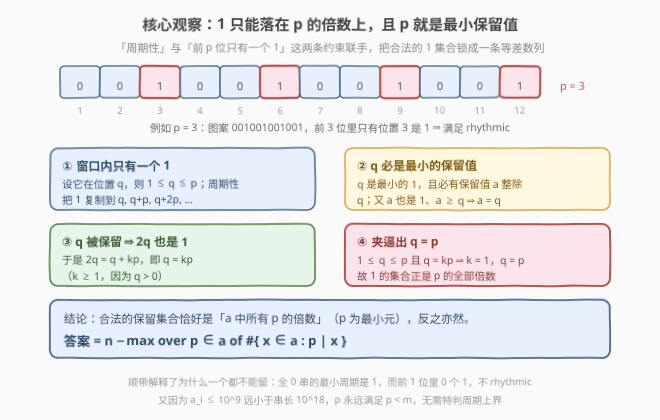
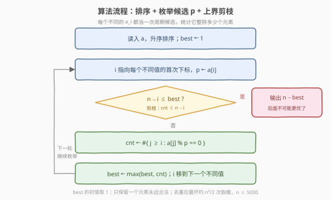
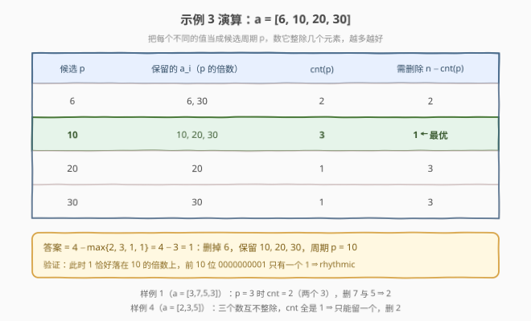

# Codeforces 2283B 节奏字符串 题解

## 1. 题目概述

- **标题 / 题号**：节奏字符串（Codeforces 2283B，英文名 Rhythmic String）
- **链接**：https://codeforces.com/problemset/problem/2283/B
- **来源**：Educational Codeforces Round 196 (Rated for Div. 2) · Problem B
- **难度**：未评级（题面未给分值，rating 尚未标定；按 Div. 2 的 B 题估计约 1200）
- **限制**：时间 2 s / 内存 512 MB
- **标签**：暴力枚举、数论、整除、剪枝

**题意**：有一个长度 $m = 10^{18}$ 的全 0 二进制串 $s$（下标从 $1$ 开始），以及 $n$ 个整数 $a_1,\dots,a_n$。正常流程是对每个 $a_i$，把所有下标为 $a_i$ 倍数的位置 $a_i, 2a_i, 3a_i, \dots$（不超过 $m$）置为 1。但**在动手之前，你可以删掉 $a$ 中任意若干元素**，剩下的元素照常处理。

若存在 $k$（$1 \le k < m$）使 $s_i = s_{i+k}$ 对所有 $1 \le i \le m-k$ 成立，则把这样的 $k$ 中**最小**的那个称作 $s$ 的**周期** $p$；若 $s$ 还满足「前 $p$ 个字符里**恰好有一个 1**」，则称 $s$ 是**有节奏（rhythmic）**的。

求最少删掉几个元素，使处理完之后的串 $s$ 有节奏。

多测：第一行 $t$，之后每组给出 $n$ 与数组 $a$，对每组输出一个整数。

**约束**：

- $1 \le t \le 5000$，$1 \le n \le 5000$，且 $\sum n \le 5000$
- $1 \le a_i \le 10^{9}$
- 串长固定 $m = 10^{18}$，比任何 $a_i$ 都大得多（后面的推理会反复用到这一点）

## 2. 示例与观察
```text
输入
4
4
3 7 5 3
3
4 8 12
4
6 10 20 30
3
2 3 5

输出
2
0
1
2
```

**逐组解释**：

- 第 1 组 $a = [3,7,5,3]$：删掉 $7$ 与 $5$，只剩两个 $3$，得到 `001001001...`，周期 $3$，前 3 位 `001` 恰有一个 1，删 $2$ 个。
- 第 2 组 $a = [4,8,12]$：三者全是 $4$ 的倍数，保留全部得到 `000100010001...`，周期 $4$，删 $0$ 个。
- 第 3 组 $a = [6,10,20,30]$：保留 $10,20,30$ 得到 `00000000010000000001...`，周期 $10$；若改留 $6$ 开头则要多删一个，故答案是 $1$。
- 第 4 组 $a = [2,3,5]$：两两互不整除，任何两个一起留都会让 1 的图案乱掉，只能留一个，删 $2$ 个。

**自造补充**：$a = [6, 12, 10, 15, 30]$（$n = 5$）→ 输出 `2`。取 $p = 6$ 时能留下 $6,12,30$ 共 $3$ 个（$10$ 与 $15$ 删掉），取 $p = 10$ 或 $15$ 只能留 $2$ 个，取 $p = 12$ 只有 $1$ 个，故最优是删 $5-3=2$ 个。

## 3. 解题思路

### 3.1 暴力思路

最直接的想法是枚举保留哪个子集（$2^n$ 种），再模拟出串、判定是否 rhythmic。这条路有两个致命问题：

一是 $n \le 5000$ 时 $2^n$ 完全不可行；二是串长 $10^{18}$，**根本没法真的构造**——哪怕只模拟前 $L$ 位，也无法确认 $10^{18}$ 长度上是否满足 $s_i = s_{i+k}$。

所以必须放弃「模拟」，把 rhythmic 这个定义翻译成关于「保留集合」的纯算术条件。下面四步推完，结论会简单到只需一次 $O(n^2)$ 枚举。

### 3.2 核心观察：合法的 1 集合只能是某个数的全部倍数



设保留下来的元素集合为 $K$（$K \ne \varnothing$），最终所有 1 的位置集合记为 $S$，则

$$S = \bigcup_{a \in K} \{a, 2a, 3a, \dots\}$$

即 $S$ 就是「被某个保留元素整除」的全部位置。关键在于：$S$ **完全由 $K$ 决定**，与处理顺序无关。

若最终串 rhythmic、周期为 $p$，则前 $p$ 位中恰有一个 1，设它在位置 $q$（$1 \le q \le p$）。由周期性 $s_i = s_{i+p}$，位置 $q$ 上的 1 会被一路向上复制，于是

$$S = \{q,\ q+p,\ q+2p,\ \dots\}$$

**第一步**：$S$ 的最小元素就是 $q$。而 $S$ 的最小元素显然等于 $\min K$（每个 $a \in K$ 本身就是一个 1 的位置）。所以 $q = \min K$。

**第二步**：$q \in S$，说明某个 $a \in K$ 满足 $a \mid q$；又 $a \in S$ 且 $q$ 是 $S$ 的最小元，故 $a \ge q$，于是只能 $a = q$——即 $q$ 本身被保留。

**第三步**：既然 $q$ 被保留，$2q$ 也必须是 1，故 $2q \in S$，写成 $2q = q + kp$（$k \ge 1$），得 $q = kp$。

**第四步**：结合 $1 \le q \le p$ 与 $k \ge 1$，只能 $k = 1$、$q = p$。代回去得到

$$S = \{p,\ 2p,\ 3p,\ \dots\}$$

也就是说：**周期 $p$ 恰好等于最小的保留值，且 1 恰好落在 $p$ 的所有倍数上**。反过来，一旦 $S$ 是「$p$ 的全部倍数」，串必然是 rhythmic 的：它以 $p$ 为周期（$s_i = s_{i+p}$），且任何 $0 < k < p$ 都不是周期（因为 $s_p = 1$ 而 $s_{p+k} = 0$），前 $p$ 位里唯一的 1 就在第 $p$ 位。

于是只剩一个纯组合问题：**能留下多少个元素**。若周期取 $p$，则保留集合必须是 $a$ 中所有 $p$ 的倍数（多留一个非倍数就会破坏图案，少留一个则是白删），因此

$$\text{能留下的个数} = \#\{\,x \in a : p \mid x\,\},\qquad \text{答案} = n - \max_{p \in a} \#\{\,x \in a : p \mid x\,\}$$

$p$ 只需要在**出现过的 $a_i$** 里枚举（因为 $p = \min K$ 必属于 $K \subseteq a$），最多 $n$ 个候选。

### 3.3 算法流程



1. 把 $a$ 升序排序，相同的值只保留一个作为候选周期，`best = 1`（只留一个元素永远合法）。
2. 对每个候选 $p = a[i]$（$i$ 是该值**首次出现**的下标）统计 $cnt = \#\{j \ge i : a[j] \bmod p = 0\}$，并令 `best = max(best, cnt)`。
3. 枚举结束，输出 $n - \texttt{best}$。

**上界剪枝**：因为 $p$ 的倍数都不小于 $p$，所以 $cnt(p) \le n - i$（只需要看下标 $\ge i$ 的元素）。由于 $n-i$ 随 $i$ 单调减小，一旦某个 $i$ 满足 $n - i \le \texttt{best}$，后面所有候选都不可能更优，可以直接跳出循环。

### 3.4 示例演算



以第 3 组 $a = [6,10,20,30]$ 为例，排序后每个值都当一次候选：

| 候选 $p$ | 保留的 $a_i$ | $cnt(p)$ | 需删除 $n - cnt$ |
|----------|--------------|----------|------------------|
| 6 | 6, 30 | 2 | 2 |
| **10** | 10, 20, 30 | **3** | **1 ← 最优** |
| 20 | 20 | 1 | 3 |
| 30 | 30 | 1 | 3 |

取 $p = 10$ 时能留下 $3$ 个，故答案 $4 - 3 = 1$。此时 $S$ 恰好是 $10$ 的倍数，串开头为 `0000000001`，前 10 位只有一个 1，周期 $10$。

对第 1 组 $a = [3,7,5,3]$：候选 $3,5,7$ 的 $cnt$ 分别为 $2,1,1$，取 $3$ 得 $4-2=2$。第 4 组 $a = [2,3,5]$：三者互不整除，$cnt$ 全是 $1$，故 $3-1=2$。

## 4. 算法细节

1. **不要真的构造字符串**。$m = 10^{18}$ 只是用来保证 $p < m$ 恒成立（$a_i \le 10^9$），代码里完全不出现 $10^{18}$。
2. **`best` 的初值是 1，不是 0**。题目不允许「一个都不留」：全 0 串的最小周期是 $1$，而前 $1$ 位里 $0$ 个 1，不 rhythmic。而只留一个元素永远合法，所以最优解总是存在，$0 \le \text{答案} \le n-1$。
3. **候选只取「不同值」**。相同值重复计算不影响正确性，但会让常数变大；去重时要用该值**首次出现**的下标 $i$ 去算上界 $n-i$，用后面的下标会把上界算小从而误剪枝。
4. **剪枝条件写成 `n - i <= best` 再 `break`**。因为 $cnt \le n-i$ 且 $n-i$ 单调递减，所以一旦上界不超过当前最优，后面全部无效。这一条把最坏常数压掉一半，也让「含 1 的大量数据」瞬间结束。
5. **整除判断与溢出**：$a_i \le 10^9$ 用 `int` 存不会溢出，但取模写 `a[j] % a[i]` 时两侧类型要一致，C++ 里统一用 `long long` 更省心；Python 没有溢出问题。
6. **多测清空**：每组新建 `vector` / `list`，`best`、`cnt` 都在组内初始化，没有跨组状态；$\sum n \le 5000$ 保证总代价是 $O((\sum n)^2)$ 量级，不必担心 $t$ 很大。
7. **I/O 与 Python 常数**：C++ 用 `ios::sync_with_stdio(false)`；Python 必须 `sys.stdin.buffer.read().split()` 一次读完再切片，避免 $10^4$ 次 `input()`。最坏约 $1.25 \times 10^7$ 次取模（实测约 0.6 s），线上机子偏慢就交 PyPy3。

## 5. 正确性证明

**引理 1（1 的位置必成等差）**：若最终串 rhythmic、周期为 $p$，则存在唯一的 $q \in [1,p]$ 使 $S = \{q + kp : k \ge 0,\ q+kp \le m\}$。

**证明**：周期为 $p$ 意味着对所有合法 $i$ 有 $s_i = s_{i+p}$，于是 $s_q = 1 \Rightarrow s_{q+p} = 1 \Rightarrow s_{q+2p} = 1 \Rightarrow \cdots$，故 $S$ 包含上述集合。另一方面，「前 $p$ 位恰有一个 1」说明 $S \cap [1,p] = \{q\}$；把 $[1,m]$ 按模 $p$ 的余数分成 $p$ 段，每段内的取值由周期性完全复制，故不在 $q$ 这一段的其余位置全为 0。两边相等。∎

**引理 2（周期 = 最小保留值）**：在上述前提下，$q = \min K$ 且 $q$ 被保留。

**证明**：由引理 1，$S$ 的最小元素是 $q$；而 $\min K \in S$（$\min K$ 本身就是一个 1 的位置），且 $S$ 中每个元素都是某个保留元素的倍数、因而不小于 $\min K$，故 $q = \min S = \min K$。又 $q \in S$ 说明存在 $a \in K$ 使 $a \mid q$；因 $a \in S$ 且 $q$ 最小，$a \ge q$，于是 $a = q \in K$。∎

**引理 3（$q = p$，即 1 集是 $p$ 的全倍数）**：rhythmic 串的 1 集合必为 $S = \{p, 2p, 3p, \dots\}$。

**证明**：由引理 2，$q = \min K$ 且 $q$ 被保留，于是 $2q$ 是 $q$ 的倍数、必为 1，即 $2q \in S$。由引理 1，$S$ 中每个元素模 $p$ 同余于 $q$，故 $2q = q + kp$，得 $q = kp$。由 $k \ge 1$、$0 < q \le p$ 得 $k = 1$、$q = p$。代回引理 1 即得 $S = \{p, 2p, \dots\}$。∎

**引理 4（可行性刻画）**：对任意 $p \in a$，令 $K_p = \{x \in a : p \mid x\}$，则 $K_p$ 得到的串 rhythmic（周期 $p$）。反之，任一使串 rhythmic 的保留集合 $K$ 必满足 $K \subseteq K_p$，其中 $p = \min K$。

**证明**：$K_p$ 的 1 集合正是 $p$ 的全倍数（$p$ 本身在 $K_p$ 中）。它对 $k = p$ 周期成立；对任意 $0 < k < p$，有 $s_p = 1$ 而 $s_{p+k} = 0$（$p+k$ 不是 $p$ 的倍数，且 $p + k \le 2p \le m$），故 $k$ 不是周期，最小周期正是 $p$；前 $p$ 位中只有第 $p$ 位是 1。故 $K_p$ 合格。反过来，由引理 3，$K$ 得到的 1 集合是 $p$ 的全倍数，故每个 $x \in K$ 都是 $p$ 的倍数，即 $K \subseteq K_p$。∎

**定理**：最少删除数等于 $n - \max_{p \in a} \lvert K_p \rvert$。

**证明**：由引理 4，任何合法保留集合都含于某个 $K_p$（$p \in a$），故其大小不超过 $\max_p \lvert K_p \rvert$；而取到该最大值的 $K_p$ 本身合法，该上界可达。于是最多能留下 $\max_p \lvert K_p \rvert$ 个元素，最少删除数即为 $n$ 减去它。算法枚举了所有 $p \in a$ 并精确统计 $\lvert K_p \rvert$，最后输出 $n - \texttt{best}$，与上式一致；剪枝只在「剩余上界不超过已有最优」时跳过，不会丢掉更优解。∎

## 6. 复杂度分析

- **时间**：排序 $O(n \log n)$；枚举候选是双重循环，最坏 $O(n^2)$（约 $n^2/2$ 次取模，去重与剪枝只会更少）。因 $\sum n \le 5000$，总量不超过约 $1.25 \times 10^7$ 次取模，与 $t$ 无关。
- **空间**：$O(n)$，只有原数组与几个计数器。
- **实测**（$n = 5000$ 单组，含最坏形态「$4999$ 个小素数 $+\,10^9$」「$5000$ 个不同素数」「随机 $10^9$ 值域」）：C++ 约 $20$ ms，Python3 约 $600$ ms。相对 $2$ s 的时限，C++ 余量 $100$ 倍，Python 余量约 $3$ 倍，均安全。

## 7. 参考代码

### C++17

```cpp
#include <bits/stdc++.h>
using namespace std;

int main() {
    ios::sync_with_stdio(false);
    cin.tie(nullptr);

    int T;
    cin >> T;
    while (T--) {
        int n;
        cin >> n;
        vector<long long> a(n);
        for (auto &x : a) cin >> x;
        sort(a.begin(), a.end());

        int best = 1;                              // 只保留一个元素一定合法
        for (int i = 0; i < n; i++) {
            if (i > 0 && a[i] == a[i - 1]) continue;        // 同一取值只算一次
            if (n - i <= best) break;                       // 上界剪枝：cnt <= n - i
            int cnt = 0;
            for (int j = i; j < n; j++)
                if (a[j] % a[i] == 0) cnt++;
            best = max(best, cnt);
        }
        cout << n - best << '\n';
    }
    return 0;
}
```

### Python3

```python
import sys


def main() -> None:
    data = sys.stdin.buffer.read().split()
    t = int(data[0])
    pos = 1
    out = []
    for _ in range(t):
        n = int(data[pos]); pos += 1
        a = list(map(int, data[pos:pos + n])); pos += n
        a.sort()

        best = 1                            # 只保留一个元素一定合法
        i = 0
        while i < n:
            if n - i <= best:               # 上界剪枝
                break
            p = a[i]
            cnt = 0
            for j in range(i, n):
                if a[j] % p == 0:
                    cnt += 1
            if cnt > best:
                best = cnt
            i += 1
            while i < n and a[i] == p:      # 同一取值只算一次
                i += 1
        out.append(str(n - best))

    sys.stdout.write("\n".join(out) + "\n")


if __name__ == "__main__":
    main()
```

## 8. 边界情况与易错点

1. **不能全删、初值别写错**：保留集合为空时串是全 0，最小周期为 $1$、前 $1$ 位 $0$ 个 1，不 rhythmic，所以 `best` 初值取 $1$（若误取 $0$，$a = [2,3,5]$ 会输出 $3$，正确是 $2$）。$n = 1$ 时 `i = 0` 处 $n - i = 1 \le \texttt{best}$ 立即跳出，输出 $0$，也是对的——单个元素的周期就是它自己。
2. **含 $1$**：$p = 1$ 时 `cnt = n`，答案为 $0$（全 1 串周期为 $1$）。注意 `1` 是最小值，一定排在 `i = 0`，不会被剪枝跳过。
3. **重复值**：$a = [3,7,5,3]$ 里两个 $3$ 都要算进 $cnt(3)$，同时候选 $3$ 只枚举一次；去重时上界必须用首次出现的下标，否则 $n - i$ 偏小，会把最优候选误剪掉。
4. **剪枝方向**：只能用 $n - i$ 这个**单调递减**的上界做 `break`；若用 $n$ 或别的非单调量做剪枝，可能跳过仍能改进的候选。
5. **`p` 必须在出现过的 $a_i$ 中取**：最小值一定来自数组本身（引理 2），不需要、也不能枚举 $1 \sim 10^9$ 的所有整数。
6. **大值域与输出**：$a_i$ 可达 $10^9$，不要开桶计数，也不要写 $O(\max a)$ 的倍数筛，只需排序 + 双重循环；多测时每组输出一行、末尾换行，不要有任何提示文字，Python 用 `"\n".join` 一次写出。

## 9. 验证记录

- **编译环境与命令**：`clang++ -std=c++17 -O2`（本机无 GNU g++，配 `codeforces/tools/include/bits/stdc++.h` 兼容头；正文代码只用标准库，可原样提交 GNU C++17）；Python 侧为 `Python 3.9.6`。
- **官方样例**：1 / 1 通过（按 Codeforces 标准 checker 的 token 比对，忽略空白与大小写）。
- **复核状态**：audited（2026-11-19 统一回归：编译 + 官方样例；写作期的随机对拍与暴力未重跑）。

## 相关题目与扩展

- [Codeforces 2283B. Rhythmic String](https://codeforces.com/problemset/problem/2283/B)：本题，官方标签正是 brute force + number theory。
- [Codeforces 230B. T-primes](https://codeforces.com/problemset/problem/230/B)：同样靠「枚举一个数的倍数/约数」的整除视角，用筛法把 $O(n\sqrt{a})$ 降到 $O(a \log a)$。
- [LeetCode 204. 计数质数](https://leetcode.cn/problems/count-primes/)：埃氏筛的「枚举倍数」套路，与本题「$p$ 的倍数都归 $p$ 管」是同一个思想。
- [LeetCode 1819. 序列中不同最大公约数的数目](https://leetcode.cn/problems/number-of-different-subsequences-gcds/)：用调和级数 $O(V \log V)$ 的倍数枚举统计「有多少元素是 $d$ 的倍数」，与本题的 $cnt(p)$ 统计完全同源。
- [LeetCode 1979. 找出数组的最大公约数](https://leetcode.cn/problems/find-greatest-common-divisor-of-array/)：整除关系的入门题，可用来热身。

**延伸思考**：

1. 若 $a_i$ 的上界很小（如 $\le 10^6$），可以开桶后对每个 $p$ 枚举倍数 $p, 2p, 3p, \dots$，复杂度 $O(V \log V)$，比 $O(n^2)$ 更快；本题 $a_i \le 10^9$ 但 $n \le 5000$，所以「按元素扫」才是正解——这正是「值域大、元素少」的典型取舍。
2. 若把「前 $p$ 位恰有一个 1」放宽成「恰有 $c$ 个 1」，结论会变成 $S$ 是 $c$ 条同余类的并，且 $q = \min K$ 与 $2q$ 的夹逼不再成立，问题立刻难上一个档次。
3. 若允许删除元素有不同代价（比如删 $a_i$ 花 $c_i$），答案就不再是「$n - \max cnt$」，而要对每个候选 $p$ 计算「保留 $K_p$ 的收益」，退化成一次线性扫描，仍是 $O(n^2)$。
