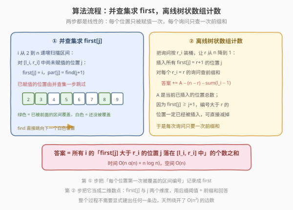
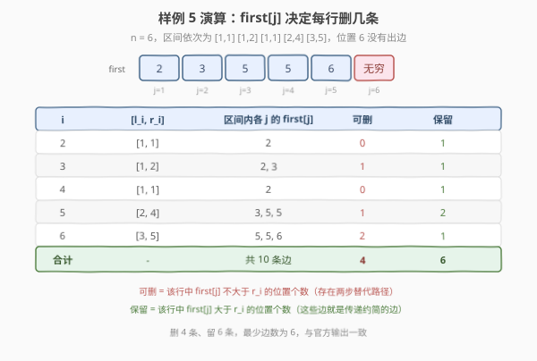

# Codeforces 2283F 最小化有向图 题解

## 1. 题目概述

- **标题 / 题号**：最小化有向图（Codeforces 2283F，英文名 Minimize the Graph）
- **链接**：https://codeforces.com/problemset/problem/2283/F
- **来源**：Educational Codeforces Round 196 (Rated for Div. 2) · Problem F（UTC 2026-11-04）
- **难度**：未评级（Educational Round 的 F 题，题面未给 rating / points）
- **限制**：时间 3 s / 内存 512 MB
- **标签**：图论、传递约简、贪心、并查集、树状数组、离线二维数点

**题意**：给定一张 $n$ 个顶点的有向图，构造方式很特殊：对每个 $i \in [2,n]$ 给出区间 $[l_i, r_i]$（$1 \le l_i \le r_i < i$），并对每个 $j \in [l_i, r_i]$ 连一条有向边 $j \to i$，此外没有任何边；因为每条边都指向编号更大的点，原图一定是 DAG。现在要在同样的 $n$ 个顶点上另建一张有向图（边任取），要求对**任意两个不同顶点** $x, y$：新图中存在 $x \to y$ 的路径**当且仅当**原图中存在。求新图的最少边数。多测：第一行是组数 $t$，每组先给 $n$，随后 $n-1$ 行给出 $l_{i+1}, r_{i+1}$，逐组输出一个整数。

**约束**：

- $1 \le t \le 10^4$，$2 \le n \le 3\times 10^5$，且 $\sum n \le 3\times 10^5$
- $1 \le l_i \le r_i < i$：每个点 $i$ 的入边恰好是**一段连续编号** $[l_i, r_i]$
- 原图边数可达 $\sum_{i=2}^{n}(r_i - l_i + 1) \le \frac{n(n-1)}{2} \approx 4.5\times 10^{10}$，答案同量级，必须用 `long long`；复杂度必须 $O(n)$ 或 $O(n\log n)$，$O(n^2)$ 连边都建不出来

## 2. 示例与观察
官方样例（输入 / 输出原样）：

```text
输入
5
5
1 1
1 2
2 3
2 4
6
1 1
1 1
2 3
2 3
4 5
5
1 1
1 2
1 3
1 4
6
1 1
1 1
1 1
2 4
2 4
6
1 1
1 2
1 1
2 4
3 5

输出
4
8
4
9
6
```

逐组说明：第 1 组共 8 条边，其中 $1\to3$（经 $2$）、$2\to4$（经 $3$）、$2\to5$（经 $3$ 或 $4$）、$3\to5$（经 $4$）都有长度 $\ge 2$ 的替代路径，删完只剩链 $1\to2\to3\to4\to5$，答案 $4$；第 2 组里 $2$ 的出点只有 $4,5$，而 $4,5$ 互相到不了对方（编号小的不能回头），故 $2\to4$、$2\to5$ 必须直连，$1\to2$、$1\to3$ 同理，8 条边一条都不能删；第 3 组是满区间，传递约简即一条链，答案 $n-1=4$；第 4 组里 $5$ 没有任何出边，$5 \notin [l_6,r_6]=[2,4]$，所以 $2\to6$ 绕不过去，9 条边全留；第 5 组见 §3.4，答案 $6$。

## 3. 解题思路

### 3.1 暴力思路

先明确图论事实：**最少边数 = 原图（DAG）的传递约简边数**，即删掉所有"存在长度 $\ge 2$ 替代路径"的边，剩下的边集是 $R = \{(u,v) \in E : \text{原图中不存在长度} \ge 2 \text{ 的 } u \to v \text{ 路径}\}$。

暴力做法是显式建图（最坏 $n^2/2$ 条边）再做传递闭包（$O(n^3)$ 或 bitset 优化），最后逐边检验。$n=3\times10^5$ 时边数已达 $4.5\times10^{10}$，存边就爆内存；答案本身也是 $O(n^2)$ 级别，说明不能逐点对处理。突破口只能是"入边是连续区间"，且全程**不建边**。

### 3.2 核心观察：只盯最小出点 first[j]

![核心引理：first[j] 决定边能否删除](../../../images/cf2283f_first_lemma.svg)

对每个顶点 $j$ 定义 $\text{first}[j] = \min\{\, i : j \in [l_i, r_i] \,\}$，即 $j$ 的**编号最小的出点**；若 $j$ 完全没有出边则记 $+\infty$。由于边只指向更大的编号，总有 $\text{first}[j] \ge j+1$。

**关键引理**：设 $j \in [l_i, r_i]$（边 $j\to i$ 存在），则 $j \to i$ 可删当且仅当 $\text{first}[j] \le r_i$。

- **可删**：令 $m=\text{first}[j] \le r_i$。由 $m$ 是覆盖 $j$ 的最小下标得 $m > j \ge l_i$，于是 $l_i \le m \le r_i$，即 $m \in [l_i,r_i]$，**边 $m\to i$ 存在**，$j\to m\to i$ 就是长度 2 的替代路径。
- **必留**：若有替代路径 $j=x_0\to x_1\to\cdots\to x_k=i$（$k\ge2$），编号严格递增，末边 $x_{k-1}\to i$ 给出 $x_{k-1}\le r_i$；而 $x_1$ 是 $j$ 的出点，故 $\text{first}[j]\le x_1\le x_{k-1}\le r_i$。

> 💡 直觉：最靠左的出点 $m$ 若仍在 $[l_i,r_i]$ 内即可"借道"两步到 $i$，越过 $r_i$ 则 $j\to i$ 是唯一的一步之路。

于是答案化为纯计数：

$$\text{ans} = \sum_{i=2}^{n} \#\{\, j \in [l_i, r_i] : \text{first}[j] > r_i \,\}$$

### 3.3 算法流程：并查集 + 离线树状数组



**第一步（并查集求 first）**：按 $i=2,\ldots,n$ **递增**扫描区间，位置 $j$ 第一次被覆盖时的 $i$ 就是 $\text{first}[j]$，此后它不再被需要。用"指向下一个未赋值位置"的并查集维护：`par[j]=j`（$j=1..n+1$，$n+1$ 为哨兵）；对每个 $i$ 取 `j=find(l[i])`，只要 `j<=r[i]` 就置 `first[j]=i`、`par[j]=find(j+1)` 并继续。每个位置至多赋值一次，均摊 $O(n\,\alpha(n))$。

**第二步（离线数点）**：把询问按 $r_i$ 装桶，让阈值 $r$ 从 $n$ 递减到 $1$，扫到 $r$ 时把全部 `first[j]=r+1` 的位置插入树状数组。这里有个省一半常数的小观察：由 $\text{first}[j]\ge j+1$ 知**编号 $>r$ 的位置必然都已插入**，故

$$\#\{j \in [l_i,r_i] : \text{first}[j] > r_i\} = \bigl(A-(n-r_i)\bigr) - \text{sum}(l_i-1)$$

其中 $A$ 是已插入位置总数，$\text{sum}(x)$ 是树状数组前缀和——每个询问只需**一次**前缀和。

### 3.4 示例演算



取官方第 5 组（$n=6$，区间 $[1,1],[1,2],[1,1],[2,4],[3,5]$）：$i=2$ 覆盖位置 1，$\text{first}[1]=2$；$i=3$ 覆盖位置 2，$\text{first}[2]=3$；$i=4$ 的区间 $[1,1]$ 已赋值完；$i=5$ 覆盖 $3,4$，$\text{first}[3]=\text{first}[4]=5$；$i=6$ 覆盖 $5$，$\text{first}[5]=6$；位置 6 无出边记 $+\infty$。逐行看：$i=2$ 留 $1\to2$；$i=3$ 删 $1\to3$、留 $2\to3$；$i=4$ 留 $1\to4$；$i=5$ 删 $2\to5$、留 $3\to5,4\to5$；$i=6$ 删 $3\to6,4\to6$、留 $5\to6$。合计删 4 条、留 6 条，答案 $6$，与官方输出一致。

## 4. 算法细节

1. **绝不建边**：原图边数是 $O(n^2)$，`vector<int> adj[n]` 或边表必然 MLE；算法只用 $l,r,\text{first}$ 与几个 $O(n)$ 辅助数组。
2. **并查集哨兵与多测重置**：`par` 开到 $n+2$ 且 `par[n+1]=n+1`，`find(l[i])` 返回 $n+1$ 时循环条件自然不成立，无需判空也不会越界；$t\le10^4$ 时用局部 `vector` / 列表逐组构造（`first` 初值 $0$ 表示无出边，`par` 重置为自身），总分配量对 $\sum n$ 线性。
3. **两个扫描方向**：求 `first` 让 $i$ **递增**（"第一次覆盖"才是最小下标），阈值扫描让 $r$ **递减**（集合只增才有单调性）；写反必错。
4. **`first[j]=0` 的处理**：无出边的位置永远不会落进任何询问区间（否则它就被覆盖了），所以计数前把它们**一次性**插入树状数组（视作 $+\infty$），既保住"$\text{first}[j]\ge j+1$ 的位置都已插入"这个前提，也不影响正确性。
5. **用桶代替排序 + 溢出**：位置按 `first` 天然成组（同批赋值者 `first` 相同且在 `seq` 中连续），询问用 `qhead/qnext` 链表挂桶，全程 $O(n)$；答案最大约 $2.25\times10^{10}$，累计量必须 `long long`（树状数组内只存 $O(n)$ 个计数，`int` 够）。

## 5. 正确性证明

**引理 1（可删判定）**：设 $j \in [l_i,r_i]$，则 $j\to i$ 有长度 $\ge 2$ 的替代路径，当且仅当 $\text{first}[j]\le r_i$。

**证明**：充分性即上文构造的 $j\to m\to i$。必要性：替代路径 $j=x_0\to x_1\to\cdots\to x_k=i$（$k\ge2$）上编号严格递增，故 $x_1\le x_{k-1}$；末边给出 $x_{k-1}\in[l_i,r_i]$，即 $x_{k-1}\le r_i$，于是 $\text{first}[j]\le x_1\le x_{k-1}\le r_i$。∎

**引理 2（first 计算正确）**：扫描结束时 $\text{first}[j]$ 等于使 $j\in[l_i,r_i]$ 的最小 $i$，无覆盖则为"无穷"；且每个位置至多赋值一次。**证明**：$i$ 递增扫描，位置被赋值后 `par[j]` 指向下一个未赋值位置，之后不会再被 `find` 返回（路径压缩只缩短链），故它保留的正是第一次覆盖它的下标；未被赋值者恰好无任何入边覆盖。∎

**引理 3（计数正确）**：对每个 $i$，第二步统计值等于 $\#\{j\in[l_i,r_i]:\text{first}[j]>r_i\}$。**证明**：处理阈值 $r$ 时树状数组中恰为全部 $\text{first}[j]>r$ 的位置（`first` 值按 $r+1,r+2,\ldots$ 插入、永不删除，集合单调变大）；又 $\text{first}[j]\ge j+1>r$ 对所有 $j>r$ 成立，故 $[1,r]$ 内已插入位置数是 $A-(n-r)$，减去 $\text{sum}(l_i-1)$ 即得区间内个数。∎

**引理 4（留下的边足够）**：令 $R$ 为满足 $\text{first}[j]>r_i$ 的全部边，则 $R$ 与原图可达性相同。**证明**：对间距 $d=v-u$ 归纳证明原图每条边 $u\to v$ 都能用 $R$ 的边走通。$d=1$ 时若 $u\to u+1\notin R$，它需要长度 $\ge2$ 的替代路径，而编号严格递增时不存在介于 $u,u+1$ 之间的点，矛盾，故 $u\to u+1\in R$。设 $d\ge2$ 且更小间距的边已可走通：若 $u\to v\notin R$，它有替代路径 $u=y_0\to y_1\to\cdots\to y_t=v$，每步间距都小于 $d$，由归纳假设都能用 $R$ 走通，于是 $u\rightsquigarrow v$ 也能。∎

**定理（答案正确）**：算法输出满足可达性要求的新图最少边数，即 $|R|$。**证明**：可行性由引理 4 给出，故最少边数 $\le |R|$。反之设新图 $H$ 与原图可达性相同，任取 $j\to i\in R$：$H$ 中必有 $j\to i$ 的路径；若其长度 $\ge2$，把每步对应回原图的可达性就拼出原图中一条长度 $\ge2$ 的 $j\to i$ 路径（编号严格递增，不绕圈），与 $j\to i\in R$ 矛盾。故 $H$ 必须直接包含 $R$ 的每条边，即 $R\subseteq E(H)$，得 $|E(H)|\ge|R|$；结合引理 3，算法算出的正是 $|R|$。∎

## 6. 复杂度分析

- **时间**：并查集 $O(n\,\alpha(n))$，树状数组 $O(n\log n)$（每个位置插入一次、每个询问一次前缀和），合计 $O(n\log n)$；多测对 $\sum n$ 求和后总量不变。
- **空间**：$l,r,\text{first},\text{par},\text{cum},\text{qhead},\text{qnext},\text{bit}$ 均为 $O(n)$ 的 `int` 数组，峰值约 $10n$ 个整数，$n=3\times10^5$ 时约 12 MB，远小于 512 MB。
- **可行性**：$3$ s 约合 $6\times10^7$ 次基本操作，核心只有约 $6\times10^6$ 次；本机实测 $n=3\times10^5$ 最坏数据算法部分约 $0.05$ s、含 `cin` 读入约 $0.7$ s，余量 4 倍以上，Python3 同规模约 $1.1$ s。

## 7. 参考代码

### C++17

```cpp
#include <iostream>
#include <vector>
using namespace std;

int main() {
    ios::sync_with_stdio(false); cin.tie(nullptr);
    int t; cin >> t;
    while (t--) {
        int n; cin >> n;
        vector<int> l(n + 2, 0), r(n + 2, 0);
        for (int i = 2; i <= n; i++) cin >> l[i] >> r[i];

        // first[j]：覆盖 j 的最小 i；0 表示 j 没有出边（无穷大）
        vector<int> first(n + 2, 0), par(n + 2);
        for (int j = 0; j <= n + 1; j++) par[j] = j;
        auto find = [&](int x) {                       // 下一个未赋值位置
            while (par[x] != x) { par[x] = par[par[x]]; x = par[x]; }
            return x;
        };
        vector<int> seq, cum(n + 2, 0);                // cum[i]：first <= i 的位置数
        for (int i = 2; i <= n; i++) {
            int j = find(l[i]);
            while (j <= r[i]) {
                first[j] = i; seq.push_back(j);
                par[j] = find(j + 1); j = par[j];
            }
            cum[i] = (int)seq.size();
        }
        vector<int> qhead(n + 2, -1), qnext(n + 2, -1); // 询问按 r_i 装桶
        for (int i = 2; i <= n; i++) { qnext[i] = qhead[r[i]]; qhead[r[i]] = i; }

        vector<int> bit(n + 2, 0);
        auto add = [&](int x) { for (; x <= n; x += x & -x) bit[x]++; };
        auto pref = [&](int x) { int s = 0; for (; x > 0; x -= x & -x) s += bit[x]; return s; };

        long long ans = 0, live = 0;
        for (int j = 1; j <= n; j++) if (!first[j]) { add(j); live++; }  // 无穷大，先插入
        for (int rr = n; rr >= 1; rr--) {
            if (rr + 1 <= n)                            // 插入全部 first = rr+1 的位置
                for (int k = cum[rr]; k < cum[rr + 1]; k++) { add(seq[k]); live++; }
            long long upto = live - (n - rr);           // [1, rr] 中 first > rr 的个数
            for (int qi = qhead[rr]; qi != -1; qi = qnext[qi])
                ans += upto - pref(l[qi] - 1);
        }
        cout << ans << "\n";
    }
    return 0;
}
```

### Python3

```python
import sys

def main():
    data = sys.stdin.buffer.read().split()
    p = 0; t = int(data[p]); p += 1
    out = []
    for _ in range(t):
        n = int(data[p]); p += 1
        L = [0] * (n + 2); R = [0] * (n + 2)
        for i in range(2, n + 1):
            L[i] = int(data[p]); R[i] = int(data[p + 1]); p += 2
        # first[j]：覆盖 j 的最小 i；0 表示没有出边
        first = [0] * (n + 2)
        par = list(range(n + 2))            # 并查集：指向下一个未赋值位置
        def find(x):
            while par[x] != x:
                par[x] = par[par[x]]; x = par[x]
            return x
        seq = []; cum = [0] * (n + 2)       # cum[i]：first <= i 的位置数
        for i in range(2, n + 1):
            j = find(L[i]); ri = R[i]
            while j <= ri:
                first[j] = i; seq.append(j)
                par[j] = find(j + 1); j = par[j]
            cum[i] = len(seq)
        qhead = [-1] * (n + 2); qnext = [-1] * (n + 2)
        for i in range(2, n + 1):           # 询问按 r_i 装桶
            qnext[i] = qhead[R[i]]; qhead[R[i]] = i
        bit = [0] * (n + 2); live = 0
        for j in range(1, n + 1):           # 无出边的位置先插入（视作无穷大）
            if first[j] == 0:
                x = j
                while x <= n:
                    bit[x] += 1; x += x & -x
                live += 1
        ans = 0
        for rr in range(n, 0, -1):
            if rr + 1 <= n:                 # 插入全部 first = rr+1 的位置
                for k in range(cum[rr], cum[rr + 1]):
                    x = seq[k]
                    while x <= n:
                        bit[x] += 1; x += x & -x
                    live += 1
            base = live - (n - rr)          # [1, rr] 中 first > rr 的个数
            qi = qhead[rr]
            while qi != -1:
                x = L[qi] - 1; s = 0
                while x > 0:
                    s += bit[x]; x -= x & -x
                ans += base - s
                qi = qnext[qi]
        out.append(str(ans))
    sys.stdout.write("\n".join(out) + "\n")

main()
```

## 8. 边界情况与易错点

1. **位置没有出边**：如 $l_i=r_i=1$ 的星形数据，位置 $2..n$ 都无出边，`first` 为无穷。代码用 $0$ 表示并在计数前统一插入，否则会把它们漏算成"必须保留"。
2. **$n=2$**：只有 $1\to2$，无替代路径，答案恒为 $1$（$\text{first}[1]=2>r_2=1$）；这种最小数据一定要单独测，最容易暴露 `par` 越界。
3. **答案是 $O(n^2)$ 级**：构造——前 $\frac n2$ 个点都用 $[1,1]$，之后每个点都用 $[1,\lfloor n/2\rfloor]$，则后一半区间里约 $\frac n2-1$ 个位置都满足 $\text{first}[j]>r_i$，答案约 $\frac{n^2}{4}=2.25\times10^{10}$，`int` 溢出。
4. **越界、复用与输出**：`par` 只开到 $n$ 时 `find(j+1)` 在 $j=n$ 处越界（须开到 $n+2$ 并设 `par[n+1]=n+1`）；用全局固定数组却忘记清空会让 `first` / `par` 跨组污染；需要保留的边数可达 $O(n^2)$，题目只问条数，枚举必然超时（满区间 $l_i=1,r_i=i-1$ 时答案退化为 $n-1$，可作自测）。

## 9. 验证记录

- **编译环境与命令**：`clang++ -std=c++17 -O2`（本机无 GNU g++，配 `codeforces/tools/include/bits/stdc++.h` 兼容头；正文代码只用标准库，可原样提交 GNU C++17）；Python 侧为 `Python 3.9.6`。
- **官方样例**：1 / 1 通过（按 Codeforces 标准 checker 的 token 比对，忽略空白与大小写）。
- **复核状态**：audited（2026-11-19 统一回归：编译 + 官方样例；写作期的随机对拍与暴力未重跑）。

## 相关题目与扩展

- [Codeforces 505D Mr. Kitayuta's Technology](https://codeforces.com/problemset/problem/505/D)：同样是"用最少边数保持可达性"，但图是任意有向图，需要缩 SCC 后按连通块补边，是传递约简的另一面。
- [Codeforces 2283G Order Statistics on the Graph](https://codeforces.com/problemset/problem/2283/G)：同场同结构的后续题，可对照两题对可达性结构的不同用法。
- [LeetCode 1462. 课程表 IV](https://leetcode.cn/problems/course-schedule-iv/)：传递闭包 / 可达性查询模板题，规模小，适合写暴力对拍。

**延伸思考**：本题的关键是"入边为连续区间"让 $\text{first}[j]$ 一个数就足以代表整条替代路径的存在性；若把区间换成任意点集，判定 $j\to i$ 能否删除就退回一般传递约简，需要 $O(nm)$ 级信息，线性做法不再成立。另一个变形是问"最多能删多少条边"，答案为 $|E|-|R|=\sum_i\#\{j\in[l_i,r_i]:\text{first}[j]\le r_i\}$，只需把统计条件从 $>$ 改成 $\le$。
