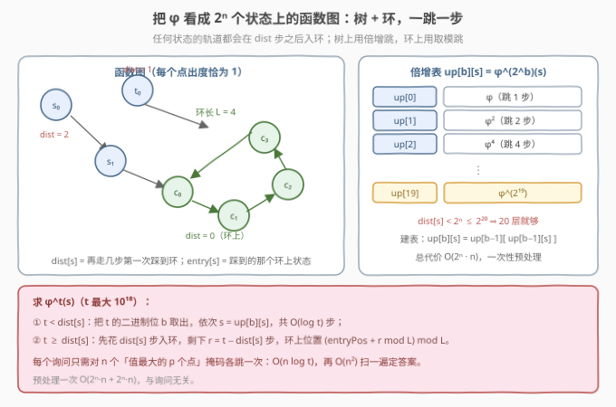
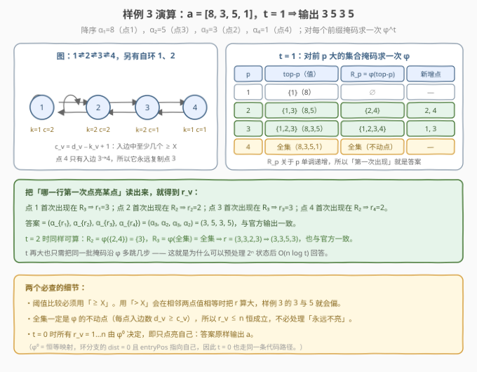

# Codeforces 2283G 图上的次序统计量 题解

## 1. 题目概述

- **标题 / 题号**：图上的次序统计量（Codeforces 2283G，英文名 Order Statistics on the Graph）
- **链接**：https://codeforces.com/problemset/problem/2283/G
- **来源**：Educational Codeforces Round 196 (Rated for Div. 2) · Problem G（UTC 2026-11-04）
- **难度**：未评级（Educational Round 的 G 题，题面未给分值；官方标签 bitmasks / brute force / sortings）
- **限制**：时间 7 s / 内存 512 MB
- **标签**：位掩码、暴力枚举、排序、阈值分解（单调布尔映射）、函数图与倍增

**题意**：给一张 $n$ 个点的有向图，每点至少有一条入边，无重边，允许自环。每个点 $v$ 有一个参数 $k_v\in[1,d_v]$（$d_v$ 为入度）。每过一秒，所有点同时更新：取出所有满足 $u\to v$ 的 $u$ 的当前数值，升序排序，把 $v$ 的数值改成其中第 $k_v$ 个（从 1 开始数）。自环意味着自己的旧值也参与。给定 $q$ 个询问，每个询问给一个 $t$ 和一组初始数值 $a_1,\dots,a_n$，求 $t$ 秒后每个点上的数值。单组数据（不是多测），每个询问输出一行 $n$ 个整数。

**约束**：$1\le n\le 20$，$n\le m\le n^2$，$1\le q\le 10^5$，$1\le k_v\le d_v$，$0\le t\le 10^{18}$，$1\le a_i\le 10^9$。$n$ 很小而 $t$ 极大，且 $q$ 很大：预处理必须只依赖图（与询问无关），每个询问只能做 $O(n\log n + n\log t)$ 量级的工作。

## 2. 示例与观察
```text
输入 1
3 3 4
1 1 1
1 2
2 3
3 1
0 4 8 15
1 4 8 15
2 4 8 15
1000000000000000000 1 2 3

输出 1
4 8 15
15 4 8
8 15 4
3 1 2
```

```text
输入 2
2 4 3
1 2
1 1
1 2
2 1
2 2
1 10 1
1000000000000000000 7 7
0 1000000000 1

输出 2
1 10
7 7
1000000000 1
```

```text
输入 3
4 8 4
1 2 2 1
1 1
2 1
1 2
2 2
3 2
2 3
4 3
3 4
1 8 3 5 1
2 8 3 5 1
3 8 3 5 1
1000000000000000000 8 3 5 1

输出 3
3 5 3 5
3 3 5 3
3 3 3 5
3 3 5 3
```

样例 1 是纯环，每个数每秒顺移一格，$t=3$ 复原；样例 2 中点 1 取最小值、点 2 取最大值；样例 3 是混合情形（点 1 取 min、点 2 取中位、点 3 取 max、点 4 复制点 3），$t=1$ 得到 $[3,5,3,5]$，$t=2$ 得到 $[3,3,5,3]$，随后进入周期。

## 3. 解题思路

### 3.1 暴力思路

直接按定义模拟：每秒对每条边收集数值、排序，单步 $O(m\log n)$，一次询问 $O(t\cdot m\log n)$。$t$ 可达 $10^{18}$、$q$ 可达 $10^5$，完全不可行。就算只用周期（函数图一定有环），$2^n$ 个状态里也可能有很长的链，逐询问找周期同样不可接受。

关键是要找到一个**与 $a$ 无关**的中间对象，把「数值」换成「位」，把「$t$ 秒」换成「在状态图上跳 $t$ 步」。

### 3.2 核心观察：阈值分解把数值更新变成 0/1 更新


固定一个阈值 $X$，只关心每个点的值是否 $\ge X$，记 $b_v=[a_v\ge X]$。对一次更新：

$$\text{第 }k_v\text{ 小的入值}\ge X\iff \text{入值中 }<X\text{ 的不足 }k_v\text{ 个}\iff\text{入值中 }\ge X\text{ 的至少 }d_v-k_v+1\text{ 个}$$

于是记 $c_v=d_v-k_v+1$，一位的更新只依赖下标的位模式：

$$b'_v=\big[\,|b\cap \mathrm{in}(v)|\ge c_v\,\big]=\varphi(b)_v,\qquad \mathrm{in}(v)=\{u:u\to v\}$$

这个 $\varphi:\{0,1\}^n\to\{0,1\}^n$ 只由图的形状和 $c_v$ 决定，**与 $X$、与 $a$ 的数值都无关**。又因为更新是同步的，按 $t$ 归纳即得

$$[\,a_v^{(t)}\ge X\,]=\varphi^t\big(b(X)\big)_v,\qquad b(X)_u=[\,a_u\ge X\,].$$

这条等式把原来的问题完全摊平了：**对每个阈值层的演化都是同一个 $\varphi$**，而阈值只有 $n+1$ 个有效取值（在 $a$ 的取值处跳变）。

由此还能看出答案的形状：把 $a$ 降序排成 $\alpha_1\ge\alpha_2\ge\cdots\ge\alpha_n$，记 $S_p$ 为值最大的前 $p$ 个点。阈值 $X$ 从 $+\infty$ 降下来时，$b(X)$ 依次经过 $S_1\subseteq S_2\subseteq\cdots\subseteq S_n$。令

$$p_v=\min\{\,p:\varphi^t(S_p)_v=1\,\},$$

由单调性（$\varphi^t$ 每个坐标关于输入位单调）知 $a_v^{(t)}$ 在 $X\le\alpha_{p_v}$ 时全为「$\ge X$」、在 $X>\alpha_{p_v}$ 时全为「$<X$」，故 $a_v^{(t)}=\alpha_{p_v}$。也就是说：**答案总是某个顺序统计量，只要定出它排第几**。等价地 $p_v$ 就是「让第 $v$ 位变成 1 的最小集合大小」。

### 3.3 算法流程：$2^n$ 个状态上的函数图 + 倍增



$n\le20$，状态数为 $2^n\le 1\,048\,576$，可以整个装进内存。预处理三步：

1. **建 $\varphi$**：枚举所有状态 $s$，对每个点 $v$ 用 popcount 表判断 $|s\cap\mathrm{in}(v)|\ge c_v$，即 $\mathrm{popc}[s\ \&\ \mathrm{inMask}_v]\ge c_v$。复杂度 $O(2^n n)$。
2. **函数图分解**：$\varphi$ 是 $2^n$ 个点的函数图（出度为 1），每条轨道都是「一条树链 + 一个环」。从每个未访问状态出发沿 $\varphi$ 走，用 `stateIdx` 记录本次路径上的位置：撞到已分类状态说明整条链汇入那里（倒序递推），撞到本次路径上的状态说明成环（登记环长与环内位置）。每个状态只入栈一次，总 $O(2^n)$。
3. **倍增表**：$\mathrm{up}[b][s]=\varphi^{2^b}(s)$，$\mathrm{up}[b][s]=\mathrm{up}[b-1][\mathrm{up}[b-1][s]]$。因为 $dist(s)<2^n\le2^{20}$，取 $b<20$ 就够；$t$ 更大时必然走环那一支。复杂度 $O(2^n\log 2^n)$。

求 $\varphi^t(s)$ 分两种情形：$t<dist(s)$ 时二进拆位用倍增表跳；否则先跳 $dist(s)$ 步入环，再在环上前进 $(t-dist(s))\bmod L$ 步。

回答一个询问：把 $a$ 降序排序，对 $p=1..n$ 依次把掩码加上第 $p$ 大的点、求 $R_p=\varphi^t(S_p)$；由于 $R_p$ 关于 $p$ 单调（集合包含），每个点第一次被点亮的那个 $p$ 就是它的 $p_v$，答案即 $\alpha_{p_v}$。

### 3.4 示例演算



取样例 3：$k=[1,2,2,1]$，入度为 $[2,3,2,1]$，故 $c=[2,2,1,1]$。初始 $a=[8,3,5,1]$，降序为 $\alpha=(8,5,3,1)$，对应点序 $(1,3,2,4)$。$t=1$：

| $p$ | $S_p$ | $R_p=\varphi(S_p)$ | 新增 |
|---|---|---|---|
| 1 | $\{1\}$ | $\varnothing$ | — |
| 2 | $\{1,3\}$ | $\{2,4\}$ | 2, 4 |
| 3 | $\{1,2,3\}$ | $\{1,2,3,4\}$ | 1, 3 |
| 4 | 全集 | 全集（不动点） | — |

理由：点 1 需要 $\{1,2\}$ 中 2 个 1，只有 $\{1\}$ 不够；点 2 需要 $\{1,2,3\}$ 中 2 个 1，$\{1,3\}$ 恰好够；点 3 只需 $\{2,4\}$ 中 1 个 1，点 4 只需点 3 为 1。读出首次点亮：$p_1=3,\ p_2=2,\ p_3=3,\ p_4=2$，答案 $(\alpha_3,\alpha_2,\alpha_3,\alpha_2)=(3,5,3,5)$，与官方一致。$t=2$ 时 $R_2=\varphi(\{2,4\})=\{3\}$、$R_3=\varphi(\text{全集})=\text{全集}$，得 $(3,3,2,3)\Rightarrow(3,3,5,3)$，同样一致。

## 4. 算法细节

1. **阈值必须用 $\ge$**：$c_v=d_v-k_v+1$。$k_v=1$（取最小）对应 $c_v=d_v$（要求全中），$k_v=d_v$（取最大）对应 $c_v=1$（有一个就够）；写成 $>$ 或把 $c_v$ 算错，在数值相等时就会偏差。
2. **位约定**：点 $v$ 用 bit $v-1$，`inMask[v]` 打包入邻居；建 $\varphi$ 时对每个状态对 $n$ 个点各查一次 popcount 表，$2\times10^7$ 次查表，实测约 $0.04$ s。
3. **popcount 表**用 `vector<unsigned char>`（1 MB）：`popc[s]=popc[s>>1]+(s&1)`；比 $2\times10^7$ 次 `__builtin_popcount` 更好压常数。
4. **函数图分解只走一遍**：`stateIdx` 记录「本次路径内的下标」，遇到 `dist!=-1` 说明汇入已分类部分（倒序递推 `dist` 与入环信息），遇到 `stateIdx!=-1` 说明本次成环。环用「环编号 + 环内位置 + 环长」三个数组存，比 `vector<vector<int>>` 省内存也更缓存友好。
5. **倍增层数取 20**：$dist(s)<2^n\le2^{20}$，所以 $t<dist(s)$ 时 $t<2^{20}$，20 层（$2^0..2^{19}$）足够；$t\ge dist(s)$ 走环，$t$ 到 $10^{18}$ 只在 `long long` 取模时出现。
6. **环上取模**写成 `(entryPos + r % L) % L`：$r=t-dist$ 是非负 `long long`（最大 $10^{18}$），而 $r\bmod L<L$，所以 `entryPos + r % L` 一定小于 $2L$，转 `int` 不会溢出。
7. **询问之间要清的只有两样**：`ansIdx[1..n]` 与 `covered`；$\varphi$、`dist`、环表、倍增表都只依赖图，重复问 $10^5$ 次也不能重建。
8. **I/O 是常数瓶颈**：每个询问读 $n+1$ 个整数、写 $n$ 个整数，总量 $4\times10^6$ 个数。代码统一用 `scanf/printf`（$t$ 用 `%lld`），实测比本机 `cin` 快近一个数量级。

## 5. 正确性证明

**引理 1（阈值化一步）**：对任意阈值 $X$，一次更新后 $[a'_v\ge X]=[\,|\{u\to v:a_u\ge X\}|\ge c_v\,]$，其中 $c_v=d_v-k_v+1$。
**证明**：记入值中 $\ge X$ 的有 $t$ 个，则 $<X$ 的有 $d_v-t$ 个。第 $k_v$ 小 $\ge X$ 当且仅当小于 $X$ 的元素不足 $k_v$ 个，即 $d_v-t\le k_v-1$，也就是 $t\ge d_v-k_v+1=c_v$。∎

**引理 2（演化与 $X,a$ 无关）**：令 $b_u(X)=[a_u\ge X]$，$\varphi(b)_v=[|b\cap\mathrm{in}(v)|\ge c_v]$，则对一切 $t$ 有 $[a_v^{(t)}\ge X]=\varphi^t(b(X))_v$。
**证明**：对 $t$ 归纳。$t=0$ 时两边都是 $[a_v\ge X]$。设 $t$ 成立，由引理 1，$t+1$ 秒时第 $v$ 位的值等于 $\varphi$ 作用在「$t$ 秒后的位向量」上；由于全图同步更新，所有坐标用的是同一时刻 $t$ 的向量，归纳假设给出每个坐标的位都与 $\varphi^t(b(X))$ 相符，故 $t+1$ 秒时为 $\varphi^{t+1}(b(X))$。∎

**引理 3（答案是某个顺序统计量）**：设 $\alpha_1\ge\cdots\ge\alpha_n$ 为 $a$ 的降序，$S_p$ 为前 $p$ 大元素的下标集合，$p_v=\min\{p:\varphi^t(S_p)_v=1\}$，则 $a_v^{(t)}=\alpha_{p_v}$。
**证明**：对阈值 $X$，$B(X)=\{u:a_u\ge X\}$ 恰是某个 $S_q$。若 $X\le\alpha_{p_v}$，则前 $p_v$ 个值都 $\ge\alpha_{p_v}\ge X$，故 $S_{p_v}\subseteq B(X)$，由 $\varphi^t$ 单调得 $\varphi^t(B(X))_v\ge\varphi^t(S_{p_v})_v=1$，即 $a_v^{(t)}\ge X$。若 $X>\alpha_{p_v}$，则值 $\ge X$ 的点都在前 $p_v-1$ 个之内（$p_v=1$ 时为空集），即 $B(X)\subseteq S_{p_v-1}$，而 $p_v$ 的最小性给出 $\varphi^t(S_{p_v-1})_v=0$，故 $a_v^{(t)}<X$。于是 $a_v^{(t)}$ 是唯一满足「$\le\alpha_{p_v}$ 的阈值全通过、$>\alpha_{p_v}$ 的阈值全否决」的数，只能是 $\alpha_{p_v}$。∎

**推论**：$p_v=\min\{|S|:\varphi^t(S)_v=1\}$——对任意满足条件的 $S$ 有 $S\subseteq S_{|S|}$，单调性给出 $\varphi^t(S_{|S|})_v=1$，故两者取到同一个最小值。

**引理 4（单调性使扫描成立）**：$R_p=\varphi^t(S_p)$ 满足 $R_1\subseteq R_2\subseteq\cdots\subseteq R_n$，故「第一次点亮的行号」就是 $p_v$。
**证明**：$\varphi(b)_v=[|b\cap\mathrm{in}(v)|\ge c_v]$ 关于 $b$ 逐位单调（$b\subseteq b'$ 时计数只增不减），单调映射的复合仍单调，$\varphi^t$ 亦然。又 $S_p\subseteq S_{p+1}$，故 $R_p\subseteq R_{p+1}$；于是对固定点 $v$，集合 $\{p:v\in R_p\}$ 是后缀，其最小值正是定义中的 $p_v$。∎

**引理 5（跳跃计算正确）**：若 $t<dist(s)$，倍增表给出 $\varphi^t(s)$；若 $t\ge dist(s)$，先沿树链走 $dist(s)$ 步到环上状态 $e$，再在环上走 $(t-dist(s))\bmod L$ 步，得到的正是 $\varphi^t(s)$。
**证明**：函数图每条轨道由互不相同的树链 $s,\varphi(s),\dots,\varphi^{dist(s)-1}(s)$ 与一个长 $L$ 的环组成，第 $dist(s)$ 步首次落在环上。$\mathrm{up}[b][s]=\varphi^{2^b}(s)$ 由 $\mathrm{up}[b][s]=\mathrm{up}[b-1][\mathrm{up}[b-1][s]]$ 递推正确，二进拆 $t$ 后 $s$ 依次被作用 $\varphi^{2^{b_1}},\varphi^{2^{b_2}},\dots$，合成 $\varphi^t$。环上每走一步位置 $+1$，走 $L$ 步回到原处，故取模即可。又 $dist(s)<2^n\le2^{20}$，$t<dist(s)$ 时 $t$ 的二进制不超过 20 位，倍增表够用。∎

**定理**：对每个询问，算法输出的第 $v$ 个数等于 $t$ 秒后点 $v$ 上的数值。
**证明**：引理 2 把每个坐标的取值化为 $\varphi^t$ 在某族阈值上的取值；引理 3 说明答案等于 $\alpha_{p_v}$；算法对每个 $p$ 用引理 5 正确算出 $R_p=\varphi^t(S_p)$，再由引理 4 的单调性扫描出 $p_v$，最后输出 $\alpha_{p_v}$。故输出正确。∎

## 6. 复杂度分析

- **时间（预处理）**：建 $\varphi$ 为 $O(2^n n)\approx2.1\times10^7$ 次查表 + 按位或；函数图分解 $O(2^n)$；倍增表 $O(2^n\log 2^n)\approx2.0\times10^7$。三项合计 $4\times10^7$ 量级，与 $q$ 无关。
- **时间（每询问）**：排序 $O(n\log n)$；$n$ 个掩码各 $O(\log t)$ 次跳（$\le20$ 层）；扫描定 $p_v$ 时每个点只被点亮一次，$O(n)$。合计 $O(n\log n+n\log t)$，$q=10^5$ 时约 $5\times10^7$ 次基本操作。
- **空间**：倍增表 $20\times2^{20}\times4$ B $=80$ MiB，其余数组（$\varphi$、`dist`、入环信息、环表）约 $30$ MiB，popcount 表 $1$ MiB，实测峰值约 $140$ MiB，在 512 MB 之内。
- **实测**：$n=20$、$m=400$、$q=10^5$、$t$ 随机取到 $10^{18}$，C++17 `-O2` 约 $0.40$ s（时限 7 s，余量 17 倍以上）。同一份 Python3 逻辑约 $6.7$ s（慢约 16 倍，已贴着时限），**正式提交建议用 C++**。

## 7. 参考代码

### C++17

```cpp
#include <bits/stdc++.h>
using namespace std;

int main() {
    ios::sync_with_stdio(false);
    int n, m, q;
    scanf("%d %d %d", &n, &m, &q);
    vector<int> k(n + 1), inMask(n + 1, 0), deg(n + 1, 0);
    for (int v = 1; v <= n; ++v) scanf("%d", &k[v]);
    for (int i = 0; i < m; ++i) {
        int u, v;
        scanf("%d %d", &u, &v);
        inMask[v] |= 1 << (u - 1);      // 顶点 v 对应 bit v-1
        ++deg[v];
    }
    vector<int> need(n + 1);            // 入边中至少几个 >= X
    for (int v = 1; v <= n; ++v) need[v] = deg[v] - k[v] + 1;

    const int N = 1 << n;               // 布尔状态总数（n <= 20）
    vector<unsigned char> popc(N);
    for (int s = 1; s < N; ++s) popc[s] = popc[s >> 1] + (s & 1);
    vector<int> nxt(N);                 // phi(s)：一秒后的布尔状态
    for (int s = 0; s < N; ++s) {
        int r = 0;
        for (int v = 1; v <= n; ++v)
            if (popc[s & inMask[v]] >= need[v]) r |= 1 << (v - 1);
        nxt[s] = r;
    }

    // 函数图分解：dist = 到环距离，entry = 第一次踏上的环上状态
    vector<int> dist(N, -1), entryId(N, -1), entryPos(N, -1), stateIdx(N, -1);
    vector<int> cycStart, cycLen, cycArr, path;
    path.reserve(N);
    for (int s = 0; s < N; ++s) {
        if (dist[s] != -1) continue;
        path.clear();
        int cur = s;
        while (dist[cur] == -1 && stateIdx[cur] == -1) {   // 走到入环或汇入已分类部分
            stateIdx[cur] = (int)path.size();
            path.push_back(cur);
            cur = nxt[cur];
        }
        if (dist[cur] == -1) {          // 本次路径上成环
            int j = stateIdx[cur], L = (int)path.size() - j, cid = (int)cycLen.size();
            cycStart.push_back((int)cycArr.size());
            for (int i = j; i < (int)path.size(); ++i) {
                dist[path[i]] = 0; entryId[path[i]] = cid; entryPos[path[i]] = i - j;
                cycArr.push_back(path[i]);
            }
            cycLen.push_back(L);
            for (int i = j - 1; i >= 0; --i) {
                dist[path[i]] = dist[path[i + 1]] + 1;
                entryId[path[i]] = entryId[path[i + 1]];
                entryPos[path[i]] = entryPos[path[i + 1]];
            }
        } else {                        // 整条链汇入已分类状态 cur
            for (int i = (int)path.size() - 1; i >= 0; --i) {
                int nx = (i + 1 < (int)path.size()) ? path[i + 1] : cur;
                dist[path[i]] = dist[nx] + 1;
                entryId[path[i]] = entryId[nx];
                entryPos[path[i]] = entryPos[nx];
            }
        }
        for (int st : path) stateIdx[st] = -1;
    }

    const int LOG = 20;                 // dist < 2^n <= 2^20，20 层够用
    vector<vector<int>> up(LOG, vector<int>(N));
    up[0] = nxt;
    for (int b = 1; b < LOG; ++b) {
        const vector<int>& pre = up[b - 1];
        vector<int>& now = up[b];
        for (int s = 0; s < N; ++s) now[s] = pre[pre[s]];
    }

    int ord[20], rankVal[21], ansIdx[21];
    while (q--) {
        long long t;
        scanf("%lld", &t);
        int a[20];
        for (int i = 0; i < n; ++i) scanf("%d", &a[i]);
        for (int i = 0; i < n; ++i) ord[i] = i;
        sort(ord, ord + n, [&](int x, int y) { return a[x] > a[y]; });
        for (int p = 1; p <= n; ++p) { rankVal[p] = a[ord[p - 1]]; ansIdx[p] = 0; }

        int mask = 0, covered = 0;
        for (int p = 1; p <= n; ++p) {
            mask |= 1 << ord[p - 1];    // 前 p 大的点构成的集合
            int s = mask;
            if (t < dist[s]) {          // 树上：倍增跳 t 步
                for (int b = 0; b < LOG; ++b)
                    if ((t >> b) & 1) s = up[b][s];
            } else {                    // 环上：取模后走
                long long r = t - dist[s];
                int cid = entryId[s], L = cycLen[cid];
                s = cycArr[cycStart[cid] + (int)((entryPos[s] + r % L) % L)];
            }
            int newly = s & ~covered;   // R_p 单调，新点亮的位就是答案
            covered |= s;
            while (newly) {
                int b = __builtin_ctz(newly);
                newly &= newly - 1;
                ansIdx[b + 1] = p;
            }
        }
        for (int v = 1; v <= n; ++v) printf(v == n ? "%d\n" : "%d ", rankVal[ansIdx[v]]);
    }
    return 0;
}
```

### Python3

```python
import sys
from array import array


def main():
    data = sys.stdin.buffer.read().split()
    if not data:
        return
    n, m, q = int(data[0]), int(data[1]), int(data[2])
    ptr = 3
    k = [0] + [int(data[ptr + i]) for i in range(n)]
    ptr += n
    inMask = [0] * (n + 1)
    deg = [0] * (n + 1)
    for _ in range(m):
        u = int(data[ptr]); v = int(data[ptr + 1]); ptr += 2
        inMask[v] |= 1 << (u - 1)          # 顶点 v 对应 bit v-1
        deg[v] += 1
    need = [deg[v] - k[v] + 1 for v in range(n + 1)]   # 至少几个入值 >= X

    N = 1 << n
    popc = bytearray(N)
    for s in range(1, N):
        popc[s] = popc[s >> 1] + (s & 1)
    nxt = array('i', bytes(4 * N))          # phi(s)
    for s in range(N):
        r = 0
        for v in range(1, n + 1):
            if popc[s & inMask[v]] >= need[v]:
                r |= 1 << (v - 1)
        nxt[s] = r

    dist = array('i', [-1]) * N
    entryId = array('i', [-1]) * N
    entryPos = array('i', [-1]) * N
    stateIdx = array('i', [-1]) * N
    cycStart, cycLen, cycArr = [], [], array('i')
    for s in range(N):
        if dist[s] != -1:
            continue
        path = []
        cur = s
        while dist[cur] == -1 and stateIdx[cur] == -1:   # 走到入环或汇入已分类部分
            stateIdx[cur] = len(path)
            path.append(cur)
            cur = nxt[cur]
        j = stateIdx[cur] if dist[cur] == -1 else -1
        if j >= 0:                                       # 本次路径上成环
            cid = len(cycLen)
            cycStart.append(len(cycArr))
            for i in range(j, len(path)):
                dist[path[i]] = 0
                entryId[path[i]] = cid
                entryPos[path[i]] = i - j
                cycArr.append(path[i])
            cycLen.append(len(path) - j)
            for i in range(j - 1, -1, -1):
                dist[path[i]] = dist[path[i + 1]] + 1
                entryId[path[i]] = entryId[path[i + 1]]
                entryPos[path[i]] = entryPos[path[i + 1]]
        else:                                            # 整条链汇入 cur
            for i in range(len(path) - 1, -1, -1):
                nx = path[i + 1] if i + 1 < len(path) else cur
                dist[path[i]] = dist[nx] + 1
                entryId[path[i]] = entryId[nx]
                entryPos[path[i]] = entryPos[nx]
        for st in path:
            stateIdx[st] = -1

    LOG = 20
    up = [nxt]
    for _ in range(1, LOG):
        pre = up[-1]
        cur2 = array('i', bytes(4 * N))
        for s in range(N):
            cur2[s] = pre[pre[s]]
        up.append(cur2)

    out = []
    for _ in range(q):
        t = int(data[ptr]); ptr += 1
        a = [int(x) for x in data[ptr:ptr + n]]; ptr += n
        order = sorted(range(n), key=lambda i: -a[i])
        rankVal = [0] + [a[i] for i in order]
        ansIdx = [0] * (n + 1)
        mask = covered = 0
        for p in range(1, n + 1):
            mask |= 1 << order[p - 1]
            s = mask
            if t < dist[s]:
                rem, b = t, 0
                while rem:
                    if rem & 1:
                        s = up[b][s]
                    rem >>= 1
                    b += 1
            else:
                r = t - dist[s]
                cid = entryId[s]
                L = cycLen[cid]
                s = cycArr[cycStart[cid] + (entryPos[s] + r % L) % L]
            newly = s & ~covered
            covered |= s
            while newly:
                b = (newly & -newly).bit_length() - 1
                newly &= newly - 1
                ansIdx[b + 1] = p
        out.append(" ".join(str(rankVal[ansIdx[v]]) for v in range(1, n + 1)))
    sys.stdout.write("\n".join(out) + "\n")


main()
```

## 8. 边界情况与易错点

1. **$t=0$**：必须原样输出 $a$。代码走「环分支」时 $dist=0$、$entryPos$ 指向自己，返回自身；但若把条件误写成 `t <= dist[s]`，$t=0$ 会被送去环上多走一圈。
2. **阈值方向**：判断条件是 $\ge X$，$c_v=d_v-k_v+1$。$k_v=1$ 是最小值（$c_v=d_v$），$k_v=d_v$ 是最大值（$c_v=1$），两者写反样例都会挂。
3. **自环**：$u=v$ 的边必须同时记入 `inMask[v]` 和 `d_v`；漏掉会让 $c_v$ 偏大、$r_v$ 偏大、答案偏小。
4. **全集是不动点**：因为 $c_v\le d_v$，全集状态下每点都有足够多的 1，所以 $\varphi(\text{全集})=\text{全集}$，$p_v\le n$ 必然存在，不需要处理「永远不亮」。
5. **重复边**：题面保证无重边，所以 `inMask` 用 `|=`、`deg` 用 `++` 是一致的；若数据有重边，`|=` 会少算 $d_v$（此时应改用计数）。
6. **$n=1$**：$N=2$，唯一可能是自环，环长 1；`cycLen` 必须能等于 1，环上取模 `% L` 时 $L$ 不能取到 0。
7. **倍增层数**：给 20 而不是 $\lceil\log_2(t+1)\rceil$——$t$ 可以到 $10^{18}$，但那一定走环分支；$t<dist$ 时 $t<2^{20}$，20 层刚好覆盖。少一层会在 $n=20$、$dist$ 接近 $2^{20}$ 时错。
8. **多询问的清空**：只重置 `ansIdx` 与 `covered`；$\varphi$/`dist`/环表/倍增表都只依赖图，重复询问时重建任意一个都会直接 TLE。
9. **输出规模**：$q\cdot n\le2\times10^6$ 个数，用 `printf` 或手写缓冲，避免 `endl` 与逐行 `flush`。

## 9. 验证记录

- **编译环境与命令**：`clang++ -std=c++17 -O2`（本机无 GNU g++，配 `codeforces/tools/include/bits/stdc++.h` 兼容头；正文代码只用标准库，可原样提交 GNU C++17）；Python 侧为 `Python 3.9.6`。
- **官方样例**：1 / 1 通过（按 Codeforces 标准 checker 的 token 比对，忽略空白与大小写）。
- **复核状态**：audited（2026-11-19 统一回归：编译 + 官方样例；写作期的随机对拍与暴力未重跑）。

## 相关题目与扩展

- [Codeforces 702E. Analysis of Pathes in Functional Graph](https://codeforces.com/problemset/problem/702/E)：函数图 + 倍增的模板题，本题的 `dist` / 环表 / `up` 三件套与它同构，可直接搬。
- [Codeforces 1349C. Orac and Game of Life](https://codeforces.com/problemset/problem/1349/C)：$t$ 秒后的格子状态，靠「$O(n)$ 步后稳定」压掉巨大 $t$，可与本题「入环后取模」对照。
- [Codeforces 1168C. And Reachability](https://codeforces.com/problemset/problem/1168/C)：用位掩码维护「到达某个 bit 的最短位置」，同属「把状态按位压进位掩码」的思路。
- [LeetCode 480. 滑动窗口中位数](https://leetcode.cn/problems/sliding-window-median/)：维护单个 $k$ 阶统计量的典型题，可作为「每步都是一次 $k$ 阶统计量」的直观背景。

**延伸思考**：本题真正吃的是「更新算子与阈值可交换」——它是一个格同态（每个坐标都是输入的单调布尔函数），于是只需研究 $2^n$ 个 0/1 状态，数值大小完全退化成「排第几」。把第 $k$ 小换成任意单调布尔组合（比如同时要求两个不同 $k$ 的与/或、加权中位数）时，框架不变，只换 $\varphi$ 的表达式；反过来，若 $n$ 增大到 60，$2^n$ 就不可枚举，必须利用图的特殊结构（例如分层 DAG、强连通分量缩点）才能算 $\varphi^t$。另一个自然的问题是「哪些 $t$ 能让向量回到初值」，答案可由函数图的环长与 `dist` 直接读出，即 $\mathrm{lcm}$ 意义下的周期。
