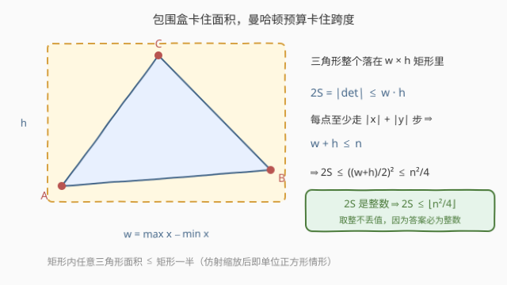
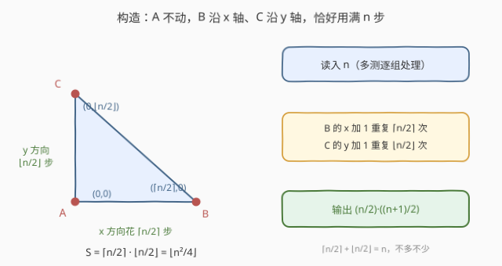
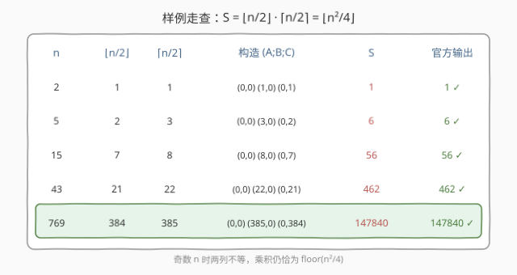

# Codeforces 2284A1 三点最大面积（简单版） 题解

## 1. 题目概述

- **标题 / 题号**：三点最大面积（简单版）（Codeforces 2284A1，英文名 15K4JR3B (Easy Version)）
- **链接**：https://codeforces.com/problemset/problem/2284/A1
- **来源**：Codeforces Round 1132 (Div. 2) · Problem A1
- **难度**：未评级（500 分，Div. 2 的 A1）
- **限制**：时间 1 s / 内存 256 MB
- **标签**：贪心、数学、数论

**题意**：三角形三个顶点 $A,B,C$ 一开始都重合在原点 $(0,0)$。执行**恰好** $n$ 次操作，每次挑一个点并把它的**某一个**坐标加 $1$ 或减 $1$，即点 $(x,y)$ 可以变成 $(x\pm1,y)$ 或 $(x,y\pm1)$。问操作全部结束后，三角形 $ABC$ 的**二倍面积** $S=\lvert (x_B-x_A)(y_C-y_A)-(y_B-y_A)(x_C-x_A)\rvert$ 最大是多少。顶点都是整点，$S$ 必为整数，所以题目只要求输出整数；多测，每个测试用例输出一行一个整数。

> 💡 问"二倍面积"而不是面积是刻意的：面积可能是 $\tfrac12$ 的倍数，二倍面积恒为整数，避免了分数与浮点。

**约束**：

- $1\le t\le 1000$，每个测试用例只有一行一个整数 $n$；
- $2\le n\le 1000$；
- 本题是 Easy 版：每次操作的位移**恰好为 $1$**。Hard 版（A2）把位移换成 $2^{a_i}$，并把规模限制为 $n\le100$、$a_i\le24$，答案会远超 $\lfloor n^2/4\rfloor$。

## 2. 示例与观察
```text
输入
5
2
5
15
43
769

输出
1
6
56
462
147840
```

官方说明里的两组走查：

- $n=2$：把 $B$ 的 $x$ 加 $1$、$C$ 的 $y$ 加 $1$，得 $(0,0),(1,0),(0,1)$，二倍面积 $1$。
- $n=5$：把 $A$ 的 $x$ 减 $1$、$B$ 的 $x$ 加 $2$、$C$ 的 $y$ 加 $2$，得 $(-1,0),(2,0),(0,2)$，二倍面积 $3\cdot2=6$。

再补一组自造样例（$n=3$）：取 $A=(-1,0)$、$B=(1,0)$、$C=(0,1)$，恰好用 $3$ 次操作，二倍面积 $2\cdot1=2$，与公式 $\lfloor 9/4\rfloor=2$ 相符。

## 3. 解题思路

### 3.1 暴力思路

一次操作有 $3\times4=12$ 种选择，直接枚举操作序列是 $12^{n}$，$n=1000$ 时完全不可行。换成"预算分配"的视角：设三点最终到原点的曼哈顿距离为 $d_A,d_B,d_C$，则必须 $d_A+d_B+d_C\le n$ 且 $n-(d_A+d_B+d_C)$ 为偶数（多出的步数可以在某个点上"来回"浪费掉），再枚举每个点曼哈顿球内的落点，复杂度仍在 $O(n^{6})$ 以上。

$n\le1000$ 时其实可以打表，但 A 题更该先手算小数据找规律：

$$n=2,3,4,5,6,7,8,9,10\quad\Longrightarrow\quad S=1,2,4,6,9,12,16,20,25 .$$

一眼可见 $S=\lfloor n^2/4\rfloor$。下面证明它既是上界、也能达到。

### 3.2 核心观察：包围盒卡住面积，曼哈顿预算卡住跨度



设最终三点为 $P_i=(x_i,y_i)$，$i\in\{A,B,C\}$，记**水平跨度**与**竖直跨度**

$$w=\max_i x_i-\min_i x_i,\qquad h=\max_i y_i-\min_i y_i .$$

有两条关键事实：

1. **面积被包围盒卡住**：三个点全都落在 $w\times h$ 的轴对齐矩形内，而矩形内任意三角形的面积不超过矩形面积的一半，于是 $S\le w\cdot h$。
2. **跨度被操作次数卡住**：把点从原点走到 $(x,y)$ 至少需要 $\lvert x\rvert+\lvert y\rvert$ 步；又取 $x$ 的最大者 $u$ 与最小者 $v$，利用 $\lvert a\rvert+\lvert b\rvert\ge\lvert a-b\rvert$ 得
$$\sum_i\lvert x_i\rvert\ \ge\ \lvert x_u\rvert+\lvert x_v\rvert\ \ge\ \lvert x_u-x_v\rvert=w,$$
$y$ 方向同理，所以总步数
$$n\ \ge\ \sum_i\bigl(\lvert x_i\rvert+\lvert y_i\rvert\bigr)\ \ge\ w+h .$$

两式一合，再用 $wh\le\left(\frac{w+h}{2}\right)^2$：

$$S\ \le\ wh\ \le\ \left(\frac{w+h}{2}\right)^{2}\ \le\ \frac{n^{2}}{4}.$$

$S$ 是整数，故 $S\le\lfloor n^2/4\rfloor$。取等要求 $w=h=n/2$，也就是三点分别贴在矩形的一条竖边、一条横边和它们的公共角上——这正是下一步的构造。

### 3.3 算法流程：原地摊开，恰好用完 n 步



让 $A$ 留在原点**一步也不动**，$B$ 沿 $x$ 轴走 $\lceil n/2\rceil$ 步，$C$ 沿 $y$ 轴走 $\lfloor n/2\rfloor$ 步：

$$A=(0,0),\qquad B=\bigl(\lceil n/2\rceil,0\bigr),\qquad C=\bigl(0,\lfloor n/2\rfloor\bigr).$$

- 总步数 $\lceil n/2\rceil+\lfloor n/2\rfloor=n$，**恰好**用满，不需要浪费任何操作；
- 以 $A$ 为原点算叉积：$S=\lceil n/2\rceil\cdot\lfloor n/2\rfloor=\lfloor n^2/4\rfloor$。

于是每组数据只需一行计算：

$$S=\left\lfloor\frac{n}{2}\right\rfloor\cdot\left\lceil\frac{n}{2}\right\rceil=\frac{n}{2}\cdot\frac{n+1}{2},$$

其中除法是**整数除法**（C++ 的 `/` 对非负整数就是下取整）。$n=2k$ 时得 $k^2$，$n=2k+1$ 时得 $k(k+1)$，两者都等于 $\lfloor n^2/4\rfloor$。

流程极短：读入 $n$ → 算 $\lfloor n/2\rfloor$ 与 $\lceil n/2\rceil$ → 相乘输出 → 处理下一组。没有搜索、没有枚举、没有二分。

### 3.4 示例演算



| $n$ | $\lfloor n/2\rfloor$ | $\lceil n/2\rceil$ | 构造 $(A;B;C)$ | $S$ | 官方输出 |
|----|----|----|----|----|----|
| 2 | 1 | 1 | $(0,0);(1,0);(0,1)$ | 1 | 1 |
| 5 | 2 | 3 | $(0,0);(3,0);(0,2)$ | 6 | 6 |
| 15 | 7 | 8 | $(0,0);(8,0);(0,7)$ | 56 | 56 |
| 43 | 21 | 22 | $(0,0);(22,0);(0,21)$ | 462 | 462 |
| 769 | 384 | 385 | $(0,0);(385,0);(0,384)$ | 147840 | 147840 |

官方 $n=5$ 的走法 $(-1,0),(2,0),(0,2)$ 与我们的构造只差"把 $A$ 的一步让给了 $B$"，二倍面积同为 $3\cdot2=6$。这说明最优解**不唯一**，但上界已经被锁死。

## 4. 算法细节

1. **闭式，别模拟**：整个算法是 $O(1)$ 的四则运算；在 $t=1000$ 下任何 BFS/DP/打表都是浪费，也更容易写错。
2. **取整写法**：写 `(n / 2) * ((n + 1) / 2)`。不要写成 `(n * (n + 1)) / 2`（那是 $1+2+\dots+n$），也不要写 `(n / 2) * (n / 2)`（奇数时会少掉一整条）。
3. **类型选择**：$n\le1000$ 时答案最大 $250000$，`int` 也装得下；仍建议统一用 `long long`，因为参数稍大（例如 $n=10^{9}$）时 `n * n` 就会溢出 `int`，$n=10^{18}$ 时连 `long long` 都装不下（$10^{36}$）。
4. **二倍面积用叉积**：$S=\lvert (x_B-x_A)(y_C-y_A)-(y_B-y_A)(x_C-x_A)\rvert$，不要用海伦公式（要开方、有浮点误差），也不要用"底 × 高 ÷ 2"（会漏掉那个 $\tfrac12$）。
5. **多测清空**：本题没有数组、没有全局状态，循环里现读现算即可，无需 `memset`；输出用 `'\n'` 而不是 `endl`，避免每组都刷新缓冲区。
6. **"恰好 $n$ 次"不构成障碍**：上界只用"总步数 ≥ 曼哈顿距离之和"，对"至多"和"恰好"都成立；下界构造恰好用满 $n$ 步，所以"恰好"与"至多"的答案相同。若真需要浪费步数，来回走两步即可。
7. **I/O**：C++ 关同步流并把 `cin` 从 `stdout` 解绑；Python 用一次 `sys.stdin.buffer.read().split()` 读完再逐组处理，比逐行 `input()` 快一个数量级。

## 5. 正确性证明

**引理 1（曼哈顿下界）**：点从 $(0,0)$ 出发，经过 $m$ 次"单坐标 $\pm1$"操作后落在 $(x,y)$，则 $m\ge\lvert x\rvert+\lvert y\rvert$。

**证明**：每次操作只改变一个坐标且改变量为 $\pm1$，由三角不等式，$m$ 步后 $\lvert x\rvert+\lvert y\rvert\le m$。（更强的结论是 $m-\lvert x\rvert-\lvert y\rvert$ 为偶数，本题只需下界。）∎

**引理 2（跨度不超过总曼哈顿距离）**：对任意三点 $P_1,P_2,P_3$，有 $w\le\sum_i\lvert x_i\rvert$ 且 $h\le\sum_i\lvert y_i\rvert$。

**证明**：设 $x_u=\max_i x_i$、$x_v=\min_i x_i$。则
$$\sum_i\lvert x_i\rvert\ge\lvert x_u\rvert+\lvert x_v\rvert\ge\lvert x_u-x_v\rvert=w,$$
第三项非负故可丢弃；$y$ 方向同证。∎

**引理 3（包围盒界）**：落在 $w\times h$ 轴对齐矩形内的任意三角形满足 $S\le wh$；等价地，单位正方形内任意三角形面积不超过 $\tfrac12$。

**证明**：作仿射变换 $(x,y)\mapsto\bigl(\frac{x-x_{\min}}{w},\frac{y-y_{\min}}{h}\bigr)$，它把矩形映成单位正方形、把面积乘以 $\frac{1}{wh}$，故只需证单位正方形情形。

设三点 $\mathbf u,\mathbf v,\mathbf t\in[0,1]^2$，二倍面积 $f=\lvert\det(\mathbf v-\mathbf u,\ \mathbf t-\mathbf u)\rvert$。固定其中两点时，$\det$ 是剩下那一点的**仿射**函数，复合绝对值后成为**凸**函数，而凸函数在正方形上的最大值必在**顶点**取到；逐点替换可知 $f$ 的最大值在三点都是角点时达到。三个角点只有两种情形：有两点重合（$f=0$），或三点互异、恰为正方形的三个角（$f=1$）。故 $f\le1$，即面积 $\le\tfrac12$；按比例缩回原矩形得 $S\le wh$。∎

**引理 4（构造可达）**：$A=(0,0)$、$B=(\lceil n/2\rceil,0)$、$C=(0,\lfloor n/2\rfloor)$ 可由恰好 $n$ 次合法操作达到，且 $S=\lfloor n^2/4\rfloor$。

**证明**：$A$ 不动；把 $B$ 的 $x$ 坐标加 $1$ 重复 $\lceil n/2\rceil$ 次，把 $C$ 的 $y$ 坐标加 $1$ 重复 $\lfloor n/2\rfloor$ 次，合计恰好 $n$ 次，且每次都合法。以 $A$ 为原点，
$$S=\Bigl(\bigl\lceil n/2\bigr\rceil-0\Bigr)\Bigl(\bigl\lfloor n/2\bigr\rfloor-0\Bigr)=\bigl\lfloor n/2\bigr\rfloor\bigl\lceil n/2\bigr\rceil=\Bigl\lfloor\frac{n^{2}}{4}\Bigr\rfloor,$$
最后一步：$n$ 偶时两边相等；$n$ 奇时两因子为 $\frac{n-1}{2},\frac{n+1}{2}$，乘积为 $\frac{n^{2}-1}{4}$。∎

**定理**：$n$ 次操作后 $\triangle ABC$ 的二倍面积最大值为 $\lfloor n^2/4\rfloor$。

**证明**：任取一个终局 $P_A,P_B,P_C$。由引理 1，$n\ge\sum_i(\lvert x_i\rvert+\lvert y_i\rvert)$；由引理 2，$w+h\le\sum_i(\lvert x_i\rvert+\lvert y_i\rvert)\le n$；由引理 3，$S\le wh\le\bigl(\frac{w+h}{2}\bigr)^2\le\frac{n^2}{4}$。又 $S\in\mathbb Z$，故 $S\le\lfloor n^2/4\rfloor$。引理 4 给出达到该值的合法方案，故最大值恰为 $\lfloor n^2/4\rfloor$。∎

## 6. 复杂度分析

- **时间**：每组 $O(1)$——两次整数除法加一次乘法，总计 $O(t)$；$t=1000$ 时不超过几千次基本运算，即使 $t=10^5$ 也是常数级吞吐。
- **空间**：$O(1)$，只有几个整型变量；Python 一次性 `read().split()` 的输入缓冲是 $O(t)$ 个 token，可忽略。
- **对照时限**：$1$ s 非常宽松。实测最大输入（$t=1000$，$n$ 全部取满 $1000$）C++ 耗时 $<1$ ms，Python3 约 $25$ ms（几乎全是解释器启动），余量在三个数量级以上。

## 7. 参考代码

### C++17

```cpp
#include <iostream>
using namespace std;

int main() {
    ios::sync_with_stdio(false);
    cin.tie(nullptr);
    int t;
    if (!(cin >> t)) return 0;              // 空输入保护
    while (t--) {
        long long n;
        cin >> n;
        // 答案 = floor(n/2) * ceil(n/2) = floor(n^2/4)
        long long ans = (n / 2) * ((n + 1) / 2);
        cout << ans << '\n';
    }
    return 0;
}
```

### Python3

```python
import sys


def main() -> None:
    data = sys.stdin.buffer.read().split()
    if not data:
        return
    t = int(data[0])
    out = []
    for i in range(1, t + 1):
        n = int(data[i])
        # 答案 = floor(n/2) * ceil(n/2) = floor(n^2/4)
        out.append(str((n // 2) * ((n + 1) // 2)))
    sys.stdout.write("\n".join(out) + "\n")


main()
```

## 8. 边界情况与易错点

1. **最小规模 $n=2$**：唯一能取到的非退化三角形是 $(0,0),(1,0),(0,1)$，$S=1$；公式给出 $\lfloor4/4\rfloor=1$，不会退化成 $0$。
2. **奇数必须下取整**：$n=3$ 的答案是 $2$，不是 $2.25$；写成 `((n+1)/2) * ((n+1)/2)` 会得 $4$，直接 WA。
3. **不要用浮点**：`pow(n,2)/4`、`sqrt` 在大 $n$ 时有精度问题（$n=10^{18}$ 时 double 无法精确表示整数），整数除法才是对的。
4. **溢出**：A1 的 $n\le1000$ 绝对安全；但若把同一闭式搬到 $n$ 更大的版本（例如 $n$ 达 $10^{18}$），`n * n` 会溢出 `long long`，应写 `(n / 2) * ((n + 1) / 2)`（先除后乘，结果永不超过 $\frac{n^2}{4}$），或改用 `__int128`。Python 的大整数无此问题。
5. **"恰好 $n$ 次" ≠ 三个点都必须动**：构造里 $A$ 一步不动完全合法；也不要担心"多出的步数会把答案弄小"——来回走两步不改变位置。
6. **多测格式**：每组输出一行，最后一组后也要换行；不要漏读 $t$，也不要把 $t$ 与第一组的 $n$ 搞混（本题每组只有一个整数，是最常见的翻车点）。

## 9. 验证记录

- **编译环境与命令**：`clang++ -std=c++17 -O2`（本机无 GNU g++，配 `codeforces/tools/include/bits/stdc++.h` 兼容头；正文代码只用标准库，可原样提交 GNU C++17）；Python 侧为 `Python 3.9.6`。
- **官方样例**：1 / 1 通过（按 Codeforces 标准 checker 的 token 比对，忽略空白与大小写）。
- **复核状态**：audited（2026-11-19 统一回归：编译 + 官方样例；写作期的随机对拍与暴力未重跑）。

## 相关题目与扩展

- [Codeforces 2284A2 三点最大面积（困难版）](https://codeforces.com/problemset/problem/2284/A2)：几何目标完全一样，但每次操作的位移是 $2^{a_i}$，可达点集不再是完整菱形，闭式失效；官方样例 $n=6$、$a=(24,24,24,0,0,0)$ 的答案是 $562950054084608$，远大于 $\lfloor 36/4\rfloor=9$，说明必须专门利用幂次的二进制结构（大幂次优先、按方向分摊）。
- [LeetCode 812. 最大三角形面积](https://leetcode.cn/problems/largest-triangle-area/)：同样用叉积算二倍面积，可以拿来手验本文 $S$ 的表达式。
- [LeetCode 976. 三角形的最大周长](https://leetcode.cn/problems/largest-perimeter-triangle/)：另一类"三角形 + 贪心"的入门题，可以对照体会"先定形、再证界"的套路。
- [Codeforces 1A](https://codeforces.com/problemset/problem/1/A)：同样是"读题 → 推闭式 → $O(1)$ 输出"的纯公式题，适合当 Div. 2 A 的训练模板。

**延伸思考**：

1. **把 $\pm1$ 换成 $\pm k$**：所有坐标始终是 $k$ 的倍数，整体除以 $k$ 就回到原题，故答案恰为 $k^2\lfloor n^2/4\rfloor$；这也解释了为什么"位移大小"本身不改变问题的结构，只有"不可公度"的位移（如 A2 的幂次）才会破坏闭式。
2. **固定每个点各自的预算** $d_A,d_B,d_C$（必须恰好用完）：上界 $\lfloor(\sum d_i)^2/4\rfloor$ 依然成立（证明一字不改），但取到它需要处理奇偶——某个点预算被锁住、必须真走奇数步时，原构造里"原地不动"的那一角就得挪开，能否补回来要按 $\bmod 2$ 分类讨论。这是本题最自然的加强版。
3. **换成 $m$ 个点求凸包面积**："包围盒 × 曼哈顿预算"的论证依然给出上界，但点的个数一变多，最优摆放必须落在凸包顶点上，问题会立刻从 A 跳到计算几何。
