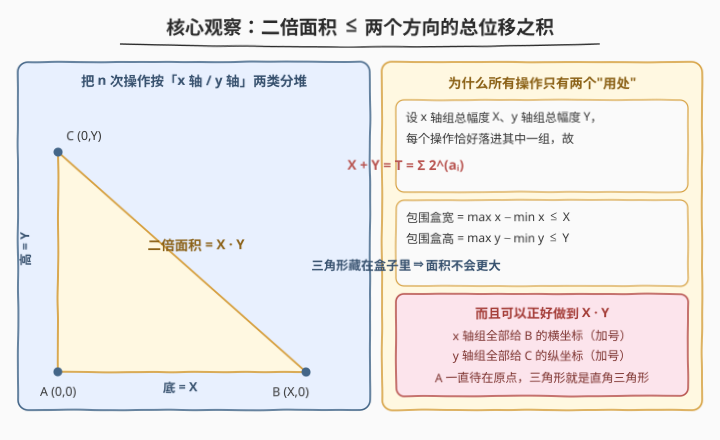
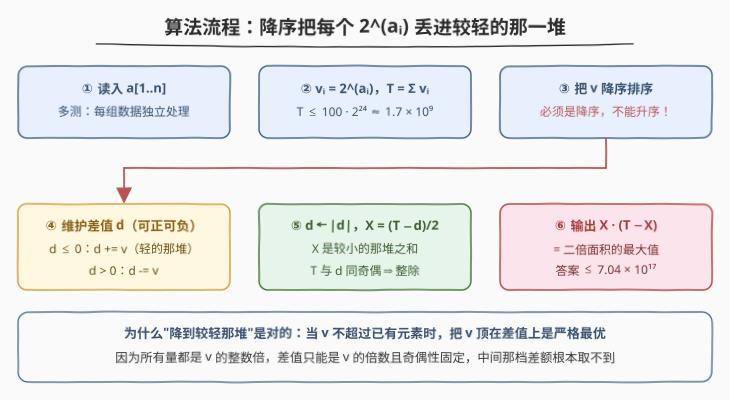
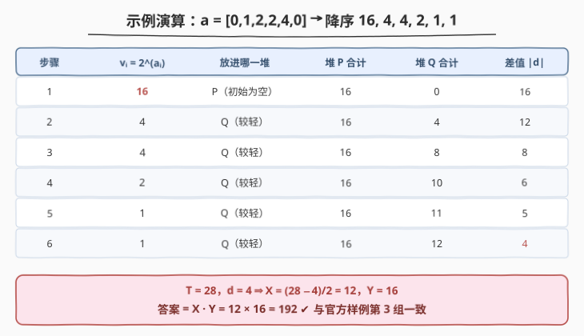

# Codeforces 2284A2 三点最大面积（困难版） 题解

## 1. 题目概述

- **标题 / 题号**：三点最大面积（困难版）（Codeforces 2284A2，英文名 15K4JR3B (Hard Version)）
- **链接**：https://codeforces.com/problemset/problem/2284/A2
- **来源**：Codeforces Round 1132 (Div. 2) · Problem A2
- **难度**：未评级（500 分）
- **限制**：时间 1 s / 内存 256 MB
- **标签**：贪心、数学、数论（2 的幂），本质是划分问题

**题意**：平面上有三个点 $A,B,C$，初始都在原点。给定长度为 $n$ 的数组 $a$，你必须**恰好执行 $n$ 次操作**：第 $i$ 次操作任选一个点，把它的某个坐标加或减 $2^{a_i}$（即选一个点从 $(x,y)$ 变成 $(x\pm 2^{a_i},y)$ 或 $(x,y\pm 2^{a_i})$）。操作全部做完后，求三角形 $ABC$ 的**二倍面积**（即 $|\det(B-A,\ C-A)|$）的最大值。多测：第一行 $t$，每组先给 $n$、再给 $a_1\sim a_n$，输出一个整数；题目保证最大值必为整数（本题所有坐标都是整数，这个保证其实用不上）。

**约束**：

- $1 \le t \le 100$
- $2 \le n \le 100$
- $0 \le a_i \le 24$，第 $i$ 次操作的位移量是 $2^{a_i}$；总幅度 $T=\sum 2^{a_i} \le 100\cdot 2^{24} \approx 1.68\times 10^{9}$
- 答案上界为 $T^2/4 \approx 7.04\times 10^{17}$，**必须用 64 位整数**
- 与简单版（2284A1）的差别：简单版每次只能改 $1$，且 $t \le 1000$、$n \le 1000$，答案是 $\lfloor n^2/4 \rfloor$（可直接 $O(1)$ 算）。本题步长变成 $2^{a_i}$，$n$ 缩小到 $100$ 但 $T$ 高达 $1.68\times 10^9$，**不能再用以 $T$ 为大小的背包**，必须利用"2 的幂"这一结构。可以认为简单版就是本题 $a_i$ 全取 $0$ 的特例。

## 2. 示例

官方样例（输入 / 输出原样）：

```text
输入：
4
2
0 0
3
0 0 1
6
0 1 2 2 4 0
6
24 24 24 0 0 0

输出：
1
4
192
562950054084608
```

样例解释：第 1 组把 $B$ 的 $x$、$C$ 的 $y$ 各加 $1$，得直角三角形，二倍面积 $1\times 1=1$；第 2 组 $A$ 的 $x$ 减 $1$、$B$ 的 $x$ 加 $1$、$C$ 的 $y$ 加 $2$，底 $2$、高 $2$，得 $4$；第 3 组装成底 $16$、高 $12$ 的直角三角形，答案 $192$；第 4 组装成底 $2^{25}$、高 $2^{24}+3$ 的直角三角形，答案 $2^{25}(2^{24}+3)=562950054084608$。

自造一组最小规模与一组"贪心陷阱"（下文 §8 会用到）：

```text
输入：
3
2
0 0
5
1 0 0 0 0
4
3 3 1 0

输出：
1
9
90
```

第 2 组位移量为 $\{2,1,1,1,1\}$，$T=6$，可以劈成 $2+1$ 与 $1+1+1$ 两边各 $3$，答案 $3\times 3=9$；第 3 组为 $\{8,8,2,1\}$，$T=19$，最接近的一半是 $9=8+1$，答案 $9\times 10=90$。

## 3. 解题思路

### 3.1 暴力思路

每次操作有 $3\times 2\times 2 = 12$ 种选择（选点、选轴、选正负号），$n$ 次就有 $12^n$ 种方案，$n=100$ 时是天量。即便退一步只考虑"每个操作分给 $x$ 轴还是 $y$ 轴"的 $2^n$ 种分法，仍然不可行。暴力只能用于小数据对拍。

### 3.2 核心观察：二倍面积只是"两个方向总位移"的乘积



把 $n$ 次操作按**作用的坐标轴**分成两组：$x$ 轴组的总幅度记作 $X$，$y$ 轴组的总幅度记作 $Y$，显然

$$X + Y = T = \sum_{i=1}^{n} 2^{a_i}.$$

设三点坐标分别为 $(x_p,y_p)$，令 $W=\max_p x_p-\min_p x_p$、$H=\max_p y_p-\min_p y_p$ 为轴对齐包围盒的宽高。两点事实：

1. 三角形整体落在自己的包围盒里，而**矩形内任意三角形的面积不超过矩形的一半**，所以二倍面积 $\le W\cdot H$；
2. 每个点的 $x$ 坐标是它收到的 $x$ 轴操作的有符号和，因此 $W \le \sum_p |x_p| \le X$，同理 $H \le Y$。

合起来就得到关键上界

$$\text{二倍面积} \le X\cdot Y,\qquad X+Y=T.$$

这个上界是**紧的**：把 $x$ 轴组的操作全部加到 $B$ 的横坐标上（取正号），$y$ 轴组的操作全部加到 $C$ 的纵坐标上（取正号），$A$ 一直留在原点，则 $A=(0,0)$、$B=(X,0)$、$C=(0,Y)$，二倍面积恰好是 $X\cdot Y$。

于是问题被彻底改写：**把 $n$ 个数 $2^{a_1},\dots,2^{a_n}$ 分成两堆，使两堆之和的乘积最大**。因为和固定为 $T$，最大化 $X(T-X)$ 等价于最小化差值 $d=|X-Y|=|T-2X|$——这正是经典的"两堆划分"问题。

### 3.3 算法流程：降序丢进较轻的那一堆



一般的划分问题要做背包，但这里的元素全是 2 的幂，可以直接贪心：

1. 把 $a$ **降序**排序（等价于把 $2^{a_i}$ 降序排序）；
2. 维护一个带符号的差值 $d=X-Y$，初始 $d=0$；
3. 依次取出最大的 $v=2^{a_i}$：若 $d\le 0$ 说明 $X$ 这堆较轻，令 $d\mathrel{+}=v$；否则令 $d\mathrel{-}=v$；
4. 结束后 $d\leftarrow |d|$，则 $X=(T-d)/2$、$Y=(T+d)/2$，输出 $X\cdot Y$。

直观上就是"每次把当前最大的块放到较轻的一边"，让两边尽量持平。注意**必须降序**：升序贪心会给出错误答案（§8 给出反例）。这个贪心为什么在 2 的幂上严格最优，见 §5 的引理 4：当新加入的 $v$ 整除已有所有元素时，"把 $v$ 顶在差值上"就是最优，因为中间档的差额根本取不到。

### 3.4 示例演算



以 $a=[0,1,2,2,4,0]$ 为例，位移量降序为 $16,4,4,2,1,1$，$T=28$。按 §3.3 逐步执行（见图中表格）：先建两堆 $P,Q$，$16$ 独自进 $P$，此时 $d=16$；随后 $4,4,2,1,1$ 依次填进较轻的 $Q$，$d$ 依次收缩为 $12,8,6,5,4$。最终 $P=16$、$Q=12$，$d=4$，于是较小堆 $X=(28-4)/2=12$、另堆 $Y=16$，答案 $12\times 16=192$，与官方样例一致。注意 $T/2=14$ 根本凑不出（$16$ 单块已超、$4+4+2+1+1=12$），$12$ 就是能凑到的最接近值。

## 4. 算法细节

1. **多测**：$t$ 组之间没有任何共享状态，每组重新读 $n$、重新累加 $T$ 与 $d$ 即可，不要复用上一组的变量。
2. **数据类型**：$T\le 1.68\times 10^9$ 看似能用 `int`，但 $X\cdot Y$ 可达 $7.04\times 10^{17}$，一律用 `long long`（Python 无此问题）。
3. **位移量写法**：用 `1LL << a[i]`，$a_i$ 最大 $24$，写成 `1 << a[i]` 在 32 位下也勉强够，但统一用 `1LL` 更稳。
4. **差值 $d$ 的维护**：$d$ 用带符号量，`d <= 0` 时加、`d > 0` 时减，等价于"放到较轻的一堆"；不要用 `abs(d)` 再判断，容易把"恰好平衡"的情况处理错。
5. **变量关系**：最后 $X=(T-d)/2$ 一定整除（$d=|X-Y|$ 与 $T=X+Y$ 同奇偶）；若用 `(T-d)/2` 写成浮点会丢精度，必须整数除法。
6. **不要背包**：以 $T$ 为下标的 01 背包需要 $10^9$ 级空间，正确做法是排序后贪心，$O(n\log n)$。
7. **I/O**：`std::ios::sync_with_stdio(false)` 关闭同步，输出用 `'\n'` 而不是 `endl`；$t$ 最大 $100$，输出量很小。

## 5. 正确性证明

**引理 1**：对任意三个点，二倍面积不超过其轴对齐包围盒的面积 $W\cdot H$。

**证明**：设包围盒为 $[0,W]\times[0,H]$（平移不影响面积），三顶点为 $P_1,P_2,P_3$。有向二倍面积等于

$$\left|\sum_{i=1}^{3} x_i\,\Delta_i\right|,\qquad \Delta_1=y_2-y_3,\ \Delta_2=y_3-y_1,\ \Delta_3=y_1-y_2 .$$

其中 $\Delta_1+\Delta_2+\Delta_3=0$ 且 $|\Delta_1|+|\Delta_2|+|\Delta_3|=2H$。把 $x_i$ 换成 $x_i-c$（取 $c=W/2$，因和式系数为零故值不变），则每个 $|x_i-c|\le W/2$，于是二倍面积 $\le \frac{W}{2}\cdot 2H=WH$。∎

**引理 2**：设把操作按坐标轴分成两组，总幅度分别为 $X,Y$，则二倍面积 $\le X\cdot Y$，且 $X+Y=T$。

**证明**：每个点的 $x$ 坐标是分给它的 $x$ 轴操作的有符号和，故 $|x_p|$ 不超过分给该点的 $x$ 轴幅度之和，于是 $W\le\sum_p|x_p|\le X$；同理由 $|y_p|$ 得 $H\le Y$。代入引理 1 得二倍面积 $\le WH\le XY$。而每个操作恰好属于一组，故 $X+Y=T$。∎

**引理 3（可达性）**：对任意子集 $S\subseteq\{1,\dots,n\}$，取 $X=\sum_{i\in S}2^{a_i}$、$Y=T-X$，都存在操作方案使二倍面积恰为 $X\cdot Y$。

**证明**：$S$ 中的操作取正号作用于 $B$ 的横坐标，其余取正号作用于 $C$ 的纵坐标，$A$ 不动。则 $A=(0,0),B=(X,0),C=(0,Y)$，二倍面积 $=|X\cdot Y-0|=XY$。∎

**定理 1**：最大二倍面积等于 $\max_{X}\ X(T-X)$，其中 $X$ 取遍 $\{2^{a_i}\}$ 的全部子集和。

**证明**：由引理 2 任何方案的二倍面积 $\le X(T-X)\le\max_X X(T-X)$；由引理 3 该值可达。∎

于是只需最小化差值。记 $f(M)$ 为多重集 $M$ 的最小 $\left|\sum \pm v\right|$。

**引理 4（顶住最小块）**：设 $M$ 中元素全是 $v=2^k$ 的正整数倍（即都是 $\ge v$ 的 2 的幂），则 $f(M\cup\{v\})=\bigl|f(M)-v\bigr|$。

**证明**：记 $T_M=\sum_{x\in M}x$。**上界**：取 $M$ 的最优分堆（差值 $f(M)$），把 $v$ 加到较轻的一边，新差值为 $|f(M)-v|$，故 $f(M\cup\{v\})\le|f(M)-v|$。

**下界**：任一 $M\cup\{v\}$ 的分堆去掉 $v$ 后给出 $M$ 的一个分堆，其（带符号）差值为 $d$，新差值为 $|d\pm v|$。由于 $M$ 的所有元素与 $v$ 都是 $v$ 的倍数，记 $\varphi=f(M)/v$、$\delta=|d|/v$，两者都是非负整数，且都满足"$\equiv T_M/v \pmod 2$"，所以 $\delta\ge\varphi$ 且 $\delta\equiv\varphi\pmod 2$。于是

$$|d\pm v|\ \ge\ \bigl||d|-v\bigr|\ =\ (\delta-1)\,v .$$

若 $\varphi=0$：由奇偶性 $\delta$ 为偶数，$\delta=0$ 时 $(\delta-1)v=v=|0-1|v$，$\delta\ge2$ 时 $(\delta-1)v\ge v=|0-1|v$；若 $\varphi\ge1$：$\delta\ge\varphi$ 给出 $(\delta-1)v\ge(\varphi-1)v=|f(M)-v|$。两种情形都有 $|d\pm v|\ge|f(M)-v|$，故 $f(M\cup\{v\})\ge|f(M)-v|$。∎

**定理 2**：按降序依次把每个 $2^{a_i}$ 放到较轻的一堆，得到的 $d$ 等于 $f(\{2^{a_i}\})$，从而答案 $=\frac{T-d}{2}\cdot\frac{T+d}{2}$ 是最优值。

**证明**：对步数归纳。处理完前 $j$ 大的元素后，集合 $M_j$ 的元素都 $\ge v_{j+1}$，故引理 4 适用，得 $f(M_{j+1})=|f(M_j)-v_{j+1}|$；而贪心维护的差值 $d_{j+1}=|d_j-v_{j+1}|$（$d_j\le0$ 时加、$>0$ 时减正是此式）。由 $f(M_0)=0=d_0$ 归纳得 $d_n=f(M_n)$。再由定理 1，$X(T-X)$ 在 $|T-2X|=d$ 时取到最大。∎

## 6. 复杂度分析

- **时间**：每组排序 $O(n\log n)$，贪心扫描 $O(n)$，故单组 $O(n\log n)$，全部数据 $O\!\left(\sum n\log n\right)\le 100\cdot 100\log 100$，约 $7\times 10^4$ 次基本运算；实测最大数据（$t=100$、$n=100$、$a_i$ 随机）C++ 约 $13$ ms（含进程开销），Python 约 $27$ ms，相对 $1$ s 时限余量充足。
- **空间**：只存一个长度 $n\le100$ 的数组与若干 64 位整数，$O(n)$，可忽略。
- **数值范围**：$T\le 1.68\times10^9$ 在 64 位内；答案 $\le T^2/4\approx7.04\times10^{17}<2^{63}-1\approx9.22\times10^{18}$，不会溢出。

## 7. 参考代码

### C++17

```cpp
#include <bits/stdc++.h>
using namespace std;

int main() {
    ios::sync_with_stdio(false);
    cin.tie(nullptr);

    int t;
    cin >> t;
    while (t--) {
        int n;
        cin >> n;
        vector<int> a(n);
        for (int i = 0; i < n; i++) cin >> a[i];

        sort(a.begin(), a.end(), greater<int>());   // 必须降序
        long long T = 0, d = 0;                     // d = X - Y，带符号
        for (int i = 0; i < n; i++) {
            long long v = 1LL << a[i];
            T += v;
            if (d <= 0) d += v;                     // 放到较轻的一堆
            else        d -= v;
        }
        if (d < 0) d = -d;
        long long X = (T - d) / 2;                  // 较小那堆之和
        cout << X * (T - X) << '\n';                // 二倍面积最大值
    }
    return 0;
}
```

### Python3

```python
import sys

def main():
    data = sys.stdin.buffer.read().split()
    t = int(data[0])
    pos = 1
    out = []
    for _ in range(t):
        n = int(data[pos]); pos += 1
        a = [int(x) for x in data[pos:pos + n]]; pos += n
        a.sort(reverse=True)                 # 必须降序
        total = 0
        d = 0                                # d = X - Y，带符号
        for x in a:
            v = 1 << x
            total += v
            if d <= 0:
                d += v                       # 放到较轻的一堆
            else:
                d -= v
        d = abs(d)
        X = (total - d) // 2                 # 较小那堆之和
        out.append(str(X * (total - X)))
    sys.stdout.write("\n".join(out) + "\n")

main()
```

## 8. 边界情况与易错点

1. **$n=2$**：最小规模。若 $a=[0,0]$，两个操作必须分到两条轴（或两个点）才有正面积，答案 $1$；若 $a=[0,24]$，答案 $2^{24}\cdot 1$（大块独占一边），不要以为总能劈成 $T/2$。
2. **必须降序贪心**：反例 $a=[1,0,0,0,0]$（位移量 $2,1,1,1,1$）。升序贪心得到 $1-1+1-1+2=2$，从而 $X=2$、答案 $2\times4=8$；正确最优是把 $2+1$ 对 $1+1+1$，$d=0$、答案 $9$。
3. **$T/2$ 往往取不到**：若 $a$ 是 $99$ 个 $0$ 再加一个 $24$，则 $T=2^{24}+99$，而子集和只有 $0\sim99$ 与 $2^{24}+(0\sim99)$ 两类，最接近 $T/2$ 的只能取 $99$，答案 $99\cdot 2^{24}=1660944384$，与 $T^2/4$ 差之千里——不要直接把 $T^2/4$ 当答案。
4. **溢出**：$T$ 与 $d$ 用 `long long`；答案 $X\cdot(T-X)$ 必须用 64 位乘法，写成 `int` 会在大数据上错得很离谱。
5. **整除性**：$X=(T-d)/2$ 中 $T$ 与 $d$ 一定同奇偶（都是 $X+Y$ 与 $|X-Y|$ 型组合），整数除法不会截断；但若先把 $d$ 取错符号或漏取绝对值，会得到负的 $X$。
6. **$a_i$ 全为 $0$（退化成简单版）**：此时所有子集和 $0\sim n$ 都能取到，答案就是 $\lfloor n^2/4\rfloor$，例如 $n=100$ 时 $2500$、$n=769$ 时 $147840$，可用它快速自测。
7. **$a_i$ 全为 $24$**：$n$ 为偶数时两两抵消，$d=0$，答案 $(50\cdot 2^{24})^2=703687441776640000$；$n$ 为奇数时差值恰为 $2^{24}$，答案变成 $\frac{n-1}{2}2^{24}\cdot\frac{n+1}{2}2^{24}$（如 $n=99$ 时为 $49\cdot50\cdot2^{48}$），注意这种因奇偶性产生的跳变。
8. **多测格式**：输入用 `cin >>`/`read().split()` 逐个读即可，不要按行读（行内空格数量不稳定）。

## 相关题目与扩展

- [Codeforces 2284A1. 15K4JR3B (Easy Version)](https://codeforces.com/problemset/problem/2284/A1)：本题的简单版，步长恒为 $1$，答案 $\lfloor n^2/4\rfloor$；可对照体会"$a_i$ 全 0"的特例。
- [LeetCode 416. 分割等和子集](https://leetcode.cn/problems/partition-equal-subset-sum/)：一般划分问题，只能背包 $O(n\sum v)$，正是本题不能用背包的原因。
- [LeetCode 1049. 最后一块石头的重量 II](https://leetcode.cn/problems/last-stone-weight-ii/)：最小化两堆差值的另一套建模，与 §3.2 的转化完全同构。

**延伸思考**：

1. 若 $a_i$ 不再限定为 $2$ 的幂（例如给定任意整数权值），引理 4 立刻失效（取不到"中间档"的论证不再成立），贪心会错；此时只能用背包或 meet-in-the-middle，复杂度随值域爆炸。
2. 若把"永远选较轻的一堆"改成"每次可以选任意一堆"，则贪心的最优性来自"降序 + 整除链"；把点数从 $3$ 增加到 $k$、要求最大化 $k$ 边形面积时，问题变成 $k$ 路划分，$k\ge3$ 时已是 NP-hard，只剩近似算法（如 LPT 的 $4/3-1/(3k)$ 保证）可用。
3. 本题真正的"浪费"只有一处：一次操作被分到哪条轴；分给哪个点无所谓，因为只有两个坐标方向能贡献面积。若允许每次操作同时改两个坐标（沿对角线移动），$X+Y=T$ 就不再成立，需要重新刻画可行域，这正是把这道签到题升级成难题的自然方向。
