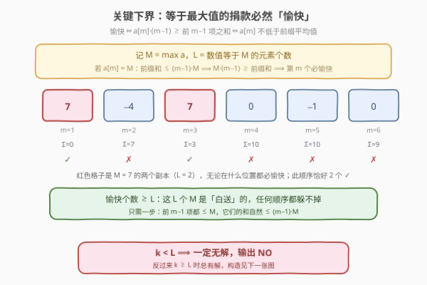
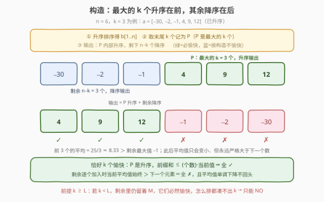
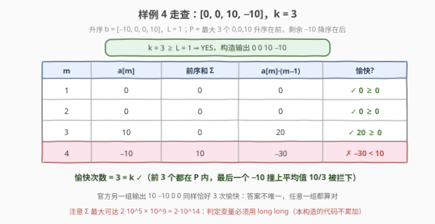

# Codeforces 2284B 小众互联网入门 题解

## 1. 题目概述

- **标题 / 题号**：小众互联网入门（Codeforces 2284B，英文名 Introduction to the Niche Internet）
- **链接**：https://codeforces.com/problemset/problem/2284/B
- **来源**：Codeforces Round 1132 (Div. 2) · Problem B（UTC 2026-11-06）
- **难度**：未评级（1000 分）
- **限制**：时间 1.5 s / 内存 256 MB
- **标签**：构造、贪心、排序、数学

**题意**：给定 $n$ 个整数 $a_1,\dots,a_n$（可正可负），把它们**重新排列**，使得恰好有 $k$ 个位置 $m$ 满足

$$a_m \cdot (m-1) \ \ge\ \sum_{i=1}^{m-1} a_i ,$$

也就是「第 $m$ 笔捐款不小于前 $m-1$ 笔的平均值」，题面把这种位置称为**很愉快**。注意 $m=1$ 时左边是 $0$、右边是空和 $0$，所以**第一个位置永远愉快**。

若存在这样的排列，先输出 `YES`、第二行输出该排列；否则输出 `NO`。多测：第一行 $t$，每组先给 $n,k$，再给 $n$ 个整数。

**约束**：

- $1 \le t \le 10^4$，$\sum n \le 2\times10^5$
- $1 \le k \le n \le 2\times10^5$
- $-10^9 \le a_i \le 10^9$
- 时间 1.5 s / 内存 256 MB：允许 $O(n\log n)$，不允许 $O(n^2)$

## 2. 示例与观察
官方样例（4 组）：

```text
输入
4
3 1
1 2 3
3 1
5 5 5
3 2
-1 -2 -3
4 3
0 0 10 -10

输出
YES
3 2 1
NO
YES
-1 -3 -2
YES
10 -10 0 0
```

- 第 1 组 `3 2 1` 只有第一个愉快（$2\cdot1<3$，$1\cdot2<5$）；第 3 组 `-1 -3 -2` 中第三个满足 $(-2)\cdot2\ge-4$，恰好 2 个（输出顺序不唯一）。
- 第 2 组三笔捐款全相等，任意顺序三个位置都愉快，凑不出 $k=1$ 故 `NO`；第 4 组 `10 -10 0 0` 的第 1、3、4 个愉快，恰好 3 个。

自造示例（标注为自造，覆盖重复值与大数在前的构造）：

```text
输入
2
3 2
2 2 3
5 3
4 4 4 1 2

输出（构造之一，自造示例）
YES
2 3 2
YES
4 4 4 2 1
```

## 3. 解题思路

### 3.1 暴力思路

排列有 $n!$ 种，$n\le 2\times10^5$ 时完全不可能枚举；而**判定一个给定排列**只要扫一遍累加前缀和，$O(n)$。所以瓶颈全在「判断有无解 + 构造」上，必须找出结构性的判据。

### 3.2 核心观察：最大值的出现次数给出下界



把条件改写成与平均值比较（$m\ge 2$）：

$$a_m \ \ge\ \frac{S_{m-1}}{m-1},\qquad S_{m-1}=\sum_{i=1}^{m-1} a_i .$$

记 $M=\max a$，$L$ 为 $M$ 在数组中出现的次数。

**下界**：若某个位置上放的正好是 $M$，那么它前面 $m-1$ 个数都 $\le M$，于是 $S_{m-1}\le (m-1)M$，条件自动成立。也就是说**每一个 $M$ 都必然愉快**，愉快个数至少是 $L$。因此 $k<L$ 时一定无解。

**上界**：把数组升序排列 $b_1\le\dots\le b_n$，第 $m$ 个元素是前 $m$ 个中最大的，同样有 $S_{m-1}\le (m-1)b_m$，于是**升序排列让全部 $n$ 个位置都愉快**，$k=n$ 永远有解。

两端都能取到：$L$ 只能靠「所有 $M$ 都愉快」勉强凑到，$n$ 靠升序拉满。自然猜想：**可行集合就是整个区间 $[L,n]$**。接下来给出取到任意中间值的构造。

### 3.3 算法流程：前 $k$ 大升序 + 其余降序



设 $b_1\le b_2\le\dots\le b_n$ 为升序数组，取最大的 $k$ 个组成 $P=\{b_{n-k+1},\dots,b_n\}$，输出顺序为

$$b_{n-k+1},\ b_{n-k+2},\ \dots,\ b_n,\qquad b_{n-k},\ b_{n-k-1},\ \dots,\ b_1 ,$$

即「$P$ 内部升序在前，剩下的降序在后」。为什么恰好 $k$ 个愉快？

- **前 $k$ 个全愉快**：$P$ 内部升序，放到第 $m$ 个时，前面 $m-1$ 个都是 $P$ 里不大于它的元素。
- **后 $n-k$ 个全不愉快**：$P$ 的平均值 $\bar P$ 严格大于剩余元素的最大值 $b_{n-k}$（$k\ge L$ 时严格，见 §5 引理 3）。于是当前平均值 $>\max(\text{剩余})$；按**降序**逐个加入时，下一个元素 $x\le \max(\text{剩余})<$ 当前平均值，必然不愉快；而加入 $x$ 后的新平均值仍大于 $x$，不变量得以保持。

> 💡 一句话记忆：**先把平均值抬到所有剩余元素之上，再严格降序地放小的**。平均值会下降，但它永远严格大于下一个待放的数，所以谁也翻不了身。

### 3.4 示例演算



以样例 4 的 $a=[0,0,10,-10]$、$k=3$ 为例：升序后 $b=[-10,0,0,10]$，$L=1$（最大值 $10$ 只出现一次），$k=3\ge L$ 有解；$P=[0,0,10]$，剩余 $[-10]$，输出 `0 0 10 -10`：

| $m$ | $a_m$ | $S_{m-1}$ | $a_m(m-1)$ | 判定 |
|-----|-------|-----------|------------|------|
| 1 | 0 | 0 | 0 | ✓（$0\ge0$，首项恒愉快） |
| 2 | 0 | 0 | 0 | ✓ |
| 3 | 10 | 0 | 20 | ✓ |
| 4 | -10 | 10 | -30 | ✗（$-30<10$） |

愉快数 $=3=k$。再顺带验证样例 3：$a=[-1,-2,-3]$、$k=2$，升序 $[-3,-2,-1]$，$P=[-2,-1]$、剩余 $[-3]$，输出 `-2 -1 -3`，第 3 个满足 $-3\cdot2=-6<-3$，恰好 2 个。

## 4. 算法细节

1. **一次排序 + 一条判据**：排序后从末尾向前数相同值即得 $L$（$O(L)$）；判据只有 $k<L\Rightarrow$ `NO`，不要额外加「最大值是否唯一」「和是否为负」之类的条件（样例 2 的 `NO` 恰恰来自 $L=3>k=1$）。
2. **两段的方向都不能随意**：前段必须升序（每个都要 $\ge$ 前缀平均），后段必须**降序**（维持「当前平均 > 剩余最大值」）。把后段写成升序是本题最隐蔽的错误，见 §8 第 3 条。
3. **$k=n$ 的退化**：后段为空，直接输出升序数组，恰好 $n$ 个愉快，不需要特判。
4. **多测清空与输出空格**：状态全在循环内的局部 `vector` 里，天然互不影响；$\sum n\le 2\times10^5$，反复分配可忽略。输出用一个 `first` 标记控制空格，避免行尾多余空格。
5. **整数范围**：构造本身不累加任何和，不用担心溢出；但若写暴力/对拍去**验证**，$a_m(m-1)$ 与前缀和最大可达 $2\cdot10^5\times10^9=2\cdot10^{14}$，必须 `long long`（Python 天然无溢出）。
6. **I/O**：$2\times10^5$ 个整数，`cin` 关同步足够。本机（macOS + libc++ + 沙箱）实测 `cin` 读 $2\times10^5$ 个 `long long` 约 $0.3$ s，而同数据 `scanf` 版本仅 $0.04$ s——这是本机流实现与系统调用开销，不是算法问题，CF 的 libstdc++ 上两者都远低于时限。

## 5. 正确性证明

**引理 1**（升序前缀全愉快）：设 $b_1\le b_2\le\dots\le b_n$。对任意 $m$，有 $\sum_{i=1}^{m-1} b_i\le (m-1)b_m$。

**证明**：对每个 $i<m$ 都有 $b_i\le b_m$，把 $m-1$ 个同向不等式相加即得。∎

**引理 2**（最大值必愉快）：在任意排列中，若 $a_m=M=\max a$，则第 $m$ 个位置愉快。

**证明**：前 $m-1$ 项均 $\le M$，故 $S_{m-1}\le (m-1)M=a_m(m-1)$。∎

**推论**：任何排列的愉快个数都 $\ge L$，故 $k<L$ 时无解。

**引理 3**（严格分离）：设 $k\ge L$ 且 $k<n$，$P$ 为最大的 $k$ 个元素，则 $\bar P=\frac{1}{k}\sum_{x\in P}x>b_{n-k}$（剩余元素的最大值）。

**证明**：$P$ 中每个元素都 $\ge b_{n-k+1}\ge b_{n-k}$，故 $\bar P\ge b_{n-k}$。若取等号，则 $P$ 中每个元素都等于 $b_{n-k}$，特别地 $\max P=M=b_{n-k}$；又 $b_{n-k}=b_{n-k+1}$，即 $M$ 至少出现 $k+1$ 次，得 $L\ge k+1>k\ge L$，矛盾。故严格不等号成立。∎

**引理 4**（降序尾段全不愉快）：设当前前缀平均值 $A$ 严格大于剩余元素的最大值，且剩余元素按降序逐个加入，则每个加入的元素都不愉快，并且加入后不变量「当前平均值 > 剩余最大值」仍成立。

**证明**：设当前前缀含 $c$ 个数、和为 $S$，下一个元素 $x\le\max(\text{剩余})<A=S/c$，于是 $x\cdot c<S$，第 $c+1$ 个位置不愉快。新平均 $A'=\frac{S+x}{c+1}$，因 $S>cx$ 得 $A'>x$；下一个待放元素 $y\le x<A'$，不变量成立。∎

**定理**：可行集合恰为 $[L,n]$；上述构造在 $k\ge L$ 时恰好产生 $k$ 个愉快位置。

**证明**：$k<L$ 时由引理 2 的推论无解。$k\ge L$ 时，前 $k$ 个位置由引理 1 全愉快；若 $k<n$，由引理 3 得 $\bar P>b_{n-k}$，再对尾段反复使用引理 4，尾段 $n-k$ 个位置全不愉快；合计 $k$ 个。$k=n$ 时无尾段，合计 $n=k$ 个。∎

## 6. 复杂度分析

- **时间**：排序 $O(n\log n)$，统计 $L$ 为 $O(n)$，输出 $O(n)$，总计 $O(\sum n\log n)$；最坏单组 $n=2\times10^5$ 约 $3.5\times10^6$ 次比较。本机实测单组约 $0.33$ s、$t=10^4$ 且 $\sum n=2\times10^5$ 约 $0.35$ s（`cin` 版本含输出，同算法 `scanf` 版本 $0.04$ s），Python 版约 $0.13$ s，相对 1.5 s 余量充足。
- **空间**：$O(n)$ 存一个数组，无额外数据结构。

## 7. 参考代码

### C++17

```cpp
#include <iostream>
#include <vector>
#include <algorithm>
using namespace std;

int main() {
    ios::sync_with_stdio(false);
    cin.tie(nullptr);

    int t;
    cin >> t;
    while (t--) {
        int n, k;
        cin >> n >> k;
        vector<long long> a(n);
        for (int i = 0; i < n; i++) cin >> a[i];
        sort(a.begin(), a.end());

        // L = 最大值的出现次数，它给出愉快个数的下界
        int L = 1;
        for (int i = n - 2; i >= 0 && a[i] == a[n - 1]; i--) L++;

        if (k < L) {          // 下界都够不到，必然无解
            cout << "NO\n";
            continue;
        }
        cout << "YES\n";

        bool first = true;
        auto put = [&](long long x) {
            if (!first) cout << ' ';
            first = false;
            cout << x;
        };
        for (int i = n - k; i < n; i++) put(a[i]);      // 最大的 k 个，升序
        for (int i = n - k - 1; i >= 0; i--) put(a[i]); // 其余，降序
        cout << '\n';
    }
    return 0;
}
```

### Python3

```python
import sys


def main():
    data = sys.stdin.buffer.read().split()
    pos = 0
    t = int(data[pos]); pos += 1
    out = []
    for _ in range(t):
        n = int(data[pos]); k = int(data[pos + 1]); pos += 2
        a = list(map(int, data[pos:pos + n])); pos += n
        a.sort()

        L = 1
        while L < n and a[n - 1 - L] == a[-1]:
            L += 1

        if k < L:
            out.append("NO")
            continue
        out.append("YES")
        order = a[n - k:] + a[:n - k][::-1]
        out.append(" ".join(map(str, order)))
    sys.stdout.write("\n".join(out) + "\n")


main()
```

## 8. 边界情况与易错点

1. **$n=1$**：$k$ 只能是 $1$，首项恒愉快，输出 `YES` 和唯一元素；此时 $L=1$，判据自动成立，代码不需要特判。
2. **$k<L$ 必须判出来**：如 `[5,5,5], k=1` → `NO`；全相同数组 $L=n$，只有 $k=n$ 有解。只构造不检查是最常见的 WA：构造在 $k<L$ 时也会输出排列，但后段里的 $M$ 仍然愉快，个数超过 $k$。
3. **尾段必须降序**：反例 $a=[-1000,0,100],k=1$。正确输出 `100 0 -1000`（仅首项愉快）；若尾段升序输出 `100 -1000 0`，平均被拉到 $-450$，最后一个 $0\cdot2=0\ge-900$ 也变愉快，变成 2 个。这就是「不变量被破坏」的具体后果。
4. **$0$、负数与溢出**：条件按普通实数不等式判定，等号也算愉快（$a_m(m-1)=S_{m-1}$），别加「必须为正」的特判；验证用的 $a_m(m-1)$ 与前缀和可达 $2\cdot10^{14}$，用 `long long`，否则 `int` 溢出成负数会把判定全判反。
5. **多测输出与清空**：`NO` 之后不要再多一行，`YES` 之后必须恰好 $n$ 个数；$t=10^4$ 且每组极小时，别每组 `memset` 一个大数组，用局部 `vector`/局部列表。

## 9. 验证记录

- **编译环境与命令**：`clang++ -std=c++17 -O2`（本机无 GNU g++，配 `codeforces/tools/include/bits/stdc++.h` 兼容头；正文代码只用标准库，可原样提交 GNU C++17）；Python 侧为 `Python 3.9.6`。
- **官方样例**：0 / 1 通过 token 比对；本题输出不唯一（构造 / 多解 / 特殊评测），剩余差异属预期，样例含义已在第 2 节逐组解释。
- **复核状态**：audited（2026-11-19 统一回归：编译 + 官方样例；写作期的随机对拍与暴力未重跑）。

## 相关题目与扩展

- [Codeforces 1738B Prefix Sum Addicts](https://codeforces.com/problemset/problem/1738/B)：给前缀和序列判合法性，同样是「前缀和与当前元素」的不等式推理。
- [Codeforces 1832B Maximum Sum](https://codeforces.com/problemset/problem/1832/B)：排序 + 前缀和，枚举「末尾取几个」，与本题「最大的 $k$ 个」同一手法。
- [LeetCode 1509. 三次操作后最大值与最小值之差最小](https://leetcode.cn/problems/minimum-difference-between-largest-and-smallest-value-after-three-moves/)：排序后枚举前缀/后缀各删多少，和本题按 $k$ 切分的思路互通。

**延伸思考**：

1. 若要求恰好 $k$ 个**不**愉快，由 $[L,n]$ 直接得到可行区间 $[0,n-L]$，构造只需把两段的判定反过来看。
2. 若要求愉快位置必须落在指定下标集合 $S$（$|S|=k$），问题变成「在约束下安排平均值」，$L\le k$ 不再是充分条件，需要额外讨论前缀平均能否在指定时刻被跨过。
3. 把「前 $m-1$ 项平均」换成「前 $m-1$ 项中位数」，结论会彻底改变：可行 $k$ 的集合不再是一个区间；把系数 $m-1$ 换成任意权重 $w_m$ 时，「抬平均值」的思路对应 $w_m=m-1$ 这一特殊情形。
