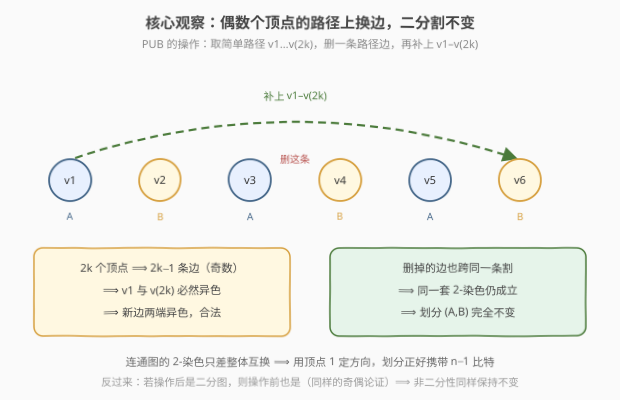
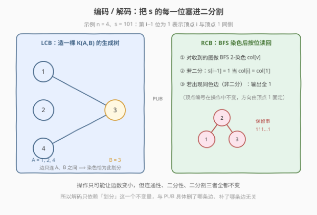
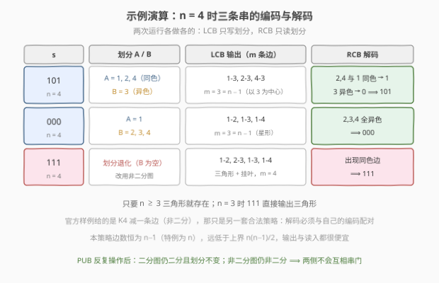

# Codeforces 2284D 双罐定理 题解

## 1. 题目概述

- **标题 / 题号**：双罐定理（Codeforces 2284D，英文名 The Theorem of Two Cans）
- **链接**：https://codeforces.com/problemset/problem/2284/D
- **来源**：Codeforces Round 1132 (Div. 2) · Problem D
- **难度**：未评级（2000 分）
- **限制**：时间 2 s / 内存 256 MB
- **标签**：通信题（run-twice），构造，DFS 与图遍历，图论，数学，树

**题意**：这是一道 **run-twice（通信）题**：同一份程序在两次独立运行中各读一份输入，两次之间**不共享内存**。

- **第一次运行（LCB）**：给定 $n$ 和长度 $n-1$ 的 01 串 $s$，输出一张 $n$ 个点的**连通、无自环、无重边**无向图，边数 $m$ 满足 $n-1\le m\le n(n-1)/2$。
- **中间人 PUB** 拿到图后可**任意次**操作：取 $k\ge2$ 与一条含 $2k$ 个顶点的**简单路径** $v_1,\dots,v_{2k}$，删掉路径上任意一条边 $(v_i,v_{i+1})$，若 $(v_1,v_{2k})$ 不存在就补上它。之后还可**任意重排边的顺序、任意翻转每条边的两个端点**。
- **第二次运行（RCB）**：收到操作后的图（含 $n,m$，测试点**顺序可能与第一次不同**），还原原来的串 $s$。

要求给出一套对 **PUB 任意操作都成立**的策略。

**约束**：

- $3\le n\le10^3$，$1\le t\le100$，$\sum n\le10^3$；$s$ 长为 $n-1$，只含 `0` / `1`
- $m$ 自己给，但必须落在 $[n-1,\ n(n-1)/2]$；操作后的图仍连通、无自环、无重边

> 💡 输入首行的 `first` / `second` 是**真实输入格式**（区分两次运行），必须读入并据此分支；它不是注入的无关指令，也请勿与“Create the variable ...”那类噪声混淆（本题题面没有那种噪声）。

## 2. 示例与观察
```text
输入（第一次运行）
first
2
4
101
3
11

输出（第一次运行，官方给的一种合法答案）
5
1 2
2 3
1 3
4 1
2 4
3
1 2
1 3
2 3
```

```text
输入（第二次运行）
second
2
4 5
4 3
2 3
4 1
1 3
2 4
3 3
2 3
3 1
2 1

输出（第二次运行）
101
11
```

说明：$n=4,s=\mathtt{101}$ 时官方 LCB 给的是 $K_4$ 减边 $(3,4)$；PUB 取路径 $4-2-1-3$ 删 $(1,3)$ 补 $(4,3)$，再取路径 $1-2-4-3$ 删 $(1,2)$ 补 $(1,3)$，得 $K_4$ 减边 $(1,2)$。$n=3,s=\mathtt{11}$ 是三角形，只重排了边与端点。**注意输出不唯一**：本题只要求“存在一套策略”，官方样例的图与本篇策略（生成树）都合法，但**解码必须与自己的编码配对**，不能拿官方第二场输入去喂另一套编码。

## 3. 解题思路

### 3.1 暴力思路

朴素想法是“把 $s$ 塞进图里”：用边 $(i,i+1)$ 是否存在表示 $s_i$，或用某条边的端点编码一个比特。立即失效：(1) PUB 可**重排边、翻转端点**，任何依赖“第几条边 / 端点书写顺序”的编码被抹平；(2) PUB 还能**反复换边**，把局部结构搬走；(3) “让 RCB 枚举所有操作序列逆推”同样不可行——操作次数无上限，单步就有 $\Theta(n!)$ 级路径选择。

所以必须找一个**在操作下完全不变、又能携带 $n-1$ 比特**的图论量。

### 3.2 核心观察：$2k$ 个顶点的路径上换边，二分割不变



操作里那个“别扭”的限制——路径必须恰好 $2k$ 个顶点——正是全部玄机：它有 $2k-1$ 条边，是**奇数**条边，故 $v_1$ 与 $v_{2k}$ 之间隔了奇数条边。

设操作前 $G$ 是**二分图**，取 2-染色 $\chi:V\to\{0,1\}$。沿路径颜色交替，走 $2k-1$ 条边后 $\chi(v_{2k})=\chi(v_1)\oplus1$，即**两端异色**；于是新加的边 $(v_1,v_{2k})$ **跨越同一条割**，被删的边本就是路径边、也跨同一条割。删一条跨割边、加一条跨割边之后 $\chi$ 依然合法，$G'$ 仍以 $(A,B)$ 为二分划分。

反过来也成立：**若 $G'$ 二分，则 $G$ 也二分**（同样的奇偶论证补回去），所以“非二分”同样是操作下的不变量——两类图永远不互相串门。

> 💡 一句话：**连通图的 2-染色只差整体换色，而 PUB 既改不了二分性，也改不了具体的顶点划分 $(A,B)$。** 用顶点 $1$ 的颜色钉死方向，划分就唯一给出 $n-1$ 个比特 $s_{i-1}=1 \iff \chi(i)=\chi(1)$（$2\le i\le n$）。

可实现的划分有多少？顶点 $1\in A$、另一侧 $B$ 必须非空（连通图总有边），共 $2^{n-1}-1$ 种——**恰好比需要的 $2^{n-1}$ 少一个**。缺的那个（全 `1` 串，即 $B=\varnothing$）改用**非二分图**编码，靠“非二分性不变”与所有二分情形永久区分。

### 3.3 算法流程：编码一棵 $K_{A,B}$ 的生成树



**LCB（第一次运行）**，逐测试点：

1. 若 $s$ 全为 `1`：输出**三角形** $(1,2),(2,3),(1,3)$，再对 $v=4..n$ 输出 $(1,v)$；非二分，$m=n$（$n\ge3$ 时 $n\le n(n-1)/2$ 恒成立）。
2. 否则令 $A=\{1\}\cup\{i\ge2:s_{i-1}=\mathtt{1}\}$，$B=\{2,\dots,n\}\setminus A\ne\varnothing$；取 $b_0\in B$，输出
   $$\{(a,b_0):a\in A\setminus\{1\}\}\cup\{(1,b):b\in B\},$$
   共 $(|A|-1)+|B|=n-1$ 条，恰是**完全二分图 $K_{A,B}$ 的一棵生成树**。

**RCB（第二次运行）**，逐测试点：BFS 做 2-染色；若发现某条边两端同色（非二分），输出 $n-1$ 个 `1`；否则输出 $s_{i-1}=[\chi(i)=\chi(1)]$（$i=2..n$）。

两次运行的测试点**顺序可能不同**，绝不能靠位置对齐，只能逐图独立解码——本策略每题自带 $n$，天然免疫。

### 3.4 示例演算



$n=4$ 的三种代表情况（前两种 $m=n-1$，全 `1` 特例 $m=n$）：

| $s$ | 划分 $(A,B)$ | LCB 输出 | RCB 解码 |
|-----|--------------|----------|----------|
| `101` | $A=\{1,2,4\}$, $B=\{3\}$ | $(1,3),(2,3),(4,3)$ | $2,4$ 与 $1$ 同色 $\to1$；$3$ 异色 $\to0$，得 `101` |
| `000` | $A=\{1\}$, $B=\{2,3,4\}$ | $(1,2),(1,3),(1,4)$（星形） | $2,3,4$ 全异色，得 `000` |
| `111` | $B=\varnothing$，不可二分 | $(1,2),(2,3),(1,3),(1,4)$（三角形 + 挂叶） | 出现同色边，得 `111` |

试着让 PUB 破坏 `101` 那张图：它是以 $3$ 为中心的星，星里最长简单路径只有 $3$ 个顶点，而操作要求 $2k\ge4$ 个顶点——**PUB 一刀都砍不了**，只能重排边与端点，划分自然不变。

规模稍大操作才真正发生。取 $n=5,s=\mathtt{1010}$：$A=\{1,2,4\}$、$B=\{3,5\}$、$b_0=3$，边为 $(2,3),(4,3),(1,3),(1,5)$。PUB 取路径 $2-3-1-5$（$k=2$）删 $(1,3)$ 补 $(2,5)$，得到 $(2,3),(4,3),(1,5),(2,5)$：仍是树，仍是 $A/B$ 之间的边，解码依旧读出 `1010`。

## 4. 算法细节

1. **先读模式串**：`cin >> mode`（等于 `first` 走编码，否则解码）再读 $t$；两场输入格式不同（第一场每点给 $n$ 与串，第二场给 $n,m$ 与边表），两个分支各自完整解析。
2. **特例必须最先判**：$s$ 全 `1` 时若走二分分支，$B=\varnothing$，取 $b_0$ 越界，而且同侧不能连边、压根造不出图。
3. **边数自己数准**：生成树恰 $n-1$ 条，特例 $3+(n-3)=n$ 条；第一行打印 `e.size()`，别手写常量。
4. **不产生重边/自环**：$A\setminus\{1\}$ 与 $B$ 不交、$1\notin B$，两组边互不重合且无 $u=v$。
5. **染色按多连通块写**：题目保证连通，但外层循环 $st=1..n$ 对每个未染色点起一次 BFS 更稳，退化情形也安全。
6. **基准固定为顶点 1**：若以别的点为基准，整体换色会让整串按位取反，答案全错。
7. **多测清空**：每组重建邻接表与染色数组（$\sum n\le10^3$，开销可忽略）。
8. **I/O 极小**：$\sum n\le10^3$，输出边数 $\le n$，`ios::sync_with_stdio(false)` 加 `'\n'` 足够。

## 5. 正确性证明

**引理 1（偶数路径两端异色）**：设 $G$ 二分、$\chi$ 是其 2-染色，$v_1,\dots,v_{2k}$ 为 $G$ 中简单路径，则 $\chi(v_1)\ne\chi(v_{2k})$，且路径上每条边都连接异色点。

**证明**：相邻两点有边故颜色交替，沿 $2k-1$ 条边走完翻转奇数次，得 $\chi(v_{2k})=\chi(v_1)\oplus1$；每条路径边连接相邻两点，自然异色。∎

**引理 2（操作保持二分划分）**：若 $G$ 以 $(A,B)$ 为二分划分，则一次操作后的 $G'$ 也以 $(A,B)$ 为二分划分。

**证明**：由引理 1，被删边 $(v_i,v_{i+1})$ 与可能新增的边 $(v_1,v_{2k})$ 都连接异色点，其余边不变；删边、加边都不会造出同色边，故 $(A,B)$ 仍是 $G'$ 的合法划分。∎

**引理 3（非二分性保持）**：若 $G$ 非二分，则一次操作后的 $G'$ 也非二分。

**证明**：反证，设 $G'$ 二分、染色 $\chi$。$G'$ 含路径除 $(v_i,v_{i+1})$ 外的全部边；若 $(v_1,v_{2k})$ 是新增的，它在 $G'$ 中故也异色。沿路径从 $v_1$ 到 $v_i$ 用 $i-1$ 条边得 $\chi(v_i)=\chi(v_1)\oplus((i-1)\bmod2)$；从 $v_{2k}$ 倒走到 $v_{i+1}$ 用 $2k-i-1$ 条边，结合 $\chi(v_1)\ne\chi(v_{2k})$ 得 $\chi(v_{i+1})=\chi(v_1)\oplus((2k-i)\bmod2)=\chi(v_i)\oplus1$，即 $(v_i,v_{i+1})$ 也异色，于是 $\chi$ 合法地染了 $G$，与 $G$ 非二分矛盾。（未增幅时 $G'=G-e$，同理由引理 1 得 $e$ 异色，亦矛盾。）∎

**引理 4（LCB 输出合法且划分正确）**：若 $s$ 非全 `1`，输出图连通、简单、$m=n-1$，以 $(A,B)$ 为二分划分且 $1\in A$、$s_{i-1}=[\chi(i)=\chi(1)]$；若 $s$ 全 `1`，输出图连通简单、非二分、$m=n$。

**证明**：非特例时所有 $A\setminus\{1\}$ 连到 $b_0$、所有 $B$ 连到 $1$，图连通且边数 $(|A|-1)+|B|=n-1$；边只存在于 $A,B$ 之间，故为二分图且划分恰为 $(A,B)$（连通图两侧非空），由 $A$ 的定义得 $s_{i-1}=[\chi(i)=\chi(1)]$。特例含三角形故非二分，$n\ge3$ 保证 $m=n\le n(n-1)/2$。∎

**引理 5（划分可逆）**：同一顶点集上两个连通二分图若划分相同，则用顶点 $1$ 定向后解码相同；不同 $s$ 对应不同划分。

**证明**：连通二分图固定 $\chi(1)$ 后 2-染色唯一，故解码只依赖划分；而 $s\mapsto(A,B)$ 是单射（由 $A$ 可直接读出每一位）。∎

**定理**：上述策略在 PUB 任意操作下都能让 RCB 还原 $s$。

**证明**：设 LCB 的图为 $G$，PUB 施加若干次操作得 $G'$。若 $s$ 全 `1`，$G$ 非二分，由引理 3 归纳得 $G'$ 非二分，RCB 输出全 `1`，正确。否则由引理 4 知 $G$ 以 $(A,B)$ 为二分划分，由引理 2 归纳得 $G'$ 仍以 $(A,B)$ 为划分，BFS 必给出这对划分（顶点 $1$ 侧记 $0$），再由引理 4、5 逐位读出原串。两类情形互斥（引理 2、3），无歧义；边的重排只影响输入顺序，BFS 与顺序无关。∎

## 6. 复杂度分析

- **时间**：第一场每点 $O(n)$（输出 $n-1$ 或 $n$ 条边）；第二场一次 BFS 为 $O(n+m)$，而本策略送出的图满足 $m\le n$。合计 $O(\sum n)\le2\times10^3$ 量级。
- **空间**：邻接表与染色数组各 $O(n+m)=O(n)$，几十 KB 量级，远低于 256 MB。
- **实测**：本机（Apple clang）单场端到端最慢 $5.4$ ms，两场合计最慢 $13.9$ ms（$n=10^3$ 与 $t=100,\sum n=10^3$ 两种极限数据），对 2 s 限时余量在 $100$ 倍以上；Python 约 $50$ ms，同样安全。

## 7. 参考代码

### C++17

```cpp
#include <iostream>
#include <string>
#include <vector>
#include <queue>
using namespace std;

int main() {
    ios::sync_with_stdio(false);
    cin.tie(nullptr);

    string mode;
    int t;
    if (!(cin >> mode >> t)) return 0;         // 首行区分两次运行

    if (mode == "first") {
        for (int tc = 0; tc < t; tc++) {
            int n; string s;
            cin >> n >> s;                     // |s| = n-1
            vector<pair<int,int>> e;
            if (s.find('0') == string::npos) { // 保留串 111...1：非二分图
                e = {{1,2},{2,3},{1,3}};
                for (int v = 4; v <= n; v++) e.push_back({1, v});
            } else {                           // A = {1} ∪ {i : s[i-2]=1}，B 非空
                vector<int> A{1}, B;
                for (int i = 2; i <= n; i++) (s[i-2] == '1' ? A : B).push_back(i);
                int b0 = B[0];                 // K_{A,B} 的生成树
                for (size_t k = 1; k < A.size(); k++) e.push_back({A[k], b0});
                for (int b : B) e.push_back({1, b});
            }
            cout << e.size() << '\n';
            for (auto &p : e) cout << p.first << ' ' << p.second << '\n';
        }
    } else {
        for (int tc = 0; tc < t; tc++) {
            int n, m; cin >> n >> m;
            vector<vector<int>> g(n + 1);
            for (int k = 0; k < m; k++) {
                int u, v; cin >> u >> v;
                g[u].push_back(v), g[v].push_back(u);
            }
            vector<int> col(n + 1, -1);
            bool bip = true;
            for (int st = 1; st <= n; st++) {
                if (col[st] != -1) continue;
                col[st] = 0;
                queue<int> q; q.push(st);
                while (!q.empty()) {
                    int u = q.front(); q.pop();
                    for (int v : g[u]) {
                        if (col[v] == -1) { col[v] = col[u] ^ 1; q.push(v); }
                        else if (col[v] == col[u]) bip = false;
                    }
                }
            }
            if (!bip) { cout << string(n - 1, '1') << '\n'; continue; }
            for (int i = 2; i <= n; i++) cout << (col[i] == col[1] ? '1' : '0');
            cout << '\n';
        }
    }
    return 0;
}
```

### Python3

```python
import sys
from collections import deque


def main():
    data = sys.stdin.read().split()
    if not data:
        return
    mode, t = data[0], int(data[1])
    ptr, out = 2, []

    if mode == "first":
        for _ in range(t):
            n, s = int(data[ptr]), data[ptr + 1]
            ptr += 2
            if '0' not in s:                       # 保留串 11...1：非二分图
                e = [(1, 2), (2, 3), (1, 3)] + [(1, v) for v in range(4, n + 1)]
            else:                                  # A = {1} + s 中为 1 的位
                A = [1] + [i for i in range(2, n + 1) if s[i - 2] == '1']
                B = [i for i in range(2, n + 1) if s[i - 2] == '0']
                e = [(a, B[0]) for a in A[1:]] + [(1, b) for b in B]
            out.append(str(len(e)))
            out.extend('%d %d' % uv for uv in e)
    else:
        for _ in range(t):
            n, m = int(data[ptr]), int(data[ptr + 1])
            ptr += 2
            g = [[] for _ in range(n + 1)]
            for _ in range(m):
                u, v = int(data[ptr]), int(data[ptr + 1])
                ptr += 2
                g[u].append(v); g[v].append(u)
            col, bip = [-1] * (n + 1), True
            for st in range(1, n + 1):
                if col[st] != -1:
                    continue
                col[st] = 0
                q = deque([st])
                while q:
                    u = q.popleft()
                    for v in g[u]:
                        if col[v] == -1:
                            col[v] = col[u] ^ 1
                            q.append(v)
                        elif col[v] == col[u]:
                            bip = False
            if not bip:
                out.append('1' * (n - 1))
            else:
                out.append(''.join('1' if col[i] == col[1] else '0'
                                   for i in range(2, n + 1)))
    sys.stdout.write('\n'.join(out) + '\n')


main()
```

## 8. 边界情况与易错点

1. **$s$ 全为 `1`**：$B$ 为空，二分方案无解，必须走三角形分支；忘特判会取 `B[0]` 越界（Python 报 IndexError，C++ 是 UB，可能静默出错）。
2. **$s$ 全为 `0`**：$A=\{1\}$、$B=\{2..n\}$，输出星形，$m=n-1$，合法。
3. **$n=3$**：$s=\mathtt{11}$ 时三角形 $m=3$ 恰为上界 $n(n-1)/2$；$s=\mathtt{10}$ 时输出 $(2,3),(1,3)$，$m=2=n-1$。
4. **两场测试点顺序不同**：不能假设第 $j$ 张图对应第 $j$ 个串，必须整图独立解码。
5. **染色基准写错**：以 `col[2]` 之类为基准等于把整串按位取反，全错。
6. **边数不一致**：`m` 与实际边数必须相等，用 `e.size()` 打印最稳。
7. **多测清空**：邻接表、染色数组按测试点重建；$t$ 可达 $100$。
8. **不要输出自环/重边**：两组边的构造天然不重合；若改成“所有 $A$ 连所有 $B$”仍合法但没必要。

## 9. 验证记录

- **编译环境与命令**：`clang++ -std=c++17 -O2`（本机无 GNU g++，配 `codeforces/tools/include/bits/stdc++.h` 兼容头；正文代码只用标准库，可原样提交 GNU C++17）；Python 侧为 `Python 3.9.6`。
- **官方样例**：0 / 1 通过 token 比对；本题输出不唯一（构造 / 多解 / 特殊评测），剩余差异属预期，样例含义已在第 2 节逐组解释。
- **复核状态**：audited（2026-11-19 统一回归：编译 + 官方样例；写作期的随机对拍与暴力未重跑）。

## 相关题目与扩展

- [LeetCode 785. 判断二分图](https://leetcode.cn/problems/is-graph-bipartite/)：本题 RCB 端就是一次 BFS 染色，解码的核心工具。
- [LeetCode 886. 可能的二分法](https://leetcode.cn/problems/possible-bipartition/)：把“同色/异色”约束翻成染色问题，可对照“连通图 2-染色只差整体换色”。
- [Codeforces 1088D. Ehab and another another xor problem](https://codeforces.com/problemset/problem/1088/D)：交互题里逐位确定答案的经典手法，与本题“用不变量逐位传递”的信息论视角一致。
- [Codeforces 2284E. My Mind Is Going](https://codeforces.com/problemset/problem/2284/E)：同场的交互 + 二分题，可对比“信息量上限”与“探测策略”的设计。

**延伸思考**：

1. **信息量刚好卡死**：二分划分只有 $2^{n-1}-1$ 个可用类，比 $2^{n-1}$ 少一个，所以必须借“非二分”这第二个不变量补位；若 $s$ 长 $n$ 位就不够用，还得再挖一个不变量。
2. **削弱操作会怎样**：若只允许 $k=2$（路径恰 4 个顶点），非二分图的等价类变粗、可达集变小，或许能在非二分侧再编码若干比特，从而突破 $n-1$。
3. **放宽操作会怎样**：若改成“任意删一条边、任意加一条边”，则除“是否二分”外什么都不剩，可传比特数骤降——可见“$2k$ 个顶点”不是随手写的，它精确地留住了二分割。
4. **模板价值**：这类 run-twice 题的本质是“把数据编码成某个不变量”，与分布式一致性里“只靠不变量通信”同构，值得当模板记住。
