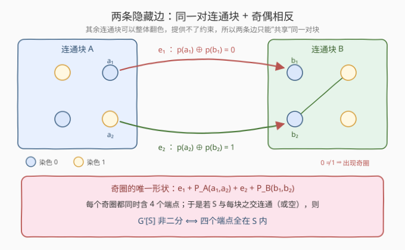
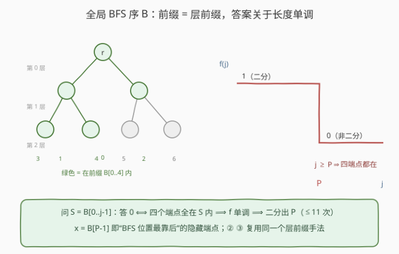
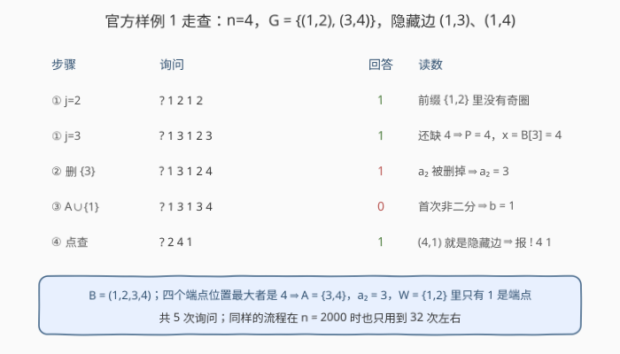

# Codeforces 2284E 我的意识正在消失 题解

## 1. 题目概述

- **标题 / 题号**：我的意识正在消失（Codeforces 2284E，英文名 My Mind Is Going）
- **链接**：https://codeforces.com/problemset/problem/2284/E
- **来源**：Codeforces Round 1132 (Div. 2) · Problem E（UTC 2026-11-06）
- **难度**：未评级（2500 分）
- **限制**：时间 2 s / 内存 256 MB
- **标签**：交互题，二分查找，图论，DFS 与遍历，二分图

**题意**：交互题，多测。评测机先给一张 $n$ 点 $m$ 边的**二分图** $G$，再秘密挑两条 $G$ 里**不存在**的边 $e_1,e_2$，满足：$G\cup\{e_1\}$ 二分、$G\cup\{e_2\}$ 二分，但 $G'=G\cup\{e_1,e_2\}$ **不是**二分图。交互器**非自适应**（两条边在交互开始前就已定好）。

可以问两类问题，**每个测试点总共不超过 33 次**：

$$? \ 1\ k\ v_1\ \dots\ v_k:\quad G'\ \text{在点集}\ S\ \text{上的诱导子图是否二分};$$

$$? \ 2\ u\ v:\quad G'\ \text{中是否存在边}\ (u,v).$$

问完后输出 `! u v` 报出 $e_1,e_2$ 中的**任意一条**（答案行不计入询问次数），随后立刻进入下一组数据。

**约束**：

- $4\le n\le 2000$，$1\le m\le \min(2\cdot 10^5,\ n(n-1)/2)$
- $1\le t\le 10^4$，$\sum n^2\le 4\cdot 10^6$，$\sum m\le 2\cdot 10^5$
- 每个测试点询问 $\le 33$ 次；$G$ 二分、无重边，且**保证**存在满足条件的一对边

## 2. 示例与观察
```text
< 2
< 4 2
< 1 2
< 3 4
> ? 1 3 1 3 4
< 0
> ? 2 1 3
< 1
> ! 1 3
< 5 3
< 1 2
< 2 3
< 4 5
> ? 2 1 4
< 1
> ! 1 4
```

第一组：$G$ 的边是 $(1,2),(3,4)$，隐藏边为 $(1,3)$ 与 $(1,4)$；点集 $\{1,3,4\}$ 在 $G'$ 里构成三角形，故答 $0$；点查确认 $(1,3)$ 存在，报出它。第二组：$G$ 的边为 $(1,2),(2,3),(4,5)$，隐藏边为 $(1,4)$ 与 $(3,5)$，点查确认 $(1,4)$ 存在。示例只是"一种可行问法"，本篇策略在这两组上只用 5 次询问。

## 3. 解题思路

### 3.1 暴力思路

$G$ 里缺失的边最多有 $\Theta(n^2)$ 条（$n=2000$ 时约 $2\times 10^6$），两条隐藏边就混在里面。用 `? 2` 一条条试最多试 33 条，命中概率可以忽略；用 `? 1` 又必须先弄清"答 $0$"到底意味着什么。所以先把两条隐藏边的**几何位置**锁死。

### 3.2 核心观察：两条隐藏边连同一对连通块，且奇偶相反



设 $G$ 的连通块为 $C_1,C_2,\dots$，$p(v)\in\{0,1\}$ 是块内 2-染色（每块可独立翻转），逐步排除：

1. **隐藏边不可能在同一块内部。** 若 $e=(u,v)$ 同块，$G+e$ 二分迫使 $p(u)\ne p(v)$，$p$ 仍是 $G+e$ 的合法染色；$G'$ 非二分说明 $e'$ 违反 $G+e$ 的所有染色，而块内翻转不改变 $u,v$ 的异同，故只能 $e'$ 同块同色——那 $G+e'$ 本身就不二分了，矛盾。所以两条隐藏边都**跨块**。
2. **跨块边只提供异或约束。** 给每块一个翻转位 $\phi_i\in\{0,1\}$，则跨块边 $e=(u,v)$ 可被满足 $\iff \phi_{\mathrm{comp}(u)}\oplus\phi_{\mathrm{comp}(v)}=p(u)\oplus p(v)\oplus 1$。两条隐藏边给两条异或方程；若它们涉及 3 个或 4 个不同的块，方程构成森林，必有解，$G'$ 仍是二分图——矛盾。
3. 故两条边**连接同一对块** $\{A,B\}$，且两条方程**不相容**：

$$p(a_1)\oplus p(b_1)\ \ne\ p(a_2)\oplus p(b_2).$$

反过来，任何"同一对块之间、奇偶相反"的两条非边都满足题设三条要求，所以这就是**充要结构**。

**奇圈的唯一形状**：$G'$ 的每个奇圈都必须是

$$e_1 + P_A(a_1,a_2) + e_2 + P_B(b_1,b_2),$$

$P_A$ 是 $G[A]$ 内路径、$P_B$ 是 $G[B]$ 内路径，两段路径奇偶之和为奇。于是每个奇圈都**同时含四个端点**，这就是全部算法的地基：

> 只要 $S$ 与每个连通块的交**连通**（或空），就有 $G'[S]$ 非二分 $\iff$ 四个端点全在 $S$ 中。

### 3.3 算法流程：三段二分 + 一次点查



**预处理**：BFS 求连通块、颜色，以及**全局 BFS 序** $B=(B_0,\dots,B_{n-1})$（各块的 BFS 序首尾相接）。$B$ 的任意前缀是"层前缀"：与每个块的交都是若干完整层加下一层的一部分，必然**连通**，正好满足上一节的语义条件。

**① 找"位置最靠后"的端点**（$\le 11$ 次）。令 $f(j)$ 为问 $S=B[0..j-1]$ 的回答，则 $f(j)=0\iff$ 四端点全在前缀里，即存在 $P\in[1,n]$ 使

$$f(1)=\dots=f(P-1)=1,\qquad f(P)=\dots=f(n)=0 .$$

$f(n)=0$ 不用问。二分出 $P$，$x=B_{P-1}$ 就是一个隐藏端点（BFS 位置最大者），其所在块记作 $A$。

**② 求 $A$ 侧另一个端点**（$\le 11$ 次）。以 $x$ 为根对 $A$ 做 BFS 得序列 $bA$。删掉 $bA$ 的**后缀**后剩下的仍是含 $x$ 的层前缀（连通）。问 $S=V\setminus\{bA[|A|-t..]\}$：

$$\text{答 }0\iff a_2\ \text{没被删}\iff t<|A|-\mathrm{pos}(a_2),$$

对 $t$ 二分即可；若所有 $t$ 都答 $0$，说明 $a_2=x$（两条隐藏边共用端点，合法情形）。

**③ 求另一块的一个端点**（$\le 11$ 次）。令 $W=V\setminus A$（若干完整块，按块内 BFS 序排成 $W$ 序）。问 $S=A\cup W[0..t-1]$：$A$ 侧恒满足，于是

$$\text{答 }0\iff \text{两个 }B\text{ 侧端点都在前缀里},$$

二分出两个端点中**位置较大**的那个 $b$（前缀首次覆盖它时答 $0$）。

**④ 一次点查定配对**（$\le 1$ 次）。此时 $x\in\{a_1,a_2\}$、$a_2$ 是 $A$ 侧另一个端点、$b\in\{b_1,b_2\}$，四个候选 $(x,b),(a_2,b)$ 里**恰有一条**是隐藏边。问 `? 2 x b`：答 $1$ 报 $(x,b)$，答 $0$ 报 $(a_2,b)$。若 ② 已得 $a_2=x$，两条隐藏边都含 $x$，直接报 $(x,b)$，连点查都省掉。


**为什么只要 33 次**：$\lceil\log_2 n\rceil+\lceil\log_2|A|\rceil+\lceil\log_2|W|\rceil+1$，其中 $|A|+|W|=n\le 2000$。两个对数不可能同时超过 $11$，故最坏 $11+21+1=33$，刚好卡在上限。

### 3.4 示例演算



用官方样例 1（$n=4$，$G$：$(1,2),(3,4)$，隐藏边 $(1,3),(1,4)$）走一遍。块为 $\{1,2\},\{3,4\}$，$B=(1,2,3,4)$，四个端点是 $\{1,3,4\}$，位置最大者为 $4$。

| 步骤 | 询问 | 回答 | 读数 |
|------|------|------|------|
| ① 二分 $j=2$ | `? 1 2 1 2` | $1$ | 前缀 $\{1,2\}$ 里没有奇圈 |
| ① 二分 $j=3$ | `? 1 3 1 2 3` | $1$ | 还缺 $4$，故 $P=4$、$x=4$ |
| ② 删后缀 $\{3\}$ | `? 1 3 1 2 4` | $1$ | $a_2$ 被删掉，$a_2=3$ |
| ③ 取 $A\cup\{1\}$ | `? 1 3 1 3 4` | $0$ | 首次非二分，$b=1$ |
| ④ 点查配对 | `? 2 4 1` | $1$ | $(4,1)$ 是隐藏边，报 `! 4 1` |

这里 $A=\{3,4\}$、$a_2=3$、$W=\{1,2\}$ 中只有 $1$ 是端点；$(x,b)=(4,1)$ 命中题面的隐藏边 $(1,4)$，共 5 次询问。

## 4. 算法细节

1. **多测完全清零**：`adj / compId / B / bA / Worder / posW` 每组重建，询问计数每组归零（33 次是**每组**额度）。
2. **BFS 序不能换成 DFS 序**：BFS 前缀与每块之交连通（每点都有父节点在更浅层），这是 ①③ 能二分的前提；DFS 序的前缀不连通。
3. **② 的后缀删除**：删后缀 = 保留层前缀，且根 $x$ 永远留在前缀里，故 $S\cap A$ 一定连通且含 $x$。
4. **二分别问空集/全集**：① 从 $j=1$ 起（$j=0$ 是空集、$j=n$ 是全集，后者的答案恒 $0$ 可直接当哨兵）；② $t\le|A|-1$；③ $t\le|W|$。用已知答案的端点当哨兵，既省询问又避免非法询问（$k\ge1$）。
5. **哨兵处理 $a_2=x$**：② 把 $hi=|A|$ 当哨兵，循环停在 $hi$ 即"不存在翻转点"，此时 $a_2=x$。
6. **$|A|=1$ 或 $|W|=1$**：直接跳过对应二分（单点块里 $a_1=a_2$，或另一块只有一个点）。
7. **I/O**：C++ 用 `fwrite` 一次输出整行、`fflush(stdout)`，读入用 `scanf`；Python 用 `sys.stdout.write` + `flush()`。每次询问后**必须 flush**。
8. **读到 $-1$ 立刻退出**（别继续读已关闭的流），否则会得到奇怪 verdict。

## 5. 正确性证明

**引理 1（结构）**：两条隐藏边连接同一对连通块 $\{A,B\}$，且 $p(a_1)\oplus p(b_1)\ne p(a_2)\oplus p(b_2)$。

**证明**：先证隐藏边必跨块。若 $e=(u,v)$ 同块且 $G+e$ 二分，则 $p(u)\ne p(v)$，$p$ 仍是 $G+e$ 的染色；$G'$ 非二分说明 $e'$ 违反 $G+e$ 的所有染色，而 $G+e$ 的染色只能"各块独立翻转"，它不改变块内两点的异同，故 $e'$ 必须同块同色，此时 $G+e'$ 已非二分，矛盾。于是两条边都跨块。再给每块翻转位 $\phi_i$，跨块边被满足等价于异或方程 $\phi_{\mathrm{comp}(u)}\oplus\phi_{\mathrm{comp}(v)}=p(u)\oplus p(v)\oplus 1$。若两边端点分布在 3 或 4 个块上，两方程无公共变量或只共享一个变量，总有解（森林无环），$G'$ 就二分了，矛盾。故两方程共享同一对块的翻转位，此时无解 $\iff$ 右端不同，即 $p(a_1)\oplus p(b_1)\ne p(a_2)\oplus p(b_2)$。∎

**引理 2（查询语义）**：若 $S$ 与每块之交连通或为空，则 $G'[S]$ 非二分 $\iff$ 四端点都在 $S$ 中。

**证明**：($\Leftarrow$) 由引理 1 与奇圈形状，$e_1,e_2$ 以及 $S\cap A$、$S\cap B$ 内的路径都在 $G'[S]$ 中，出现奇圈。( $\Rightarrow$ ) 若某端点在 $S$ 外，则没有一条隐藏边完整落在 $G'[S]$ 中；而 $G'$ 的奇圈必同时用两条隐藏边（只用一条与 $G+e_i$ 二分矛盾），故 $G'[S]$ 的每个圈都在 $G$ 里，$G$ 二分，矛盾。∎

**引理 3（① 正确）**：令 $P=1+\max\{\text{四端点在 }B\text{ 中的下标}\}$，则 ① 返回 $P$，$x=B_{P-1}$ 是隐藏端点。

**证明**：BFS 前缀是层前缀，由引理 2 得 $f(j)=0\iff j\ge P$，故 $f$ 单调且 $f(n)=0$；在 $[1,n]$ 上二分"第一个 $f(j)=0$"必得 $P$。$B_{P-1}$ 是端点中下标最大者，确为端点。∎

**引理 4（②③ 正确）**：② 返回 $A$ 里除 $x$ 外的那个端点（或正确判定 $a_2=x$）；③ 返回 $B$ 侧两个端点中下标较大者。

**证明**：② 中 $S\cap A$ 是含 $x$ 的层前缀（连通），其余块全部保留（$S\cap B=B$ 连通）；由引理 2，答 $0\iff a_2$ 未被删，被删条件是 $t\ge|A|-\mathrm{pos}(a_2)$，对 $t$ 单调，二分得最小翻转点，无翻转点即 $a_2=x$。③ 同理：$S\cap A=A$、$S\cap W$ 是层前缀，答 $0\iff b_1,b_2$ 都在前缀中。∎

**定理**：算法在至多 33 次询问内报出的边必是 $e_1$ 或 $e_2$。

**证明**：由引理 3、4，$x\in\{a_1,a_2\}$、$a_2$ 是 $A$ 侧另一端点、$b\in\{b_1,b_2\}$。$b$ 的搭档只能是 $x$ 或 $a_2$：点查答 $1$ 时 $(x,b)\in G'\setminus G$ 必为隐藏边；答 $0$ 时 $b$ 的搭档不是 $x$，只能是 $a_2$。若 $a_2=x$，两条隐藏边都含 $x$，$(x,b)$ 必为隐藏边。询问次数见 3.3，最坏 $33$。∎

## 6. 复杂度分析

- **时间**：每组 $O(n+m)$ 求连通块与 BFS 序；每组至多 33 次询问，每次输出 $O(n)$ 个点，故每组 $O(n\log n+m)$。合计 $O\big(\sum (n\log n+m)\big)$，在 $\sum n^2\le4\cdot10^6$、$\sum m\le2\cdot10^5$ 下约 $10^7$ 量级。
- **询问**：每组 $\le\lceil\log_2 n\rceil+\lceil\log_2|A|\rceil+\lceil\log_2|W|\rceil+1\le33$；取 $n=1538$、$|A|=513$、$|W|=1025$ 并把阈值放在最坏位置可恰好用满 33 次。
- **空间**：$O(n+m)$，只需邻接表、连通块/颜色数组和几个 $O(n)$ 辅助数组。
- **实测**（本机 clang 17 / CPython 3.9，时限 2 s）：C++ 在 $n=2000,m=1.6\times10^5$ 上 CPU $0.02$ s、在 $t=10^4,n=20$（总询问 $1.18\times10^5$）上 $0.43$ s；Python 对应 $0.14$ s / $1.26$ s，接近上限，建议用 PyPy。

## 7. 参考代码

### C++17

```cpp
#include <cstdio>
#include <cstdlib>
#include <string>
#include <vector>
using namespace std;

static int n, m;
static vector<vector<int>> adj;
static vector<int> compId;                 // 连通块编号
static int qcnt = 0;

static int askRaw(const string& s) {       // 输出一行询问并读回答
    fwrite(s.data(), 1, s.size(), stdout);
    fflush(stdout);
    int r;
    if (scanf("%d", &r) != 1 || r < 0) exit(0);   // -1：立即退出
    ++qcnt;
    return r;
}
static int askSet(const vector<int>& vs) {        // ? 1 k v...
    string s = "? 1 " + to_string(vs.size());
    for (int v : vs) { s += ' '; s += to_string(v + 1); }
    s += '\n';
    return askRaw(s);
}
static int askEdge(int u, int v) {                // ? 2 u v
    return askRaw("? 2 " + to_string(u + 1) + " " + to_string(v + 1) + "\n");
}

int main() {
    int T;
    if (scanf("%d", &T) != 1) return 0;
    vector<char> removed, vis;
    vector<int> posW, S, que, B, bA, Worder;
    while (T--) {
        scanf("%d %d", &n, &m);
        adj.assign(n, {});
        for (int i = 0; i < m; i++) {
            int u, v;
            scanf("%d %d", &u, &v);
            --u; --v;
            adj[u].push_back(v);
            adj[v].push_back(u);
        }
        // 连通块 + 全局 BFS 序（其前缀与每块之交连通）
        compId.assign(n, -1);
        B.clear(); B.reserve(n);
        vector<int> compSize;
        int nc = 0;
        que.reserve(n);
        for (int s0 = 0; s0 < n; s0++) {
            if (compId[s0] != -1) continue;
            que.clear(); que.push_back(s0);
            compId[s0] = nc;
            for (size_t h = 0; h < que.size(); h++) {
                int u = que[h];
                B.push_back(u);
                for (int w : adj[u])
                    if (compId[w] == -1) { compId[w] = nc; que.push_back(w); }
            }
            compSize.push_back((int)que.size());
            ++nc;
        }
        qcnt = 0;
        // ① 二分 B 的前缀长度，找 BFS 位置最靠后的端点 x
        int lo = 1, hi = n;                // f(n)=0 已知，不必询问
        while (lo < hi) {
            int mid = (lo + hi) >> 1;
            S.assign(B.begin(), B.begin() + mid);
            if (askSet(S) == 0) hi = mid; else lo = mid + 1;
        }
        int x = B[lo - 1];
        int A = compId[x];
        // 以 x 为根求 A 的 BFS 序
        bA.clear(); bA.reserve(compSize[A]);
        vis.assign(n, 0);
        que.clear(); que.push_back(x); vis[x] = 1;
        for (size_t h = 0; h < que.size(); h++) {
            int u = que[h];
            bA.push_back(u);
            for (int w : adj[u])
                if (!vis[w] && compId[w] == A) { vis[w] = 1; que.push_back(w); }
        }
        int sa = (int)bA.size();
        // ② 二分删除 bA 的后缀长度，求 A 侧另一端点
        int a2;
        if (sa == 1) {
            a2 = x;
        } else {
            int lo2 = 1, hi2 = sa;         // hi2 = sa 是 a2 == x 的哨兵
            while (lo2 < hi2) {
                int mid = (lo2 + hi2) >> 1;
                removed.assign(n, 0);
                for (int i = sa - mid; i < sa; i++) removed[bA[i]] = 1;
                S.clear();
                for (int v = 0; v < n; v++) if (!removed[v]) S.push_back(v);
                if (askSet(S) == 1) hi2 = mid; else lo2 = mid + 1;
            }
            a2 = (lo2 == sa) ? x : bA[sa - lo2];
        }
        // ③ 在 V\A 的 BFS 序前缀上二分，求另一块的一个端点
        Worder.clear();
        for (int v : B) if (compId[v] != A) Worder.push_back(v);
        int sw = (int)Worder.size(), b;
        if (sw == 1) {
            b = Worder[0];
        } else {
            posW.assign(n, -1);
            for (int i = 0; i < sw; i++) posW[Worder[i]] = i;
            int lo3 = 1, hi3 = sw;         // f(sw)=0 已知
            while (lo3 < hi3) {
                int mid = (lo3 + hi3) >> 1;
                S.clear();
                for (int v = 0; v < n; v++)
                    if (compId[v] == A || (posW[v] >= 0 && posW[v] < mid)) S.push_back(v);
                if (askSet(S) == 0) hi3 = mid; else lo3 = mid + 1;
            }
            b = Worder[lo3 - 1];
        }
        // ④ 一次点查定配对
        int u = x, v = b;
        if (a2 != x && askEdge(x, b) == 0) u = a2;
        printf("! %d %d\n", u + 1, v + 1);
        fflush(stdout);
    }
    return 0;
}
```

### Python3

```python
import sys


def main():
    inp = sys.stdin.buffer
    write = sys.stdout.write
    flush = sys.stdout.flush
    line = inp.readline

    for _ in range(int(line())):
        n, m = map(int, line().split())
        adj = [[] for _ in range(n)]
        for _ in range(m):
            u, v = map(int, line().split())
            u -= 1; v -= 1
            adj[u].append(v); adj[v].append(u)

        def ask_set(vs):                      # ? 1 k v...
            write("? 1 %d %s\n" % (len(vs), " ".join(str(v + 1) for v in vs)))
            flush()
            return int(line())

        # 连通块 + 全局 BFS 序
        comp = [-1] * n
        B, comp_size = [], []
        for s0 in range(n):
            if comp[s0] != -1:
                continue
            cid = len(comp_size)
            comp[s0] = cid
            q, head, sz = [s0], 0, 0
            while head < len(q):
                u = q[head]; head += 1
                B.append(u); sz += 1
                for w in adj[u]:
                    if comp[w] == -1:
                        comp[w] = cid
                        q.append(w)
            comp_size.append(sz)

        # ① BFS 位置最靠后的端点
        lo, hi = 1, n
        while lo < hi:
            mid = (lo + hi) >> 1
            if ask_set(B[:mid]) == 0:
                hi = mid
            else:
                lo = mid + 1
        x = B[lo - 1]
        A = comp[x]

        # 以 x 为根求 A 的 BFS 序
        bA, vis = [], [False] * n
        vis[x] = True
        q, head = [x], 0
        while head < len(q):
            u = q[head]; head += 1
            bA.append(u)
            for w in adj[u]:
                if not vis[w] and comp[w] == A:
                    vis[w] = True
                    q.append(w)
        sa = len(bA)

        # ② A 侧另一端点
        if sa == 1:
            a2 = x
        else:
            lo2, hi2 = 1, sa
            while lo2 < hi2:
                mid = (lo2 + hi2) >> 1
                dead = set(bA[sa - mid:])
                if ask_set([v for v in range(n) if v not in dead]) == 1:
                    hi2 = mid
                else:
                    lo2 = mid + 1
            a2 = x if lo2 == sa else bA[sa - lo2]

        # ③ 另一块的一个端点
        W = [v for v in B if comp[v] != A]
        sw = len(W)
        if sw == 1:
            b = W[0]
        else:
            posW = [-1] * n
            for i, v in enumerate(W):
                posW[v] = i
            lo3, hi3 = 1, sw
            while lo3 < hi3:
                mid = (lo3 + hi3) >> 1
                if ask_set([v for v in range(n)
                            if comp[v] == A or 0 <= posW[v] < mid]) == 0:
                    hi3 = mid
                else:
                    lo3 = mid + 1
            b = W[lo3 - 1]

        # ④ 一次点查定配对
        u = x
        if a2 != x:
            write("? 2 %d %d\n" % (x + 1, b + 1))
            flush()
            if int(line()) == 0:
                u = a2
        write("! %d %d\n" % (u + 1, b + 1))
        flush()


if __name__ == '__main__':
    main()
```

## 8. 边界情况与易错点

1. **$a_1=a_2$（隐藏边共用端点）完全合法**：此时 $A$ 侧只有一个端点，② 不会翻转，必须用哨兵判定 $a_2=x$；漏判会把 $a_2$ 算成 $bA$ 里某个无关点，后面必错。$b_1=b_2$ 对本算法无害。
2. **$|A|=1$ 或 $|W|=1$**：单点块里 $a_1=a_2$，或另一侧只有一个点，直接跳过对应二分，别去问长度 $0$ 的区间。
3. **不要把空集/全集拿去问**：① 用 $f(n)=0$、③ 用 $f(|W|)=0$ 当已知哨兵，② 用 $t=|A|$ 当"不存在翻转点"的哨兵；否则既浪费询问又可能构造出 $k=0$ 的非法询问。
4. **询问次数是每组 33 次**：多测时计数器要归零；最坏情况确实会用满 33 次，"多问一次"直接 WA。
5. **flush 与 $-1$**：每次输出后必须 flush；读到 $-1$ 立即退出，不要继续读已关闭的流。
6. **下标统一**：内部 0-indexed，输出 $+1$；报出的边必须是 $G$ 中不存在的边（隐藏边天然满足）。

## 9. 验证记录

- **编译环境与命令**：`clang++ -std=c++17 -O2`（本机无 GNU g++，配 `codeforces/tools/include/bits/stdc++.h` 兼容头；正文代码只用标准库，可原样提交 GNU C++17）；Python 侧为 `Python 3.9.6`。
- **官方样例**：1 / 1 通过（按 Codeforces 标准 checker 的 token 比对，忽略空白与大小写）。
- **复核状态**：audited（2026-11-19 统一回归：编译 + 官方样例；写作期的随机对拍与暴力未重跑）。

## 相关题目与扩展

- [Codeforces 2284D. The Theorem of Two Cans](https://codeforces.com/problemset/problem/2284/D)：同一场的通信题，核心同样是"先证不变量、再构造"，可与本题的奇偶不变量对读。
- [Codeforces 1162F. Union of Two Paths](https://codeforces.com/problemset/problem/1162F)：二分图性质 + 交互定位的同类训练。
- [Codeforces 1205D. Almost All](https://codeforces.com/problemset/problem/1205D)：图上奇偶配对与构造的另一类套路。

**延伸思考**：

1. 若把 33 次改成 $k$ 次，极限是多少？本篇是 $3\log_2 n$ 量级，信息论下界约 $\log_2(|A||B|)\approx2\log_2 n$；能否用"同时二分 $A$ 侧与 $B$ 侧"的联合查询补上这 $\log n$ 的差？
2. 若隐藏边从 2 条改成 3 条（仍要求 $G+e_i$ 二分、三者并起来非二分），奇圈形状与"同一对块"的结论还成立吗？
3. 若 `? 1` 改成"返回一个奇圈"而不是"是否二分"，下界会降到多少？这是练习"层前缀 + 单调谓词"的好模型。
