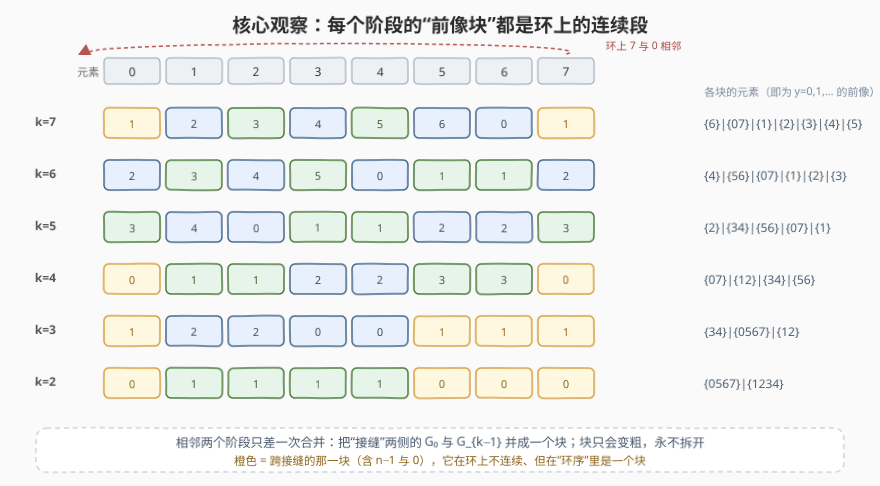
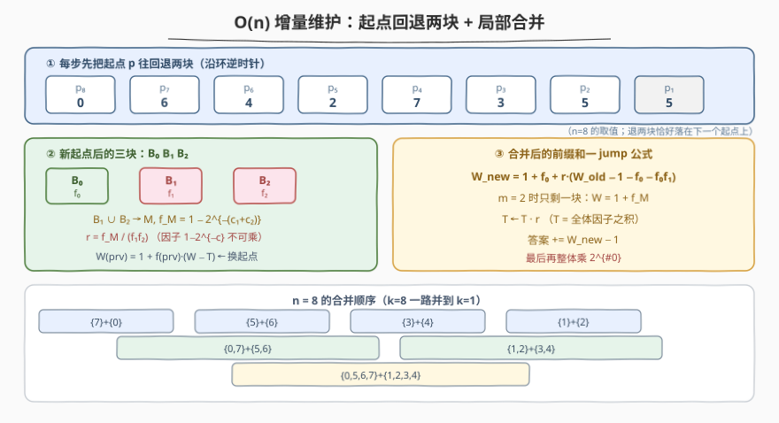
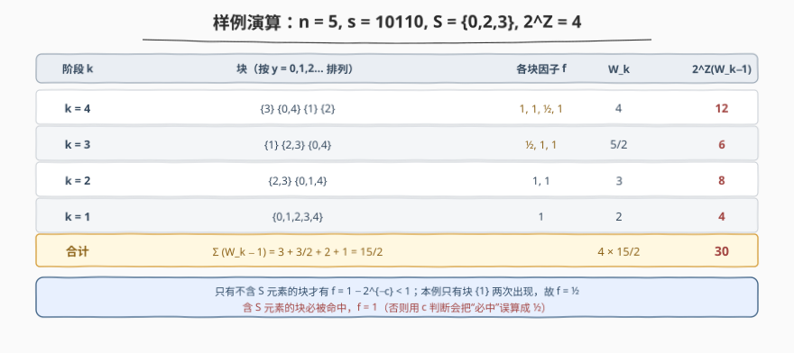

# Codeforces 2284F 快乐时光 题解

## 1. 题目概述

- **标题 / 题号**：快乐时光（Codeforces 2284F，英文名 Fun Times）
- **链接**：https://codeforces.com/problemset/problem/2284/F
- **来源**：Codeforces Round 1132 (Div. 2) · Problem F
- **难度**：未评级（2750 分）
- **限制**：时间 2 s / 内存 256 MB
- **标签**：组合数学、数据结构、DP、数学、矩阵

**题意**：给定 $n$ 与集合 $\mathcal S\subseteq\{0,\dots,n-1\}$（长度 $n$ 的 01 串 $s$，$s_i=1\iff i\in\mathcal S$）。对集合 $\mathcal A$ 做 $n-1$ 步变换：第 $i$ 步（$1\le i\le n-1$）把当前每个元素 $x$ 同时替换为 $(x+1)\bmod(n-i)$，替换后去重；记第 $i$ 步后为 $\mathcal A_i$，定义

$$f(\mathcal A)=\sum_{i=1}^{n-1}\operatorname{mex}(\mathcal A_i).$$

求所有超集 $\mathcal S\subseteq\mathcal S'\subseteq\{0,\dots,n-1\}$ 的 $f(\mathcal S')$ 之和，模 $10^9+7$。

**约束**：

- $1\le t\le 10^4$，$1\le n\le 5\cdot10^5$，$\sum n\le 5\cdot10^5$；
- 超集个数为 $2^{Z}$（$Z$ 是 `0` 的个数，可达 $5\cdot10^5$），必须做到 $O(n)$ 或 $O(n\log n)$；
- 时间 2 s，内存 256 MB。

> 💡 题面 Input 一节把 $n$ 写成 "the length of the string"，是模板残留笔误；本题 $n$ 即集合大小，也等于串长。

## 2. 示例

```text
输入
4
5
10110
3
000
9
101010101
6
000111

输出
30
14
306
78
```

第 1 组 $n=5$、$\mathcal S=\{0,2,3\}$、$Z=2$，4 个超集的 $f$ 为 $5,10,5,10$，和 $30$；第 2 组 $\mathcal S=\varnothing$，答案 $14$。

**自造示例**（最小非平凡情形）：

```text
输入
1
2
00

输出
3
```

$n=2$ 只有一步 $x\mapsto(x+1)\bmod 1=0$：非空集合都变成 $\{0\}$、$\operatorname{mex}=1$，空集 $\operatorname{mex}=0$，4 个超集里 3 个非空，和为 $3$。

## 3. 解题思路

### 3.1 暴力思路

枚举 $2^{Z}$ 个超集、每个模拟 $n-1$ 步、每步扫 $n$ 个元素，复杂度 $O(2^{Z}n^{2})$；连单个集合的 $f$ 都要 $O(n^{2})$。$Z$ 可达 $5\cdot10^5$，此路不通——必须同时拆掉"逐超集"和"逐阶段"两层循环。

### 3.2 核心观察：每一阶段的前像都是环上的连续段

记 $F_k(x)$ 为 $x$ 走完 $i=n-k$ 步后的值（$k$ 是当前值域大小），则 $F_n(x)=x$ 且

$$F_{k-1}(x)=\bigl(F_k(x)+1\bigr)\bmod(k-1).$$

因 $F_k(x)\in[0,k-1]$，一步就是"全体 $+1$，唯独顶上的 $k-1$ 折回 $1$（不是 $0$）"。这给出极强的结构。



**引理 1（块结构）**：$G^{(k)}_y=F_k^{-1}(y)$（$y=0..k-1$）把 $\{0..n-1\}$ 划分为 $k$ 块；按 $y$ 递增排列，它们是环 $0\to1\to\cdots\to n-1\to0$ 上一段接一段的连续弧，且一步只把"接缝"两侧的 $G^{(k)}_0$ 与 $G^{(k)}_{k-1}$ 并成一块。

图中 $n=8$ 的六行是 $k=7,6,5,4,3,2$ 的划分（格内数字是块下标 $y$，颜色只区分奇偶）：块只变粗、从不拆开，跨接缝的那块（橙色，含 $7$ 与 $0$）在环上首尾相连。

**引理 2（mex 的块刻画）**：$\operatorname{mex}\bigl(F_k(\mathcal S')\bigr)=\min\{y:G^{(k)}_y\cap\mathcal S'=\varnothing\}$（全被命中时取 $k$）。于是 $\operatorname{mex}=\sum_{j\ge1}[\text{前 }j\text{ 块都被命中}]$，"求 mex"变成"数命中前缀长度"。

### 3.3 算法流程：超集线性化 + 两条 $O(1)$ 递推

设 $Z$ 为自由元素个数，对块 $B$ 定义

$$f_B=\begin{cases}1,& B\cap\mathcal S\neq\varnothing\\ 1-2^{-|B\setminus\mathcal S|},&\text{否则}\end{cases}$$

即"随机超集（每个自由元素独立以 $1/2$ 加入）命中 $B$"的概率。

**引理 3（超集求和）**：令 $W_k=\sum_{j=0}^{k}\prod_{y<j}f_{G^{(k)}_y}$（空积为 $1$），则 $\sum_{\mathcal S'}\operatorname{mex}\bigl(F_k(\mathcal S')\bigr)=2^{Z}(W_k-1)$，故

$$\text{ans}=2^{Z}\sum_{k=1}^{n-1}\bigl(W_k-1\bigr).$$

原因是块间自由元素互不相交、硬币独立，"前缀全命中"的概率就是各块概率之积。

剩下的难点是 $W_k$ 有 $k+1$ 项、$k$ 从 $n-1$ 到 $1$，朴素算 $O(n^{2})$。但相邻两阶段只差一次合并，且**起点只回退两块**。



**引理 4（换起点）**：设当前 $m$ 块，$T=\prod f$ 为全体因子之积，$b'$ 是块起点 $b$ 的后继，则 $W(b)=1+f_{B(b)}\bigl(W(b')-T\bigr)$，于是挪起点 $O(1)$。

**引理 5（合并跳变）**：从起点 $s$ 出发的块依次为 $B_0,B_1,B_2,\dots$，把 $B_1,B_2$ 并为 $M$，令 $r=f_M/(f_1f_2)$，则 $m\ge3$ 时

$$W^{(m-1)}(s)=1+f_0+r\bigl(W^{(m)}(s)-1-f_0-f_0f_1\bigr),$$

$m=2$ 时只剩一块，直接 $W^{(1)}(s)=1+f_M$。**注意 $f_M=1-2^{-(c_1+c_2)}\ne f_1f_2$**，合并必须用比值 $r$ 修正。

**起点为何只回退两块**：由引理 1 的证明，新起点是 $G^{(k)}_{k-2}$ 的起点，而 $G^{(k)}_{k-1}$ 的起点是旧起点往回一块、$G^{(k)}_{k-2}$ 再往回一块；并且被合并的 $G^{(k)}_{k-1},G^{(k)}_0$ 恰好位于新起点的第 $1,2$ 号位置，正合引理 5。用循环双链表维护块、$O(1)$ 更新 $W,T$，共 $n-1$ 个阶段。

### 3.4 示例演算

样例 1（$n=5$，$s=10110$，$\mathcal S=\{0,2,3\}$，$Z=2$）逐阶段结果：



$k=4$ 时块为 $\{3\},\{0,4\},\{1\},\{2\}$，因子 $1,1,\tfrac12,1$，$W=4$，贡献 $2^{2}\cdot3=12$；$k=3$ 为 $\{1\},\{2,3\},\{0,4\}$，$W=\tfrac52$，贡献 $6$；$k=2$ 为 $\{2,3\},\{0,1,4\}$，$W=3$，贡献 $8$；$k=1$ 整块，$W=2$，贡献 $4$。合计 $30$ ✓。只有不含 $\mathcal S$ 元素的块 $\{1\}$ 才出现 $f=\tfrac12$，其余块必被命中、$f=1$。

## 4. 算法细节

1. **全局预处理**：$2^{-c}$、$(1-2^{-c})^{-1}$、$2^{c}$ 各一张表，做到读入后的最大 $n$，多测共用；逆元用"一次前缀积 + 一次快速幂"批量求逆，$O(\max n)$。
2. **因子永不为零**：$f_B$ 只可能是 $1$ 或 $1-2^{-c}$（$c\ge1$，且 $c\le5\cdot10^5$ 远小于 $2$ 在模 $p$ 下的阶），故可逆，除法安全。
3. **起点回退**：两次 `st=prv[st]; W=1+f[st]*(W-T)`；$m=2$ 时 `prv[prv(t)]=t` 绕回自身，公式仍成立。
4. **`hasS` 与 $c$ 分开维护**：合并时 `hasS` 取或、$c$ 取和；$f$ 只看 `hasS`，$c$ 只用于 $1-2^{-c}$。混成一个量是最常见的错解来源。
5. **$m=2$ 单独处理**：最后并的是跨接缝的 $B_1\cup B_0$（起点保持 $st$），照抄 $m\ge3$ 分支会漏项。
6. **负值取模**：$W-T$、$W-1-f_0-f_0f_1$ 常为负，需 `(x%MOD+MOD)%MOD`。
7. **数组复用**：`nxt/prv/f/c/has/finv` 都是长 $n$ 的全局数组，只重写前 $n$ 位；$\sum n$ 有界，总代价线性。

## 5. 正确性证明

**引理 1**：$G^{(k-1)}_0=G^{(k)}_{k-2}$，$G^{(k-1)}_1=G^{(k)}_0\cup G^{(k)}_{k-1}$，$G^{(k-1)}_y=G^{(k)}_{y-1}$（$2\le y\le k-2$）。
**证明**：$k=n$ 时全为单点集，按 $y$ 递增即环序。归纳：由 $F_{k-1}=(F_k+1)\bmod(k-1)$ 及 $F_k\in[0,k-1]$ 得 $F_k=k-1\Rightarrow F_{k-1}=1$、$F_k=k-2\Rightarrow F_{k-1}=0$、其余 $v\mapsto v+1$，即上式；新次序 $G^{(k)}_{k-2},(G^{(k)}_0\cup G^{(k)}_{k-1}),G^{(k)}_1,\dots$ 中 $G^{(k)}_{k-1}$ 与 $G^{(k)}_0$ 环上相邻，故仍是连续弧。∎

**推论**：若 $p_k$ 是 $G^{(k)}_0$ 的起点，则 $p_{k-1}$ 在 $p_k$ 逆时针两块处，且从 $p_{k-1}$ 看 $B_0=G^{(k)}_{k-2}$、$B_1=G^{(k)}_{k-1}$、$B_2=G^{(k)}_0$，被合并的正是 $B_1,B_2$。∎

**引理 2**：$\operatorname{mex}(F_k(\mathcal S'))=\min\{y:G^{(k)}_y\cap\mathcal S'=\varnothing\}\le k$。
**证明**：$y\in F_k(\mathcal S')\iff F_k^{-1}(y)\cap\mathcal S'\ne\varnothing\iff G^{(k)}_y\cap\mathcal S'\ne\varnothing$；mex 是第一个缺席值，值域只有 $0..k-1$，全命中时 mex $=k$。∎

**引理 3**：$\sum_{\mathcal S'}\operatorname{mex}(F_k(\mathcal S'))=2^{Z}(W_k-1)$。
**证明**：由引理 2 展开指示变量，$\operatorname{mex}=\sum_{j=1}^{k}\mathbf 1[\text{前 }j\text{ 块全命中}]$；块间自由元素不交，$\Pr[\text{前 }j\text{ 块全命中}]=\prod_{y<j}f_{G^{(k)}_y}$。$2^{Z}$ 个超集上每个自由元素独立等概率，求和即 $2^{Z}$ 乘概率，加上 $j=0$ 的空项得 $W_k-1$。∎

**引理 4**：$W(b)=1+f_{B(b)}(W(b')-T)$。
**证明**：设从 $b$ 出发的块为 $C_0..C_{m-1}$，$P_j=\prod_{i<j}f_{C_i}$，$W(b)=\sum_{j=0}^{m}P_j$，且 $C_m=C_0$，则 $f_0W(b')=\sum_{j=0}^{m}f_0\cdots f_j=\bigl(\sum_{j=0}^{m-1}f_0\cdots f_j\bigr)+Tf_0=(W(b)-1)+Tf_0$，整理即得。∎

**引理 5**：$m\ge3$ 时 $W^{(m-1)}(s)=1+f_0+r(W^{(m)}(s)-1-f_0-f_0f_1)$，$r=f_M/(f_1f_2)$。
**证明**：合并后新序列 $B_0,M,B_3,\dots,B_{m-1}$ 的第 $j$ 项前缀积（$j\ge2$）为 $f_0f_M\prod_{l=3}^{j}f_l=rP^{old}_{j+1}$，故 $W^{(m-1)}=1+f_0+r\sum_{i=3}^{m}P^{old}_i$；而 $W^{(m)}=1+f_0+f_0f_1+\sum_{i=3}^{m}P^{old}_i$，代入即得；$m=2$ 时只剩一块 $M$，$W=1+f_M$。∎

**定理**：上述 $O(n)$ 流程输出题目所求答案。
**证明**：初始化给出 $k=n$ 的单点划分与正确的 $W^{(n)}(0),T$。第 $r$ 轮开始时维护的是 $m=n-r+1$ 块的划分、当前起点 $p_m$ 及正确的 $W^{(m)}(p_m),T$；两步 `prv` 由推论交出 $p_{m-1}$，每步用引理 4 更新 $W$，再用引理 5 得到合并后划分在 $p_{m-1}$ 处的值 $W_{m-1}$，随后按引理 1 合并并更新 $T$，不变式成立。循环累加 $\sum_{k=1}^{n-1}(W_k-1)$ 后乘 $2^{Z}$，由引理 3 即答案。∎

## 6. 复杂度分析

- **时间**：预处理 $O(\max n)$（含一次快速幂）；每测初始化 $O(n)$、主循环 $n-1$ 轮、每轮常数次模运算，即 $O(n)$。总 $O(\max n+\sum n)=O(5\cdot10^5)$，实测最坏 $0.09$ s，对 2 s 时限有 20 倍以上余量。
- **空间**：8 个长度 $O(\max n)$ 的数组（含批量求逆的临时表），约 27 MB，远低于 256 MB。
- **本质**：$W$ 的换起点与合并都是 $W\mapsto aW+b$ 的仿射变换，故可 $O(1)$ 传递（呼应"矩阵"标签）。

## 7. 参考代码

### C++17

```cpp
#include <iostream>
#include <string>
using namespace std;
typedef long long ll;
const ll MOD = 1000000007LL;
const int MAXN = 500005;

ll ipw2[MAXN + 2], invom[MAXN + 2];        // 2^{-c} and (1-2^{-c})^{-1}
int nxt_[MAXN], prv_[MAXN], c_[MAXN];
ll f_[MAXN], finv_[MAXN];
bool hs_[MAXN];                            // block meets S ?

ll pw(ll b, ll e) { ll r = 1; for (b %= MOD; e; e >>= 1, b = b * b % MOD) if (e & 1) r = r * b % MOD; return r; }
ll fac(bool h, int c) { return h ? 1 : (1 - ipw2[c] + MOD) % MOD; }

int main() {
    ios::sync_with_stdio(false); cin.tie(nullptr);
    const ll ihalf = (MOD + 1) / 2;
    ipw2[0] = 1;
    for (int i = 1; i <= MAXN + 1; i++) ipw2[i] = ipw2[i - 1] * ihalf % MOD;
    {   // batch inversion of 1 - 2^{-c}
        static ll pre[MAXN + 1];
        pre[0] = 1;
        for (int i = 1; i <= MAXN; i++) pre[i] = pre[i - 1] * ((1 - ipw2[i] + MOD) % MOD) % MOD;
        ll all = pw(pre[MAXN], MOD - 2);
        for (int i = MAXN; i >= 1; i--) {
            invom[i] = all * pre[i - 1] % MOD;
            all = all * ((1 - ipw2[i] + MOD) % MOD) % MOD;
        }
    }
    int t; cin >> t; string s;
    while (t--) {
        int n; cin >> n >> s;
        int zeros = 0;
        for (int i = 0; i < n; i++) {
            hs_[i] = (s[i] == '1'); c_[i] = hs_[i] ? 0 : 1; zeros += !hs_[i];
            f_[i] = fac(hs_[i], c_[i]); finv_[i] = hs_[i] ? 1 : invom[c_[i]];
            nxt_[i] = (i + 1 == n ? 0 : i + 1); prv_[i] = (i == 0 ? n - 1 : i - 1);
        }
        ll W = 1, T = 1;                     // W: prefix-product sum, T: product of all f
        for (int i = 0, b = 0; i < n; i++) { T = T * f_[b] % MOD; W = (W + T) % MOD; b = nxt_[b]; }
        ll total = 0; int st = 0;
        for (int m = n; m >= 2; m--) {       // current partition has m blocks
            st = prv_[st]; W = (1 + f_[st] * ((W - T) % MOD + MOD)) % MOD;   // retreat start
            st = prv_[st]; W = (1 + f_[st] * ((W - T) % MOD + MOD)) % MOD;
            int X = nxt_[st], Y = (m >= 3 ? nxt_[X] : st);                   // blocks to merge
            ll f0 = f_[st], f1 = f_[X];
            int cM = c_[X] + c_[Y]; bool hM = hs_[X] || hs_[Y];
            ll fM = fac(hM, cM);
            if (m >= 3) {
                ll r = fM * finv_[X] % MOD * finv_[Y] % MOD;
                ll inner = ((W - 1 - f0 - f0 * f1 % MOD) % MOD + MOD) % MOD;
                W = (1 + f0 + r * inner % MOD) % MOD;
                T = T * r % MOD;
                nxt_[X] = nxt_[Y]; prv_[nxt_[Y]] = X;
            } else {
                W = (1 + fM) % MOD; T = fM;
                int nx = nxt_[X]; nxt_[st] = nx; prv_[nx] = st; X = st;
            }
            total = (total + W - 1 + MOD) % MOD;
            c_[X] = cM; hs_[X] = hM; f_[X] = fM; finv_[X] = hM ? 1 : invom[cM];
        }
        cout << total % MOD * pw(2, zeros) % MOD << "\n";
    }
    return 0;
}
```

### Python3

线性同解，实测 $n=5\cdot10^5$ 单测约 1.1 s、$10^4$ 组小测约 0.7 s，2 s 内可过（PyPy 更快；CPython 判题机偏慢时建议用 C++）。

```python
import sys

MOD = 10**9 + 7
INV2 = (MOD + 1) // 2


def main():
    data = sys.stdin.buffer.read().split()
    t = int(data[0])
    tests, maxn = [], 1
    p = 1
    for _ in range(t):
        n = int(data[p]); s = data[p + 1].decode(); p += 2
        tests.append((n, s)); maxn = max(maxn, n)

    ipw2 = [1] * (maxn + 2)                       # 2^{-c}
    for i in range(1, maxn + 2):
        ipw2[i] = ipw2[i - 1] * INV2 % MOD
    invom = [1] * (maxn + 1)                      # (1 - 2^{-c})^{-1}
    pre = [1] * (maxn + 1)
    for i in range(1, maxn + 1):
        pre[i] = pre[i - 1] * ((1 - ipw2[i]) % MOD) % MOD
    allinv = pow(pre[maxn], MOD - 2, MOD)
    for i in range(maxn, 0, -1):
        invom[i] = allinv * pre[i - 1] % MOD
        allinv = allinv * ((1 - ipw2[i]) % MOD) % MOD
    pw2 = [1] * (maxn + 1)
    for i in range(1, maxn + 1):
        pw2[i] = pw2[i - 1] * 2 % MOD

    out = []
    for n, s in tests:
        c = [0] * n; hs = [False] * n; f = [0] * n; finv = [0] * n
        nxt = [0] * n; prv = [0] * n
        zeros = 0
        for i in range(n):
            hs[i] = (s[i] == '1'); c[i] = 0 if hs[i] else 1; zeros += not hs[i]
            f[i] = 1 if hs[i] else (1 - INV2) % MOD
            finv[i] = 1 if hs[i] else 2
            nxt[i] = i + 1 if i + 1 < n else 0
            prv[i] = i - 1 if i > 0 else n - 1
        W = 1; T = 1; b = 0
        for _ in range(n):
            T = T * f[b] % MOD; W = (W + T) % MOD; b = nxt[b]
        total = 0; st = 0
        for m in range(n, 1, -1):
            st = prv[st]; W = (1 + f[st] * ((W - T) % MOD)) % MOD
            st = prv[st]; W = (1 + f[st] * ((W - T) % MOD)) % MOD
            X = nxt[st]; Y = nxt[X] if m >= 3 else st
            f0 = f[st]; f1 = f[X]
            cM = c[X] + c[Y]; hM = hs[X] or hs[Y]
            fM = 1 if hM else (1 - ipw2[cM]) % MOD
            if m >= 3:
                r = fM * finv[X] % MOD * finv[Y] % MOD
                W = (1 + f0 + r * (W - 1 - f0 - f0 * f1)) % MOD
                T = T * r % MOD
                nxt[X] = nxt[Y]; prv[nxt[Y]] = X
            else:
                W = (1 + fM) % MOD; T = fM
                nx = nxt[X]; nxt[st] = nx; prv[nx] = st; X = st
            total = (total + W - 1) % MOD
            c[X] = cM; hs[X] = hM; f[X] = fM
            finv[X] = 1 if hM else invom[cM]
        out.append(str(total % MOD * pw2[zeros] % MOD))
    sys.stdout.write('\n'.join(out) + '\n')


main()
```

## 8. 边界情况与易错点

1. **$n=1$**：没有阶段，答案恒 $0$；主循环 `for m=n..2` 不执行，别去访问空链表。
2. **$\mathcal S$ 为全集**（$s$ 全 `1`）：唯一超集，答案应为 $\sum_{i=1}^{n-1}\operatorname{mex}=n(n-1)/2$；此时 $f\equiv1$、$W_k=k+1$，自动吻合（$n=5\cdot10^5$ 验得 $999749132$）。
3. **$\mathcal S$ 为空**：$Z=n$，每块 $f=1-2^{-|B|}$，答案乘 $2^{n}$；用预处理幂，别在循环里反复算。
4. **$f=1$ 的判据**：只看"块与 $\mathcal S$ 有交"，不能看 $c=0$。样例 1 的 $k=1$ 阶段整块含 $\mathcal S$ 元素但 $c=2\ne0$，若按 $c$ 判会得到 $23$ 而不是 $30$。
5. **$m=2$ 的最后一次合并**：合并的是跨接缝的 $B_1\cup B_0$；若照抄 $m\ge3$ 分支，$n=2,s=00$ 会输出 $2$ 而非 $3$（$n=6$ 全 `0` 时是 $412$ 而非 $427$）。样例 1 恰好两块的因子都是 $1$，会把这个错误掩盖掉。
6. **负值取模**：$W-T$、$W-1-f_0-f_0f_1$ 常为负，C++ 直接 `%` 会留下负数。
7. **多测清空**：只重置前 $n$ 项；若每测 `memset` 整张 `MAXN` 数组，$10^4$ 组会退化成 $10^4\times5\cdot10^5$。

## 相关题目与扩展

- [Codeforces 1436E Complicated Computations](https://codeforces.com/problemset/problem/1436/E)：区间 mex 的可取值集合，与"mex = 第一个缺席值"同源。
- [Codeforces 940F Machine Learning](https://codeforces.com/problemset/problem/940/F)：带修区间 mex，展示 mex 类问题的数据结构侧写法。
- [洛谷 P4137 Rmq Problem / mex](https://www.luogu.com.cn/problem/P4137)：区间 mex 模板，适合对照两种视角。
- [LeetCode 1863 找出所有子集的异或总和再求和](https://leetcode.cn/problems/sum-of-all-subset-xor-totals/)：对全体子集求和的线性化，与本题"超集求和 → 乘 $2^{Z}$ 再算概率"同一思想。

**延伸思考**：

1. 若把每步模数从 $n-i$ 换成任意严格递减序列，引理 1 的"只合并相邻两块"仍成立，但"起点只回退两块"会失效；本解法的 $O(n)$ 恰好依赖这一局部性。
2. 若求 $\sum f(\mathcal S')^{2}$，$W$ 需升级为"和 + 平方和"二元组，每步仍是常数矩阵变换（正对"矩阵"标签）。
3. 若 $n$ 到 $10^7$ 且 $t$ 很小，可整体通分：所有 $f$ 形如 $\frac{2^{c}-1}{2^{c}}$，$r$ 的除法退化为指数加减，无需逆元表。
4. 若要一次回答"所有 $\mathcal S$"，可按每个块的 $c$ 做直方图统计，再用卷积把 $O(n)$ 阶段合并成一次多项式运算。
