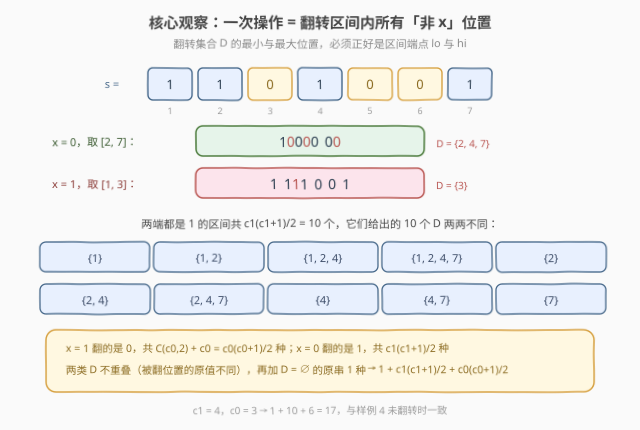
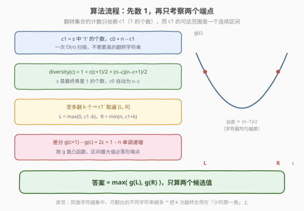
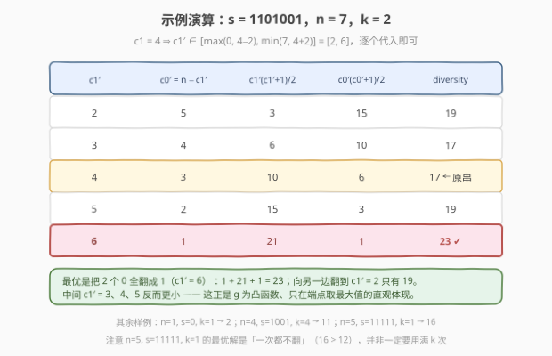

# Codeforces 2285B 多样化字符串 题解

## 1. 题目概述

- **标题 / 题号**：多样化字符串（Codeforces 2285B，英文名 Diverse String）
- **链接**：https://codeforces.com/problemset/problem/2285/B
- **来源**：Codeforces Round 1135 (Div. 2) · Problem B
- **难度**：未评级（1250 分）
- **限制**：时间 1.5 s / 内存 256 MB
- **标签**：组合计数、数学、字符串

**题意**：给定一个 01 串 $s$，定义它的**多样性** $\text{div}(s)$ 为：最多执行一次下面这个操作，能得到多少个**互不相同**的 01 串——任选 $x \in \{0,1\}$ 与 $1 \le l \le r \le n$，把 $s_l, s_{l+1}, \dots, s_r$ 全部赋值为 $x$。

注意三点：

1. 「最多一次」包含「零次」，所以原串 $s$ 本身一定被算进去；
2. 题面原文举的例子是 `10` 的多样性为 $3$（`10`、`11`、`00`），可用来校验对定义的理解；
3. 不同操作只要得到同一个串，只算一次。

现在你最多可以**翻转**（`0` 变 `1`、`1` 变 `0`）$s$ 中的 $k$ 个字符，问翻转后字符串的多样性最大能是多少。多测：$t$ 组数据，每组给定 $n, k$ 与长度为 $n$ 的 01 串，对每组输出一行答案。

**约束**：

- $1 \le t \le 10^4$
- $1 \le n \le 2 \times 10^5$，$0 \le k \le n$
- $\sum n \le 3 \times 10^5$
- $s$ 只含 `0` 与 `1`

$t$ 很大而 $\sum n$ 不大，说明**每组只能是 $O(n)$**，且必须把「枚举翻转方案」彻底消灭掉。

## 2. 示例

```text
输入
4
1 1
0
4 4
1001
5 1
11111
7 2
1101001

输出
2
11
16
23
```

**逐组说明**：

- 第 1 组：$n=1$，把 `0` 翻成 `1`，`0` 与 `1` 各算一种，答案 $2$。
- 第 2 组：$n=4$，$k=4$ 可以把 `1001` 全翻成 `1111`，此时 $c_1=4,\ c_0=0$，答案 $1 + 10 + 0 = 11$。
- 第 3 组：$n=5$，$s$ 已是 `11111`，$k=1$ 反而**不该用**：不翻得 $1 + 15 = 16$，翻一个得 $1 + 10 + 1 = 12$，故答案 $16$。
- 第 4 组：$s = 1101001$ 中 $c_1 = 4,\ c_0 = 3$；用 $2$ 次翻转把两个 `0` 变 `1` 得 $c_1 = 6$，答案 $1 + 21 + 1 = 23$。

## 3. 解题思路

### 3.1 暴力思路

先想「怎么算一个给定串的多样性」：枚举 $x \in \{0,1\}$ 与所有 $O(n^2)$ 个区间，把结果串（长度 $n$）塞进哈希集合，复杂度 $O(n^3)$。

再想「怎么最大化」：枚举翻转哪些字符，共 $\sum_{j \le k} \binom{n}{j}$ 种方案，每种再跑一遍上面的流程。两层指数/平方叠加，$n = 2\times10^5$ 时完全不可行。

真正的瓶颈在于：我们一直在**比较字符串**，而没有刻画「操作到底改变了哪些位置」。

### 3.2 核心观察：用「差异集合」给结果串去重



把结果串 $t$ 与 $s$ 的**差异集合**记为 $D = \{i : t_i \ne s_i\}$。因为一次操作只是把一段区间赋成常数 $x$，所以

$$D = \{\, i \in [l, r] : s_i \ne x \,\}$$

也就是说：$D$ 恰好是区间 $[l,r]$ 内**所有值不等于 $x$** 的位置。而 $t$ 与 $D$ 是一一对应的（$t_i = s_i$ 当且仅当 $i \notin D$），于是问题从「数不同的串」变成「数不同的集合 $D$」。

固定 $x$，把所有取值 $1-x$ 的位置按从小到大排成 $p_1 < p_2 < \dots < p_c$（$c$ 就是 $1-x$ 的出现次数）。任何一次操作给出的 $D$ 都是**下标连续的一段** $D = \{p_a, p_{a+1}, \dots, p_b\}$；反之，任取 $a \le b$ 并用区间 $[p_a, p_b]$ 就能实现它。同时 $a$ 与 $b$ 又由 $\min D$、$\max D$ 在该有序表中的下标唯一确定，所以不同的 $(a,b)$ 给出不同的 $D$。因此

$$\#\{\text{固定 } x \text{ 的非空 } D\} = \binom{c}{2} + c = \frac{c(c+1)}{2}$$

最后只剩两类之间的去重：$x=0$ 时 $D \subseteq \{i : s_i = 1\}$，$x=1$ 时 $D \subseteq \{i : s_i = 0\}$，两个非空集合族**天然不相交**；再加上 $D = \varnothing$ 的原串 $1$ 个，就得到闭式

$$\text{div}(s) = 1 + \frac{c_1(c_1+1)}{2} + \frac{c_0(c_0+1)}{2}, \qquad c_1 + c_0 = n$$

其中 $c_1, c_0$ 分别是 `1`、`0` 的个数。**多样性只与字符计数有关，与它们的排列顺序无关**——这是本题最关键的「降维」。

### 3.3 算法流程：从计数公式到只看两个端点



翻转 $j$ 个字符时，每翻一个 `0` 让 $c_1$ 加一，每翻一个 `1` 让 $c_1$ 减一。由于「至多 $k$ 次」而不是「恰好 $k$ 次」，最终串里 `1` 的个数 $c_1'$ 可以取遍

$$c_1' \in [\,L,\ R\,], \qquad L = \max(0,\ c_1 - k),\quad R = \min(n,\ c_1 + k)$$

把 $g(c) = 1 + \frac{c(c+1)}{2} + \frac{(n-c)(n-c+1)}{2}$ 看作关于 $c$ 的函数，相邻差分

$$g(c+1) - g(c) = (c+1) - (n-c) = 2c + 1 - n$$

随 $c$ 单调递增，所以 $g$ 是**离散凸函数**（先降后升，谷底在 $c \approx (n-1)/2$）。凸函数在闭区间上的最大值必在端点取得，于是

$$\text{answer} = \max\bigl(g(L),\ g(R)\bigr)$$

整个算法只有三步：扫一遍数 `1` → 算出 $L, R$ → 取两个候选值的较大者。**既不用真的翻转字符串，也不用枚举 $c_1'$。**

### 3.4 示例演算



以第 4 组 $s = 1101001$（$n=7$，$k=2$，$c_1 = 4$）为例，$c_1' \in [2, 6]$：

| $c_1'$ | $c_0' = 7 - c_1'$ | $c_1'(c_1'+1)/2$ | $c_0'(c_0'+1)/2$ | diversity |
|--------|-------------------|------------------|------------------|-----------|
| 2 | 5 | 3 | 15 | 19 |
| 3 | 4 | 6 | 10 | 17 |
| 4 | 3 | 10 | 6 | 17 |
| 5 | 2 | 15 | 3 | 19 |
| 6 | 1 | 21 | 1 | **23** |

中段（$c_1' = 3,4,5$）明显更低，两端更高，正好印证凸性；最大值为 $23$，与官方输出一致。再核对第 1 组（$c_1' \in [0,1]$ 均为 $2$）与第 3 组（$g(4)=12 < g(5)=16$，最优解是**一次都不翻**），公式全部吻合。

## 4. 算法细节

1. **只统计 $c_1$**：`count(s.begin(), s.end(), '1')` 或 `s.count('1')` 即可，不需要构造翻转后的串，也不需要前缀和。字符串的具体排布完全不影响答案。
2. **必须用 64 位**：$n = 2\times10^5$ 时 $g$ 的最大值约为 $\frac{n^2}{2} \approx 2\times10^{10}$，超出 `int`（约 $2.1\times10^9$）。C++ 中 $c_1, L, R, k$ 全部用 `long long`；Python 的大整数天然安全。
3. **端点要做 clamp**：$L = \max(0, c_1-k)$ 可能为负（$c_1 < k$），$R = \min(n, c_1+k)$ 可能超过 $n$。漏掉 clamp 会让公式算出无意义的值。
4. **不要假设「用满 $k$ 次」**：第 3 组样例就是反例（$k=1$ 时最优是不翻）。因为 $L \le c_1 \le R$，`max(g(L), g(R))` 自动把「零次翻转」纳入候选，无需额外分支。
5. **组合数的写法**：写成 `c * (c + 1) / 2`，不要写成 `(c + 1) / 2 * c`（后者在 $c$ 为偶数时会先做整除而丢精度）。$c(c+1)$ 一定是偶数，先乘后除永远安全。
6. **多测清空**：所有量（$c_1, L, R$）都在每组内部重新计算，没有跨组的全局状态，不需要 `memset`。总复杂度 $O(\sum n) \le 3\times10^5$。
7. **I/O 开销**：$t \le 10^4$ 且总字符数 $3\times10^5$，C++ 用 `ios::sync_with_stdio(false)` 即可；Python 必须用 `sys.stdin.buffer.read().split()` 一次性读完，逐行 `input()` 在 $10^4$ 组时容易超时。
8. **对称性检查**：$g(c) = g(n-c)$，所以「把 $k$ 次全用于把 `0` 变 `1`」和「全用于把 `1` 变 `0`」只需比较 $c_1+k$ 与 $c_1-k$ 两个方向的端点，这也是 `max(g(L), g(R))` 的由来。

## 5. 正确性证明

**引理 1（差异集合的形态）**：固定 $x$，设取值 $1-x$ 的位置依次为 $p_1 < p_2 < \dots < p_c$。则一次 $(x,[l,r])$ 操作给出的差异集合恰为某个下标连续段 $\{p_a, \dots, p_b\}$（允许为空，当 $a > b$）。

**证明**：由定义 $D = \{i \in [l,r] : s_i \ne x\} = \{i \in [l,r] : s_i = 1-x\}$。把 $[l,r]$ 内所有取值 $1-x$ 的位置按序取出，它们在全局有序表 $p_1 < \dots < p_c$ 中必然占据连续的一段下标，故 $D = \{p_a, \dots, p_b\}$。∎

**引理 2（段与集合一一对应）**：固定 $x$，非空差异集合与二元组 $(a,b)$（$1 \le a \le b \le c$）一一对应，因此固定 $x$ 的非空差异集合个数为 $\frac{c(c+1)}{2}$。

**证明**：引理 1 已说明每个 $(a,b)$ 都可由区间 $[p_a, p_b]$ 实现，故映射 $(a,b) \mapsto D$ 是满射。若 $(a,b) \ne (a',b')$，不妨设 $a \ne a'$，则 $\min D$ 在两种情形下分别是 $p_a$ 与 $p_{a'}$，由于 $p$ 严格递增，$p_a \ne p_{a'}$，故 $D \ne D'$，映射是单射。于是它是一一对应，二元组个数为 $\binom{c}{2} + c = \frac{c(c+1)}{2}$。∎

**引理 3（两类互不重复）**：$x = 0$ 产生的非空差异集合与 $x = 1$ 产生的非空差异集合不相交；并且它们都不等于原串。

**证明**：$x=0$ 时 $D \subseteq \{i : s_i = 1\}$，$x=1$ 时 $D \subseteq \{i : s_i = 0\}$，两个集合族中的元素都非空且分属互不相交的「原值为 1」「原值为 0」位置集合，故不可能相等。非空 $D$ 意味着至少有一位被改写，故结果串不同于 $s$。∎

**引理 4（可达的 $c_1'$）**：翻转至多 $k$ 个字符后，最终串中 `1` 的个数 $c_1'$ 取遍且仅取遍 $[\max(0, c_1-k),\ \min(n, c_1+k)]$ 中的整数。

**证明**：每次翻转只改变一个字符，$c_1'$ 与 $c_1$ 之差的绝对值不超过翻转次数，故 $|c_1' - c_1| \le k$，又 $0 \le c_1' \le n$，必要性得证。充分性：若 $c_1' > c_1$ 且 $c_1' - c_1 = j \le k$，由于 $c_1' \le n$，串中至少有 $j$ 个 `0`，把它们全部翻成 `1` 即可（$j$ 次翻转）；$c_1' < c_1$ 时对称地把 $c_1 - c_1'$ 个 `1` 翻成 `0`。∎

**定理**：$\text{div}(s) = 1 + \frac{c_1(c_1+1)}{2} + \frac{c_0(c_0+1)}{2}$；且在至多 $k$ 次翻转下，答案等于 $\max(g(L), g(R))$。

**证明**：多样性 = 原串 $1$ 个（对应 $D = \varnothing$，被引理 3 排除在两类之外）+ $x=1$ 的非空差异集合数（此时 $c = c_0$）+ $x=0$ 的非空差异集合数（此时 $c = c_1$）。由引理 2 与引理 3，三者互不重复且已穷尽所有操作结果，故第一个等式成立。

由引理 4，所有可达的 $c_1'$ 构成区间 $[L,R]$；由第一个等式，答案即 $\max_{c \in [L,R]} g(c)$。由 $g(c+1)-g(c) = 2c+1-n$ 单调递增知 $g$ 是离散凸函数：对任意 $L < c < R$，有 $g(c) \le \max(g(L), g(R))$（凸函数在区间内部不超过端点最大值），故区间最大值在 $L$ 或 $R$ 处取得。∎

## 6. 复杂度分析

- **时间**：每组 $O(n)$ 扫描统计 `1` 的个数，之后 $O(1)$ 算出两个候选值。总计 $O(\sum n) \le 3\times10^5$ 次字符访问，与 $t$ 的大小无关（$t$ 只带来常数级的读写开销）。实测最大数据（$t = 10^4$，$\sum n = 3\times10^5$）：C++ 约 $0.04$ s，Python 约 $0.04$ s，相对 $1.5$ s 的时限余量超过 $30$ 倍。
- **空间**：只存当前这组的字符串 $O(n)$，额外变量为常数个 $64$ 位整数，即 $O(n)$ 输入空间、$O(1)$ 辅助空间。

## 7. 参考代码

### C++17

```cpp
#include <bits/stdc++.h>
using namespace std;
typedef long long ll;

int main() {
    ios::sync_with_stdio(false);
    cin.tie(nullptr);

    int T;
    cin >> T;
    while (T--) {
        int n;
        ll k;
        cin >> n >> k;
        string s;
        cin >> s;

        ll c1 = 0;                       // s 中 '1' 的个数
        for (char ch : s) c1 += (ch == '1');

        // 最终串里 1 的个数 c1' 可以取遍 [L, R]
        ll L = max(0LL, c1 - k);
        ll R = min((ll)n, c1 + k);

        // 若最终串有 c 个 1，则 diversity = 1 + c(c+1)/2 + (n-c)(n-c+1)/2
        auto g = [&](ll c) -> ll {
            ll z = (ll)n - c;
            return 1 + c * (c + 1) / 2 + z * (z + 1) / 2;
        };

        cout << max(g(L), g(R)) << '\n'; // g 是凸函数，区间最大值在端点
    }
    return 0;
}
```

### Python3

```python
import sys


def main() -> None:
    data = sys.stdin.buffer.read().split()
    t = int(data[0])
    pos = 1
    out = []
    for _ in range(t):
        n = int(data[pos])
        k = int(data[pos + 1])
        pos += 2
        s = data[pos]
        pos += 1

        c1 = s.count(b'1')          # 只需统计 '1' 的个数，做一次 O(n) 扫描
        lo = max(0, c1 - k)
        hi = min(n, c1 + k)

        def g(c: int) -> int:       # 最终串有 c 个 1 时的 diversity
            z = n - c
            return 1 + c * (c + 1) // 2 + z * (z + 1) // 2

        out.append(str(max(g(lo), g(hi))))   # 凸函数，区间最大值在端点

    sys.stdout.write("\n".join(out) + "\n")


if __name__ == "__main__":
    main()
```

## 8. 边界情况与易错点

1. **$n = 1$**：$c_1$ 是 $0$ 或 $1$，$c_1' \in \{0,1\}$ 时 $g$ 都等于 $2$（`0` 与 `1` 两种串），答案恒为 $2$。公式不会越界，无需特判。
2. **$k = 0$**：$L = R = c_1$，答案退化为 $\text{div}(s)$ 本身，代码自然正确。
3. **全 `0` 或全 `1`**：$c_0 = 0$ 时第二项为 $0$，公式变成 $1 + \frac{n(n+1)}{2}$；由 $g(c) = g(n-c)$ 知 $c = n$ 与 $c = 0$ 处同样取到最大，所以**不要**误以为「必须翻点什么才有收益」。
4. **$c_1 + k > n$ 或 $c_1 - k < 0$**：必须 clamp 到 $[0, n]$，否则 `g` 会拿到负的 $z$ 或大于 $n$ 的 $c$，算出完全错误的数（Python 不会报错，只会静默 WA）。
5. **`int` 溢出**：$n = 2\times10^5$ 全同类时答案 $20000100001 \approx 2\times10^{10}$，超出 $32$ 位有符号范围。C++ 中参与乘法的 $c$ 必须是 `long long`，只把结果存 `long long` 而中间量是 `int` 仍然会溢出。
6. **漏掉 $D = \varnothing$ 的那 $1$ 个**：如果只写 $\frac{c_1(c_1+1)}{2} + \frac{c_0(c_0+1)}{2}$，`10` 会算成 $2$ 而不是 $3$；这是最容易犯的错，务必记住「零次操作也算一种结果」。
7. **多测输入解析**：字符串长度可能为 $1$，用 `cin >> s` / `split()` 按 token 读最稳；不要用 `getline` 混用 `cin >>`，否则会读到空行。
8. **别把「翻转 $k$ 个字符」理解成「$k$ 次区间赋值」**：本题的 $k$ 是**单点翻转**次数，与多样性定义里的那次区间赋值操作是两件不同的事，混淆会导致完全跑偏的建模。

## 相关题目与扩展

- [Codeforces 2285A. Composite Permutation](https://codeforces.com/problemset/problem/2285/A)：同场 A 题，同样是「先推结论再构造」的组合计数风格，可与本题对照训练读题速度。
- [LeetCode 1512. 好数对的数目](https://leetcode.cn/problems/number-of-good-pairs/)：本质就是数 $\binom{c}{2}$，和本题「同一类位置任取两个当端点」的计数方式完全一致。
- [LeetCode 1759. 统计同构子字符串的数目](https://leetcode.cn/problems/count-number-of-homogenous-substrings/)：把长度 $L$ 的段贡献 $\frac{L(L+1)}{2}$，与本题 $c_1(c_1+1)/2$ 是同一个组合恒等式的另一种用法。

**延伸思考**：

1. 若把「最多执行一次区间赋值」改成「最多执行两次」，可得到的字符串集合大小如何计算？此时差异集合会变成**两段**，计数需要处理区间相交/相邻的重复，可用「枚举第一段、第二段在剩余部分计数」再容斥。
2. 若字母表从二进制扩展到 $m$ 元，一次操作把区间赋成某个字符 $x$，则非空差异集合的个数会变成 $(m-1)$ 类之和，每类形如 $\sum_{y \ne x}\binom{c_y+1}{2}$ 的推广形式，去重时需要更细致地论证不同 $x$ 之间的集合不相交。
3. 本题的凸性说明「字符越集中越好」；如果限制翻转的字符必须构成连续区间（而不是任意 $k$ 个位置），最优 $c_1'$ 就不再是简单端点，需要结合区间长度做分类讨论。
