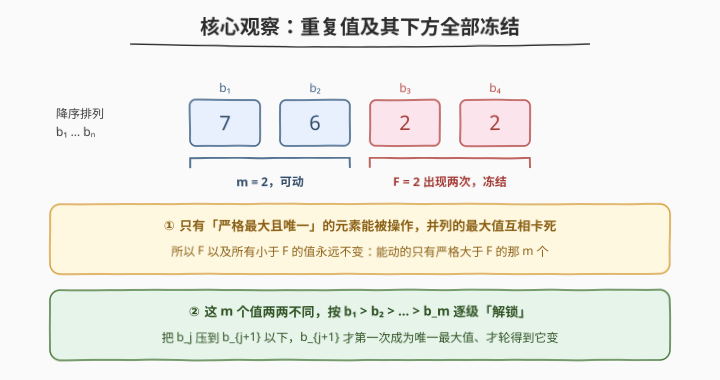
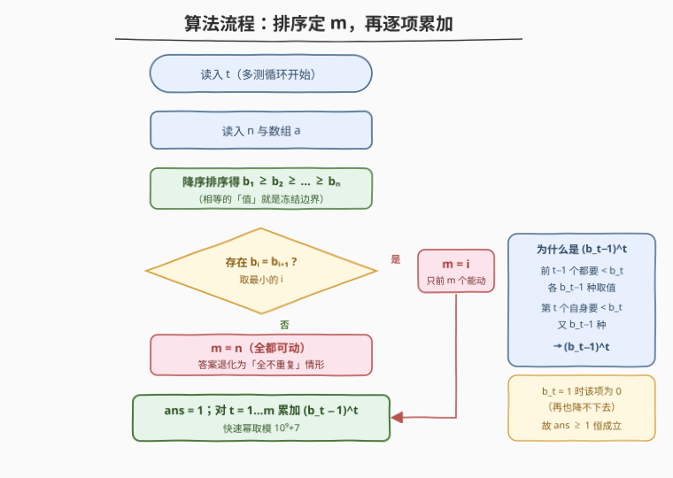
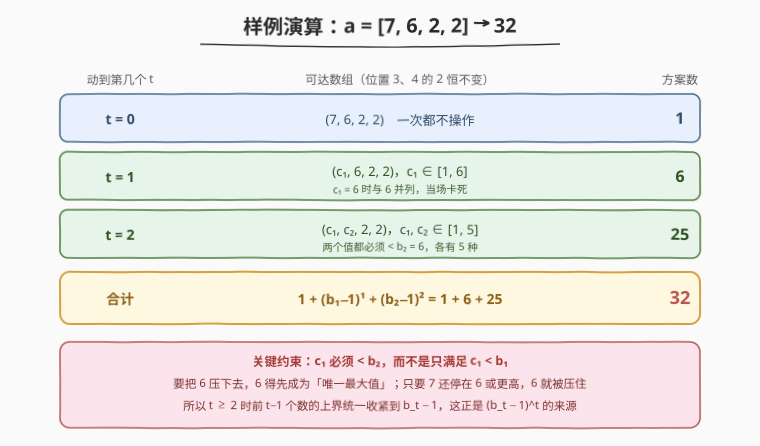

# Codeforces 2285C 最大值替换 题解

## 1. 题目概述

- **标题 / 题号**：最大值替换（Codeforces 2285C，英文名 Max Substitution）
- **链接**：https://codeforces.com/problemset/problem/2285/C
- **来源**：Codeforces Round 1135 (Div. 2) · Problem C（UTC 2026-11-15）
- **难度**：未评级（1500 分）
- **限制**：时间 2 s / 内存 256 MB
- **标签**：组合数学、数学、排序、数据结构、双指针

**题意**：给定长度为 $n$ 的数组 $a$。一次操作：**若当前数组的最大值唯一**（设它在位置 $p$、值为 $M$），则可以把 $a_p$ 换成**任意**满足 $1 \le x < M$ 的正整数 $x$。操作可以执行任意多次（包括 $0$ 次），问一共能得到多少个**本质不同**的数组（至少有一个位置不同即视为不同），答案对 $10^9+7$ 取模。多测，每组输出一行答案。

**约束**：

- $1 \le t \le 1000$，$1 \le n \le 2\times 10^5$，$\sum n \le 2\times 10^5$，$1 \le a_i \le 10^9$
- 操作前提是「最大值唯一」：最大值出现 $\ge 2$ 次时**不能**做任何操作；单次操作可一步压到任意更小的正整数，步长不限于 $1$
- 答案规模极大（值域 $10^9$、指数 $2\times 10^5$），必须取模并配快速幂

## 2. 示例与观察
官方样例（输入 / 输出原样）：

```text
输入：
5
3
2 2 1
2
1000000000 1
4
6 7 2 2
3
3 4 2
1
1

输出：
1
1000000000
32
9
1
```

样例解释（按官方 Note）：第 1 组 $[2,2,1]$ 最大值不唯一，一次也动不了，答案 $1$；第 2 组 $[10^9,1]$ 可得到 $[1,1],[2,1],\dots,[10^9,1]$ 共 $10^9$ 个；第 3、4 组为 $32$、$9$，下文的演算会逐项核对；第 5 组 $[1]$ 无法再降，答案 $1$。

自造一组，覆盖「最大值唯一、但它下方出现重复」的边界：

```text
输入：
1
4
5 4 3 3

输出：
14

解释：降序 b = (5,4,3,3)，最大重复值 F = 3 出现两次，故 m = 2；
      答案 = 1 + (5−1)¹ + (4−1)² = 1 + 4 + 9 = 14。
```

## 3. 解题思路

### 3.1 暴力思路

把「数组」当状态做 BFS：一个状态至多 $\max(a)-1$ 个后继，而 $\max(a)$ 可达 $10^9$，状态总数本身就是答案量级（$[10^9,1]$ 有 $10^9$ 个状态），枚举不可行。

但小数据暴力能看出结构：$[6,7,2,2]$ 的可达状态只有 $32$ 个，$[7,6,2,2]$ 每一层都是「一条主链 + 若干分支」。说明**绝大多数元素根本动不了**，剩下的自由度可以解析计数。

### 3.2 核心观察：重复值是一条「冻结线」



把数组降序排列为 $b_1 \ge b_2 \ge \cdots \ge b_n$。关键事实只有两条：

1. **并列的最大值谁也动不了**。若值 $v$ 出现至少两次，这些持有者永远并列，都想先动却都不是「唯一最大值」，于是 $v$ 及其下方（所有值 $\le v$ 的元素）**永久冻结**。
2. **只有冻结线以上的元素能动**。令 $F$ 为出现次数 $\ge 2$ 的最大值（所有元素互不相同时记 $F = 0$），令

$$m = \#\{\,i : a_i > F\,\}$$

由 $F$ 的最大性，这 $m$ 个值两两不同，降序后恰是 $b_1 > b_2 > \cdots > b_m > F \ge \text{其余}$。

这 $m$ 个元素还只能**按值从大到小逐个解锁**：要让 $b_j$ 成为唯一最大值，必须先把上面 $j-1$ 个元素全压到 $b_j$ 以下。整个操作过程就是沿 $b_1 \to b_2 \to \cdots$ 一路下行。

### 3.3 计数：按「动到第几个」分类



下面把「被改动的位置数」记为 $k$（避免与测试组数 $t$ 混淆），$0 \le k \le m$。由 3.2，被改的必是 $b_1,\dots,b_k$ 对应的 $k$ 个位置，其余原样不动；它们的最终值记作 $c_1,\dots,c_k$。

**可达的充要条件**（§5 证明）：

$$1 \le c_j < b_j \ (1 \le j \le k), \qquad \max(c_1,\dots,c_{k-1}) < b_k \ (k \ge 2)$$

第二条最不直观：为了把第 $k$ 个元素压下去，它必须先成为唯一最大值，所以**前面所有元素都得先降到 $b_k$ 之下**，而不只是降到各自的 $b_j$ 之下。

由于 $b_1 > \cdots > b_k$，对 $j<k$ 有 $b_j-1 \ge b_k$，「$c_j<b_j$」比「$c_j<b_k$」更松，两个条件合并成

$$c_j \in [1,\,b_k-1] \quad (1 \le j \le k)$$

每个 $c_j$ 有 $b_k-1$ 种取值，由乘法原理，**恰好改动 $k$ 个位置**的方案数为 $(b_k-1)^k$。再补上 $k=0$ 的「原数组」：

$$\text{ans} = 1 + \sum_{k=1}^{m} (b_k - 1)^k \pmod{10^9+7}$$

> 💡 附带得到一个更强的结论：第 $k$ 项统计的是**最少操作次数恰为 $k$** 的数组——每个被改的位置至少要一次操作，而 §5 引理 4 的构造恰好用 $k$ 次。

### 3.4 示例演算



以第 3 组样例 $a = [7,6,2,2]$ 为例：降序 $b = (7,6,2,2)$，最大重复值 $F = 2$，故 $m = 2$。

| 改动几个 $k$ | 可达数组 | 方案数 |
|---|---|---|
| $k=0$ | $(7,6,2,2)$，一次不动 | $1$ |
| $k=1$ | $(c_1,6,2,2)$，$c_1 \in [1,6]$ | $6$ |
| $k=2$ | $(c_1,c_2,2,2)$，$c_1,c_2 \in [1,5]$ | $25$ |
| 合计 | $1 + (7-1)^1 + (6-1)^2 = 1+6+25$ | $\mathbf{32}$ |

再看第 4 组 $[3,4,2]$：降序 $b=(4,3,2)$，三值互异，$m=3$，于是

$$1 + (4-1)^1 + (3-1)^2 + (2-1)^3 = 1 + 3 + 4 + 1 = 9$$

与样例一致。最后一项 $1^3=1$ 对应「最小值只能降成 $1$、三个位置全被改」的那一个数组。

## 4. 算法细节

1. **求 $m$**：降序排序后，$m$ 就是**第一个**满足 $b_i = b_{i+1}$ 的下标 $i$（$0$-indexed）；不存在则 $m=n$。因为 $b_{m+1}=F$ 是最大重复值，它的首次出现位置正是分界点。
2. **排序方向**：必须降序（或升序后反向取），因为公式里的 $b_k$ 是「第 $k$ 大」；用升序会把 $(b_k-1)^k$ 完全算错，且小数据下可能偶然与正确答案相等，不易察觉。
3. **快速幂**：底数 $b_k-1$ 可达 $10^9-1$，指数 $k$ 可达 $2\times10^5$，逐项 `pow` 为 $O(\log k)$，总计 $O(n\log n)$；不要写成循环乘 $k$ 次，那是 $O(n^2)$。
4. **底数为 $0$**：$b_k=1$ 时 $(b_k-1)^k=0^k=0$（$k\ge1$），直接累加；注意 $0$ 的正整数次幂是 $0$，误当成 $1$ 会让 $[1]$ 输出 $2$。
5. **溢出与取模**：$(b_k-1)^2 \approx 10^{18}$，必须 `long long`（$(10^9-1)^2<9.22\times10^{18}$ 不会越界）；每次乘法后立刻 `% MOD`，累加后也取模。
6. **多测**：`ans` 每组重置为 $1$（即 $k=0$ 那一项），排序用各组自己的数组，天然无跨测污染；总复杂度按 $\sum n$ 计。
7. **I/O**：输入至多 $2\times10^5$ 个整数，C++ 开 `std::ios::sync_with_stdio(false)` 足够；Python 用 `sys.stdin.buffer.read().split()` 一次性读入。

## 5. 正确性证明

**引理 1（冻结线）**：设 $F$ 为出现次数 $\ge 2$ 的最大值（不存在则 $F=0$），则任何初始值 $\le F$ 的元素，其值在任意次操作后都不变。

**证明**：反证，取第一次「初始值 $\le F$ 的元素被操作」的时刻。该元素此刻的值 $v \le F$，且必须是唯一最大值；而在此之前初始值 $\le F$ 的元素都没被改过，特别地至少两个初始值为 $F$ 的元素此刻仍是 $F$。于是存在另一个值为 $F \ge v$ 的元素，与「其余元素严格小于 $v$」矛盾。∎

**引理 2（可动集合是前缀）**：若总共改动 $k$ 个位置，则它们恰为 $b_1,\dots,b_k$ 对应的位置；记第 $j$ 个位置首次被改的时刻为 $T_j$，则 $T_1<T_2<\cdots<T_k$。

**证明**：位置 $j$ 在 $T_j$ 前值仍是 $b_j$（首次改动尚未发生）。该时刻它是唯一最大值，故所有当前值 $>b_j$ 的元素都已被改过（值只减不增）。初始值 $>b_j$ 的正是 $b_1,\dots,b_{j-1}$，故 $T_1,\dots,T_{j-1}<T_j$，归纳得严格递增；$j>k$ 的位置从未被改，故可动集合恰为前 $k$ 个。∎

**引理 3（必要条件）**：最终值满足 $c_j<b_j$（$1\le j\le k$）与 $\max(c_1,\dots,c_{k-1})<b_k$。

**证明**：前半：位置 $j$ 至少被改一次，每次严格减小其值，故 $c_j<b_j$。后半：$T_k$ 时刻位置 $k$ 的值仍是 $b_k$ 且是唯一最大值，故其余元素此刻都 $<b_k$；值只减不增，最终值 $c_i\le$ 此刻值 $<b_k$。∎

**引理 4（充分条件）**：若 $1\le c_j<b_j$ 且 $\max(c_1,\dots,c_{k-1})<b_k$，则对应数组可达。

**证明**：按 $1,2,\dots,k$ 的顺序操作，第 $j$ 次把位置 $j$ 的值从 $b_j$ 直接改为 $c_j$。归纳证明每步合法：轮到 $j$ 时位置 $1..j-1$ 的值是 $c_1..c_{j-1}$，都 $\le\max(c_1,\dots,c_{k-1})<b_k\le b_j$；位置 $j..n$ 仍是初始值且都 $\le b_j$、等号只在位置 $j$。故位置 $j$ 是**唯一**最大值，可换成任意更小正整数，取 $c_j$。$k$ 步后即得目标数组。∎

**引理 5（逐项计数）**：满足引理 4 条件的元组 $(c_1,\dots,c_k)$ 恰有 $(b_k-1)^k$ 个；不同 $k$ 得到的数组互不相同。

**证明**：由 $b_1>\cdots>b_k$ 知 $b_j-1\ge b_k$，「$c_j<b_j$」在 $c_j<b_k$ 时自动满足，故每个 $c_j$ 恰取 $[1,b_k-1]$ 中任意值，共 $b_k-1$ 种，$k$ 个分量独立得 $(b_k-1)^k$。互异性：$k$ 与 $k'>k$ 的数组在第 $k+1$ 个位置上分别是 $b_{k+1}$ 与某个 $<b_{k+1}$ 的值，必不相等。∎

**定理**：算法输出 $1+\sum_{k=1}^{m}(b_k-1)^k \bmod (10^9+7)$ 恰为可达数组个数。

**证明**：由引理 1、2，任何可达数组或为原数组（$k=0$），或落在某个 $k\in[1,m]$ 的族中；由引理 3、4，每个族恰由引理 4 的条件刻画；由引理 5，各族大小为 $(b_k-1)^k$ 且两两不交。求和即得结论，取模不影响正确性。∎

## 6. 复杂度分析

- **时间**：每组排序 $O(n\log n)$，求 $m$ 与扫描一遍 $O(n)$，快速幂 $m\le n$ 次、每次 $O(\log k)$，仍是 $O(n\log n)$。全场合计 $O(\sum n\log n)\le 2\times10^5\times18\approx3.6\times10^6$ 次基本运算。
- **空间**：$O(n)$ 存数组，其余常数个变量；题目标签里的「数据结构 / 双指针」在最优写法中都用不上。
- **实测**（$n=2\times10^5$ 且完全无重复的极端数据）：C++ 全流程约 $0.29$ s，其中模幂部分仅约 $11$ ms，其余为进程启动与读入；对 $2$ s 时限有 5 倍以上余量。Python3 用内置 `pow(b,e,MOD)` 跑同一数据约 $0.27$ s，同样安全。

## 7. 参考代码

### C++17

```cpp
#include <bits/stdc++.h>
using namespace std;

static const long long MOD = 1000000007LL;

long long pw(long long b, long long e) {      // b^e mod MOD
    b %= MOD;
    long long r = 1 % MOD;
    while (e > 0) {
        if (e & 1) r = r * b % MOD;
        b = b * b % MOD;
        e >>= 1;
    }
    return r;
}

int main() {
    ios::sync_with_stdio(false);
    cin.tie(nullptr);
    int t;
    if (!(cin >> t)) return 0;
    while (t--) {
        int n;
        cin >> n;
        vector<long long> b(n);
        for (int i = 0; i < n; ++i) cin >> b[i];
        sort(b.begin(), b.end(), greater<long long>());   // 降序
        int m = n;                                        // 无重复时 m = n
        for (int i = 0; i + 1 < n; ++i)
            if (b[i] == b[i + 1]) { m = i; break; }        // 第一个相等处即冻结线
        long long ans = 1 % MOD;                          // k = 0：原数组
        for (int k = 1; k <= m; ++k)
            ans = (ans + pw(b[k - 1] - 1, k)) % MOD;       // (b_k - 1)^k
        cout << ans << "\n";
    }
    return 0;
}
```

### Python3

```python
import sys


def main() -> None:
    data = sys.stdin.buffer.read().split()
    if not data:
        return
    MOD = 10 ** 9 + 7
    t = int(data[0])
    pos = 1
    out = []
    for _ in range(t):
        n = int(data[pos]); pos += 1
        b = sorted(map(int, data[pos:pos + n]), reverse=True)   # 降序
        pos += n
        m = n                                                  # 无重复时 m = n
        for i in range(n - 1):
            if b[i] == b[i + 1]:
                m = i
                break
        ans = 1                                                # k = 0：原数组
        for k in range(1, m + 1):
            ans = (ans + pow(b[k - 1] - 1, k, MOD)) % MOD       # (b_k - 1)^k
        out.append(str(ans))
    sys.stdout.write("\n".join(out) + "\n")


main()
```

## 8. 边界情况与易错点

1. **最大值本身重复**：如 $[2,2,1]$，此时 $m=0$，答案必须是 $1$。若把 $m$ 误算成「去重后个数」或「严格递减前缀长度」，会凭空多算一堆不存在的方案。
2. **$m$ 要取「第一个」相等位置**：$[7,6,2,2]$ 的严格递减前缀长度是 $3$，但正确的 $m=2$——值 $2$ 已重复，它的持有者动不了。
3. **$0$ 次幂陷阱**：$k\ge1$ 时 $0^k=0$，故 $b_k=1$ 的项贡献 $0$；但 $k=0$ 的常数项 $1$ 必须保留，代码写 `ans = 1` 而非 `ans = 0` 就是这个原因。
4. **指数写错**：公式是 $(b_k-1)^k$，指数与下标**同为 $k$**。写成 $(b_k-1)^{k-1}$ 会把样例 3 算成 $1+6^0+5^1=7$，而不是 $32$。
5. **下标错位**：$0$-indexed 下「第 $k$ 大」是代码里的 `b[k-1]`、而指数是 $k$，两处下标不同步极易写错；建议循环变量就叫 `k`，并写 `pw(b[k-1]-1, k)`。
6. **溢出**：用 `int` 存 $b_k-1$ 再平方会溢出，必须全程 `long long`；Python 无此问题。
7. **全相同 / 单元素**：$[1]$ 输出 $1$；$2\times10^5$ 个 $10^9$ 输出 $1$（$m=0$，连一次幂都不该算），这类数据专卡「没有提前退出」的实现。

## 9. 验证记录

- **编译环境与命令**：`clang++ -std=c++17 -O2`（本机无 GNU g++，配 `codeforces/tools/include/bits/stdc++.h` 兼容头；正文代码只用标准库，可原样提交 GNU C++17）；Python 侧为 `Python 3.9.6`。
- **官方样例**：1 / 1 通过（按 Codeforces 标准 checker 的 token 比对，忽略空白与大小写）。
- **复核状态**：audited（2026-11-19 统一回归：编译 + 官方样例；写作期的随机对拍与暴力未重跑）。

## 相关题目与扩展

- [Codeforces 1768B Quick Sort](https://codeforces.com/problemset/problem/1768/B)：只有「下一个该被消掉的元素」能动、其余冻结，同款「可动前缀 + 不动后缀」分析。
- [Codeforces 1455D Sequence and Swaps](https://codeforces.com/problemset/problem/1455/D)：受限的单调操作序列，只需盯住当前最大值与可交换值的相对大小来判断操作是否合法。
- [Codeforces 1730C Minimum Notation](https://codeforces.com/problemset/problem/1730/C)：每次只能把元素变到受限的小值范围内，同样是「先定谁必须动，再定动到多少」。
- [LeetCode 945. 使数组唯一的最小增量](https://leetcode.cn/problems/minimum-increment-to-make-array-unique/)：只能单向调整数值，核心也是找出「并列造成的死锁」并统计修它所需的代价。

**延伸思考**：

1. **步长改为 $1$**：若每次只能把最大值减 $1$，可达集合会严格变小——最大值刚降到第二大附近就会被「接棒」，来回横跳，不少 $(c_1,\dots,c_k)$ 组合不再可达。请重新刻画并计数。
2. **允许换成 $0$**：若值域放宽为 $0\le x<M$，每个 $c_j$ 的取值变成 $b_k$ 种，答案变为 $1+\sum_{k=1}^{m} b_k^{\,k}$。
3. **放宽唯一性**：若把「唯一最大值」换成「最大的 $r$ 个元素（互不相同时）可各自变小」，冻结线与解锁顺序都要重推。
4. **按最少操作次数分类**：本题第 $k$ 项恰好统计「最少操作次数为 $k$」的数组个数，请证明为什么不会出现「改了 $k$ 个位置却少于 $k$ 次操作」的偏差。
