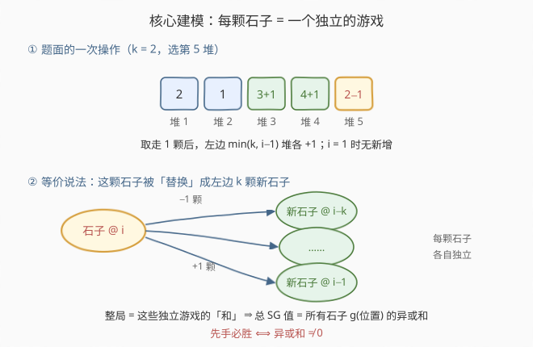
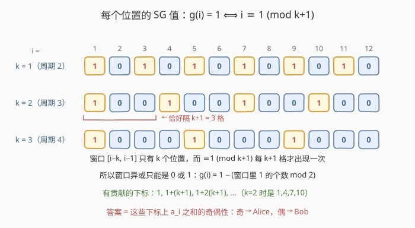
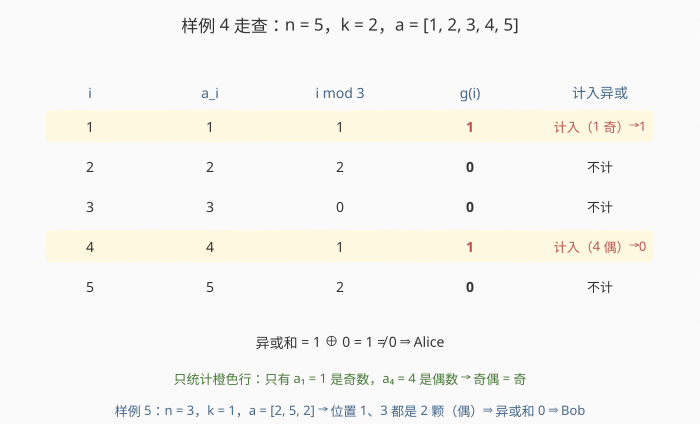

# Codeforces 2290E 雪崩 题解

## 1. 题目概述

- **标题 / 题号**：雪崩（Codeforces 2290E，英文名 Avalanche）
- **链接**：https://codeforces.com/problemset/problem/2290/E
- **来源**：Codeforces Round 1134 (Div. 4) · Problem E
- **难度**：未评级（Div. 4 的 E 题，暂无公开 rating）
- **限制**：时间 2 s / 内存 256 MB
- **标签**：博弈论、Sprague-Grundy 定理、动态规划、数学

**题意**：有 $n$ 堆石子排成一行，第 $i$ 堆有 $a_i$ 颗。两人轮流操作，Alice 先手。一步操作是：选一个**非空**的堆 $i$，从它里面取走 $1$ 颗石子，然后给左边紧邻的 $\min(k,\,i-1)$ 堆（下标 $\max(1,i-k)$ 到 $i-1$）各**加入** $1$ 颗石子；若 $i=1$ 则不加入任何石子。新石子数量不限。不能操作者输。问双方都最优时谁获胜。

注意这是一道**判定胜负**的题，不需要输出操作序列；多测，每组独立给出 $n,k$ 与 $a_1,\dots,a_n$，输出一行 `Alice` 或 `Bob`。

**约束**：

- $1 \le t \le 10^4$（测试组数）
- $2 \le n \le 2\cdot 10^5$，$1 \le k \le n-1$
- $0 \le a_i \le 10^9$
- $\sum n \le 2\cdot 10^5$（所有测试组的 $n$ 之和）

$a_i$ 能到 $10^9$、且一步操作可能让石子总数**变多**，所以任何"按步数模拟"的做法都会超时；$\sum n$ 的上界则提示每组应当是 $O(n)$ 甚至 $O(1)$ 摊还的线性扫描。

## 2. 示例

```text
输入
5
2 1
1 1
3 2
0 0 1
4 1
0 0 1 0
5 2
1 2 3 4 5
3 1
2 5 2

输出
Alice
Bob
Alice
Alice
Bob
```

第 1 组两堆各 $1$ 颗时 Alice 两种走法都赢；第 2 组只有第 3 堆有 $1$ 颗，Alice 取走后第 1、2 堆各 $+1$，Bob 反制后 Alice 无路可走；第 3 组同理但先手胜。
第 4 组 $k=2$、$a=[1,2,3,4,5]$ 与第 5 组 $k=1$、$a=[2,5,2]$ 分别对应 Alice / Bob，下面的公式会在 §3.4 逐一核对。

## 3. 解题思路

### 3.1 暴力思路

最直接的做法是把整个局面当成一个状态（元组或数组），记忆化搜索"是否存在一步走到必败态"：

$$\text{win}(s) = \bigvee_{\text{合法操作 } s \to s'} \lnot \text{win}(s')$$

$\sum a_i$ 可达 $2\cdot10^{14}$，而 $k\ge 2$ 时一次操作还会让石子**净增加** $k-1$ 颗，局面数量根本无法枚举。即使想按 SG 定理把局面拆成若干子游戏，也必须先知道"一颗石子"的 SG 值。

### 3.2 核心观察：每颗石子是一个独立的子游戏



把**一颗石子**看作一个"棋子"，它所在的位置就是它的局面。关键事实是：一次操作只涉及**一颗**石子——把它取走，并在它左边生成若干新石子。也就是说，

- 任一时刻的局面 = 若干颗石子的集合；
- 走一步 = 挑出其中一颗石子，用"左边窗口里的那几颗新石子"替换它。

这正是**不交并（disjunctive sum）**的结构，所以 Sprague-Grundy 定理直接适用。记 $g(i)$ 为"位于第 $i$ 堆的一颗石子"这个子游戏的 SG 值，则整局的 SG 值为

$$G=\bigoplus_{\text{所有石子}} g(\text{它所在的位置})$$

先手必胜 $\iff G \ne 0$。

再看单颗石子的走法：它**只有唯一一种**操作（取走自己），走完之后局面就是左边窗口内那些新石子之和，其 SG 值为

$$\bigoplus_{j=\max(1,i-k)}^{i-1} g(j)$$

（$i=1$ 时为空局面，SG 值为 $0$。）于是

$$g(1)=1,\qquad g(i)=\operatorname{mex}\Bigl\{\bigoplus_{j=\max(1,i-k)}^{i-1} g(j)\Bigr\}\ (i\ge 2)$$

**只有一个选项**意味着 $\operatorname{mex}$ 的输入只有一个数，且这个数只能是 $0$ 或 $1$（归纳可得 $g$ 全在 $\{0,1\}$ 中），所以

$$g(i)=1-\bigoplus_{j=\max(1,i-k)}^{i-1} g(j)\in\{0,1\}$$

即：窗口内"$g=1$ 的石子"的个数的奇偶性决定 $g(i)$。

### 3.3 规律与算法流程：SG 值的周期结构



按上面的递推手算几组就能发现规律：

- $k=1$：$g = 1,0,1,0,1,\dots$（周期 $2$）
- $k=2$：$g = 1,0,0,1,0,0,1,\dots$（周期 $3$）
- $k=3$：$g = 1,0,0,0,1,0,0,0,1,\dots$（周期 $4$）

一般的结论是

$$g(i)=1 \iff i-1 \text{ 是 } k+1 \text{ 的倍数}$$

**为什么**：窗口 $[i-k,\,i-1]$ 最多 $k$ 个位置，而 $i\equiv 1$ 的位置每隔 $k+1$ 个才出现一次，所以窗口里"$g=1$"的位置**至多一个**，异或值只可能是 $0$ 或 $1$。再数一数：把窗口补上位置 $i$ 得到连续区间 $[\max(1,i-k),\,i]$（长度恰为 $\min(k,i-1)+1 \le k+1$），它最多含一个 $\equiv 1 \pmod{k+1}$ 的位置，而且

- 若 $i \le k$，这个区间是 $[1,i]$，$\equiv 1$ 的位置就是 $1$，且 $i \ne 1$；
- 若 $i \ge k+1$，区间长度正好 $k+1$，恰有一个 $\equiv 1$ 的位置，它就是 $i$ 当且仅当 $i\equiv 1$。

所以窗口内恰好有一个 $1$ $\iff$ $i \not\equiv 1 \pmod{k+1}$，窗口异或 $=[i\not\equiv 1]$，代回 $g(i)=1-\text{窗口异或}$ 即得结论。

于是整局的 SG 值只取决于所有 $i \equiv 1 \pmod{k+1}$ 的堆里的石子**总数的奇偶性**：

$$G=\bigoplus_{i\equiv 1\,(k+1)} \bigl(a_i \bmod 2\bigr)= \Bigl(\sum_{i\equiv 1\,(k+1)} a_i\Bigr) \bmod 2$$

**算法流程**（每组测试）：

1. 令 $\text{step}=k+1$，$\text{parity}=0$；
2. 读入 $a_1,\dots,a_n$（实现里用 0-indexed，条件是 $i \bmod \text{step} = 0$），把每个命中位置的奇偶性异或进 `parity`；
3. 输出 `parity ? "Alice" : "Bob"`。

一行式的结论：**答案只与"每 $k+1$ 个堆里的第 $1$ 个"的那些石子数的总奇偶性有关**。

> 💡 这也解释了题面里"石子会变多"为什么不影响判定：真正携带 SG 值的只有下标 $\equiv 1 \pmod{k+1}$ 的堆，其他堆上的石子都是 SG 值为 $0$ 的"零游戏"，加多少颗都不改变异或和。

### 3.4 示例演算



以样例 4 为例，$n=5$、$k=2$，所以 $\text{step}=3$，有贡献的位置是 $i=1,4$（1-indexed）：

| $i$ | $a_i$ | $i \bmod 3$ | $g(i)$ | 是否计入 $G$ |
|-----|-------|-------------|--------|--------------|
| 1 | 1 | 1 | 1 | 计入，$1$ 是奇数 |
| 2 | 2 | 2 | 0 | 不计 |
| 3 | 3 | 0 | 0 | 不计 |
| 4 | 4 | 1 | 1 | 计入，$4$ 是偶数 |
| 5 | 5 | 2 | 0 | 不计 |

$G=(1+4)\bmod 2=1 \ne 0$，所以 Alice 胜，与官方输出一致。

再看样例 5：$n=3$、$k=1$，$\text{step}=2$，有贡献的是位置 $1,3$，$a_1+a_3=2+2=4$ 为偶数 $\Rightarrow G=0\Rightarrow$ Bob，同样一致。

## 4. 算法细节

1. **下标基准要统一**。实现用 0-indexed 读入，条件是 `i % (k+1) == 0`；若按 1-indexed 思考，条件是 $(i-1)\bmod (k+1)=0$。两者混用是最常见的 WA。
2. **只留奇偶，避免求和溢出**。$\sum a_i$ 可达 $2\cdot 10^{14}$，$32$ 位整型一定会溢出；最省事的写法是 `parity ^= (x & 1)`，既不需要 `long long` 也能保证正确（若坚持求和，请用 `long long`，$2\cdot10^{14}$ 在范围内）。
3. **多测无须清空**。全部状态都在循环内的局部变量里，只需注意每组都要**完整读掉** $n$ 个 $a_i$（哪怕已经可以提前判断），否则下一组的读入会错位。
4. **$k$ 的两个极端**：$k=n-1$ 时 $\text{step}=n$，只统计第 $1$ 堆；$k=1$ 时 $\text{step}=2$，统计 $1,3,5,\dots$ 号堆（1-indexed）。
5. **$i=1$ 的特例已被公式吸收**：$g(1)=\operatorname{mex}\{0\}=1$ 正好符合 $1 \equiv 1 \pmod{k+1}$，代码里不需要任何特判。
6. **I/O**：$t$ 可达 $10^4$、总读入量约 $2\cdot10^5$ 个数，`cin` 配 `std::ios::sync_with_stdio(false)` + `cin.tie(nullptr)` 足够；若想再稳一手可改用 `scanf`/`fread` 快读（本题读入量很小，属于锦上添花）。
7. **不需要真的建 SG 数组**。闭式 $g(i)=[i\equiv 1 \pmod{k+1}]$ 让额外空间降到 $O(1)$，也让单组复杂度从"$O(n)$ 递推 + 前缀异或"进一步简化为一次扫描。

## 5. 正确性证明

**引理 1（局面拆分）**：把每颗石子视为一个独立子游戏（局面为该石子所在的下标），则原游戏的任一局面与这些子游戏的**不交并**同构：每一步操作恰好是其中一个子游戏走一步。

**证明**：局面到"石子多重集"是双射（每颗石子可区分，但同位置的石子同构，多重集足够）。一次合法操作选定非空堆 $i$，取走其中一颗石子并给 $\max(1,i-k),\dots,i-1$ 各加一颗，恰好等价于"把下标为 $i$ 的那个子游戏的局面替换为下标 $i-k,\dots,i-1$ 的若干子游戏"，未涉及的石子（子游戏）不变。故走子集合与不交并的走子集合一一对应。∎

**引理 2（单石子递推）**：$g(1)=1$；对 $i\ge 2$，
$$g(i)=\operatorname{mex}\Bigl\{\bigoplus_{j=\max(1,i-k)}^{i-1} g(j)\Bigr\}\in\{0,1\}.$$

**证明**：位于 $i$ 的石子只有一个选项（取走自己），故其 SG 值是"走一步后局面 SG 值"这个单元素集合的 $\operatorname{mex}$；由引理 1，走一步后的局面正是左边窗口内各子游戏之并，其 SG 值为窗口内 $g$ 的异或和。$i=1$ 时走一步为空局面，SG 值 $0$，故 $g(1)=\operatorname{mex}\{0\}=1$。对 $i$ 归纳：若窗口内所有 $g(j)\in\{0,1\}$，则其异或 $x\in\{0,1\}$，而 $\operatorname{mex}\{0\}=1$、$\operatorname{mex}\{1\}=0$，故 $g(i)=1-x\in\{0,1\}$。∎

**引理 3（闭式）**：对一切 $i\ge 1$，$g(i)=1 \iff i\equiv 1 \pmod{k+1}$。

**证明**：对 $i$ 强归纳。$i=1$ 时 $g(1)=1$ 且 $1\equiv 1$，成立。设结论对所有 $j<i$ 成立，记 $W=[\max(1,i-k),\,i-1]$。

- 窗口 $W$ 是至多 $k$ 个连续整数，而 $\equiv 1 \pmod{k+1}$ 的位置间隔恰为 $k+1>k$，故 $W$ 中至多有一个位置满足 $g=1$，于是窗口异或 $\in\{0,1\}$，且等于 $1$ 当且仅当 $W$ 里恰有一个 $g=1$ 的位置。
- 考察 $W'=W\cup\{i\}=[\max(1,i-k),\,i]$，它是连续区间，长度 $\min(k,i-1)+1\le k+1$。若 $i\le k$，$W'=[1,i]$ 含位置 $1$ 且 $i\ne 1$（因 $i\ge 2$），即 $W$ 含一个 $g=1$；若 $i\ge k+1$，$W'$ 长恰为 $k+1$，其中恰有一个 $\equiv 1 \pmod{k+1}$ 的位置，它是 $i$ 当且仅当 $i\equiv 1$，因此 $W$ 含一个 $g=1$ $\iff$ $i\not\equiv 1$。
- 综合：窗口异或 $=[i\not\equiv 1]$，由引理 2 得 $g(i)=1-[i\not\equiv1]=[i\equiv1]$。∎

**定理**：先手（Alice）必胜 $\iff \sum_{i\equiv 1\,(k+1)} a_i$ 为奇数。

**证明**：由引理 1 与 Sprague-Grundy 定理，先手必胜 $\iff$ 整局 SG 值 $G\ne 0$，其中 $G=\bigoplus_{\text{石子}}g(\text{位置})$。位置 $i$ 上有 $a_i$ 颗石子，每颗的 $g$ 值都是 $g(i)\in\{0,1\}$，故这 $a_i$ 颗石子对异或和的贡献为 $0$（$a_i$ 偶）或 $g(i)$（$a_i$ 奇）；再由引理 3，只有 $i\equiv 1 \pmod{k+1}$ 的位置可能贡献 $1$。于是

$$G=\Bigl(\sum_{i\equiv 1\,(k+1)} a_i\Bigr)\bmod 2,$$

$G=1$（奇数）时先手必胜，$G=0$（偶数）时先手必败。∎

（题面已保证游戏在有限步内结束，属正规博弈，故 SG 定理适用。）

## 6. 复杂度分析

- **时间**：每组 $O(n)$，只做一次读入 + 一次取模判断 + 一次按位异或；总计 $O(\sum n)\le 2\cdot10^5$ 次基本操作。最大规模实测：C++（`scanf` 版）约 $0.01$–$0.03$ s；即使本机 libc++ 下用 `cin` 也只有 $0.30$ s 左右（Codeforces 用 libstdc++，`cin` 关同步后比这快一个量级），相对 $2$ s 时限余量充足。Python3 约 $0.05$ s。
- **空间**：$O(1)$ 额外空间（不存数组、不存 SG 表），仅输入缓冲；若按最朴素的"存下整个数组"实现则为 $O(n)$，同样安全。

## 7. 参考代码

### C++17

```cpp
#include <iostream>
using namespace std;

int main() {
    ios::sync_with_stdio(false);
    cin.tie(nullptr);
    int T;
    if (!(cin >> T)) return 0;
    while (T--) {
        int n, k;
        cin >> n >> k;
        long long parity = 0;            // 只关心下标 i ≡ 0 (mod k+1) 的 a_i 之和的奇偶性
        for (int i = 0; i < n; i++) {
            long long x;
            cin >> x;
            if (i % (k + 1) == 0) parity ^= (x & 1LL);
        }
        cout << (parity ? "Alice" : "Bob") << "\n";
    }
    return 0;
}
```

### Python3

```python
import sys


def main():
    data = sys.stdin.buffer.read().split()
    t = int(data[0])
    p = 1
    out = []
    for _ in range(t):
        n, k = int(data[p]), int(data[p + 1])
        p += 2
        step = k + 1
        parity = 0
        for i in range(0, n, step):        # 0-indexed：i = 0, step, 2*step, ...
            parity ^= int(data[p + i]) & 1
        p += n
        out.append("Alice" if parity else "Bob")
    sys.stdout.write("\n".join(out) + "\n")


main()
```

> ⚠️ Python 版一次性读入全部 token（`sys.stdin.buffer.read().split()`），比逐行 `input()` 快数倍；`for i in range(0, n, step)` 直接跳到有贡献的下标，无需遍历全部 $n$ 个数（但仍要 `p += n` 跳过它们）。

## 8. 边界情况与易错点

1. **全 $0$ 的输入**：Alice 无路可走，直接判 Bob。公式给出 $G=0$，正确；实现里不要为"没有石子"另加特判，否则容易把胜负写反。
2. **$k=n-1$**：$\text{step}=n$，只有第 $1$ 堆有贡献，其余堆无论多少颗都不影响答案；不要因为"第 $1$ 堆为 $0$ 而其他堆很大"就误判成 Alice。
3. **$k=1$**：只统计 $1,3,5,\dots$ 号堆，且注意 $1$ 号堆（下标 $0$）永远计入——它是唯一不产生新石子的位置。
4. **下标混用**：0-indexed 判断 `i % (k+1) == 0` 与 1-indexed 判断 `(i-1) % (k+1) == 0` 必须只选一种；样例 4（$k=2$）会同时暴露把 $i$ 写成 `i % k` 或 `(i+1) % (k+1)` 的错误。
5. **溢出**：不要用 `int` 累加 $a_i$（$\sum a_i$ 可到 $2\cdot10^{14}$）；用奇偶异或或 `long long`。`1e9` 本身在 `int` 内，但和会溢出。
6. **多测读入错位**：无论是否已经能判定答案，都必须读满 $n$ 个数；提前 `break` 而不读剩余输入会让后续测试组全错。
7. **输出格式**：只输出 `Alice` / `Bob`，大小写敏感，不要输出 `YES`/`NO` 或多余空格；$t$ 组之间用换行分隔，末尾换行可选。

## 相关题目与扩展

- [Codeforces 1382B Sequential Nim](https://codeforces.com/problemset/problem/1382/B)：只能从第一个非空堆取石，胜负由"第一个 $a_i>1$ 的堆"决定，同样是"结论只看某一类下标"的化简型博弈。
- [LeetCode 292. Nim 游戏](https://leetcode.cn/problems/nim-game/)：SG 定理的最经典入门，结论是 $n \bmod 4 \ne 0$ 时先手胜。
- [LeetCode 1025. 除数博弈](https://leetcode.cn/problems/divisor-game/)：单堆、选项集合随 $n$ 变化的 SG 入门题，适合体会"选项个数决定 $g$ 的取值范围"。
- [Codeforces 2290E Avalanche](https://codeforces.com/problemset/problem/2290/E)：本题本身。

**延伸思考**：(1) 本题能化简成 $0/1$ 的关键是"一颗石子只有唯一走法"，若一步允许取走 $1..m$ 颗，$g(i)$ 的取值域会扩到 $\{0,\dots,m\}$，周期结构也会随之变化，可以试试 $m=2$ 时的规律。(2) 若把"向左 $k$ 堆各 $+1$"改成"向右 $k$ 堆各 $+1$"，石子只向右流，游戏依然有限（取权重 $w_i=(k+1)^{-i}$，则势 $\sum w_i a_i$ 每步严格下降），但 $g$ 的递推方向与周期结构都要重推，可以借此检验自己是否真的理解了"只有 $i\equiv 1$ 的位置有贡献"的来由。(3) 若把胜负改成 misère 规则（不能动者胜），由于局面中可能存在 $g=1$ 的孤立石子，需要单独讨论"全为 0 之外是否只剩必败结构"，不能直接套用本文结论。
