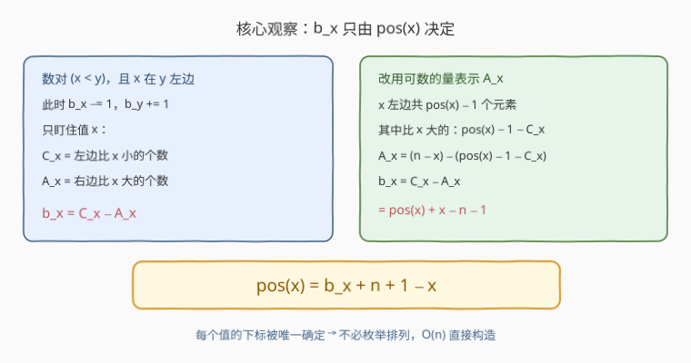
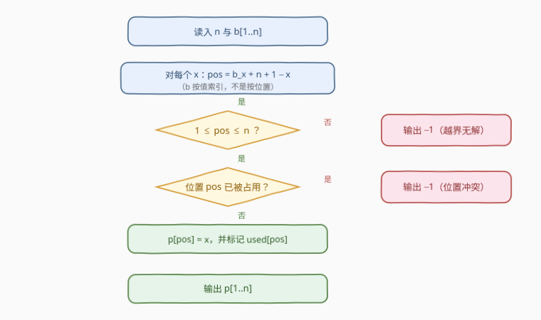
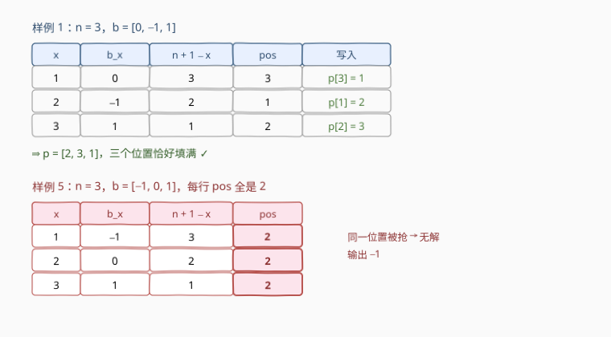

# Codeforces 2290F 值计数器 题解

## 1. 题目概述

- **标题 / 题号**：值计数器（Codeforces 2290F，英文名 Value Counters）
- **链接**：https://codeforces.com/problemset/problem/2290/F
- **来源**：Codeforces Round 1134 (Div. 4) · Problem F
- **难度**：未评级（Div. 4 的 F 题，官方暂无 rating）
- **限制**：时间 2 s / 内存 256 MB
- **标签**：二分查找、构造、数学

**题意**：给定长度为 $n$ 的排列 $p$，按下述规则生成数组 $b$（**下标是数值，不是位置**）：

1. 初始 $b_1=b_2=\cdots=b_n=0$；
2. 枚举所有满足 $1\le x<y\le n$ 且 $x$ 在 $p$ 中位于 $y$ **左边**的数对 $(x,y)$；
3. 每个这样的数对让 $b_x$ 减 $1$、$b_y$ 加 $1$。

例如 $p=[2,1,3]$ 时合法的数对是 $(1,3)$ 与 $(2,3)$，故 $b=[-1,-1,2]$。

现在反过来：给出 $b_1,\dots,b_n$，要求还原出 $p$；若不存在这样的排列输出 $-1$。**多测**，每个测试用例输出一行：无解输出 `-1`，否则输出 $p_1,\dots,p_n$。

**约束**：

- $1 \le t \le 10^4$，$1 \le n \le 2\cdot 10^5$，且所有测试用例的 $\sum n \le 2\cdot 10^5$；
- $-n \le b_x \le n$；
- 若存在合法排列，题目保证它唯一（下文引理 2 也独立证明）。

## 2. 示例

```text
输入
5
3
0 -1 1
1
0
2
1 1
4
-2 1 -1 2
3
-1 0 1

输出
2 3 1
1
-1
3 1 4 2
-1
```

第 1 组：$p=[2,3,1]$，唯一合法数对是 $(2,3)$，于是 $b_1=0,\ b_2=-1,\ b_3=1$；第 2 组：$n=1$ 没有数对，$b_1$ 必须为 $0$，答案是 $[1]$。
第 3 组：$[1,2]$ 给出 $b=[-1,1]$，$[2,1]$ 给出 $b=[0,0]$，都凑不出 $[1,1]$，无解；第 4 组：$p=[3,1,4,2]$，合法数对 $(1,2),(1,4),(3,4)$，故 $b=[-2,1,-1,2]$；第 5 组无解（见下面的演算表）。

**自造示例**（逆序排列）：输入 `1 / 5 / 0 0 0 0 0`，输出 `5 4 3 2 1`。逆序时没有任何「小的在大的左边」的数对，故 $b$ 全为 $0$；反过来 $b$ 全 $0$ 也只能是逆序。

## 3. 解题思路

### 3.1 暴力思路

直接枚举全部 $n!$ 个排列，对每个排列用 $O(n^2)$ 枚举数对算出 $b$ 再比对，复杂度 $O(n!\cdot n^2)$：$n\le 9$ 时还能硬跑，$n=2\cdot10^5$ 完全不可能。更糟的是「构造」类问题没法像判定那样提前剪枝，必须换一个角度：**直接从 $b$ 反解出每个值的位置**。

### 3.2 核心观察：$b_x$ 唯一决定 $x$ 的位置



固定一个数值 $x$，看它在生成过程中被改动了多少次。设 $\text{pos}(x)$ 是 $x$ 在 $p$ 中的位置（$1$ 起）。

- $b_x$ 收到 $+1$，当且仅当存在 $y<x$ 且 $y$ 在 $x$ 左边 —— 即数对 $(y,x)$ 被枚举。记这类 $y$ 的个数为 $C_x$。
- $b_x$ 收到 $-1$，当且仅当存在 $y>x$ 且 $x$ 在 $y$ 左边 —— 即数对 $(x,y)$ 被枚举。记这类 $y$ 的个数为 $A_x$。

于是

$$b_x = C_x - A_x$$

关键是 $A_x$ 可以换成**只和位置有关**的量：$x$ 左边一共有 $\text{pos}(x)-1$ 个元素，其中比 $x$ 小的有 $C_x$ 个，所以左边比 $x$ 大的有 $\text{pos}(x)-1-C_x$ 个。而比 $x$ 大的值总共 $n-x$ 个，故

$$A_x = (n-x) - \bigl(\text{pos}(x)-1-C_x\bigr)$$

代回：

$$b_x = C_x - \bigl(n-x-\text{pos}(x)+1+C_x\bigr) = \text{pos}(x) + x - n - 1$$

$C_x$ 被**完全抵消**了！这就是本题的全部秘密：左右两侧各有多少「比自己小」的元素，最终都会约掉。移项即得

$$\boxed{\ \text{pos}(x) = b_x + n + 1 - x\ }$$

也就是说，$b_x$ 与 $n,x$ 一起把 $x$ 的位置**唯一定死**，不需要任何搜索。

### 3.3 算法流程



1. 读入 $n$ 与 $b_1,\dots,b_n$；
2. 对每个 $x\in[1,n]$ 算出 $\text{pos}(x)=b_x+n+1-x$；若落在 $[1,n]$ 外，直接判无解；
3. 把 $x$ 写到 $p[\text{pos}(x)]$，用 `used` 标记该位置已被占用；若已占用则无解（也可省掉 `used`：碰撞时必有位置仍为 $0$，最后扫一遍 $p$ 检查即可）；
4. 全部合法则输出 $p$。

### 3.4 示例演算



样例 1（$n=3$，$b=[0,-1,1]$），解得 $p=[2,3,1]$：

| $x$ | $b_x$ | $n+1-x$ | $\text{pos}(x)$ | 写入 |
|-----|-------|---------|-----------------|------|
| 1 | 0 | 3 | 3 | $p_3=1$ |
| 2 | −1 | 2 | 1 | $p_1=2$ |
| 3 | 1 | 1 | 2 | $p_2=3$ |

样例 4（$n=4$，$b=[-2,1,-1,2]$）：四个位置依次为 $2,4,1,3$，填出 $p=[3,1,4,2]$。

样例 5（$n=3$，$b=[-1,0,1]$）：三个值算出的位置**都是 $2$**，一个位置塞不下三个数，故输出 $-1$。这正说明「逐项检查范围」不够，**必须再做一次冲突检查**。

## 4. 算法细节

1. **下标语义**：$b$ 按**数值**索引，$b_x$ 描述的是值 $x$。读入第 $i$ 个数就是 $b_i$，不要误当成「位置 $i$ 的计数」。
2. **数值范围**：由 $\text{pos}(x)=b_x+n+1-x$ 与 $|b_x|\le n$ 得 $\text{pos}(x)\in[1-n,\,2n]$，绝对值不超过 $4\cdot10^5$，`int` 足够，无需 `long long`。
3. **先判范围再写数组**：$\text{pos}$ 越界时绝不能执行 `p[pos] = x`，否则是未定义行为；判断与写入必须用 `if/else` 分开。
4. **冲突检测**：位置重复是本类构造最常见的坑。用 `used[pos]` 标记，或最后统一扫描 $p$ 中是否有 $0$/重复，都是 $O(n)$。
5. **多测清空**：$t$ 可达 $10^4$，若每测都 `memset` 一个固定 $2\cdot10^5$ 的数组，总清空量 $2\cdot10^9$ 直接 TLE。要按 $n$ 分配/清空，或使用「版本号」技巧。
6. **I/O 与输出**：`ios::sync_with_stdio(false); cin.tie(nullptr);` 加速；无解时整行只有 `-1`，有解时一行 $n$ 个数、空格分隔、行末无多余空格。

## 5. 正确性证明

**引理 1**（$b$ 的闭式表达）：对任意排列 $p$，若 $\text{pos}(x)$ 表示值 $x$ 在 $p$ 中的位置，则

$$b_x = \text{pos}(x) + x - n - 1.$$

**证明**：对固定的 $x$，只有包含 $x$ 的数对会改变 $b_x$。数对 $(y,x)$（$y<x$）在 $y$ 位于 $x$ 左边时被枚举，给 $b_x$ 加 $1$，这样的 $y$ 有 $C_x$ 个；数对 $(x,y)$（$y>x$）在 $x$ 位于 $y$ 左边时被枚举，给 $b_x$ 减 $1$，这样的 $y$ 有 $A_x$ 个。故 $b_x=C_x-A_x$。

$x$ 左边共 $\text{pos}(x)-1$ 个元素，其中比 $x$ 小的恰为 $C_x$，因此比 $x$ 大的为 $\text{pos}(x)-1-C_x$。比 $x$ 大的值共 $n-x$ 个，故

$$A_x=(n-x)-\bigl(\text{pos}(x)-1-C_x\bigr).$$

代入得 $b_x=C_x-\bigl(n-x-\text{pos}(x)+1+C_x\bigr)=\text{pos}(x)+x-n-1$。$\blacksquare$

**引理 2**（唯一性）：若存在排列给出 $b$，则该排列唯一。

**证明**：由引理 1，$\text{pos}(x)=b_x+n+1-x$ 由 $b$ 与 $n,x$ 完全确定；排列即映射 $x\mapsto\text{pos}(x)$，故 $p$ 唯一。$\blacksquare$

**定理 1**（可靠性）：若算法输出 $p$，则 $p$ 是合法排列且恰好生成 $b$。

**证明**：算法对每个 $x$ 只在 $\text{pos}(x)\in[1,n]$ 时写入 $p[\text{pos}(x)]=x$。输出合法的前提是 $n$ 个值各写一次、$p$ 的 $n$ 个位置全部非 $0$ 且值互不相同；$n$ 次写入落在 $n$ 个位置上且无重复，说明「值 $\to$ 位置」是双射，故 $p$ 是 $1..n$ 的排列。又因 $x$ 被放在 $\text{pos}(x)=b_x+n+1-x$ 上，由引理 1 反推，该排列产生的数组正是 $b_x=\text{pos}(x)+x-n-1$，即输入的 $b$。$\blacksquare$

**定理 2**（完备性）：若算法输出 $-1$，则不存在生成 $b$ 的排列。

**证明**：反设存在这样的排列 $p$。由引理 1，它的每个值 $x$ 必定位于 $\text{pos}(x)=b_x+n+1-x$：这个位置一定在 $[1,n]$ 内（否则与「$p$ 是排列」矛盾），且这些位置两两不同（同一个位置不能放两个数）。因此算法在范围检查和冲突检查处都不会失败，必然输出 $p$，与输出 $-1$ 矛盾。$\blacksquare$

**推论**：对合法输入必有 $\sum_x b_x=0$。由引理 1 求和，$\sum_x b_x=\sum_x\text{pos}(x)-n(n+1)/2=\sum_{i=1}^n i-n(n+1)/2=0$。所以无需单独校验这个条件，冲突检查会自动覆盖它。

## 6. 复杂度分析

- **时间**：每个测试用例先读入 $O(n)$，再对 $x=1..n$ 算位置 $O(n)$，最后冲突检查 $O(n)$，合计 $O(n)$；由 $\sum n\le 2\cdot10^5$，总时间 $O(\sum n)$，约 $6\cdot10^5$ 次基本操作。
- **空间**：$b$、$p$、`used` 各 $O(n)$，单测最大 $n=2\cdot10^5$ 时约 $3\times 2\cdot10^5$ 个 `int`，约 $2.4$ MB，远小于 $256$ MB。
- **对照时限**：$2$ s 下余量充足——$n=2\cdot10^5$ 时算法本体约 $0.3$ ms，本机整测（含 `cin` 读写）约 $0.25$ s，仍留 7 倍以上余量（CF 的 libstdc++ 更快）。

## 7. 参考代码

### C++17

```cpp
#include <iostream>
#include <vector>
using namespace std;

int main() {
    ios::sync_with_stdio(false);
    cin.tie(nullptr);

    int t;
    cin >> t;
    while (t--) {
        int n;
        cin >> n;
        vector<int> b(n + 1), p(n + 1, 0);
        for (int x = 1; x <= n; ++x) cin >> b[x];
        bool ok = true;
        // 由 b_x 反解每个值的位置：pos(x) = b_x + n + 1 - x
        for (int x = 1; x <= n && ok; ++x) {
            int pos = b[x] + n + 1 - x;
            if (pos < 1 || pos > n) ok = false;   // 越界：先判再写
            else p[pos] = x;
        }
        // 冲突检查：n 个位置必须被恰好填满
        if (ok) {
            vector<char> used(n + 1, 0);
            for (int i = 1; i <= n && ok; ++i) {
                if (p[i] == 0 || used[p[i]]) ok = false;
                else used[p[i]] = 1;
            }
        }
        if (!ok) {
            cout << -1 << '\n';
        } else {
            for (int i = 1; i <= n; ++i)
                cout << p[i] << " \n"[i == n];
        }
    }
    return 0;
}
```

### Python3

```python
import sys

def main():
    data = list(map(int, sys.stdin.buffer.read().split()))
    t = data[0]
    idx = 1
    out = []
    for _ in range(t):
        n = data[idx]; idx += 1
        b = data[idx:idx + n]; idx += n
        p = [0] * (n + 1)
        ok = True
        for x in range(1, n + 1):
            pos = b[x - 1] + n + 1 - x      # 反解位置
            if pos < 1 or pos > n:
                ok = False
                break
            p[pos] = x
        if ok:
            seen = [False] * (n + 1)
            for i in range(1, n + 1):
                v = p[i]
                if v == 0 or seen[v]:
                    ok = False
                    break
                seen[v] = True

        out.append("-1" if not ok else " ".join(map(str, p[1:])))
    sys.stdout.write("\n".join(out) + "\n")

main()
```

## 8. 边界情况与易错点

1. **$n=1$**：没有数对，$b_1$ 必为 $0$，$\text{pos}=1$，输出 `1`；若输入 $b_1=1$，算出位置 $2$ 越界，正确输出 `-1`。
2. **位置越界**：$b_x$ 很大时 $\text{pos}$ 会超过 $n$（如 $n=2,b=[1,1]$ 得 $\text{pos}(1)=3$），必须**先判范围再写数组**，否则越界写会导致崩溃或错误。
3. **位置冲突**：样例 5 三行全算出位置 $2$，必须靠 `used` 或「扫 $p$ 查 $0$」发现，只看范围会误判为有解。
4. **多测清空代价**：$t=10^4$ 时每测 `memset` 固定 $2\cdot10^5$ 的数组 = $2\cdot10^9$ 次写，比正解本身慢上千倍，务必按 $n$ 分配。
5. **下标是值不是位置**：本题最容易的误解是把 $b_i$ 当成「第 $i$ 个位置」的计数，那样推不出闭式，也不可能有 $O(n)$ 做法。
6. **输出细节**：无解只输出 `-1` 一行，不要输出多余空格；有解时行末换行（多测之间不会粘行）。
7. **负数与冗余判断**：$b_x$ 可为负，Python 的 `split()` + `int` 与 C++ 的 `cin >> int` 都天然支持，勿用无符号类型；$\sum b_x=0$ 是必要条件但已被冲突检查蕴含（推论），不必单独判。

## 相关题目与扩展

- [LeetCode 315. 计算右侧小于当前元素的个数](https://leetcode.cn/problems/count-of-smaller-numbers-after-self/)：同样是「按值统计数对贡献」，本题把反向构造做成了闭式解。
- [LeetCode 46. 全排列](https://leetcode.cn/problems/permutations/)：$n!$ 枚举的上界，正是本题暴力不可行的原因。
- [Codeforces 2285A 合数排列题解](../2285/A.合数排列题解.md)：同仓库的另一道构造题，可对照「先猜必要条件、再证明充要」的套路。

**延伸思考**：

1. 如果把数对条件从「$x<y$ 且 $x$ 在左」改成「$p_i<p_j$ 且 $i<j$」（按位置枚举），闭式会变成什么？此时 $\text{pos}$ 不再能孤立求出，需要树状数组逐步定位。
2. 若只给出**部分** $b_x$（其余未知），问题会退化为带约束的位置分配：先用已知项定死一部分位置，再对剩余位置做匹配，复杂度仍可做到 $O(n\log n)$。
3. 若去掉「唯一性」，即允许多个排列给出同一 $b$，答案个数是多少？由引理 2 可知只要存在就唯一，所以本问题根本没有多解分支。
