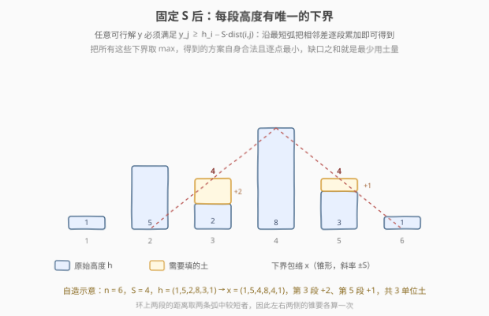
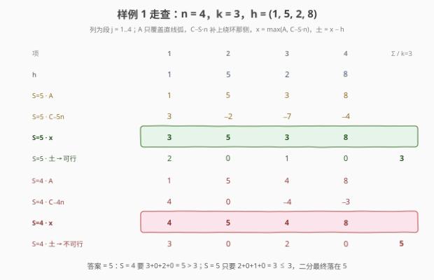

# Codeforces 2290G1 湖畔小径 题解

## 1. 题目概述

- **标题 / 题号**：湖畔小径（Codeforces 2290G1，英文名 Lakeside Trail (Easy Version)）
- **链接**：https://codeforces.com/problemset/problem/2290/G1
- **来源**：Codeforces Round 1134 (Div. 4) · Problem G1
- **难度**：未评级（Div. 4 的 G1，官方暂无 rating）
- **限制**：时间 4 s / 内存 256 MB
- **标签**：二分查找、枚举、数学

**题意**：环湖步道分成 $n$ 段，编号 $1\sim n$，第 $i$ 段高度为 $h_i$；$i$ 与 $i+1$ 相邻，$n$ 与 $1$ 也相邻。陡峭度定义为相邻两段高度差绝对值的最大值：

$$\text{steep}(h)=\max_{1\le i\le n}\left|h_i-h_{i+1}\right|,\qquad h_{n+1}=h_1 .$$

你手里有 $k$ 单位土，一单位土让某一段高度 $+1$，可以重复用在同一段上，但**只能加不能减**。求用至多 $k$ 单位土之后陡峭度的最小值。多测，每个测试用例输出一行一个整数。

**约束**：

- $1\le t\le 500$，$3\le n\le 2\cdot 10^3$，且所有测试用例的 $\sum n\le 2\cdot 10^3$；
- $0\le k\le 10^{18}$，$1\le h_i\le 10^9$；
- 本题是 Easy 版，Hard 版只放大了 $n$、$\sum n$ 与 $t$ 这三项约束。

## 2. 示例与观察
```text
输入
6
4 3
1 5 2 8
5 5
2 9 4 1 6
3 0
1 4 7
3 100
1 10 1
5 5
4 1 1 1 1
6 14
3 6 2 4 1 5

输出
5
4
6
0
2
1
```

第 1 组把第 1 段 $+2$、第 3 段 $+1$ 得 $(3,5,3,8)$，边差 $2,2,5,5$，要做到 $4$ 至少需 $5$ 单位土；第 3 组 $k=0$，答案即初始陡峭度 $\lvert 7-1\rvert=6$；第 4 组全抬到 $10$ 只花 $18$ 单位土，答案 $0$。

## 3. 解题思路

### 3.1 暴力思路

「土怎么分配」的方案数是天文数字（$k$ 可达 $10^{18}$），枚举分配方式不可行。但答案是一个整数 $D$，且有明显单调性：**若陡峭度能做到 $\le S$，那么 $S$ 再大也一定能做到**（同一方案不用改）。于是问题转成「二分答案 + 判定」：给定 $S$，用至多 $k$ 单位土能否让所有相邻差都 $\le S$？难点全在判定本身——要在不枚举分配方案的前提下算出最少用土量，朴素地猜最终高度向量会组合爆炸，必须找到每段高度的**唯一确定下界**。

### 3.2 核心观察：最小方案就是 $S$-利普希茨上包络



设最终高度为 $y_1,\dots,y_n$，要求 $y_j\ge h_j$ 且相邻差 $\le S$。在环上取 $i$ 到 $j$ 的**最短弧**，它含 $d(i,j)=\min(\lvert i-j\rvert,\,n-\lvert i-j\rvert)$ 条边；沿这条弧把相邻差用三角不等式逐边累加：

$$\lvert y_i-y_j\rvert\le S\cdot d(i,j)\ \Longrightarrow\ y_j\ \ge\ y_i-S\cdot d(i,j)\ \ge\ h_i-S\cdot d(i,j).$$

让 $i$ 取遍所有段，就得到**每个位置各自的下界**：

$$f(j)=\max_{1\le i\le n}\Bigl(h_i-S\cdot d(i,j)\Bigr). \tag{1}$$

这个 $f$ 有两个关键性质，合起来就是本题的全部秘密：

1. **$f$ 自身合法**：$i=j$ 给出 $f(j)\ge h_j$；又每个 $g_i(j)=h_i-S\cdot d(i,j)$ 都是 $S$-利普希茨的，有限个 $S$-利普希茨函数取 $\max$ 仍是 $S$-利普希茨，故相邻两段的 $f$ 值相差不超过 $S$。
2. **$f$ 逐点最小**：任意合法 $y$ 都满足 $y_j\ge f(j)$，所以 $f$ 就是「陡峭度 $\le S$」约束下花费最小的方案。

于是判定无需搜索，花费有闭式：

$$C(S)=\sum_{j=1}^{n}\bigl(f(j)-h_j\bigr),\qquad \text{可行}\iff C(S)\le k. \tag{2}$$

再注意 $g_i(j)$ 随 $S$ 增大而**不增**，所以 $f(j)$ 与 $C(S)$ 都关于 $S$ 单调不增——二分答案完全合法。

### 3.3 算法流程：两次扫描求包络，总 $O(n\log V)$


按 (1) 逐点枚举 $i$ 是 $O(n^2)$ 的。因为 $d(i,j)=\min(\lvert i-j\rvert,\,n-\lvert i-j\rvert)$，把 (1) 拆成两条弧各算一遍再取大：

$$A(j)=\max_i\bigl(h_i-S\lvert i-j\rvert\bigr),\quad B(j)=\max_i\bigl(h_i-S(n-\lvert i-j\rvert)\bigr)=C(j)-S\cdot n,$$

其中 $C(j)=\max_i\bigl(h_i+S\lvert i-j\rvert\bigr)$，与 $A$ 同一次扫描，只把步长 $-S$ 换成 $+S$。$A$ 与 $C$ 都是「一维距离变换」，两遍扫描即可，每遍只覆盖线性距离的一侧：

```text
正向：L[i] = max(h[i], L[i-1] - S)        i = 1..n-1
反向：R[i] = max(h[i], R[i+1] - S)        i = n-2..0
A[i] = max(L[i], R[i])                    // 同理得 C：把 -S 换成 +S
x[i] = max(A[i], C[i] - S*n)              // 两条弧合并
cost = sum(x[i] - h[i])，中途 > k 即返回 false
```

外层在 $[0,\ \text{初始陡峭度}]$ 上二分最小可行 $S$：上界取初始陡峭度是因为「一单位土都不用」必然可行。

### 3.4 示例演算



以样例 1（$n=4$，$k=3$，$h=(1,5,2,8)$）为例，二分只需判定 $S=5$ 与 $S=4$：

| 量 | 段 1 | 段 2 | 段 3 | 段 4 | 合计 |
|----|------|------|------|------|------|
| $h$ | 1 | 5 | 2 | 8 | — |
| $S=5$：$A$ | 1 | 5 | 3 | 8 | — |
| $S=5$：$C-5n$ | 3 | $-2$ | $-7$ | $-4$ | — |
| $S=5$：$x$ | 3 | 5 | 3 | 8 | — |
| $S=5$：土 | 2 | 0 | 1 | 0 | **3 ≤ 3 可行** |
| $S=4$：$A$ | 1 | 5 | 4 | 8 | — |
| $S=4$：$C-4n$ | 4 | 0 | $-4$ | $-3$ | — |
| $S=4$：$x$ | 4 | 5 | 4 | 8 | — |
| $S=4$：土 | 3 | 0 | 2 | 0 | **5 > 3 不可行** |

$S=5$ 时绕环那条弧没有起作用（$C-5n$ 全被 $A$ 压住），最小方案恰是 $(3,5,3,8)$，花 $3$ 单位正好用完；$S=4$ 要花 $5$ 单位，超预算。二分收缩后答案为 $5$。

## 4. 算法细节

1. **二分上下界**：$lo=0$、$hi=\max_i\lvert h_i-h_{i+1}\rvert$。$hi$ 一定可行（原样不动，花费 $0$），所以 `while (lo < hi)` 里不必单独验证上界。
2. **类型与溢出**：$k$ 必须按 `long long` 读（$10^{18}$ 装不进 `int`）；$h_i-S\cdot d$ 最小约 $-2\cdot 10^{12}$，$C(j)-S\cdot n$ 同量级；而 $C(S)\le n\cdot\max h\le 2\cdot 10^{12}$，与 $k$ 比较安全。
3. **距离变换要用两份数组**：对 $\max$ 型变换，若在同一数组上先正向再反向，正向得到的偏大值再加 $S$ 会产生虚假的更大值被 $\max$ 选中（$\min$ 型没有这个坑）。代码里正向用 `L`、反向用 `R`，都从原数组拷贝。
4. **提前退出**：`cost` 累加中一旦超过 $k$ 立即返回 `false`，既省时间也避免读者担心累加溢出。
5. **下标与距离**：环上 $\lvert i-j\rvert\in[0,n-1]$，两条弧长为 $\lvert i-j\rvert$ 与 $n-\lvert i-j\rvert$；$i=j$ 的项自动出现在 $A$ 里，保证 $f(j)\ge h_j$。代码用 $0$-indexed，相邻取 `(i+1)%n`。
6. **多测清空与 I/O**：数组按 $n$ 现场构造（`vector<ll> h(n)`），不要 `memset` 固定 $2\cdot 10^5$；C++ 关同步流，Python 用 `sys.stdin.buffer.read().split()` 一次读入。

## 5. 正确性证明

**引理 1（下界）**：设 $y$ 是任一合法方案（$y_j\ge h_j$，相邻差 $\le S$），则对任意 $i,j$ 有 $y_j\ge h_i-S\cdot d(i,j)$。

**证明**：取 $i$ 到 $j$ 的最短弧，顶点依次为 $v_0=i,\dots,v_d=j$，$d=d(i,j)$。每步差不超过 $S$，由三角不等式 $\lvert y_j-y_i\rvert\le\sum_t\lvert y_{v_t}-y_{v_{t-1}}\rvert\le S\cdot d$；又 $y_i\ge h_i$，故 $y_j\ge y_i-S\cdot d\ge h_i-S\cdot d$。对 $i$ 取 $\max$ 即得 $y_j\ge f(j)$。∎

**引理 2（$f$ 可行）**：由 (1) 定义的 $f$ 满足 $f(j)\ge h_j$，且对任意 $j,k$ 有 $\lvert f(j)-f(k)\rvert\le S\cdot d(j,k)$，特别地相邻两段之差 $\le S$。

**证明**：$i=j$ 时 $h_j-S\cdot 0=h_j$，故 $f(j)\ge h_j$。对固定 $i$，环距离满足三角不等式 $\lvert d(i,j)-d(i,k)\rvert\le d(j,k)$，于是 $\lvert g_i(j)-g_i(k)\rvert=S\cdot\lvert d(i,j)-d(i,k)\rvert\le S\cdot d(j,k)$，即每个 $g_i$ 都是 $S$-利普希茨的。有限个 $S$-利普希茨函数逐点取 $\max$ 后仍满足同一不等式：设 $j$ 处最大的是 $g_{i_1}$、$k$ 处是 $g_{i_2}$，则 $f(j)-f(k)=g_{i_1}(j)-g_{i_2}(k)\le g_{i_1}(j)-g_{i_1}(k)\le S\cdot d(j,k)$，反向同理。取 $d(j,k)=1$ 即得相邻差 $\le S$。∎

**引理 3（最小性）**：$C(S)=\sum_j\bigl(f(j)-h_j\bigr)$ 是所有「陡峭度 $\le S$」方案中的最小花费，且 $C(S)$ 关于 $S$ 单调不增。

**证明**：由引理 1，任一合法方案逐点不低于 $f$，花费 $\sum(y_j-h_j)\ge\sum(f(j)-h_j)=C(S)$，而引理 2 说明 $f$ 合法、下界可取到。单调性：固定 $i,j$ 时 $g_i(j)$ 随 $S$ 增大而不增，故 $f(j)$ 与 $C(S)$ 都不增。∎

**定理**：设 $T$ 为最小可达陡峭度，则二分返回 $T$。

**证明**：对整数 $S$，「陡峭度 $\le S$ 且花费 $\le k$」等价于 $C(S)\le k$（引理 3）。若 $S\ge T$，取达到 $T$ 的方案，其陡峭度 $\le S$ 且花费 $\le k$，故 $C(S)\le k$；若 $S<T$，则 $C(S)\le k$ 会给出陡峭度 $\le S<T$ 的可行方案，与 $T$ 的最小性矛盾。所以谓词恰在 $[T,hi]$ 上为真，二分取第一个真值即得 $T$。∎

## 6. 复杂度分析

- **时间**：一次判定做两次距离变换（各两遍扫描）加一遍合并，$O(n)$；二分 $O(\log V)$ 轮，$V\le 10^9$ 约 $30$ 轮，总计 $O(n\log V)$，$\sum n\le 2\cdot 10^3$ 时约 $2.4\times 10^{5}$ 次基本运算。
- **空间**：每测约 $6n$ 个 `long long`（$h,L,R,A,C$），$n=2000$ 时不到 $100$ KB，远小于 $256$ MB。
- **对照时限**：$4$ s 下实测 C++ 最大单测 $6\sim 11$ ms、Python $50\sim 120$ ms，余量百倍以上；判定严格 $O(n)$，放大到 Hard 版规模也依然适用。

## 7. 参考代码

### C++17

```cpp
#include <iostream>
#include <cstdlib>
#include <vector>
#include <algorithm>
using namespace std;
typedef long long ll;
int main() {
    ios::sync_with_stdio(false);
    cin.tie(nullptr);
    int T; cin >> T;
    while (T--) {
        int n; ll k;
        cin >> n >> k;
        vector<ll> h(n);
        for (auto &x : h) cin >> x;
        ll hi = 0;                        // 二分上界：原样不动的陡峭度
        for (int i = 0; i < n; ++i) hi = max(hi, llabs(h[i] - h[(i + 1) % n]));

        // max_i (f[i] + step*|i-j|)：正向只管 i<=j，反向只管 i>=j
        auto transform = [&](const vector<ll>& f, ll step) {
            vector<ll> L(f), R(f), res(n);
            for (int i = 1; i < n; ++i) L[i] = max(L[i], L[i - 1] + step);
            for (int i = n - 2; i >= 0; --i) R[i] = max(R[i], R[i + 1] + step);
            for (int j = 0; j < n; ++j) res[j] = max(L[j], R[j]);
            return res;
        };
        auto feasible = [&](ll S) {
            vector<ll> A = transform(h, -S), C = transform(h, S);   // 两条弧
            ll cost = 0, Sn = S * (ll)n;
            for (int j = 0; j < n; ++j) {
                cost += max(A[j], C[j] - Sn) - h[j];
                if (cost > k) return false;   // 提前退出
            }
            return true;
        };
        ll lo = 0;
        while (lo < hi) {
            ll mid = lo + (hi - lo) / 2;
            if (feasible(mid)) hi = mid; else lo = mid + 1;
        }
        cout << lo << '\n';
    }
    return 0;
}
```

### Python3

```python
import sys


def solve(n, k, h):
    def transform(f, step):          # max_i (f[i] + step*|i-j|)，两遍扫描都用原数组
        L = f[:]
        for i in range(1, n):
            if L[i - 1] + step > L[i]: L[i] = L[i - 1] + step
        R = f[:]
        for i in range(n - 2, -1, -1):
            if R[i + 1] + step > R[i]: R[i] = R[i + 1] + step
        return [max(L[j], R[j]) for j in range(n)]

    def feasible(S):
        A, C = transform(h, -S), transform(h, S)
        Sn, cost = S * n, 0
        for j in range(n):
            cost += max(A[j], C[j] - Sn) - h[j]
            if cost > k: return False
        return True
    lo, hi = 0, max(abs(h[i] - h[(i + 1) % n]) for i in range(n))
    while lo < hi:
        mid = (lo + hi) // 2
        if feasible(mid):
            hi = mid
        else:
            lo = mid + 1
    return lo


def main():
    data = list(map(int, sys.stdin.buffer.read().split()))
    t, p, out = data[0], 1, []
    for _ in range(t):
        n, k = data[p], data[p + 1]
        h = data[p + 2:p + 2 + n]
        p += 2 + n
        out.append(str(solve(n, k, h)))
    sys.stdout.write("\n".join(out) + "\n")


main()
```

## 8. 边界情况与易错点

1. **$k=0$**：一单位土都不能用，判定只在 $S\ge$ 初始陡峭度时成立；二分下界必须从 $lo=0$ 开始，写成 $1$ 会漏掉答案为 $0$ 的情形。
2. **$k$ 极大**：$k\ge n\cdot\max h-\sum h$ 时答案直接是 $0$（全抬到最高段），此时 $C(0)=n\cdot\max h-\sum h\le 2\cdot 10^{12}$，与 $10^{18}$ 比较无风险，但 $k$ 要用 `long long` 读。
3. **$n=3$ 与高度全相同**：$n=3$ 时两条弧长为 $1$ 与 $2$，$k=0$ 的答案就是三个相邻差的最大值，可快速手验；高度全相同时初始陡峭度 $0$，$lo=hi=0$ 直接返回 $0$，且 $S=0$ 时 $x=h$、花费 $0$，不会误判。
4. **负值与输出**：$h_i-S\cdot d$ 可能为负，不要用无符号类型、也不要在中途 `clamp` 到 $0$（负值会被 $i=j$ 项压住，提前截断反而算错花费）；每测输出一行，Python 用 `"\n".join(out)` 后记得补换行。
5. **二分方向**：写「可行就把 $hi$ 压到 $mid$」并返回 $lo$，不要写成「记录最后一个不可行值再 $+1$」，容易在上界处差一。

## 9. 验证记录

- **编译环境与命令**：`clang++ -std=c++17 -O2`（本机无 GNU g++，配 `codeforces/tools/include/bits/stdc++.h` 兼容头；正文代码只用标准库，可原样提交 GNU C++17）；Python 侧为 `Python 3.9.6`。
- **官方样例**：1 / 1 通过（按 Codeforces 标准 checker 的 token 比对，忽略空白与大小写）。
- **复核状态**：audited（2026-11-19 统一回归：编译 + 官方样例；写作期的随机对拍与暴力未重跑）。

## 相关题目与扩展

- [Codeforces 2290G2 湖畔小径（困难版）](https://codeforces.com/problemset/problem/2290/G2)：只放大了 $n$、$\sum n$ 与 $t$，本文 $O(n\log V)$ 的判定思路原封不动即可使用，正好说明「判定写得好，版本升级不用改」。
- [LeetCode 410. 分割数组的最大值](https://leetcode.cn/problems/split-array-largest-sum/) 与 [LeetCode 1631. 最小体力消耗路径](https://leetcode.cn/problems/path-with-minimum-effort/)：都是「答案二分 + 阈值判定」，前者判定为贪心分段，后者把「最大值最小」转成可达性，与本题的「固定 $S$ 判可行性」同构。
- [Codeforces 2290F 值计数器题解](../2290/F.值计数器题解.md)：同场另一道需要「先推闭式、再线性构造」的题，思路气质相近。

**延伸思考**：

1. 若规则反过来是**只能挖土、不能加高**，把 (1) 的 $\max$ 换成 $\min$：$x_j=\min_i\bigl(h_i+S\cdot d(i,j)\bigr)$ 是逐点最大的可行方案，花费 $\sum(h_j-x_j)$；有趣的是 $\min$ 型距离变换**可以**就地复用数组——第 4 节第 3 条那种「偏大的污染值」恰好被 $\min$ 忽略，这正是 $\min$ 模板照抄能过、$\max$ 模板照抄却 WA 的原因。
2. 把环换成**树**（每条树边都有差约束，只增不减），包络论证照旧成立：$f(v)=\max_u\bigl(h_u-S\cdot\mathrm{dist}(u,v)\bigr)$，可用两遍 DFS（换根式距离变换）在 $O(n)$ 内求出，这正是同场 H 题「Extra Road」的核心工具。
3. 若要求**恰好**用完 $k$ 单位土（而非至多），答案未必等于「至多」版本：最小包络方案只花 $C(S)$，多出来的土还得继续往上倒，而每段能「白吃」多少土受坡度约束限制，总量有限。判定要从「$C(S)\le k$」变成「存在坡度 $\le S$ 的方案恰好花 $k$」，需要额外刻画每个 $S$ 下花费的可达范围，难度明显上升。
