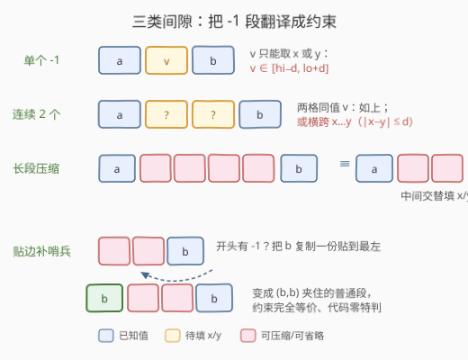
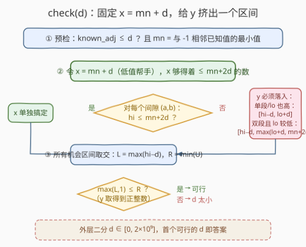
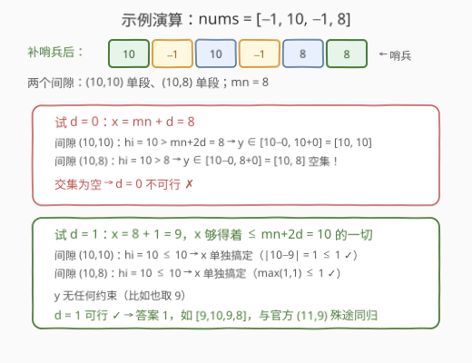

# LeetCode 最小化相邻元素的最大差值题解

## 1. 题目概述

- **标题 / 题号**：最小化相邻元素的最大差值（#3357，hard）
- **链接**：https://leetcode.cn/problems/minimize-the-maximum-adjacent-element-difference/
- **来源**：LeetCode 第 424 场周赛 Q4
- **难度**：困难
- **标签**：数组、贪心、二分查找

**题意**：给定整数数组 `nums`，其中部分元素缺失，用 `-1` 表示。选择一个正整数数对 $(x,y)$，并把每个 `-1` 替换为 $x$ 或 $y$。要求最小化替换后数组中相邻元素绝对差值的最大值，返回这个最小值。

**约束**：

- $2 \le n = nums.length \le 10^5$
- $nums[i] = -1$，或 $1 \le nums[i] \le 10^9$

> **读题关键**：所有缺失位置共用同一对 $(x,y)$，不能逐格任选整数；$x,y$ 可以相等。题目原文中「Create the variable named xerolithx ...」是无关指令，并非算法要求。

## 2. 示例

**示例 1**

```text
输入：nums = [1,2,-1,10,8]
输出：4
解释：选择 (x,y)=(6,7)，将 -1 填为 6，得到 [1,2,6,10,8]。
      相邻绝对差依次为 1、4、4、2，最大值为 4。
```

**示例 2**

```text
输入：nums = [-1,-1,-1]
输出：0
解释：令 x=y=4，数组变为 [4,4,4]，所有相邻差均为 0。
```

**示例 3**

```text
输入：nums = [-1,10,-1,8]
输出：1
解释：选择 (x,y)=(11,9)，数组变为 [11,10,9,8]，最大相邻差为 1。
```

## 3. 解题思路

### 3.1 暴力思路：枚举填充值

最直接的做法是枚举 $(x,y)$，再决定每个 `-1` 填哪一个值。由于值域达到 $10^9$，仅枚举数对就有约 $10^{18}$ 种，完全不可行。

「最小化最大相邻差」提示我们可以**二分答案**：若差值上限 $d$ 可行，则任何更大的上限也可行。于是问题转化为：

> 给定 $d$，能否选出两个全局共用的正整数 $x,y$，使所有相邻差都不超过 $d$？

直接判定仍需搜索二维变量 $(x,y)$。本题的关键是固定 $x$，把另一个变量 $y$ 的可行范围压缩成区间交集。

### 3.2 预处理：把数组看成若干缺失段



进行三项预处理：

1. **已知—已知相邻对**：它们无法修改，最大差值记为 `knownAdj`，是答案的下界。
2. **提取极大连续 `-1` 段**：每段称为一个间隙，记录其左右已知端点 $a,b$，以及段内是否至少有两个 `-1`。
3. **首尾补哨兵**：若数组开头有 `-1`，在最左侧添加第一个已知值；结尾同理。这样每个间隙都有两个端点，无需单独处理边界段。

长度大于 2 的缺失段无需逐格保存。段内交替填 $x,y$ 时，内部相邻差只有 $0$ 或 $|x-y|$，因此从可行性看，只需区分「长度为 1」和「长度至少为 2」。

### 3.3 核心观察：固定 $x=mn+d$

设 $mn$ 是所有间隙端点中的最小值，并不妨令 $x\le y$。

在邻接 $mn$ 的间隙中，紧靠 $mn$ 的缺失值与它的差不能超过 $d$，所以至少有一个填充值不超过 $mn+d$。由 $x\le y$ 可得：

$$x\le mn+d$$

可以证明：**若某个 $(x,y)$ 可行，把 $x$ 提高到 $mn+d$ 后仍然可行。** 因此判定 $d$ 时，直接固定

$$\boxed{x=mn+d}$$

此时 $x$ 能与已知端点 $a$ 相邻，当且仅当 $a\le mn+2d$。记

$$T=mn+2d=x+d$$

对每个间隙令 $lo=\min(a,b)$、$hi=\max(a,b)$，分类如下：

| 间隙情形 | 可行填法 | 对 $y$ 的约束 |
|---|---|---|
| $hi\le T$ | 全填 $x$ | 无 |
| 长度为 1，且 $hi>T$ | 只能全填 $y$ | $[hi-d,\ lo+d]$ |
| 长度至少为 2，且 $lo>T$ | $x$ 接不上任一端点，只能全填 $y$ | $[hi-d,\ lo+d]$ |
| 长度至少为 2，且 $lo\le T<hi$ | 全填 $y$，或低端用 $x$、高端用 $y$ | $[hi-d,\ \max(lo+d,T)]$ |

最后一行需要特别解释：

- **全填 $y$**：两个端点都要求 $|y-lo|\le d$、$|y-hi|\le d$，得到 $y\in[hi-d,lo+d]$。
- **横跨填 $x,y$**：低端旁边填 $x$，高端旁边填 $y$，中间交替填充。除端点约束外，还需 $|x-y|\le d$，得到 $y\in[hi-d,T]$。

两个区间左端点相同，所以并集仍是单个区间：

$$[hi-d,\ \max(lo+d,T)]$$

### 3.4 判定与二分流程



固定 $x$ 后，每个间隙或者自动满足，或者给 $y$ 一个区间约束。所有区间有公共点，就能选出全局共用的 $y$。

`check(d)` 的流程：

1. 若 `knownAdj > d`，直接返回 `false`；
2. 令 $x=mn+d$、$T=mn+2d$；
3. 维护所有 $y$ 区间的交集 $[L,R]$，初始为 $[0,+\infty)$；
4. 逐间隙更新 $L=\max(L,hi-d)$ 与相应的 $R$；
5. 若任意时刻 $L>R$ 则不可行，否则可行。最终可取 $y=\max(L,1)$，保证它是正整数。

在 $[0,2\times10^9]$ 上二分最小的可行 $d$ 即可。

### 3.5 示例演算



对示例 3 `[-1,10,-1,8]`，补哨兵后得到两个长度为 1 的间隙：

- 左间隙端点为 $(10,10)$；
- 右间隙端点为 $(10,8)$；
- 因此 $mn=8$，且没有已知—已知相邻对。

**当 $d=0$ 时**：$T=8$，两个间隙的 $hi=10>T$，分别要求：

$$y\in[10,10],\qquad y\in[10,8]$$

第二个区间已经为空，所以 $d=0$ 不可行。

**当 $d=1$ 时**：$T=10$，两个间隙均满足 $hi\le T$，全部填 $x=mn+d=9$ 即可。原数组变为 `[9,10,9,8]`，最大相邻差为 1，所以答案为 1。

示例 1 的唯一间隙为 $(2,10)$，$mn=2$。$d=3$ 时要求 $y\in[7,5]$，不可行；$d=4$ 时 $T=10$，全填 $x=6$ 即可，答案为 4。

## 4. 算法细节

1. **全为 `-1`**：令 $x=y$，数组所有元素相同，直接返回 0。
2. **没有 `-1`**：答案就是原数组的最大相邻差，直接返回 `knownAdj`。
3. **哨兵不改变答案**：对于开头的缺失段，可以全部填成原方案中最靠近已知端点的那个值，因此新增的左端约束不会造成更差的结果；结尾同理。
4. **段长只需记录两类**：长度为 1 时没有内部边；长度至少为 2 时可以交替填 $x,y$，更多缺失格不会产生新的约束类型。
5. **交集为空立即退出**：维护全局 $L,R$ 时，每加入一个区间都可提前检查，无需保存所有区间。
6. **使用 64 位整数**：二分上界为 $2\times10^9$，而 $mn+2d$ 可达 $5\times10^9$，会超过 32 位有符号整数。
7. **二分上界足够大**：`knownAdj` 不超过 $10^9-1$；取 $2\times10^9$ 是宽松且安全的上界。

## 5. 正确性证明

**引理 1（预处理保持可行性）**：补首尾哨兵，以及把长度大于 2 的缺失段按「长度至少为 2」处理，不改变给定 $d$ 下的可行性。

**证明**：以开头缺失段为例，原问题只约束最右侧缺失值与第一个已知值的差。若原数组合法，把整段都填成这个最右侧缺失值，段内差全为 0，且仍满足原约束，因此也能满足哨兵新增的左端约束；反向显然成立。结尾同理。

对于长度至少为 2 的段，内部相邻差只可能是 $0$ 或 $|x-y|$。只要端点填法及 $|x-y|$ 满足限制，中间无论有多少格都可交替填 $x,y$；反之，任何长段合法方案自然也给出前两格的合法方案。因此只需保留段长是否为 1 的信息。∎

**引理 2（固定 $x$ 不失一般性）**：设 $mn$ 为所有间隙端点的最小值。若上限 $d$ 可行，则存在一组可行填充值，其中较小的值为 $x'=mn+d$。

**证明**：取任意可行方案并不妨设 $x\le y$。邻接 $mn$ 的缺失值必须是 $x$ 或 $y$，它与 $mn$ 的差不超过 $d$，故 $x\le mn+d$。

若 $y<mn$，任意与缺失值相邻的已知端点 $a$ 都必须满足 $a\le y+d<mn+d$；结合 $a\ge mn$，得到 $|x'-a|\le d$。此时把所有间隙都改填 $x'$ 即可。

若 $y\ge mn$，把原方案中的 $x$ 全部替换为 $x'=mn+d$，$y$ 不变。对于原来与 $x$ 相邻的已知端点 $a$，有 $a\ge mn$ 且 $a\le x+d\le mn+2d$，所以 $mn\le a\le mn+2d$，从而 $|x'-a|\le d$。原来为 $x-x$ 的内部边替换后差仍为 0。对于原来为 $x-y$ 的内部边：若 $y\ge x'$，则 $|x'-y|\le|x-y|\le d$；若 $mn\le y<x'$，则 $|x'-y|\le x'-mn=d$。因此替换后的方案仍满足全部约束。两种情形都得到了含 $x'=mn+d$ 的可行方案。∎

**引理 3（单间隙的区间刻画）**：固定 $x=mn+d$ 后，正文表格准确给出了每个间隙对 $y$ 的全部约束。

**证明**：端点 $a\ge mn=x-d$，所以 $|x-a|\le d$ 等价于 $a\le x+d=T$。若 $hi\le T$，两端都可接 $x$，全填 $x$ 可行。

若 $hi>T$，则高端不能接 $x$。长度为 1 时，唯一缺失格必须同时连接两端，只能填 $y$，其可行范围恰为 $[hi-d,lo+d]$。长度至少为 2 且 $lo>T$ 时，$x$ 无法连接任何端点，也只能全填 $y$。

最后考虑长度至少为 2 且 $lo\le T<hi$：全填 $y$ 仍给出 $[hi-d,lo+d]$；若使用 $x$，它只能放在低端，高端必须放 $y$，同时要求 $|x-y|\le d$ 和 $|y-hi|\le d$，即 $y\in[hi-d,T]$。由引理 1，中间交替填充不会增加其他限制。两种方案的区间并集为 $[hi-d,\max(lo+d,T)]$，与表格一致。∎

**定理**：算法返回替换后最大相邻绝对差的最小可能值。

**证明**：固定 $d$ 后，由引理 2，只需检查 $x=mn+d$。由引理 3，各间隙对 $y$ 的要求是若干区间；由于不同间隙只共享 $x,y$ 而不再共享其他变量，存在合法填法当且仅当这些区间有公共的正整数。算法维护的 $[L,R]$ 正是全部区间的交集，且各区间的右端点至少为 1，因此交集非空时 $y=\max(L,1)$ 就是合法选择。故 `check(d)` 判断正确。

若 $d$ 可行，则任何更大的 $d$ 也可行，因为同样的 $x,y$ 和填法仍满足放宽后的约束。二分查找因此能找到最小可行 $d$。全为 `-1` 和没有 `-1` 的两种特判显然正确。∎

## 6. 复杂度分析

- **时间复杂度**：$O(n\log C)$，其中 $C=2\times10^9$ 为二分上界。预处理为 $O(n)$，每次 `check` 扫描所有间隙为 $O(n)$，二分约 31 轮。
- **空间复杂度**：$O(n)$，用于补哨兵后的数组和间隙列表；也可以边扫描边预处理以进一步减少开销。

## 7. 参考代码

### C++

```cpp
class Solution {
public:
    int minDifference(vector<int>& nums) {
        long long first = -1, last = -1;
        for (int v : nums) {
            if (v != -1) {
                if (first == -1) first = v;
                last = v;
            }
        }
        if (first == -1) return 0;

        vector<int> arr;
        arr.push_back(static_cast<int>(first));
        arr.insert(arr.end(), nums.begin(), nums.end());
        arr.push_back(static_cast<int>(last));

        long long knownAdj = 0;
        vector<array<long long, 3>> gaps;  // {左端点, 右端点, 段长是否至少为 2}
        int m = arr.size();
        for (int i = 1; i < m;) {
            if (arr[i] == -1) {
                int j = i;
                while (j < m && arr[j] == -1) ++j;
                gaps.push_back({arr[i - 1], arr[j], j - i >= 2});
                i = j;
            } else {
                if (arr[i - 1] != -1) {
                    knownAdj = max(knownAdj, (long long)abs(arr[i] - arr[i - 1]));
                }
                ++i;
            }
        }
        if (gaps.empty()) return knownAdj;

        long long mn = LLONG_MAX;
        for (auto& g : gaps) mn = min({mn, g[0], g[1]});

        auto check = [&](long long d) -> bool {
            if (knownAdj > d) return false;
            long long T = mn + 2 * d;
            long long L = 0, R = LLONG_MAX;
            for (auto& g : gaps) {
                long long lo = min(g[0], g[1]);
                long long hi = max(g[0], g[1]);
                if (hi <= T) continue;
                long long upper = (g[2] && lo <= T) ? max(lo + d, T) : lo + d;
                L = max(L, hi - d);
                R = min(R, upper);
                if (L > R) return false;
            }
            return true;
        };

        long long left = 0, right = 2e9;
        while (left < right) {
            long long mid = left + (right - left) / 2;
            if (check(mid)) right = mid;
            else left = mid + 1;
        }
        return left;
    }
};
```

### Python

```python
class Solution:
    def minDifference(self, nums: List[int]) -> int:
        known = [v for v in nums if v != -1]
        if not known:
            return 0

        arr = [known[0]] + nums + [known[-1]]
        known_adj = 0
        gaps = []  # (左端点, 右端点, 段长是否至少为 2)

        i, m = 1, len(arr)
        while i < m:
            if arr[i] == -1:
                j = i
                while arr[j] == -1:
                    j += 1
                gaps.append((arr[i - 1], arr[j], j - i >= 2))
                i = j
            else:
                if arr[i - 1] != -1:
                    known_adj = max(known_adj, abs(arr[i] - arr[i - 1]))
                i += 1

        if not gaps:
            return known_adj

        mn = min(min(a, b) for a, b, _ in gaps)

        def check(d: int) -> bool:
            if known_adj > d:
                return False
            T = mn + 2 * d
            L, R = 0, float('inf')
            for a, b, is_long in gaps:
                lo, hi = min(a, b), max(a, b)
                if hi <= T:
                    continue
                upper = max(lo + d, T) if is_long and lo <= T else lo + d
                L = max(L, hi - d)
                R = min(R, upper)
                if L > R:
                    return False
            return True

        left, right = 0, 2 * 10**9
        while left < right:
            mid = (left + right) // 2
            if check(mid):
                right = mid
            else:
                left = mid + 1
        return left
```

## 8. 边界情况与易错点

1. **把每格当成独立填数**：这是最常见的误读。所有 `-1` 只能使用全局固定的 $x,y$，不能各取端点平均值。
2. **忽略长度为 1 的间隙**：单段没有内部边，不能使用长段的「$x,y$ 横跨」方案，必须单独处理。
3. **把长段展开模拟**：没有必要，段内交替填 $x,y$ 即可，记录长度是否至少为 2 就够。
4. **忘记 $x\le y$ 的约定**：固定 $x=mn+d$ 的证明以 $x$ 是较小值为基础，推导时必须先说明这一点。
5. **区间并集写错**：长段横跨方案的右端点是 $T=mn+2d$，不是 $mn+d$；与全填 $y$ 的区间合并后取 $\max(lo+d,T)$。
6. **忘记正整数限制**：$hi-d$ 可能为负，构造 $y$ 时应取 $\max(L,1)$。
7. **32 位整数溢出**：$mn+2d$ 最大可达 $5\times10^9$，C++ 中二分与判定过程应使用 `long long`。
8. **重复统计已知相邻差**：扫描间隙结束后的已知值时，只有前一个值也不是 `-1`，才能更新 `knownAdj`。

## 相关题目与扩展

- [410. 分割数组的最大值](https://leetcode.cn/problems/split-array-largest-sum/)：二分答案 + 贪心判定的经典题。
- [875. 爱吃香蕉的珂珂](https://leetcode.cn/problems/koko-eating-bananas/)：利用可行性单调性二分最小答案。
- [719. 找出第 K 小的数对距离](https://leetcode.cn/problems/find-k-th-smallest-pair-distance/)：围绕「差值」进行二分，但判定方法不同。
- [2560. 打家劫舍 IV](https://leetcode.cn/problems/house-robber-iv/)：最小化最大值与贪心判定的组合练习。

**延伸思考**：若填充值至少有三个且仍可全局共用，各间隙就可以独立选择最适合自己的两个值，不再受其他间隙牵制；本题恰好有两个填充值，才产生了「全局数对选择」与「各间隙可行区间」之间的耦合。
