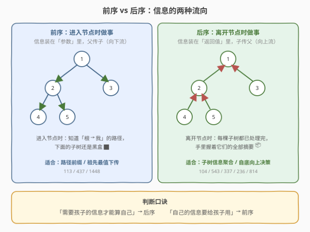
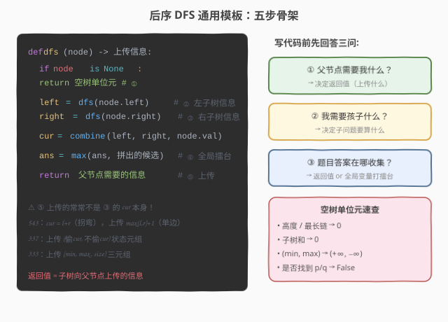
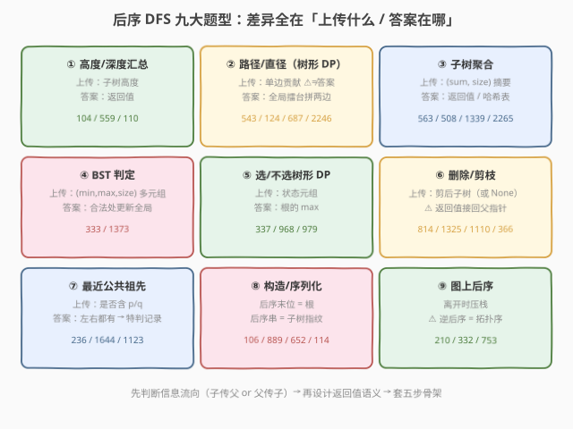
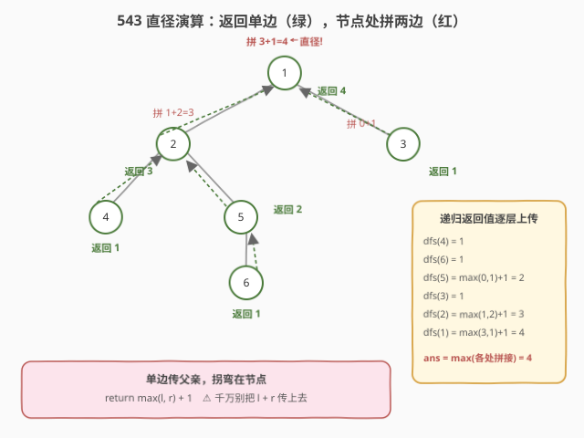

<!-- title: 后序 DFS 专题 -->
# 后序 DFS 专题

- **专题**：后序 DFS（Post-order DFS）
- **适用**：二叉树 / N 叉树 / 无向树上「**依赖子树信息**」的统计与决策、树形 DP、构造与序列化、图上的拓扑/欧拉类问题
- **前置**：递归基础、二叉树的前/中/后序遍历、DFS 思想
- **关联题解**：本站已收录 104 / 110 / 145 / 236 / 250 / 337 / 333 / 543 / 563 / 652 / 814 / 834 / 968 / 979 / 106 等数十道后序 DFS 题解

> 💡 **一句话定位**：后序 DFS = 「**先递归孩子，拿到所有子树上传的信息，再处理自己**」。前序是「进入节点时做事」，手里只有从根**下传**的路径信息；后序是「离开节点时做事」，手里握着每棵子树**上传**的完整信息——它天然是分治：**子问题（子树）先解决，父节点负责汇总**。树的绝大多数面试难题（直径、树形 DP、LCA、剪枝、BST 判定）本质都是后序。

---

## 1. 什么是后序 DFS

### 1.1 定义

后序遍历的访问顺序是「**左 → 右 → 根**」（N 叉树则是「孩子从左到右 → 根」）。但顺序本身不重要，重要的是**处理时机**：当前节点的代码，要等**左右子树的递归调用全部返回之后**才执行。

```python
def dfs(node):
    if node is None: return
    dfs(node.left)    # ① 先把左子树彻底处理完
    dfs(node.right)   # ② 再把右子树彻底处理完
    #   ③ 此处：左右子树的信息已全部就绪，才轮到处理 node —— 后序逻辑写在这里
```

这个「③」的位置就是后序的全部魔法：**执行到这里时，任何只依赖子树的问题都已经可解**。

### 1.2 什么时候用后序

凡是满足下面特征的题，几乎都该想到后序 DFS：

| 特征 | 说明 | 例题 |
|------|------|------|
| **答案依赖子树** | 要算自己，必须先知道子树的高度 / 和 / 大小 / 最值 | 104 / 563 / 543 |
| **要判定子树性质** | 是否平衡、是否 BST、是否同值——性质由孩子决定 | 110 / 333 / 250 |
| **自底向上做决策** | 孩子处理完，父亲才能决定自己怎么办 | 814 剪枝 / 968 放相机 |
| **最优解在树上分段** | 树形 DP：每个节点是「分治决策点」 | 337 / 968 / 979 |
| **要给子树发指纹** | 后序序列 = 子树结构签名，配哈希找重复 | 652 / 1948 |
| **用后序序列构造树** | 后序末位就是根，天然定根分段 | 106 / 889 |

> ⚠️ **前序 vs 后序的分界线**：看**信息流向**。父传子（路径前缀、祖先最值）用**前序**，如 [113. 路径总和 II](../solution/0101-0200/113_路径总和II.md)、[437. 路径总和 III](../solution/0401-0500/437_路径总和III.md)（前序 + 前缀和）、[1448. 好节点](../solution/1401-1500/1448_统计二叉树中好节点的数目.md)（前序向下传 pathMax）；子传父（子树信息聚合）用**后序**，如 [250. 统计同值子树](../solution/0201-0300/250_统计同值子树.md)（后序布尔上传）。1448 与 250 恰好互为镜像——一个是「祖先信息向下流」，一个是「子树信息向上流」。

---

## 2. 核心心智模型：信息自底向上流动



把一棵树看成一张「信息管道网」：**边是管道，递归调用让信息在管道里流动**。

- **前序（下传）**：信息装在**函数参数**里，从根往下灌。进入节点时，你知道「从根到我」这条路径上的一切，但对下面的子树一无所知——子树还是黑盒。
- **后序（上传）**：信息装在**返回值**里，从叶子往上收。离开节点时，每棵子树的黑盒都已打开，你手里握着它们的全部摘要。

所以后序天然是**分治**：`f(子树)` 是规模更小的同类子问题，父节点拿 `f(左)`、`f(右)` 的答案拼出自己的答案。这也是「后序 = 树上的分治」「树形 DP 的递归骨架 = 后序」这两句等价说法的由来。

> 💡 **一个判断口诀**：**「需要孩子的信息才能算自己」→ 后序；「自己的信息要给孩子用」→ 前序**。如果两个方向都需要（如 [543. 二叉树的直径](../solution/0501-0600/543_二叉树的直径.md) 里向下传无、向上传单边链），通常以后序为主、参数下传为辅。

---

## 3. 通用代码模板



所有后序题都套用下面这个骨架，核心是设计好**三件套**：空树 base case、汇总逻辑、**上传信息**。

### Python 模板

```python
def solve(root):
    ans = 初始值                     # 全局答案（副作用收集）

    def dfs(node) -> 上传信息:
        if node is None:
            return 空树的单位元       # 高度 0 / 和 0 / (min,max,size) 边界...
        left = dfs(node.left)         # ① 左子树信息
        right = dfs(node.right)       # ② 右子树信息
        cur = combine(left, right, node.val)   # ③ 汇总：当前子树整体信息
        ans = max(ans, 由 left/right 拼出的候选)  # ④ 全局擂台（按题取舍）
        return 父节点需要的信息        # ⑤ 上传 ⚠ 常常不是 cur 本身！

    dfs(root)
    return ans
```

### C++ 模板

```cpp
struct Info { /* 上传的信息：高度/和/多元组... */ };

Info dfs(TreeNode* node, long long& ans) {
    if (node == nullptr) return {};          // 空树单位元
    Info L = dfs(node->left, ans);           // ①
    Info R = dfs(node->right, ans);          // ②
    Info cur = combine(L, R, node->val);     // ③
    ans = max(ans, 拼出的候选);               // ④
    return 父节点需要的信息;                   // ⑤
}
```

### 返回值设计三问

后序题写不对，九成是返回值语义没想清楚。写代码前先回答：

1. **父节点需要我什么？**——决定**返回值**（上传什么）；
2. **我需要孩子什么？**——决定**子问题要算什么**；
3. **题目答案在哪收集？**——返回值本身，还是**全局变量**打擂台？

| 题目 | 返回值（上传） | 答案在哪 |
|------|---------------|----------|
| 104 最大深度 | 子树高度 `max(l,r)+1` | 返回值（根的上传值） |
| 543 直径 | **单边**最长链 `max(l,r)+1` | **全局**：节点处拼 `l+r` |
| 124 最大路径和 | **单边贡献** `max(0, max(l,r))+val` | **全局**：节点处拼 `l+r+val` |
| 337 打家劫舍 III | `(偷cur的最优, 不偷cur的最优)` | 返回值（根的 max） |
| 333 最大 BST 子树 | `(min, max, size)` 三元组 | 全局：合法处更新 size |
| 236 LCA | 「子树是否含 p/q」 | 特判：左右都有 → 记录答案 |

> ⚠️ **最关键的一课（543 / 124）**：**返回值 ≠ 答案**。路径经过节点时要「拐弯」（左链 + 右链），但答案只能沿**一条边**传给父亲——拐弯的候选在节点处用全局变量结算，**只把单边最优上传**。混淆这两者，就是 124 这类题最典型的 bug。

---

## 4. 迭代后序：三种写法

### 4.1 前序反转法（最常用）

把前序改成「**根 → 右 → 左**」，得到的序列整体 `reverse` 就是后序。[145](../solution/0101-0200/145_二叉树的后序遍历.md) 与 [590](../solution/0501-0600/590_N叉树的后序遍历.md) 的主推写法：

```python
def postorderTraversal(root):
    stack, out = [root] if root else [], []
    while stack:
        node = stack.pop()
        out.append(node.val)              # 根
        if node.left:  stack.append(node.left)   # 左先压（后弹）
        if node.right: stack.append(node.right)  # 右后压（先弹）→ 根右左
    return out[::-1]                      # ⭐ 反转成左右根
```

### 4.2 显式栈 + prev 标记

记录上一个弹出的节点，判断右子树是否已处理，处理完才弹出自己——模拟「离开节点」的时机，适合**迭代版后序逻辑**（不只收集值）。

### 4.3 BFS 定序 + 逆序处理（工程防爆栈，重点）

树有 `10⁵` 个节点且退化成链时，Python 默认递归深度（1000）必爆栈。标准工程写法：**BFS/DFS 记录每个节点的父节点得到一个「父先子后」的序列，逆序遍历它就是迭代后序**：

```python
order, parent = [root], {root: None}
for node in order:                      # 借 list 边遍历边追加 = BFS
    for ch in (node.left, node.right):
        if ch:
            parent[ch] = node
            order.append(ch)
for node in reversed(order):            # ⭐ 逆序 = 孩子先于父亲 = 后序
    # 此时 node 的所有孩子信息已在 info[] 中就绪
    info[node] = combine(info_of_children(node), node.val)
```

[1916. 统计为蚁群构筑房间的不同顺序](../solution/1901-2000/1916_统计为蚁群构筑房间的不同顺序.md)、[2920. 收集所有金币](../solution/2901-3000/2920_收集所有金币可获得的最大积分.md) 等新题均用此范式。**逆 BFS 序 = 迭代后序**，记住这个等价。

---

## 5. 题型分类



| 题型 | 上传信息 | 答案收集 | 代表题 |
|------|----------|----------|--------|
| **① 高度/深度汇总** | 子树高度 | 返回值 | 104 / 559 / 110 |
| **② 路径/直径（树形 DP）** | **单边**贡献 | 全局擂台 | 543 / 124 / 687 / 1372 / 2246 |
| **③ 子树聚合** | (sum, size) 等摘要 | 返回值 / 哈希表 | 563 / 508 / 1339 / 1120 / 2265 |
| **④ BST 判定** | (min, max, isBST, …) 多元组 | 全局 | 333 / 1373 |
| **⑤ 选/不选树形 DP** | 状态元组 | 返回值 | 337 / 968 / 979 |
| **⑥ 删除/剪枝** | 剪后的子树（或 None） | 返回值接回父指针 | 814 / 1325 / 1110 / 366 |
| **⑦ 最近公共祖先** | 是否含 p/q / (depth, lca) | 特判记录 | 236 / 1644 / 1123 |
| **⑧ 构造/序列化** | 建好的子树 / 子树序列 | — | 106 / 889 / 652 / 114 |
| **⑨ 图上后序** | 离开时压栈 | **逆**后序 | 210 / 332 / 753 |

### 5.1 高度汇总：最纯的后序

[104](../solution/0101-0200/104_二叉树的最大深度.md) 的 `max(l,r)+1` 是后序世界的 "Hello World"。[110 平衡二叉树](../solution/0101-0200/110_平衡二叉树.md) 是它的重要变体：自顶向下判平衡每层都重算高度 → $O(n^2)$；改为**后序一次遍历**，高度算好的同时顺手判平衡，不平衡返回 `-1` 哨兵提前止损 → $O(n)$。**「后序消灭重复计算」**是这个变体教的事。

### 5.2 路径/直径：「返回单边，内部拼两边」

直径 / 最长路径类（543、[124](../solution/0101-0200/124_二叉树中的最大路径和.md)、[687](../solution/0601-0700/687_最长同值路径.md)、[1372](../solution/1301-1400/1372_二叉树中的最长交错路径.md)、[2246](../solution/2201-2300/2246_相邻字符不同的最长路径.md)、[1522](../solution/1501-1600/1522_N叉树的直径.md)）共享同一副骨架：**递归返回「以我为端点向下延伸的单边最优」，在节点处把左右两段拼成「拐弯路径」候选，全局打擂台**。N 叉版把「左右两段」换成「孩子贡献的 Top-2」。

### 5.3 子树聚合：把子树压成一个摘要

[563 坡度](../solution/0501-0600/563_二叉树的坡度.md)、[508 子树和](../solution/0501-0600/508_出现次数最多的子树元素和.md)、[1339 分裂最大乘积](../solution/1301-1400/1339_分裂二叉树的最大乘积.md)、[2265 子树平均值](../solution/2201-2300/2265_统计值等于子树平均值的节点数.md) 都是「后序算子树和/子树 size，节点处使用」。要**多个统计量**就上传元组：[1120](../solution/1101-1200/1120_子树的最大平均值.md) 上传 `(sum, size)`，[1530 好叶子对](../solution/1501-1600/1530_好叶子节点对的数量.md) 上传「各距离叶子数」列表并在节点处合并计数。

### 5.4 BST 判定：多元组打包上传

[333](../solution/0301-0400/333_最大二叉搜索子树.md) 上传 `(min, max, size)` 三元组：当前树是 BST ⟺ 左子树是 BST 且 `L.max < val < R.min`。[1373](../solution/1301-1400/1373_二叉搜索子树的最大键值和.md) 再加一层 `sum` 变四元组。核心思想：**一个布尔量不够用，就把「判定性质所需的全部信息」打包成一个元组上传**。

### 5.5 树形 DP：树上选/不选

[337 打家劫舍 III](../solution/0301-0400/337_打家劫舍III.md) 开创「每个节点上传 `(选, 不选)` 成对状态」的范式，是所有树上状态机 DP 的祖师爷。[968 监控二叉树](../solution/0901-1000/968_监控二叉树.md) 用三状态（未覆盖 / 有相机 / 已覆盖）+「叶子不放相机，父亲兜底」的贪心自底向上决策；[979 分配硬币](../solution/0901-1000/979_在二叉树中分配硬币.md) 上传子树**净流量**（盈余为正亏缺为负），`Σ|净流量|` 即移动次数。树上 DP 与线性 DP 的唯一区别：**阶段顺序 = 后序**。

### 5.6 删除/剪枝：先处理孩子，再决定自己

[814 剪枝](../solution/0801-0900/814_二叉树剪枝.md) 的规则是「移除所有不含 1 的子树」。为什么必须后序？因为**孩子剪完之前，父亲不知道自己是否也变成全 0**。同族：[1325 删值等于 target 的叶子](../solution/1301-1400/1325_删除给定值的叶子节点.md)（删除会产生新叶子，反复触发）、[1110 删点成林](../solution/1101-1200/1110_删点成林.md)、[366 摘叶子](../solution/0301-0400/366_寻找二叉树的叶子节点.md)（按「离地高度」分层摘 = 反复后序删除）。共性：**返回剪完后的子树根（None 则剪掉），父节点把返回值接回指针**。

### 5.7 最近公共祖先：后序三路决策

[236](../solution/0201-0300/236_二叉树的最近公共祖先.md)：递归返回「子树里是否找到 p/q」。某节点**左右都找到了**，它就是 LCA——这正是后序位置才能做的判断（孩子先汇报）。变体：[1644](../solution/1601-1700/1644_二叉树的最近公共祖先II.md) 加计数处理「节点可能不存在」，[1123](../solution/1101-1200/1123_最深叶节点的最近公共祖先.md) / [865](../solution/0801-0900/865_具有所有最深节点的最小子树.md) 上传 `(最深深度, 该深度叶子的 LCA)` 二元组，[1740](../solution/1701-1800/1740_找到二叉树中的距离.md) 借 LCA 求节点距离。

### 5.8 构造/序列化：后序串就是子树指纹

- **定根**：后序序列**末位是根**，配哈希表在中序里定位分割点——[106 从中序与后序构造二叉树](../solution/0101-0200/106_从中序与后序遍历序列构造二叉树.md)（后序指针从右往左移 → 递归**先右后左**）、[889 前序 + 后序](../solution/0801-0900/889_根据前序与后序遍历构造二叉树.md)。
- **指纹**：[652 寻找重复的子树](../solution/0601-0700/652_寻找重复的子树.md) 用「左指纹 + 右指纹 + 根」拼出当前子树指纹，哈希计数找重复——后序序列天然是**子树的唯一签名**；[1948 删除重复文件夹](../solution/1901-2000/1948_删除系统中的重复文件夹.md) 把它推广到 Trie/N 叉。
- **变形**：[114 展开为链表](../solution/0101-0200/114_二叉树展开为链表.md) 用**反向后序**（右→左→根）+ `prev` 头插，一遍原地接链。

### 5.9 图上后序：逆后序 = 拓扑序

DFS 中「**离开节点**」的时刻同样构成后序。把节点在**离开时压栈**，最终栈从顶到底就是**逆后序 = 拓扑序**（[210 课程表 II](../solution/0201-0300/210_课程表II.md) 方法二）。欧拉路径的 Hierholzer 算法同理：出边耗尽才入栈、再整体逆序（[332 重新安排行程](../solution/0301-0400/332_重新安排行程.md)、[753 破解保险箱](../solution/0701-0800/753_破解保险箱.md) 的 de Bruijn 序列）。**「后序 + 反转」是图上一族算法的共同密码**。

---

## 6. 例题精讲

### 6.1 二叉树的最大深度（104）—— 后序 Hello World

**题意**：求二叉树最大深度。

**思路**：「我的深度 = max(左深度, 右深度) + 1」——子问题先解，父节点汇总，返回值即答案。

```python
def maxDepth(root):
    if root is None:
        return 0                       # 空树深度 0：base case 单位元
    return max(maxDepth(root.left),    # ① 左子树深度
               maxDepth(root.right)) + 1   # ②③ 右子树深度 + 汇总
```

> 详见站内题解 [104. 二叉树的最大深度](../solution/0101-0200/104_二叉树的最大深度.md)。对照其「前序回溯版」（深度作参数下传 + 全局打擂台）体会两种信息流向的等价与优劣。

### 6.2 二叉树的直径（543）—— 「返回单边，内部拼两边」模板源头

**题意**：求任意两节点间最长路径的边数（路径可拐弯）。

**思路**：每条直径必然在某个节点处「拐弯」= 左边链长 + 右边链长。递归返回**单边**最长链（父亲只能接一边），节点处拼出拐弯候选更新全局。



```python
def diameterOfBinaryTree(root):
    ans = 0
    def dfs(node):                 # 返回：以 node 为端点向下的单边链长
        nonlocal ans
        if node is None:
            return 0
        l = dfs(node.left)         # 左子树单边链长
        r = dfs(node.right)        # 右子树单边链长
        ans = max(ans, l + r)      # ⭐ 拐弯候选：左右拼接，全局打擂台
        return max(l, r) + 1       # ⚠ 只上传单边，不能把 l+r 传上去
    dfs(root)
    return ans
```

**演算**（如上图）：`dfs(4)=1`、`dfs(6)=1`、`dfs(5)=2` → 节点 5 处候选 `0+1=1`；节点 2 处候选 `1+2=3`，上传 `3`；节点 1 处候选 `3+1=4` → 答案 **4**（路径 `6-5-2-1-3`）。

> 详见站内题解 [543. 二叉树的直径](../solution/0501-0600/543_二叉树的直径.md)。124 / 687 / 1372 / 2246 / 1522 全是这套骨架换汇总函数：124 加「负贡献弃零」，687 加「同值才延续」，1372 记 (向左长, 向右长)，N 叉取孩子贡献 Top-2。

### 6.3 打家劫舍 III（337）—— 状态元组上传的树形 DP

**题意**：树上选节点求权和，父子不能同选。

**思路**：每个节点上传 `(选自己的最优, 不选自己的最优)`。父亲「选」时孩子必须全不选；父亲「不选」时孩子各自取 max——状态在**后序位置**由孩子状态拼出。

```python
def rob(root):
    def dfs(node):                 # 返回 (偷 node 的最优, 不偷 node 的最优)
        if node is None:
            return (0, 0)
        l_rob, l_skip = dfs(node.left)
        r_rob, r_skip = dfs(node.right)
        rob_cur  = node.val + l_skip + r_skip      # 偷我：孩子全不偷
        skip_cur = max(l_rob, l_skip) + max(r_rob, r_skip)  # 不偷我：孩子自由
        return (rob_cur, skip_cur)
    return max(dfs(root))
```

> 详见站内题解 [337. 打家劫舍 III](../solution/0301-0400/337_打家劫舍III.md)。对比「后序 + 哈希记忆化」版：状态元组版一次遍历 $O(n)$，是树上「选/不选」类 DP（2313 / 2378 / 2920 等）的通用范式。

### 6.4 二叉树的最近公共祖先（236）—— 后序三路决策

**题意**：求 p、q 在二叉树中的最近公共祖先。

**思路**：递归返回「当前子树中是否找到 p 或 q」。三种情况：左右都找到 → 当前节点即 LCA；只有一边找到 → 把该侧结果上传；都没找到 → 上传空。**判断「左右都有」必须发生在孩子汇报之后——这就是后序位置**。

```python
def lowestCommonAncestor(root, p, q):
    if root is None or root is p or root is q:
        return root                  # 空树 / 命中目标：直接上传
    left  = lowestCommonAncestor(root.left,  p, q)
    right = lowestCommonAncestor(root.right, p, q)
    if left and right:               # ⭐ 一边一个：当前即 LCA
        return root
    return left or right             # 双方都挤在同侧：上传该侧
```

> 详见站内题解 [236. 二叉树的最近公共祖先](../solution/0201-0300/236_二叉树的最近公共祖先.md)。1123 / 865 把「是否找到 p/q」换成「子树最深深度」，(depth, lca) 二元组上传，同一副骨架。

### 6.5 二叉树剪枝（814）—— 先孩子后自己

**题意**：移除所有**不含 1** 的子树（值只有 0/1）。

**思路**：孩子剪完之前，父亲不知道自己该不该剪——必须后序。返回「剪完后的子树根」，父节点把返回值接回指针。

```python
def pruneTree(root):
    if root is None:
        return None
    root.left  = pruneTree(root.left)     # ⭐ 返回值必须接回！
    root.right = pruneTree(root.right)
    if root.val == 0 and not root.left and not root.right:
        return None                       # 孩子全剪光 + 自己是 0 → 我也剪
    return root
```

> 详见站内题解 [814. 二叉树剪枝](../solution/0801-0900/814_二叉树剪枝.md)。1325 / 1110 / 366 同族：**后序删除 + 返回值接指针**，删除产生的连锁反应由递归自然处理。

---

## 7. 复杂度分析

| 维度 | 复杂度 | 说明 |
|------|--------|------|
| **时间** | $O(n)$ | 每个节点恰好进入/离开各一次；每节点 $O(1)$（或孩子数）汇总 |
| **空间** | $O(h)$ 递归栈 | $h$ 为树高：平衡 $O(\log n)$，**链状退化 $O(n)$** |

> ⚠️ **警惕隐性超 $O(n)$**：(a) 在后序里做 $O(n)$ 的序列化/拷贝（652 朴素拼字符串每次 $O(n)$，总 $O(n^2)$——用三元组编号指纹优化）；(b) 孩子信息用列表逐个合并时 lists 过长（1530 限制距离列表长度 ≤ d）；(c) 自顶向下重复算高度（110 的 $O(n^2)$ 教训）。

> ⚠️ **Python 递归爆栈**：LeetCode 树规模常达 $10^5$，链状树递归深度同数量级，远超默认递归限制。对策：`sys.setrecursionlimit(300000)`（简单但可能撑爆 C 栈），或改用 **4.3 的 BFS 定序 + 逆序处理**迭代后序（工程正解，新题 1916 / 2920 / 3544 均如此）。

> 💡 **换根 DP 是「两次遍历」的后序扩展**：第一趟后序自底向上算子树聚合（如 size、向下距离和），第二趟前序自顶向下「换根」下推兄弟信息，得到**所有节点为根**的答案——[834 树中距离之和](../solution/0801-0900/834_树中距离之和.md)、[2458 移除子树后的高度](../solution/2401-2500/2458_移除子树后的二叉树高度.md)。本质仍是「后序上传 + 前序下传」的组合拳。

---

## 8. 常见误区与技巧

1. **返回值语义混乱（头号错误）**
   - 543 / 124 的返回值是「**单边**贡献」，不是答案；答案（拐弯路径）在节点处用全局变量结算。把 `l + r` 当返回值上传，父亲会把拐弯路径再延长，结果全错。写代码前先用「三问」锁定语义。

2. **空节点 base case 单位元想错**
   - 高度 → 0；子树和 → 0；最长链 → 0；(min, max) → `(+∞, −∞)`；LCA → `None`。单位元错了，汇总全错。333 的 `(min, max, size)` 对空节点要取**不影响判断**的极值。

3. **该后序却用前序硬写**
   - 前序时子树是黑盒，只能靠「进入时下传 + 回溯时撤销」维护路径信息（113/437/1448 的路子）。对「子树聚合」类问题这样写要么极绕、要么 $O(n^2)$。**先判断信息流向再选序**。

4. **自顶向下重复计算**
   - 110 朴素解每层重算子树高度 → $O(n^2)$。改成后序「高度算好顺手判平衡」一次 $O(n)$。看到「对每个节点都要子树统计量」，第一反应后序。

5. **忘把返回值接回父指针（删除类）**
   - `pruneTree(node.left)` 返回的是**剪完后的新左子树根**，必须 `node.left = pruneTree(node.left)`。忘了接回，剪掉的操作等于没做。

6. **多元组信息漏传**
   - 333 只上传 size 不够——判定 BST 必须同时知道孩子的 min 和 max。设计返回值时问自己：「父亲用我的信息做判断时，还缺什么？」缺什么补什么，打包成元组。

7. **Python 递归爆栈**
   - $10^5$ 规模链状树直接 `RecursionError`。见 7 的两条对策；比赛/新题优先考虑迭代后序（BFS 定序 + 逆序处理）。

8. **图上后序忘了「逆」**
   - 拓扑序 = **逆**后序（离开时压栈，栈顶到栈底才是依赖顺序）；Hierholzer 的路径也是后序入栈再整体反转。直接拿后序序列用，方向全反。

9. **迭代后序忘反转**
   - 前序反转法按「根右左」收集后**必须 `reverse`**；这和上一条是同一个坑：**后序家族的输出经常要翻转**。

10. **全局答案忘初始化 / 被样例空树坑**
    - `ans` 的初始值要覆盖「根节点自身也是答案」的边界（如 124 单节点、543 单节点答案 0）；空树入参先判 `root is None`。

---

## 9. 课后练习题

按难度递进，建议**按顺序刷**，每道题先自己写，卡 20 分钟再看站内题解。带「✅ 题解」的表示本站已有详细中文题解。

### 🟢 基础：后序骨架与信息上传

| 题号 | 题目 | 难度 | 考点 | 题解 |
|------|------|------|------|------|
| 104 | [二叉树的最大深度](https://leetcode.cn/problems/maximum-depth-of-binary-tree/) | 简单 | `max(l,r)+1`，后序 Hello World | ✅ [题解](../solution/0101-0200/104_二叉树的最大深度.md) |
| 145 | [二叉树的后序遍历](https://leetcode.cn/problems/binary-tree-postorder-traversal/) | 简单 | 递归 / 前序反转法 / 显式栈 | ✅ [题解](../solution/0101-0200/145_二叉树的后序遍历.md) |
| 590 | [N 叉树的后序遍历](https://leetcode.cn/problems/n-ary-tree-postorder-traversal/) | 简单 | N 叉版：孩子全处理完再根 | ✅ [题解](../solution/0501-0600/590_N叉树的后序遍历.md) |
| 110 | [平衡二叉树](https://leetcode.cn/problems/balanced-binary-tree/) | 简单 | 后序消灭重复计算 + `-1` 哨兵 | ✅ [题解](../solution/0101-0200/110_平衡二叉树.md) |
| 617 | [合并二叉树](https://leetcode.cn/problems/merge-two-binary-trees/) | 简单 | 双树同步后序，返回新子树 | ✅ [题解](../solution/0601-0700/617_合并二叉树.md) |
| 226 | [翻转二叉树](https://leetcode.cn/problems/invert-binary-tree/) | 简单 | 任意序皆可，体会为何后序最自然 | ✅ [题解](../solution/0201-0300/226_翻转二叉树.md) |

> **目标**：默写后序骨架，能说清「返回值 = 上传给父亲的信息」。

### 🟡 进阶：单边贡献与子树聚合

| 题号 | 题目 | 难度 | 考点 | 题解 |
|------|------|------|------|------|
| 543 | [二叉树的直径](https://leetcode.cn/problems/diameter-of-binary-tree/) | 简单 | **返回单边、内部拼两边**（必背模板） | ✅ [题解](../solution/0501-0600/543_二叉树的直径.md) |
| 563 | [二叉树的坡度](https://leetcode.cn/problems/binary-tree-tilt/) | 简单 | 子树和上传 | ✅ [题解](../solution/0501-0600/563_二叉树的坡度.md) |
| 508 | [出现次数最多的子树元素和](https://leetcode.cn/problems/most-frequent-subtree-sum/) | 中等 | 后序 + 哈希计数 | ✅ [题解](../solution/0501-0600/508_出现次数最多的子树元素和.md) |
| 250 | [统计同值子树](https://leetcode.cn/problems/count-univalue-subtrees/) | 中等 | 布尔性质上传（与 1448 互为镜像） | ✅ [题解](../solution/0201-0300/250_统计同值子树.md) |
| 124 | [二叉树中的最大路径和](https://leetcode.cn/problems/binary-tree-maximum-path-sum/) | 困难 | 单边贡献 + 负值弃零 + 全局擂台 | ✅ [题解](../solution/0101-0200/124_二叉树中的最大路径和.md) |
| 814 | [二叉树剪枝](https://leetcode.cn/problems/binary-tree-pruning/) | 中等 | 先孩子后自己 + 返回值接回 | ✅ [题解](../solution/0801-0900/814_二叉树剪枝.md) |
| 652 | [寻找重复的子树](https://leetcode.cn/problems/find-duplicate-subtrees/) | 中等 | 后序序列化做子树指纹 | ✅ [题解](../solution/0601-0700/652_寻找重复的子树.md) |
| 236 | [二叉树的最近公共祖先](https://leetcode.cn/problems/lowest-common-ancestor-of-a-binary-tree/) | 中等 | 后序三路决策 | ✅ [题解](../solution/0201-0300/236_二叉树的最近公共祖先.md) |

> **目标**：吃透「返回值 ≠ 答案」，熟练用全局变量结算拐弯候选；掌握删除类「接回指针」写法。

### 🔴 挑战：树形 DP 与多元组上传

| 题号 | 题目 | 难度 | 考点 | 题解 |
|------|------|------|------|------|
| 337 | [打家劫舍 III](https://leetcode.cn/problems/house-robber-iii/) | 中等 | (选, 不选) 状态元组上传 | ✅ [题解](../solution/0301-0400/337_打家劫舍III.md) |
| 333 | [最大二叉搜索子树](https://leetcode.cn/problems/largest-bst-subtree/) | 中等 | (min, max, size) 三元组 | ✅ [题解](../solution/0301-0400/333_最大二叉搜索子树.md) |
| 1373 | [二叉搜索子树的最大键值和](https://leetcode.cn/problems/maximum-sum-bst-in-binary-tree/) | 困难 | 四元组上传 + 全局最优 | ✅ [题解](../solution/1301-1400/1373_二叉搜索子树的最大键值和.md) |
| 968 | [监控二叉树](https://leetcode.cn/problems/binary-tree-cameras/) | 困难 | 三状态自底向上贪心 | ✅ [题解](../solution/0901-1000/968_监控二叉树.md) |
| 979 | [在二叉树中分配硬币](https://leetcode.cn/problems/distribute-coins-in-binary-tree/) | 中等 | 净流量上传 | ✅ [题解](../solution/0901-1000/979_在二叉树中分配硬币.md) |
| 1372 | [二叉树中的最长交错路径](https://leetcode.cn/problems/longest-zigzag-path-in-a-binary-tree/) | 中等 | (向左长, 向右长) 状态转移 | ✅ [题解](../solution/1301-1400/1372_二叉树中的最长交错路径.md) |
| 2246 | [相邻字符不同的最长路径](https://leetcode.cn/problems/longest-path-with-different-adjacent-characters/) | 困难 | N 叉 + 孩子贡献 Top-2 | ✅ [题解](../solution/2201-2300/2246_相邻字符不同的最长路径.md) |
| 1123 | [最深叶节点的最近公共祖先](https://leetcode.cn/problems/lowest-common-ancestor-of-deepest-leaves/) | 中等 | (depth, lca) 二元组上传 | ✅ [题解](../solution/1101-1200/1123_最深叶节点的最近公共祖先.md) |

> **目标**：能把「判定/决策所需的全部信息」打包成元组在后序位置转移；掌握树上状态机 DP。

### 🏆 拓展：构造、换根与图上后序

| 题号 | 题目 | 难度 | 考点 |
|------|------|------|------|
| 106 | [从中序与后序遍历序列构造二叉树](https://leetcode.cn/problems/construct-binary-tree-from-inorder-and-postorder-traversal/) | 中等 | 后序末位定根 + 先右后左（✅ [题解](../solution/0101-0200/106_从中序与后序遍历序列构造二叉树.md)） |
| 889 | [根据前序与后序遍历构造二叉树](https://leetcode.cn/problems/construct-binary-tree-from-preorder-and-postorder-traversal/) | 中等 | 前序首 + 后序尾双定根（✅ [题解](../solution/0801-0900/889_根据前序与后序遍历构造二叉树.md)） |
| 114 | [二叉树展开为链表](https://leetcode.cn/problems/flatten-binary-tree-to-linked-list/) | 中等 | 反向后序 + prev 头插（✅ [题解](../solution/0101-0200/114_二叉树展开为链表.md)） |
| 834 | [树中距离之和](https://leetcode.cn/problems/sum-of-distances-in-tree/) | 困难 | 换根 DP：后序聚合 + 前序下推（✅ [题解](../solution/0801-0900/834_树中距离之和.md)） |
| 1916 | [统计为蚁群构筑房间的不同顺序](https://leetcode.cn/problems/count-ways-to-build-rooms-in-an-ant-colony/) | 困难 | 迭代后序防爆栈 + 组合数学（✅ [题解](../solution/1901-2000/1916_统计为蚁群构筑房间的不同顺序.md)） |
| 210 | [课程表 II](https://leetcode.cn/problems/course-schedule-ii/) | 中等 | 图上逆后序 = 拓扑序（✅ [题解](../solution/0201-0300/210_课程表II.md)） |
| 332 | [重新安排行程](https://leetcode.cn/problems/reconstruct-itinerary/) | 困难 | Hierholzer：后序入栈 + 逆序（✅ [题解](../solution/0301-0400/332_重新安排行程.md)） |
| 753 | [破解保险箱](https://leetcode.cn/problems/cracking-the-safe/) | 困难 | de Bruijn 序列：后序 + 反转（✅ [题解](../solution/0701-0800/753_破解保险箱.md)） |
| 1948 | [删除系统中的重复文件夹](https://leetcode.cn/problems/delete-duplicate-folders-in-system/) | 困难 | Trie 后序指纹（652 的 N 叉版）（✅ [题解](../solution/1901-2000/1948_删除系统中的重复文件夹.md)） |
| 2458 | [移除子树后的二叉树高度](https://leetcode.cn/problems/height-of-binary-tree-after-subtree-removal-queries/) | 困难 | 后序求高 + 前序换根预处理（✅ [题解](../solution/2401-2500/2458_移除子树后的二叉树高度.md)） |

> **目标**：理解后序在「构造（定根）」「换根（两趟）」「图（逆后序/欧拉）」中的延伸，能从后序视角统一这一族算法。

---

## 10. 速记总结

> **后序 DFS = 先递归孩子、再处理自己**。前序信息沿**参数下传**（父传子），后序信息沿**返回值上传**（子传父）——「需要孩子信息才能算自己」就用后序，它天然是树上的分治。骨架五步：**base case 单位元 → 递归左右 → 汇总 → 全局擂台 → 上传**。头号要诀：**返回值 ≠ 答案**（543/124 上传单边贡献，拐弯候选在节点处全局结算）。九大题型：高度汇总、路径直径、子树聚合、BST 多元组、选/不选树形 DP、删除剪枝（返回值接回指针）、LCA、构造序列化（后序串 = 子树指纹）、图上逆后序。复杂度 $O(n)$ 时间 / $O(h)$ 栈深；$10^5$ 链状树记得防爆栈（逆 BFS 序 = 迭代后序）。口诀：**信息向上流，答案打擂台；单边传父亲，拐弯在节点**。
